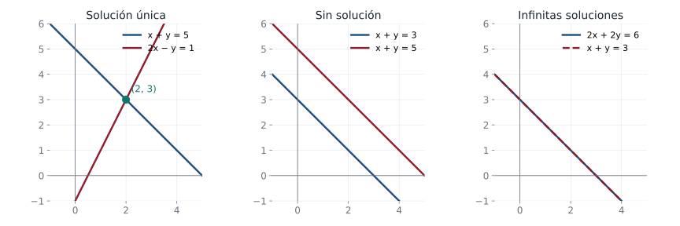

## En la vida diaria: ¿cuánto cuesta cada cosa? {.nostretch}

::: {.aplicacion data-t="Para empezar"}
En la cafetería, 2 empanadas y 1 jugo cuestan \$7 000, y 1 empanada y 1 jugo cuestan \$4 500. ¿Cuánto vale cada cosa?
:::

{fig-align="center" height="230px"}

Cada dato es una **ecuación** con dos incógnitas (precio de la empanada y del jugo). Juntas forman un **sistema de ecuaciones lineales**. Restando: la empanada vale \$2 500 y el jugo \$2 000. Con este mismo tipo de cálculo el GPS ubica el celular, los bancos reparten inversiones y los ingenieros calculan corrientes en un circuito.

**En esta clase:** aprenderá a resolver sistemas de cualquier tamaño de forma ordenada, y a saber cuándo tienen una, infinitas o ninguna solución.

## Objetivos de la clase

- Reconocer una **ecuación lineal** y un **sistema de ecuaciones lineales** $m\times n$.
- Interpretar geométricamente los sistemas $2\times 2$: solución única, ninguna o infinitas.
- Representar un sistema con su **matriz aumentada** y aplicar **operaciones elementales por filas**.
- Resolver sistemas con los métodos de **Gauss** y **Gauss-Jordan**.
- Plantear y resolver problemas que se modelan con sistemas lineales.

## Ecuación lineal

::: {.definicion}
Una **ecuación lineal** en las incógnitas $x_1, x_2, \dots, x_n$ es una expresión de la forma
$$
a_1x_1 + a_2x_2 + \cdots + a_nx_n = b,
$$
donde $a_1,\dots,a_n$ (coeficientes) y $b$ (término independiente) son números reales.
:::

::: {.palabras}
Es una ecuación donde cada incógnita aparece **sola**, multiplicada por un número: sin potencias, raíces ni incógnitas multiplicadas entre sí. Por ejemplo, $2x+3y=7$ es lineal; $x^2+y=1$ y $xy=4$ no lo son.
:::

. . .

| Ecuación | ¿Lineal? | Motivo |
|---|:---:|---|
| $4x = 3$ | Sí | una incógnita, grado 1 |
| $3x - 2y = 1$ | Sí | recta en el plano |
| $5x - 2y + z = 5$ | Sí | plano en el espacio |
| $x^2 + y = 4$ | No | aparece $x^2$ |
| $xy - z = 0$ | No | producto de incógnitas |
| $\operatorname{sen} x + y = 1$ | No | función no lineal de $x$ |

## Sistema de $m$ ecuaciones con $n$ incógnitas

::: {.definicion}
Un **sistema lineal** $m\times n$ es un conjunto de $m$ ecuaciones lineales en las mismas $n$ incógnitas:
$$
\begin{aligned}
a_{11}x_1 + a_{12}x_2 + \cdots + a_{1n}x_n &= b_1\\
a_{21}x_1 + a_{22}x_2 + \cdots + a_{2n}x_n &= b_2\\
&\ \vdots\\
a_{m1}x_1 + a_{m2}x_2 + \cdots + a_{mn}x_n &= b_m
\end{aligned}
$$
Una **solución** es una $n$-upla $(s_1,\dots,s_n)$ que satisface **todas** las ecuaciones a la vez.
:::

::: {.palabras}
Son varias ecuaciones que deben cumplirse **al mismo tiempo**. Resolver el sistema es encontrar los valores de las incógnitas que funcionan en **todas** las ecuaciones, no solo en una.
:::

## Sistema de $m$ ecuaciones con $n$ incógnitas (continuación)

::: {.columns}
::: {.column width="33%"}
**Sistema $2\times 2$**
$$\begin{aligned}2x+3y&=1\\5x-2y&=4\end{aligned}$$
:::
::: {.column width="33%"}
**Sistema $3\times 3$**
$$\begin{aligned}5x-y+3z&=5\\x-3y+6z&=1\\3y-5z&=4\end{aligned}$$
:::
::: {.column width="33%"}
**Sistema $2\times 4$**
$$\begin{aligned}5x-y+3z+8w&=5\\x-3y+6z-5w&=1\end{aligned}$$
:::
:::

## Interpretación geométrica: sistemas $2\times 2$

Cada ecuación $ax+by=c$ es una **recta**. Resolver el sistema es encontrar los puntos comunes.

{fig-align="center" width="100%"}

::: {.obs data-t="Clasificación"}
**Consistente** (tiene solución): única o infinitas. **Inconsistente**: no tiene solución.
:::

## Los tres casos posibles

::: {.teorema data-t="Número de soluciones"}
Todo sistema de ecuaciones lineales tiene **exactamente una** solución, **ninguna** solución o **infinitas** soluciones.
:::

. . .

::: {.demo}
Basta ver que si hay dos soluciones distintas, entonces hay infinitas. Sean $\mathbf{x}$ y $\mathbf{y}$ soluciones distintas de $A\mathbf{x}=\mathbf{b}$ (notación matricial de la clase 5). Para cada $t\in\mathbb{R}$, considere $\mathbf{z}_t = \mathbf{x} + t(\mathbf{y}-\mathbf{x})$. Entonces
$$
A\mathbf{z}_t = A\mathbf{x} + t\,(A\mathbf{y} - A\mathbf{x}) = \mathbf{b} + t(\mathbf{b}-\mathbf{b}) = \mathbf{b}.
$$
Como $\mathbf{y}-\mathbf{x}\neq \mathbf{0}$, los vectores $\mathbf{z}_t$ son distintos para valores distintos de $t$: hay infinitas soluciones.
:::

## Operaciones elementales por filas

::: {.definicion}
Sobre una matriz se pueden realizar tres **operaciones elementales por filas**:

1. **Intercambio:** $F_i \leftrightarrow F_j$.
2. **Escalamiento:** $F_i \to c\,F_i$, con $c \neq 0$.
3. **Reemplazo:** $F_j \to F_j + c\,F_i$ (sumar a una fila un múltiplo de otra).
:::

::: {.palabras}
Son los tres "movimientos permitidos" para simplificar un sistema **sin cambiar sus soluciones**: cambiar el orden de dos ecuaciones, multiplicar una ecuación por un número distinto de cero, y sumarle a una ecuación un múltiplo de otra.
:::

## Operaciones elementales por filas (continuación)

::: {.definicion data-t="Equivalencia por filas"}
$A$ es **equivalente por filas** a $B$ (se escribe $A\sim B$) si $B$ se obtiene de $A$ mediante una sucesión finita de operaciones elementales.
:::

::: {.palabras}
Dos matrices son equivalentes por filas si se puede pasar de una a la otra con esos movimientos. Sus sistemas tienen **exactamente las mismas soluciones**.
:::

. . .

::: {.teorema}
Si las matrices aumentadas de dos sistemas son equivalentes por filas, los dos sistemas tienen **exactamente las mismas soluciones**.
:::

## ¿Por qué no cambian las soluciones?

::: {.demo}
Basta comprobarlo para una sola operación, porque luego se encadena.

- **Intercambio:** las ecuaciones son las mismas, solo cambia el orden.
- **Escalamiento:** $E_i: \;\mathbf a_i\cdot\mathbf x=b_i$ y $c\,\mathbf a_i\cdot \mathbf x = c\,b_i$ tienen las mismas soluciones porque $c\neq 0$ (se puede dividir por $c$).
- **Reemplazo:** si $\mathbf x$ satisface $E_i$ y $E_j$, también satisface $E_j + cE_i$. Recíprocamente, si satisface $E_i$ y $E_j+cE_i$, entonces satisface $(E_j + cE_i) - cE_i = E_j$.

Además, cada operación se **deshace** con otra del mismo tipo ($F_i\leftrightarrow F_j$; $F_i\to \tfrac1c F_i$; $F_j\to F_j - cF_i$), así que la relación es simétrica.
:::

## Forma escalonada y forma escalonada reducida

::: {.definicion}
Una matriz está en **forma escalonada por filas** si:

a) Las filas nulas (si las hay) están en la parte inferior.
b) El primer número distinto de cero de cada fila no nula es un $1$ (**pivote** o **1 principal**).
c) El pivote de cada fila está a la **derecha** del pivote de la fila anterior.

Está en **forma escalonada reducida** si además:

d) Cada columna que contiene un pivote tiene **ceros** en todas las demás posiciones.
:::

::: {.palabras}
La matriz queda en forma de **escalera**: cada fila empieza con un 1 que está más a la derecha que el de la fila anterior, y las filas de ceros van abajo. En la forma **reducida**, además, arriba y abajo de cada 1 principal solo hay ceros, y la solución se lee directamente.
:::

## Forma escalonada y forma escalonada reducida (continuación)

$$
\underbrace{\begin{pmatrix}1&2&3\\0&1&2\\0&0&1\end{pmatrix}}_{\text{escalonada}}
\qquad
\underbrace{\begin{pmatrix}1&0&0&-2&4\\0&1&0&1&8\\0&0&0&0&0\end{pmatrix}}_{\text{escalonada reducida}}
\qquad
\underbrace{\begin{pmatrix}0&1&5\\1&0&2\end{pmatrix}}_{\text{no es escalonada}}
$$

## Métodos de eliminación

::: {.columns}
::: {.column width="50%"}
::: {.definicion data-t="Eliminación gaussiana"}
1. Escribir la matriz aumentada $(A\mid\mathbf b)$.
2. Llevarla a **forma escalonada** con operaciones elementales.
3. Resolver por **sustitución hacia atrás** (de la última ecuación hacia la primera).
:::
:::
::: {.column width="50%"}
::: {.definicion data-t="Gauss-Jordan"}
1. Escribir la matriz aumentada $(A\mid\mathbf b)$.
2. Llevarla a **forma escalonada reducida**.
3. Leer la solución directamente; las incógnitas sin pivote son **variables libres**.
:::
:::
:::

. . .

::: {.obs data-t="Estrategia práctica"}
Trabaje **columna por columna**: consiga un $1$ en la posición del pivote y luego ceros **debajo** (Gauss) y también **encima** (Gauss-Jordan). Escriba siempre la operación que usa: así es fácil revisar.
:::

## Ejemplo resuelto: Gauss-Jordan (solución única)

::: {.ejemplo}
Resuelva $\;x + 2y + 3z = 9,\quad 2x - y + z = 8,\quad 3x - z = 3.$
:::

. . .

$$
\left(\begin{array}{ccc|c}1&2&3&9\\2&-1&1&8\\3&0&-1&3\end{array}\right)
\xrightarrow[F_3\to F_3-3F_1]{F_2\to F_2-2F_1}
\left(\begin{array}{ccc|c}1&2&3&9\\0&-5&-5&-10\\0&-6&-10&-24\end{array}\right)
\xrightarrow{F_2\to -\frac15F_2}
\left(\begin{array}{ccc|c}1&2&3&9\\0&1&1&2\\0&-6&-10&-24\end{array}\right)
$$

. . .

$$
\xrightarrow[F_3\to F_3+6F_2]{F_1\to F_1-2F_2}
\left(\begin{array}{ccc|c}1&0&1&5\\0&1&1&2\\0&0&-4&-12\end{array}\right)
\xrightarrow{F_3\to -\frac14F_3}
\left(\begin{array}{ccc|c}1&0&1&5\\0&1&1&2\\0&0&1&3\end{array}\right)
$$

. . .

$$
\xrightarrow[F_2\to F_2-F_3]{F_1\to F_1-F_3}
\left(\begin{array}{ccc|c}1&0&0&2\\0&1&0&-1\\0&0&1&3\end{array}\right)
\qquad\Longrightarrow\qquad x=2,\; y=-1,\; z=3.
$$

. . .

**Solución única.** Verificación en la tercera ecuación: $3(2)-3=3$ ✓.

## Ejemplo resuelto: infinitas soluciones

::: {.ejemplo}
Resuelva $\;x + y + z = 2,\quad x + 2y + 3z = 5,\quad 2x + 3y + 4z = 7.$
:::

. . .

$$
\left(\begin{array}{ccc|c}1&1&1&2\\1&2&3&5\\2&3&4&7\end{array}\right)
\xrightarrow[F_3\to F_3-2F_1]{F_2\to F_2-F_1}
\left(\begin{array}{ccc|c}1&1&1&2\\0&1&2&3\\0&1&2&3\end{array}\right)
\xrightarrow[F_3\to F_3-F_2]{F_1\to F_1-F_2}
\left(\begin{array}{ccc|c}1&0&-1&-1\\0&1&2&3\\0&0&0&0\end{array}\right)
$$

. . .

La columna de $z$ no tiene pivote: $z$ es **libre**. Tomando $z=t$:
$$
x = -1 + t,\qquad y = 3 - 2t,\qquad z = t,\qquad t\in\mathbb{R}.
$$

. . .

Por ejemplo, $t=0$ da $(-1,3,0)$ y $t=1$ da $(0,1,1)$. Geométricamente: tres planos que se cortan en una **recta**.

## Ejemplo resuelto: sistema inconsistente

::: {.ejemplo}
Resuelva $\;x + y + z = 2,\quad x + 2y + 3z = 5,\quad 2x + 3y + 4z = 8.$
:::

. . .

Con las mismas operaciones del ejemplo anterior (solo cambia la última columna):
$$
\left(\begin{array}{ccc|c}1&1&1&2\\1&2&3&5\\2&3&4&8\end{array}\right)\xrightarrow[F_{3}\to F_{3}-2F_{1}]{F_{2}\to F_{2}-F_{1}}\left(\begin{array}{ccc|c}1&1&1&2\\0&1&2&3\\0&1&2&4\end{array}\right)\xrightarrow[F_{3}\to F_{3}-F_{2}]{F_{1}\to F_{1}-F_{2}}\left(\begin{array}{ccc|c}1&0&-1&-1\\0&1&2&3\\0&0&0&1\end{array}\right)
$$

. . .

La última fila dice $0x + 0y + 0z = 1$, es decir, $0=1$: **imposible**. El sistema **no tiene solución**.

. . .

::: {.teorema data-t="Criterio de consistencia"}
Un sistema es inconsistente si y solo si en la forma escalonada de $(A\mid\mathbf b)$ aparece una fila $\left(0\;\cdots\;0\mid c\right)$ con $c\neq 0$. Si es consistente, tiene solución única cuando **todas** las columnas de $A$ tienen pivote, e infinitas cuando hay al menos una variable libre.
:::

## Problema de aplicación

::: {.ejemplo data-t="Inversiones"}
Una persona invierte \$10 000 en tres fondos que rinden 5 %, 7 % y 9 % anual. En total gana \$760 al año, y lo invertido al 9 % es igual a la suma de lo invertido en los otros dos fondos. ¿Cuánto invirtió en cada fondo?
:::

. . .

Sean $a, b, c$ los montos invertidos al 5 %, 7 % y 9 %:
$$
\begin{aligned}
a + b + c &= 10\,000\\
0.05a + 0.07b + 0.09c &= 760\\
a + b - c &= 0
\end{aligned}
$$

. . .

**Paso 1.** Restando la tercera ecuación a la primera: $(a+b+c)-(a+b-c)=10\,000-0$, es decir, $2c = 10\,000$, así que $c = 5000$.

**Paso 2.** En la primera ecuación: $a + b + 5000 = 10\,000$, luego $a + b = 5000$ y $b = 5000-a$.

**Paso 3.** Sustituyendo $b=5000-a$ y $c=5000$ en la segunda:
$$
0.05a + 0.07(5000-a) + 0.09(5000) = 760\;\Rightarrow\;0.05a + 350 - 0.07a + 450 = 760\;\Rightarrow\;-0.02a = -40\;\Rightarrow\;a = 2000 .
$$
Entonces $b = 5000-2000 = 3000$.

. . .

**Respuesta:** \$2000 al 5 %, \$3000 al 7 % y \$5000 al 9 %. Verificación: $100 + 210 + 450 = 760$ ✓.

## Ejercicios propuestos

::: {.ejercicio data-t="1"}
Resuelva por Gauss-Jordan: $\;2x + y - z = 3,\quad x - y + 2z = 1,\quad 3x + 2y + z = 8.$
:::

::: {.solucion .fragment}
$$
\left(\begin{array}{ccc|c}2&1&-1&3\\1&-1&2&1\\3&2&1&8\end{array}\right)\xrightarrow{F_{1}\leftrightarrow F_{2}}\left(\begin{array}{ccc|c}1&-1&2&1\\2&1&-1&3\\3&2&1&8\end{array}\right)\xrightarrow[F_{3}\to F_{3}-3F_{1}]{F_{2}\to F_{2}-2F_{1}}\left(\begin{array}{ccc|c}1&-1&2&1\\0&3&-5&1\\0&5&-5&5\end{array}\right)
$$

$$
\xrightarrow{F_{2}\to \tfrac{1}{3}F_{2}}\left(\begin{array}{ccc|c}1&-1&2&1\\0&1&-\tfrac{5}{3}&\tfrac{1}{3}\\0&5&-5&5\end{array}\right)\xrightarrow[F_{3}\to F_{3}-5F_{2}]{F_{1}\to F_{1}+F_{2}}\left(\begin{array}{ccc|c}1&0&\tfrac{1}{3}&\tfrac{4}{3}\\0&1&-\tfrac{5}{3}&\tfrac{1}{3}\\0&0&\tfrac{10}{3}&\tfrac{10}{3}\end{array}\right)
$$

$$
\xrightarrow{F_{3}\to \tfrac{3}{10}F_{3}}\left(\begin{array}{ccc|c}1&0&\tfrac{1}{3}&\tfrac{4}{3}\\0&1&-\tfrac{5}{3}&\tfrac{1}{3}\\0&0&1&1\end{array}\right)\xrightarrow[F_{2}\to F_{2}+\tfrac{5}{3}F_{3}]{F_{1}\to F_{1}-\tfrac{1}{3}F_{3}}\left(\begin{array}{ccc|c}1&0&0&1\\0&1&0&2\\0&0&1&1\end{array}\right)
$$

Se lee $(x,y,z)=(1,2,1)$. Compruebe: $2+2-1=3$, $1-2+2=1$, $3+4+1=8$.
:::

## Ejercicios propuestos

::: {.ejercicio data-t="2"}
¿Para qué valor de $k$ el sistema $\;x - 2y = 3,\quad 2x + ky = 7\;$ **no** tiene solución?
:::

::: {.solucion .fragment}
$F_2\to F_2-2F_1$ da $\left(\begin{array}{cc|c}1&-2&3\\0&k+4&1\end{array}\right)$. Si $k=-4$ la segunda fila es $(0\;0\mid 1)$: inconsistente. Si $k\neq -4$ hay solución única. **Respuesta:** $k=-4$ (rectas paralelas).
:::

## Ejercicios del texto guía {.texto-guia}

Grossman y Flores, *Álgebra lineal*, 8.ª ed. (ejercicios sugeridos en el cronograma del departamento):

| Sección | Ejercicios |
|---|---|
| 1.1 Dos ecuaciones lineales con dos incógnitas | 3, 7, 8, 19, 20, 21, 22, 41, 43 |
| 1.2 $m$ ecuaciones con $n$ incógnitas | 5, 10, 27, 28, 31, 32, 38, 49, 51, 52, 53, 54, 55, 56, 58, 59 |

. . .

::: {.obs data-t="Para la próxima clase"}
Repase la forma escalonada reducida: en la clase 2 estudiaremos los **sistemas homogéneos** $A\mathbf x=\mathbf 0$, que siempre son consistentes.
:::

## Resumen

- Un sistema lineal tiene **0, 1 o infinitas** soluciones.
- Las **operaciones elementales por filas** no cambian el conjunto solución.
- **Gauss:** escalonada + sustitución hacia atrás. **Gauss-Jordan:** escalonada reducida + lectura directa.
- Fila $\left(0\cdots0\mid c\right)$ con $c\neq0$ ⟹ inconsistente. Columnas sin pivote ⟹ variables libres.

 

[← Programa del curso](../algebra_lineal.qmd) · [Clase 2: Sistemas homogéneos →](clase_02.qmd)
