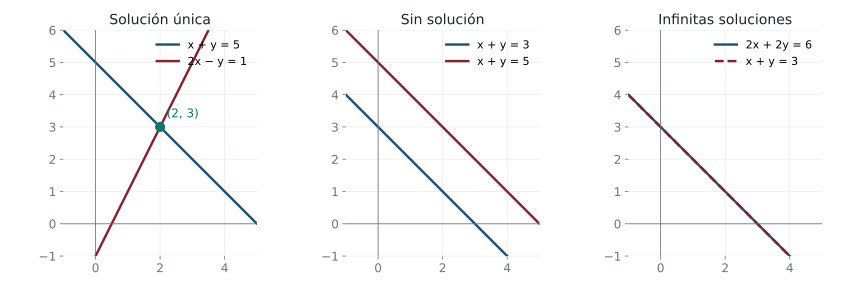
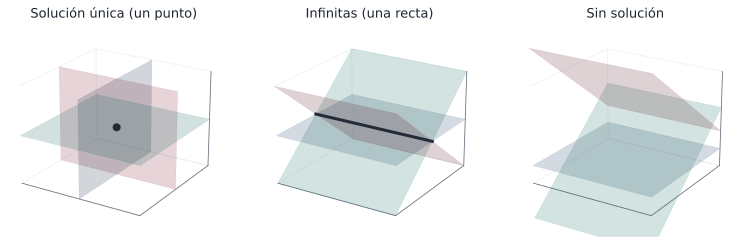

## Objetivos de la clase

- Reconocer una **ecuación lineal** y un **sistema de ecuaciones lineales** $m\times n$.
- Interpretar geométricamente los sistemas $2\times 2$: solución única, ninguna o infinitas.
- Representar un sistema con su **matriz aumentada** y aplicar **operaciones elementales por filas**.
- Resolver sistemas con los métodos de **Gauss** y **Gauss-Jordan**.
- Plantear y resolver problemas que se modelan con sistemas lineales.

## Ruta de la clase (70 min)

| Tiempo | Actividad |
|:---:|---|
| 0 – 5 | Motivación: ¿dónde aparecen los sistemas lineales? |
| 5 – 20 | Ecuaciones y sistemas lineales; interpretación geométrica en 2D y 3D |
| 20 – 35 | Matriz aumentada, operaciones elementales y forma escalonada |
| 35 – 55 | Gauss-Jordan: solución única, infinitas soluciones, sistema inconsistente |
| 55 – 70 | Problemas de aplicación y práctica en clase |

## ¿Dónde aparecen los sistemas lineales?

::: {.columns}
::: {.column width="50%"}
- **Ingeniería:** corrientes en circuitos (leyes de Kirchhoff), fuerzas en estructuras.
- **Economía:** producción, mezclas, flujo de bienes entre sectores.
- **Química:** balanceo de ecuaciones.
- **Computación:** gráficos, redes, aprendizaje automático (millones de ecuaciones).
:::
::: {.column width="50%"}
::: {.obs data-t="Pregunta"}
Un sistema de dos ecuaciones con dos incógnitas son dos rectas. ¿De cuántas formas pueden ubicarse dos rectas en el plano? Cada forma corresponde a un tipo de solución.
:::
:::
:::

## Ecuación lineal

::: {.definicion}
Una **ecuación lineal** en las incógnitas $x_1, x_2, \dots, x_n$ es una expresión de la forma
$$
a_1x_1 + a_2x_2 + \cdots + a_nx_n = b,
$$
donde $a_1,\dots,a_n$ (coeficientes) y $b$ (término independiente) son números reales.
:::

. . .

| Ecuación | ¿Lineal? | Motivo |
|---|:---:|---|
| $4x = 3$ | Sí | una incógnita, grado 1 |
| $3x - 2y = 1$ | Sí | recta en el plano |
| $5x - 2y + z = 5$ | Sí | plano en el espacio |
| $x^2 + y = 4$ | No | aparece $x^2$ |
| $xy - z = 0$ | No | producto de incógnitas |
| $\operatorname{sen} x + y = 1$ | No | función no lineal de $x$ |

## Sistema de $m$ ecuaciones con $n$ incógnitas

::: {.definicion}
Un **sistema lineal** $m\times n$ es un conjunto de $m$ ecuaciones lineales en las mismas $n$ incógnitas:
$$
\begin{aligned}
a_{11}x_1 + a_{12}x_2 + \cdots + a_{1n}x_n &= b_1\\
a_{21}x_1 + a_{22}x_2 + \cdots + a_{2n}x_n &= b_2\\
&\ \vdots\\
a_{m1}x_1 + a_{m2}x_2 + \cdots + a_{mn}x_n &= b_m
\end{aligned}
$$
Una **solución** es una $n$-upla $(s_1,\dots,s_n)$ que satisface **todas** las ecuaciones a la vez.
:::

. . .

::: {.columns}
::: {.column width="33%"}
**Sistema $2\times 2$**
$$\begin{aligned}2x+3y&=1\\5x-2y&=4\end{aligned}$$
:::
::: {.column width="33%"}
**Sistema $3\times 3$**
$$\begin{aligned}5x-y+3z&=5\\x-3y+6z&=1\\3y-5z&=4\end{aligned}$$
:::
::: {.column width="33%"}
**Sistema $2\times 4$**
$$\begin{aligned}5x-y+3z+8w&=5\\x-3y+6z-5w&=1\end{aligned}$$
:::
:::

## Interpretación geométrica: sistemas $2\times 2$

Cada ecuación $ax+by=c$ es una **recta**. Resolver el sistema es encontrar los puntos comunes.

{fig-align="center" width="100%"}

::: {.obs data-t="Clasificación"}
**Consistente** (tiene solución): única o infinitas. **Inconsistente**: no tiene solución.
:::

## Los tres casos posibles

::: {.teorema data-t="Número de soluciones"}
Todo sistema de ecuaciones lineales tiene **exactamente una** solución, **ninguna** solución o **infinitas** soluciones.
:::

. . .

::: {.demo}
Basta ver que si hay dos soluciones distintas, entonces hay infinitas. Sean $\mathbf{x}$ y $\mathbf{y}$ soluciones distintas de $A\mathbf{x}=\mathbf{b}$ (notación matricial de la clase 5). Para cada $t\in\mathbb{R}$, considere $\mathbf{z}_t = \mathbf{x} + t(\mathbf{y}-\mathbf{x})$. Entonces
$$
A\mathbf{z}_t = A\mathbf{x} + t\,(A\mathbf{y} - A\mathbf{x}) = \mathbf{b} + t(\mathbf{b}-\mathbf{b}) = \mathbf{b}.
$$
Como $\mathbf{y}-\mathbf{x}\neq \mathbf{0}$, los vectores $\mathbf{z}_t$ son distintos para valores distintos de $t$: hay infinitas soluciones.
:::

## Sistemas $3\times 3$: tres planos

Cada ecuación $ax+by+cz=d$ es un **plano** en el espacio. Las soluciones son los puntos comunes a los tres planos.

{fig-align="center" width="95%"}

Los mismos tres casos: un punto, una recta (o un plano) de soluciones, o ningún punto común.

## Ejemplo resuelto: sistema $2\times 2$

::: {.ejemplo}
Resuelva $\quad x + y = 5,\qquad 2x - y = 1.$
:::

. . .

Sumando las dos ecuaciones se elimina $y$:
$$
(x+y) + (2x-y) = 5 + 1 \;\Longrightarrow\; 3x = 6 \;\Longrightarrow\; x = 2.
$$

. . .

Sustituyendo en la primera: $2 + y = 5 \Rightarrow y = 3$.

. . .

**Verificación:** $2+3=5$ ✓ y $2(2)-3=1$ ✓. La solución única es $(x,y)=(2,3)$: el punto donde se cortan las dos rectas de la figura anterior.

. . .

::: {.obs}
En el caso $2\times 2$, si $a_{11}a_{22}-a_{12}a_{21}\neq 0$ el sistema tiene solución única. Esta cantidad es el **determinante** del sistema (unidad 3).
:::

## Matriz de coeficientes y matriz aumentada

Un sistema se codifica por sus coeficientes. Para
$$
\begin{aligned}
x + 2y + 3z &= 9\\
2x - y + z &= 8\\
3x \phantom{{}+2y} - z &= 3
\end{aligned}
\qquad
A=\begin{pmatrix}1&2&3\\2&-1&1\\3&0&-1\end{pmatrix},
\qquad
(A\mid \mathbf{b})=\left(\begin{array}{ccc|c}1&2&3&9\\2&-1&1&8\\3&0&-1&3\end{array}\right)
$$

. . .

- $A$ es la **matriz de coeficientes** ($m\times n$).
- $(A\mid\mathbf b)$ es la **matriz aumentada** ($m\times(n+1)$).
- Cada **fila** (renglón) representa una ecuación; cada **columna**, una incógnita.

## Operaciones elementales por filas

::: {.definicion}
Sobre una matriz se pueden realizar tres **operaciones elementales por filas**:

1. **Intercambio:** $F_i \leftrightarrow F_j$.
2. **Escalamiento:** $F_i \to c\,F_i$, con $c \neq 0$.
3. **Reemplazo:** $F_j \to F_j + c\,F_i$ (sumar a una fila un múltiplo de otra).
:::

. . .

::: {.definicion data-t="Equivalencia por filas"}
$A$ es **equivalente por filas** a $B$ (se escribe $A\sim B$) si $B$ se obtiene de $A$ mediante una sucesión finita de operaciones elementales.
:::

. . .

::: {.teorema}
Si las matrices aumentadas de dos sistemas son equivalentes por filas, los dos sistemas tienen **exactamente las mismas soluciones**.
:::

## ¿Por qué no cambian las soluciones?

::: {.demo}
Basta comprobarlo para una sola operación, porque luego se encadena.

- **Intercambio:** las ecuaciones son las mismas, solo cambia el orden.
- **Escalamiento:** $E_i: \;\mathbf a_i\cdot\mathbf x=b_i$ y $c\,\mathbf a_i\cdot \mathbf x = c\,b_i$ tienen las mismas soluciones porque $c\neq 0$ (se puede dividir por $c$).
- **Reemplazo:** si $\mathbf x$ satisface $E_i$ y $E_j$, también satisface $E_j + cE_i$. Recíprocamente, si satisface $E_i$ y $E_j+cE_i$, entonces satisface $(E_j + cE_i) - cE_i = E_j$.

Además, cada operación se **deshace** con otra del mismo tipo ($F_i\leftrightarrow F_j$; $F_i\to \tfrac1c F_i$; $F_j\to F_j - cF_i$), así que la relación es simétrica.
:::

## Forma escalonada y forma escalonada reducida

::: {.definicion}
Una matriz está en **forma escalonada por filas** si:

a) Las filas nulas (si las hay) están en la parte inferior.
b) El primer número distinto de cero de cada fila no nula es un $1$ (**pivote** o **1 principal**).
c) El pivote de cada fila está a la **derecha** del pivote de la fila anterior.

Está en **forma escalonada reducida** si además:

d) Cada columna que contiene un pivote tiene **ceros** en todas las demás posiciones.
:::

. . .

$$
\underbrace{\begin{pmatrix}1&2&3\\0&1&2\\0&0&1\end{pmatrix}}_{\text{escalonada}}
\qquad
\underbrace{\begin{pmatrix}1&0&0&-2&4\\0&1&0&1&8\\0&0&0&0&0\end{pmatrix}}_{\text{escalonada reducida}}
\qquad
\underbrace{\begin{pmatrix}0&1&5\\1&0&2\end{pmatrix}}_{\text{no es escalonada}}
$$

## Métodos de eliminación

::: {.columns}
::: {.column width="50%"}
::: {.definicion data-t="Eliminación gaussiana"}
1. Escribir la matriz aumentada $(A\mid\mathbf b)$.
2. Llevarla a **forma escalonada** con operaciones elementales.
3. Resolver por **sustitución hacia atrás** (de la última ecuación hacia la primera).
:::
:::
::: {.column width="50%"}
::: {.definicion data-t="Gauss-Jordan"}
1. Escribir la matriz aumentada $(A\mid\mathbf b)$.
2. Llevarla a **forma escalonada reducida**.
3. Leer la solución directamente; las incógnitas sin pivote son **variables libres**.
:::
:::
:::

. . .

::: {.obs data-t="Estrategia práctica"}
Trabaje **columna por columna**: consiga un $1$ en la posición del pivote y luego ceros **debajo** (Gauss) y también **encima** (Gauss-Jordan). Escriba siempre la operación que usa: así es fácil revisar.
:::

## Ejemplo resuelto: Gauss-Jordan (solución única)

::: {.ejemplo}
Resuelva $\;x + 2y + 3z = 9,\quad 2x - y + z = 8,\quad 3x - z = 3.$
:::

. . .

$$
\left(\begin{array}{ccc|c}1&2&3&9\\2&-1&1&8\\3&0&-1&3\end{array}\right)
\xrightarrow[F_3\to F_3-3F_1]{F_2\to F_2-2F_1}
\left(\begin{array}{ccc|c}1&2&3&9\\0&-5&-5&-10\\0&-6&-10&-24\end{array}\right)
\xrightarrow{F_2\to -\frac15F_2}
\left(\begin{array}{ccc|c}1&2&3&9\\0&1&1&2\\0&-6&-10&-24\end{array}\right)
$$

. . .

$$
\xrightarrow[F_3\to F_3+6F_2]{F_1\to F_1-2F_2}
\left(\begin{array}{ccc|c}1&0&1&5\\0&1&1&2\\0&0&-4&-12\end{array}\right)
\xrightarrow{F_3\to -\frac14F_3}
\left(\begin{array}{ccc|c}1&0&1&5\\0&1&1&2\\0&0&1&3\end{array}\right)
$$

. . .

$$
\xrightarrow[F_2\to F_2-F_3]{F_1\to F_1-F_3}
\left(\begin{array}{ccc|c}1&0&0&2\\0&1&0&-1\\0&0&1&3\end{array}\right)
\qquad\Longrightarrow\qquad x=2,\; y=-1,\; z=3.
$$

. . .

**Solución única.** Verificación en la tercera ecuación: $3(2)-3=3$ ✓.

## Ejemplo resuelto: infinitas soluciones

::: {.ejemplo}
Resuelva $\;x + y + z = 2,\quad x + 2y + 3z = 5,\quad 2x + 3y + 4z = 7.$
:::

. . .

$$
\left(\begin{array}{ccc|c}1&1&1&2\\1&2&3&5\\2&3&4&7\end{array}\right)
\xrightarrow[F_3\to F_3-2F_1]{F_2\to F_2-F_1}
\left(\begin{array}{ccc|c}1&1&1&2\\0&1&2&3\\0&1&2&3\end{array}\right)
\xrightarrow[F_3\to F_3-F_2]{F_1\to F_1-F_2}
\left(\begin{array}{ccc|c}1&0&-1&-1\\0&1&2&3\\0&0&0&0\end{array}\right)
$$

. . .

La columna de $z$ no tiene pivote: $z$ es **libre**. Tomando $z=t$:
$$
x = -1 + t,\qquad y = 3 - 2t,\qquad z = t,\qquad t\in\mathbb{R}.
$$

. . .

Por ejemplo, $t=0$ da $(-1,3,0)$ y $t=1$ da $(0,1,1)$. Geométricamente: tres planos que se cortan en una **recta**.

## Ejemplo resuelto: sistema inconsistente

::: {.ejemplo}
Resuelva $\;x + y + z = 2,\quad x + 2y + 3z = 5,\quad 2x + 3y + 4z = 8.$
:::

. . .

Con las mismas operaciones del ejemplo anterior:
$$
\left(\begin{array}{ccc|c}1&1&1&2\\1&2&3&5\\2&3&4&8\end{array}\right)
\sim
\left(\begin{array}{ccc|c}1&0&-1&-1\\0&1&2&3\\0&0&0&1\end{array}\right)
$$

. . .

La última fila dice $0x + 0y + 0z = 1$, es decir, $0=1$: **imposible**. El sistema **no tiene solución**.

. . .

::: {.teorema data-t="Criterio de consistencia"}
Un sistema es inconsistente si y solo si en la forma escalonada de $(A\mid\mathbf b)$ aparece una fila $\left(0\;\cdots\;0\mid c\right)$ con $c\neq 0$. Si es consistente, tiene solución única cuando **todas** las columnas de $A$ tienen pivote, e infinitas cuando hay al menos una variable libre.
:::

## Problema de aplicación

::: {.ejemplo data-t="Inversiones"}
Una persona invierte \$10 000 en tres fondos que rinden 5 %, 7 % y 9 % anual. En total gana \$760 al año, y lo invertido al 9 % es igual a la suma de lo invertido en los otros dos fondos. ¿Cuánto invirtió en cada fondo?
:::

. . .

Sean $a, b, c$ los montos invertidos al 5 %, 7 % y 9 %:
$$
\begin{aligned}
a + b + c &= 10\,000\\
0.05a + 0.07b + 0.09c &= 760\\
a + b - c &= 0
\end{aligned}
$$

. . .

Restando la tercera ecuación a la primera: $2c = 10\,000 \Rightarrow c = 5000$, luego $a + b = 5000$. Sustituyendo en la segunda: $0.05a + 0.07(5000-a) + 450 = 760 \Rightarrow -0.02a = -40 \Rightarrow a = 2000$.

. . .

**Respuesta:** \$2000 al 5 %, \$3000 al 7 % y \$5000 al 9 %. Verificación: $100 + 210 + 450 = 760$ ✓.

## Problema de aplicación: producción

::: {.ejemplo data-t="Taller de producción"}
Una fábrica produce piezas A, B y C. Cada pieza A requiere 2 h de corte, 1 h de ensamble y 1 h de pintura; cada B, 1 h, 2 h y 1 h; cada C, 1 h, 1 h y 2 h. Se dispone de 40 h de corte, 35 h de ensamble y 45 h de pintura. ¿Cuántas piezas de cada tipo se deben fabricar para usar todo el tiempo?
:::

. . .

Con $a,b,c$ el número de piezas:
$$
\left(\begin{array}{ccc|c}2&1&1&40\\1&2&1&35\\1&1&2&45\end{array}\right)
\xrightarrow{F_1\leftrightarrow F_2}
\left(\begin{array}{ccc|c}1&2&1&35\\2&1&1&40\\1&1&2&45\end{array}\right)
\xrightarrow[F_3\to F_3-F_1]{F_2\to F_2-2F_1}
\left(\begin{array}{ccc|c}1&2&1&35\\0&-3&-1&-30\\0&-1&1&10\end{array}\right)
$$

. . .

$$
\xrightarrow[F_2\to -F_2]{F_2\leftrightarrow F_3}
\left(\begin{array}{ccc|c}1&2&1&35\\0&1&-1&-10\\0&-3&-1&-30\end{array}\right)
\xrightarrow{F_3\to F_3+3F_2}
\left(\begin{array}{ccc|c}1&2&1&35\\0&1&-1&-10\\0&0&-4&-60\end{array}\right)
$$

. . .

Sustitución hacia atrás: $c=15$, $\;b=-10+15=5$, $\;a=35-10-15=10$. **Respuesta:** 10 piezas A, 5 B y 15 C. Verificación de pintura: $10+5+30=45$ ✓.

## Práctica en clase: sistema con parámetro

::: {.ejercicio}
Para qué valores de $k$ el sistema $\;x+y+kz=1,\quad x+ky+z=1,\quad kx+y+z=1\;$ tiene (a) solución única, (b) infinitas soluciones, (c) ninguna solución.
:::

. . .

::: {.solucion}
$F_2-F_1$ y $F_3-kF_1$: $\left(\begin{array}{ccc|c}1&1&k&1\\0&k-1&1-k&0\\0&1-k&1-k^2&1-k\end{array}\right)$, y $F_3+F_2$: $\left(\begin{array}{ccc|c}1&1&k&1\\0&k-1&1-k&0\\0&0&(1-k)(2+k)&1-k\end{array}\right)$.

- $k=1$: todas las ecuaciones son $x+y+z=1$ → **infinitas** (dos parámetros).
- $k=-2$: la última fila es $(0\;0\;0\mid 3)$ → **ninguna**.
- $k\neq1,-2$: **única**, $x=y=z=\dfrac{1}{k+2}$.
:::

## Ejercicios propuestos

::: {.ejercicio data-t="1"}
Resuelva por Gauss-Jordan: $\;2x + y - z = 3,\quad x - y + 2z = 1,\quad 3x + 2y + z = 8.$
:::

::: {.solucion .fragment}
$(A\mid\mathbf b)\sim\left(\begin{array}{ccc|c}1&0&0&1\\0&1&0&2\\0&0&1&1\end{array}\right)$, así que $(x,y,z)=(1,2,1)$. Compruebe: $2+2-1=3$, $1-2+2=1$, $3+4+1=8$.
:::

## Ejercicios propuestos

::: {.ejercicio data-t="2"}
¿Para qué valor de $k$ el sistema $\;x - 2y = 3,\quad 2x + ky = 7\;$ **no** tiene solución?
:::

::: {.solucion .fragment}
$F_2\to F_2-2F_1$ da $\left(\begin{array}{cc|c}1&-2&3\\0&k+4&1\end{array}\right)$. Si $k=-4$ la segunda fila es $(0\;0\mid 1)$: inconsistente. Si $k\neq -4$ hay solución única. **Respuesta:** $k=-4$ (rectas paralelas).
:::

## Ejercicios propuestos

::: {.ejercicio data-t="3"}
Resuelva: $\;x_1 - x_2 + 2x_3 - x_4 = 1,\quad 2x_1 + x_2 - x_3 + x_4 = 5,\quad x_1 + 2x_2 - 3x_3 + 2x_4 = 4.$
:::

::: {.solucion .fragment}
$$
(A\mid\mathbf b)\sim\left(\begin{array}{cccc|c}1&0&\tfrac13&0&2\\0&1&-\tfrac53&1&1\\0&0&0&0&0\end{array}\right).
$$
Variables libres $x_3$ y $x_4$. Con $x_3 = 3r$ y $x_4 = t$ (para evitar fracciones):
$x_1 = 2 - r,\; x_2 = 1 + 5r - t,\; x_3 = 3r,\; x_4 = t$, con $r,t\in\mathbb R$. Infinitas soluciones.
:::

## Ejercicios propuestos

::: {.ejercicio data-t="4 · Demostración"}
Demuestre que si $(x_1,y_1)$ y $(x_2,y_2)$ son soluciones de $ax+by=0$, entonces $(x_1+x_2,\,y_1+y_2)$ y $(cx_1,\,cy_1)$ también lo son, para todo $c\in\mathbb R$.
:::

::: {.solucion .fragment}
$a(x_1+x_2)+b(y_1+y_2) = (ax_1+by_1)+(ax_2+by_2) = 0+0 = 0$, y $a(cx_1)+b(cy_1)=c(ax_1+by_1)=c\cdot 0=0$. Se usaron la distributividad y la asociatividad de los números reales. (Esta idea reaparece en sistemas homogéneos y subespacios.)
:::

## Ejercicios del texto guía {.texto-guia}

Grossman y Flores, *Álgebra lineal*, 8.ª ed. (ejercicios sugeridos en el cronograma del departamento):

| Sección | Ejercicios |
|---|---|
| 1.1 Dos ecuaciones lineales con dos incógnitas | 3, 7, 8, 19, 20, 21, 22, 41, 43 |
| 1.2 $m$ ecuaciones con $n$ incógnitas | 5, 10, 27, 28, 31, 32, 38, 49, 51, 52, 53, 54, 55, 56, 58, 59 |

. . .

::: {.obs data-t="Para la próxima clase"}
Repase la forma escalonada reducida: en la clase 2 estudiaremos los **sistemas homogéneos** $A\mathbf x=\mathbf 0$, que siempre son consistentes.
:::

## Resumen

- Un sistema lineal tiene **0, 1 o infinitas** soluciones.
- Las **operaciones elementales por filas** no cambian el conjunto solución.
- **Gauss:** escalonada + sustitución hacia atrás. **Gauss-Jordan:** escalonada reducida + lectura directa.
- Fila $\left(0\cdots0\mid c\right)$ con $c\neq0$ ⟹ inconsistente. Columnas sin pivote ⟹ variables libres.

 

[← Programa del curso](../algebra_lineal.qmd) · [Clase 2: Sistemas homogéneos →](clase_02.qmd)
