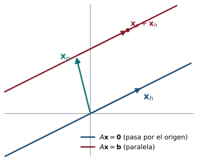

## Objetivos de la clase

- Reconocer un **sistema homogéneo** y su solución trivial.
- Decidir cuándo un sistema homogéneo tiene **soluciones no triviales**.
- Escribir el conjunto solución en **forma paramétrica (vectorial)**.
- Demostrar que la suma y los múltiplos de soluciones homogéneas son soluciones.
- Relacionar las soluciones de $A\mathbf x=\mathbf b$ con las de $A\mathbf x=\mathbf 0$.

## Definición

::: {.definicion}
Un sistema lineal es **homogéneo** si todos sus términos independientes son cero:
$$
\begin{aligned}
a_{11}x_1 + a_{12}x_2 + \cdots + a_{1n}x_n &= 0\\
&\ \vdots\\
a_{m1}x_1 + a_{m2}x_2 + \cdots + a_{mn}x_n &= 0
\end{aligned}
\qquad\Longleftrightarrow\qquad A\mathbf x = \mathbf 0.
$$
:::

. . .

- $x_1 = x_2 = \cdots = x_n = 0$ **siempre** es solución: la **solución trivial**.
- Por tanto un sistema homogéneo **nunca es inconsistente**.
- Solo hay dos posibilidades: **únicamente** la trivial, o **infinitas** soluciones (soluciones **no triviales**).

. . .

::: {.obs}
Al reducir la matriz aumentada $(A\mid\mathbf 0)$, la última columna sigue siendo de ceros. Por eso basta reducir $A$.
:::

## Ejemplo resuelto: solo la solución trivial

::: {.ejemplo}
Resuelva $\;x_1 - 2x_2 + 3x_3 = 0,\quad 4x_1 + x_2 - x_3 = 0,\quad 2x_1 - x_2 + 3x_3 = 0.$
:::

. . .

$$
\begin{pmatrix}1&-2&3\\4&1&-1\\2&-1&3\end{pmatrix}
\xrightarrow[F_3\to F_3-2F_1]{F_2\to F_2-4F_1}
\begin{pmatrix}1&-2&3\\0&9&-13\\0&3&-3\end{pmatrix}
\xrightarrow{F_2\leftrightarrow F_3}
\begin{pmatrix}1&-2&3\\0&3&-3\\0&9&-13\end{pmatrix}
$$

. . .

$$
\xrightarrow{F_2\to \frac13F_2}
\begin{pmatrix}1&-2&3\\0&1&-1\\0&9&-13\end{pmatrix}
\xrightarrow{F_3\to F_3-9F_2}
\begin{pmatrix}1&-2&3\\0&1&-1\\0&0&-4\end{pmatrix}
\sim I_3
$$

. . .

Hay un pivote en cada columna: **no hay variables libres**. La única solución es la trivial $(0,0,0)$.

## Ejemplo resuelto: infinitas soluciones

::: {.ejemplo}
Resuelva $\;x + y + z + w = 0,\quad x + w = 0,\quad x + 2y + z = 0.$
:::

. . .

$$
\begin{pmatrix}1&1&1&1\\1&0&0&1\\1&2&1&0\end{pmatrix}
\sim
\begin{pmatrix}1&0&0&1\\0&1&0&-1\\0&0&1&1\end{pmatrix}
\quad\Longrightarrow\quad
\begin{cases}x + w = 0\\ y - w = 0\\ z + w = 0\end{cases}
$$

. . .

La variable $w$ es libre. Con $w = t$:
$$
\mathbf x=\begin{pmatrix}x\\y\\z\\w\end{pmatrix}=\begin{pmatrix}-t\\t\\-t\\t\end{pmatrix}= t\begin{pmatrix}-1\\1\\-1\\1\end{pmatrix},\qquad t\in\mathbb R.
$$

. . .

El conjunto solución es $S=\{t(-1,1,-1,1) : t\in\mathbb R\}$: una **recta** que pasa por el origen de $\mathbb R^4$.

## Más incógnitas que ecuaciones

::: {.teorema}
Un sistema homogéneo con **más incógnitas que ecuaciones** ($n > m$) tiene infinitas soluciones.
:::

. . .

::: {.demo}
La forma escalonada reducida de $A$ tiene a lo sumo un pivote por fila, es decir, a lo sumo $m$ pivotes. Como hay $n > m$ columnas, al menos $n - m \geq 1$ columnas no tienen pivote: hay al menos una **variable libre**. Asignando a esa variable cualquier valor real (y despejando las demás) se obtiene una solución, y valores distintos producen soluciones distintas. Como el sistema es consistente (tiene la trivial), tiene infinitas soluciones.
:::

. . .

::: {.obs data-t="Cuidado"}
El recíproco es falso: un sistema con $n \le m$ también puede tener infinitas soluciones (ejemplo: dos ecuaciones iguales con dos incógnitas).
:::

## Las soluciones homogéneas se pueden sumar y escalar

::: {.teorema}
Si $\mathbf u$ y $\mathbf v$ son soluciones de $A\mathbf x = \mathbf 0$ y $c\in\mathbb R$, entonces $\mathbf u + \mathbf v$ y $c\,\mathbf u$ también son soluciones.
:::

. . .

::: {.demo}
Usamos las propiedades del producto matriz-vector (clase 4): $A(\mathbf u+\mathbf v) = A\mathbf u + A\mathbf v$ y $A(c\mathbf u) = c\,A\mathbf u$. Entonces
$$
A(\mathbf u + \mathbf v) = A\mathbf u + A\mathbf v = \mathbf 0 + \mathbf 0 = \mathbf 0,
\qquad
A(c\,\mathbf u) = c\,(A\mathbf u) = c\,\mathbf 0 = \mathbf 0.
$$
:::

. . .

::: {.obs}
Esta propiedad dice que el conjunto solución de un sistema homogéneo es un **subespacio**. Volveremos a ella en la unidad 5 (espacio nulo de $A$).
:::

## Relación entre $A\mathbf x=\mathbf b$ y $A\mathbf x=\mathbf 0$

::: {.teorema data-t="Estructura de las soluciones"}
Sea $\mathbf x_p$ una solución particular de $A\mathbf x = \mathbf b$. Entonces **toda** solución de $A\mathbf x=\mathbf b$ es de la forma
$$
\mathbf x = \mathbf x_p + \mathbf x_h,
$$
donde $\mathbf x_h$ es una solución del sistema homogéneo asociado $A\mathbf x=\mathbf 0$.
:::

. . .

::: {.demo}
Si $\mathbf x$ es solución de $A\mathbf x=\mathbf b$, sea $\mathbf x_h = \mathbf x - \mathbf x_p$. Entonces $A\mathbf x_h = A\mathbf x - A\mathbf x_p = \mathbf b - \mathbf b = \mathbf 0$, y $\mathbf x = \mathbf x_p + \mathbf x_h$.
Recíprocamente, si $A\mathbf x_h = \mathbf 0$, entonces $A(\mathbf x_p+\mathbf x_h) = \mathbf b + \mathbf 0 = \mathbf b$.
:::

## Interpretación geométrica

{fig-align="center" width="52%"}

Las soluciones de $A\mathbf x=\mathbf 0$ forman una recta (o plano) **por el origen**. Las de $A\mathbf x=\mathbf b$ son esa misma recta **trasladada** por una solución particular $\mathbf x_p$.

## Ejemplo: solución general = particular + homogénea

En la clase 1 resolvimos $\;x+y+z=2,\;\; x+2y+3z=5,\;\; 2x+3y+4z=7$ y obtuvimos
$$
\begin{pmatrix}x\\y\\z\end{pmatrix}
=\underbrace{\begin{pmatrix}-1\\3\\0\end{pmatrix}}_{\mathbf x_p}
+\underbrace{t\begin{pmatrix}1\\-2\\1\end{pmatrix}}_{\mathbf x_h},\qquad t\in\mathbb R.
$$

. . .

Comprobemos que $\mathbf x_h$ resuelve el homogéneo:
$$
\begin{pmatrix}1&1&1\\1&2&3\\2&3&4\end{pmatrix}\begin{pmatrix}1\\-2\\1\end{pmatrix}
=\begin{pmatrix}1-2+1\\1-4+3\\2-6+4\end{pmatrix}=\begin{pmatrix}0\\0\\0\end{pmatrix}\ ✓
$$

. . .

Geométricamente: la recta solución de $A\mathbf x = \mathbf b$ es **paralela** a la recta solución de $A\mathbf x=\mathbf 0$ (que pasa por el origen), desplazada por $\mathbf x_p$.

## Aplicación: balanceo de ecuaciones químicas

::: {.ejemplo}
Balancee la combustión del propano: $\;x_1\,\mathrm{C_3H_8}+x_2\,\mathrm{O_2}\;\longrightarrow\;x_3\,\mathrm{CO_2}+x_4\,\mathrm{H_2O}$.
:::

. . .

Igualando átomos de cada elemento a ambos lados se obtiene un sistema **homogéneo**:
$$
\begin{aligned}
\text{C}:&\;3x_1=x_3\\ \text{H}:&\;8x_1=2x_4\\ \text{O}:&\;2x_2=2x_3+x_4
\end{aligned}
\qquad\Longrightarrow\qquad
\begin{pmatrix}3&0&-1&0\\8&0&0&-2\\0&2&-2&-1\end{pmatrix}\sim
\begin{pmatrix}1&0&0&-\frac14\\0&1&0&-\frac54\\0&0&1&-\frac34\end{pmatrix}.
$$

. . .

$x_4=t$ es libre: $x_1=\tfrac t4$, $x_2=\tfrac{5t}{4}$, $x_3=\tfrac{3t}{4}$. Con $t=4$ (los menores enteros positivos):
$$
\mathrm{C_3H_8}+5\,\mathrm{O_2}\longrightarrow3\,\mathrm{CO_2}+4\,\mathrm{H_2O}.
$$

. . .

Hay infinitas soluciones (todas proporcionales): por eso el sistema es homogéneo con una variable libre.

## Machine learning: cambios que el modelo no nota {.compacto .nostretch}

::: {.ml data-t="Espacio nulo"}
Un modelo lineal transforma una entrada $\mathbf x\in\mathbb R^3$ (tres características) en dos salidas: $\;\mathbf y=W\mathbf x$, con $W=\begin{pmatrix}1&2&-1\\0&1&1\end{pmatrix}$.
:::

. . .

Las soluciones de $W\mathbf x=\mathbf 0$ son $\mathbf x=t\,(3,-1,1)$. Son los cambios en la entrada que el modelo **no ve**:

$$
W\begin{pmatrix}1\\0\\2\end{pmatrix}=\begin{pmatrix}-1\\2\end{pmatrix},
\qquad
W\begin{pmatrix}4\\-1\\3\end{pmatrix}=W\left[\begin{pmatrix}1\\0\\2\end{pmatrix}+\begin{pmatrix}3\\-1\\1\end{pmatrix}\right]=\begin{pmatrix}-1\\2\end{pmatrix}.
$$

. . .

Es la relación **particular + homogénea** de esta clase: dos entradas dan la misma salida si y solo si su diferencia es solución del sistema homogéneo. Con más características que salidas ($n>m$) siempre existen esas direcciones "invisibles".

## Ejemplo 1 · Fácil: ¿solo la solución trivial? {.compacto}

::: {.ejemplo data-t="Nivel fácil"}
Resuelva el sistema homogéneo $\quad x-y=0,\qquad x+y=0.$
:::

. . .

**Paso 1.** Todo sistema homogéneo tiene al menos la solución $x=y=0$. La pregunta es si hay **otras**.

. . .

**Paso 2.** Sumando: $2x=0\Rightarrow x=0$, y entonces $y=x=0$.

. . .

**Paso 3 · Interpretación.** Las rectas $y=x$ y $y=-x$ pasan por el origen con pendientes distintas: solo se cortan en $(0,0)$. El determinante $\begin{vmatrix}1&-1\\1&1\end{vmatrix}=2\neq0$ lo confirma.

::: {.solucion}
Solo la **solución trivial** $(0,0)$.
:::

## Ejemplo 2 · Fácil: infinitas soluciones {.compacto}

::: {.ejemplo data-t="Nivel fácil"}
Resuelva $\quad x+2y=0,\qquad 3x+6y=0.$
:::

. . .

**Paso 1.** La segunda ecuación es $3$ veces la primera: $F_2-3F_1$ da la fila $(0\;\;0\mid0)$. Queda **una sola** ecuación con dos incógnitas.

. . .

**Paso 2 · Variable libre.** Se toma $y=t$ (libre) y se despeja $x=-2t$.

. . .

**Paso 3 · Escribir la solución como vector:**
$$
\begin{pmatrix}x\\y\end{pmatrix}=t\begin{pmatrix}-2\\1\end{pmatrix},\qquad t\in\mathbb R .
$$
Por ejemplo, $t=1$ da $(-2,1)$: $\;-2+2=0$ ✓ y $-6+6=0$ ✓.

::: {.solucion}
Infinitas soluciones: todos los múltiplos de $(-2,1)$, es decir, la recta $x+2y=0$.
:::

## Ejemplo 3 · Medio: más incógnitas que ecuaciones {.compacto}

::: {.ejemplo data-t="Nivel medio"}
Resuelva $\quad x_1+x_2-x_3+2x_4=0,\qquad 2x_1+3x_2+x_3+x_4=0.$
:::

. . .

**Paso 1 · Saber qué esperar.** Hay $2$ ecuaciones y $4$ incógnitas: como máximo hay $2$ pivotes, así que quedan **al menos $2$ variables libres**. Habrá infinitas soluciones.

. . .

**Paso 2 · Gauss-Jordan** ($F_2-2F_1$, luego $F_1-F_2$):
$$
\begin{pmatrix}1&1&-1&2\\2&3&1&1\end{pmatrix}\sim
\begin{pmatrix}1&1&-1&2\\0&1&3&-3\end{pmatrix}\sim
\begin{pmatrix}1&0&-4&5\\0&1&3&-3\end{pmatrix}.
$$

. . .

**Paso 3 · Despejar los pivotes** con $x_3=s$, $x_4=t$ libres: $\;x_1=4s-5t$, $\;x_2=-3s+3t$.

::: {.solucion}
$$
\mathbf x=s\begin{pmatrix}4\\-3\\1\\0\end{pmatrix}+t\begin{pmatrix}-5\\3\\0\\1\end{pmatrix}.
$$
Comprobación de $(4,-3,1,0)$: $4-3-1+0=0$ ✓ y $8-9+1+0=0$ ✓.
:::

## Ejemplo 4 · Difícil: ¿para qué $k$ hay soluciones no triviales? {.compacto}

::: {.ejemplo data-t="Nivel difícil"}
Halle los valores de $k$ para los que $\;x+ky+z=0,\;\;kx+y+z=0,\;\;x+y+kz=0\;$ tiene soluciones no triviales, y descríbalas.
:::

. . .

**Paso 1 · Criterio.** Un sistema homogéneo cuadrado tiene soluciones no triviales **si y solo si** $\det A=0$.
$$
\det\begin{pmatrix}1&k&1\\k&1&1\\1&1&k\end{pmatrix}=-(k-1)^2(k+2).
$$

. . .

**Paso 2 · Caso $k=1$.** Las tres ecuaciones son $x+y+z=0$: dos variables libres, $\;\mathbf x=s(-1,1,0)+t(-1,0,1)$ (un **plano**).

. . .

**Paso 3 · Caso $k=-2$.** Reduciendo $\begin{pmatrix}1&-2&1\\-2&1&1\\1&1&-2\end{pmatrix}\sim\begin{pmatrix}1&0&-1\\0&1&-1\\0&0&0\end{pmatrix}$: $\;x=z$, $y=z$, es decir $\mathbf x=t(1,1,1)$ (una **recta**). Comprobación: $1-2+1=0$ ✓.

::: {.solucion}
Hay soluciones no triviales solo si $k=1$ (un plano de soluciones) o $k=-2$ (una recta). Para cualquier otro $k$, solo la trivial.
:::

## Práctica en clase

::: {.ejercicio data-t="1"}
¿Para qué valores de $a$ el sistema homogéneo $\;x+y+z=0,\;\;x+2y+az=0,\;\;x+4y+a^2z=0\;$ tiene soluciones no triviales?
:::

::: {.solucion .fragment}
Reduciendo: $F_2-F_1$, $F_3-F_1$ y luego $F_3-3F_2$ dejan la última fila $\big(0\;\;0\;\;a^2-3a+2\big)=\big(0\;\;0\;\;(a-1)(a-2)\big)$. Hay variable libre si y solo si $a=1$ o $a=2$.
:::

::: {.ejercicio data-t="2"}
Sin hacer cuentas: ¿cuántas soluciones tiene un sistema homogéneo de 3 ecuaciones con 5 incógnitas?
:::

::: {.solucion .fragment}
Infinitas: hay a lo sumo 3 pivotes, luego al menos $5-3=2$ variables libres.
:::

## Ejercicios propuestos

::: {.ejercicio data-t="1"}
Resuelva $\;x + 2y - z = 0,\quad 2x - y + 3z = 0,\quad 3x + y + 2z = 0$ y escriba la solución en forma vectorial.
:::

::: {.solucion .fragment}
$A\sim\begin{pmatrix}1&0&1\\0&1&-1\\0&0&0\end{pmatrix}$, luego $x=-z$, $y = z$. Con $z=t$: $\;\mathbf x = t(-1,1,1)$, $t\in\mathbb R$. (Note que $F_3 = F_1 + F_2$: una ecuación es redundante.)
:::

## Ejercicios propuestos

::: {.ejercicio data-t="2"}
¿Para qué valores de $\lambda$ el sistema $\;(\lambda-1)x + 2y = 0,\quad 3x + (\lambda - 2)y = 0\;$ tiene soluciones no triviales?
:::

::: {.solucion .fragment}
Un sistema homogéneo $2\times2$ tiene soluciones no triviales si y solo si $a_{11}a_{22}-a_{12}a_{21}=0$:
$(\lambda-1)(\lambda-2) - 6 = \lambda^2 - 3\lambda - 4 = (\lambda-4)(\lambda+1) = 0$. **Respuesta:** $\lambda = 4$ o $\lambda=-1$. (Esta es la idea de los **valores propios**, unidad 7.)
:::

## Ejercicios propuestos

::: {.ejercicio data-t="3"}
Resuelva $\;x_1 + x_2 - x_3 + 2x_4 = 0,\quad 2x_1 + 3x_2 + x_3 + x_4 = 0$.
:::

::: {.solucion .fragment}
$\begin{pmatrix}1&1&-1&2\\2&3&1&1\end{pmatrix}\sim\begin{pmatrix}1&0&-4&5\\0&1&3&-3\end{pmatrix}$. Libres: $x_3=s$, $x_4=t$.
$$\mathbf x = s\,(4,-3,1,0) + t\,(-5,3,0,1),\qquad s,t\in\mathbb R.$$
Es un plano en $\mathbb R^4$ (dos parámetros), como predice el teorema: $n-m = 2$.
:::

## Ejercicios propuestos

::: {.ejercicio data-t="4 · Demostración"}
Demuestre que si $\mathbf x_1$ y $\mathbf x_2$ son soluciones de $A\mathbf x = \mathbf b$, entonces $\mathbf x_1 - \mathbf x_2$ es solución de $A\mathbf x = \mathbf 0$. ¿Es $\mathbf x_1 + \mathbf x_2$ solución de $A\mathbf x=\mathbf b$?
:::

::: {.solucion .fragment}
$A(\mathbf x_1-\mathbf x_2) = A\mathbf x_1 - A\mathbf x_2 = \mathbf b-\mathbf b=\mathbf 0$. En cambio $A(\mathbf x_1+\mathbf x_2) = 2\mathbf b$, que es igual a $\mathbf b$ **solo si** $\mathbf b = \mathbf 0$. Así, el conjunto solución de un sistema **no** homogéneo no es cerrado bajo la suma.
:::

## Ejercicios del texto guía {.texto-guia}

Grossman y Flores, *Álgebra lineal*, 8.ª ed.:

| Sección | Ejercicios |
|---|---|
| 1.4 Sistemas homogéneos de ecuaciones | 5, 9, 22 |

. . .

::: {.obs data-t="Para practicar más"}
Repita los ejercicios de la sección 1.2 pero cambiando el lado derecho por ceros: compare el número de soluciones del sistema original con el del homogéneo asociado.
:::

## Resumen

- $A\mathbf x=\mathbf 0$ siempre tiene la solución trivial: es **consistente**.
- Hay soluciones no triviales $\iff$ hay **variables libres** $\iff$ algún pivote falta.
- Si $n>m$ siempre hay soluciones no triviales.
- Las soluciones homogéneas son **cerradas** bajo suma y múltiplos escalares.
- Solución general de $A\mathbf x = \mathbf b$: $\;\mathbf x = \mathbf x_p + \mathbf x_h$.

 

[← Clase 1](clase_01.qmd) · [Programa del curso](../algebra_lineal.qmd) · [Clase 3: Vectores y matrices →](clase_03.qmd)
