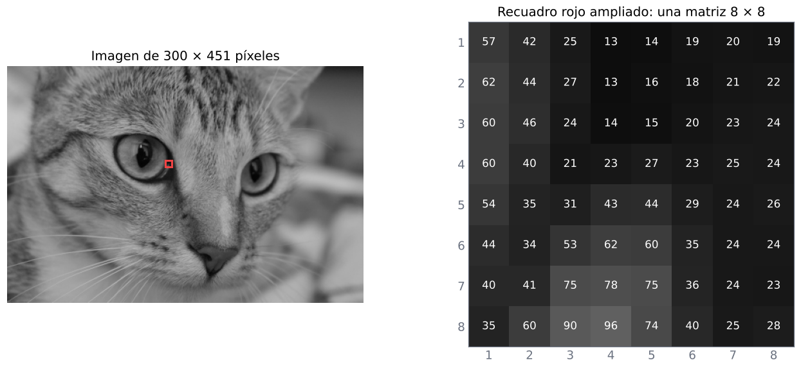
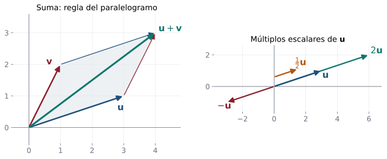
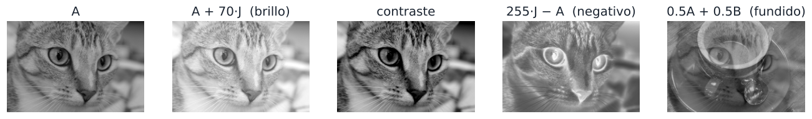

## En la vida diaria: una foto es una tabla de números {.nostretch}

::: {.aplicacion data-t="Para empezar"}
Cada foto del celular se guarda como una tabla gigante de números: uno por cada punto (píxel) de la imagen.
:::

{fig-align="center" height="250px"}

Esa tabla es una **matriz**. Subir el brillo es sumarle un número a todas sus entradas, y mezclar dos fotos es sumar matrices. Los datos de una encuesta, las notas de un curso o las ventas de una tienda también se guardan en matrices.

**En esta clase:** aprenderá qué son los vectores y las matrices y cómo se suman y se multiplican por un número.

## Objetivos de la clase

- Definir **vectores** de $\mathbb R^n$ (renglón y columna) y **matrices** $m\times n$.
- Reconocer los tipos especiales: cuadrada, cero, diagonal, escalar, identidad, triangular.
- Operar con matrices: **igualdad, suma, resta y multiplicación por escalar**.
- Demostrar las propiedades algebraicas de estas operaciones.
- Resolver **ecuaciones matriciales** y estudiar **combinaciones lineales** de matrices.

## Vectores {.compacto}

::: {.definicion}
Un **vector renglón** de $n$ componentes es una lista ordenada $(x_1, x_2, \dots, x_n)$. Un **vector columna** de $n$ componentes es
$$
\mathbf x=\begin{pmatrix}x_1\\x_2\\\vdots\\x_n\end{pmatrix}.
$$
El conjunto de todos los vectores de $n$ componentes reales es $\;\mathbb R^n=\{(x_1,\dots,x_n) : x_i\in\mathbb R,\ 1\le i\le n\}$.
:::

. . .

- $(3,6)\in\mathbb R^2$, $\;\begin{pmatrix}2\\-1\\5\end{pmatrix}\in\mathbb R^3$, $\;(2,-1,0,4)\in\mathbb R^4$.
- El **vector cero** $\mathbf 0 = (0,\dots,0)$.
- Dos vectores son **iguales** si tienen el mismo número de componentes y las componentes correspondientes coinciden.

## Geometría de las operaciones con vectores

{fig-align="center" width="92%"}

La suma sigue la **regla del paralelogramo**; multiplicar por $c>0$ estira o encoge, y por $c<0$ además invierte el sentido.

## Matrices {.compacto}

::: {.definicion}
Una **matriz** $A$ de tamaño $m\times n$ es un arreglo rectangular de números con $m$ **renglones** (filas) y $n$ **columnas**:
$$
A = (a_{ij}) = \begin{pmatrix}
a_{11}&a_{12}&\cdots&a_{1n}\\
a_{21}&a_{22}&\cdots&a_{2n}\\
\vdots&\vdots&\ddots&\vdots\\
a_{m1}&a_{m2}&\cdots&a_{mn}
\end{pmatrix}\in M_{m\times n}(\mathbb R).
$$
$a_{ij}$ es la **entrada** del renglón $i$ y la columna $j$.
:::

. . .

::: {.ejemplo}
$C=\begin{pmatrix}-3&5&1&-3&1\\2&6&1&2&2\\-1&0&4&-4&9\end{pmatrix}$ es $3\times 5$; $\;c_{23}=1$, $\;c_{35}=9$, y $c_{43}$ **no existe**.
:::

. . .

Las entradas pueden ser reales, complejas, racionales…: $\begin{pmatrix}2+i&-3i\\7i&5-i\end{pmatrix}\in M_{2\times2}(\mathbb C)$. En este curso trabajamos con reales.

## En la vida real: una imagen es una matriz {.nostretch}

{fig-align="center" width="92%"}

Una foto en escala de grises es una matriz $A$ de tamaño $300\times451$: cada entrada $a_{ij}$ es el **brillo** del píxel en la fila $i$ y la columna $j$, de $0$ (negro) a $255$ (blanco).

[Las fotografías de ejemplo del curso provienen de la colección de imágenes de scikit-image (dominio público y CC0).]{.chico .muted}

## En la vida real: una foto a color son tres matrices {.nostretch}

{fig-align="center" width="95%"}

Una imagen a color guarda **tres matrices del mismo tamaño**: cuánto rojo ($R$), verde ($G$) y azul ($B$) tiene cada píxel. Una cámara de 12 megapíxeles produce tres matrices de unos $3000\times4000$.

::: {.ml}
Las redes neuronales que reconocen imágenes reciben exactamente estas matrices como entrada.
:::

## Tipos especiales de matrices {.compacto}

| Tipo | Condición | Ejemplo |
|---|---|---|
| **Cuadrada** | $m = n$ | $\begin{pmatrix}2&0\\3&-1\end{pmatrix}$ |
| **Cero** | $a_{ij}=0$ para todo $i,j$ | $\begin{pmatrix}0&0&0\\0&0&0\end{pmatrix}$ |
| **Diagonal** | cuadrada y $a_{ij}=0$ si $i\ne j$ | $\begin{pmatrix}-3&0&0\\0&-2&0\\0&0&4\end{pmatrix}$ |
| **Escalar** | diagonal con $a_{ii}=c$ | $\begin{pmatrix}-2&0\\0&-2\end{pmatrix}$ |
| **Identidad** $I_n$ | escalar con $c = 1$ | $\begin{pmatrix}1&0&0\\0&1&0\\0&0&1\end{pmatrix}$ |
| **Triangular superior** | $a_{ij}=0$ si $i>j$ | $\begin{pmatrix}1&4&2\\0&3&5\\0&0&6\end{pmatrix}$ |
| **Triangular inferior** | $a_{ij}=0$ si $i<j$ | $\begin{pmatrix}1&0&0\\4&3&0\\2&5&6\end{pmatrix}$ |

Las entradas $a_{11}, a_{22},\dots,a_{nn}$ forman la **diagonal principal**.

## Igualdad, suma y multiplicación por escalar {.compacto}

::: {.definicion}
Sean $A=(a_{ij})$, $B=(b_{ij})$ de tamaño $m\times n$ y $c\in\mathbb R$.

- **Igualdad:** $A = B \iff a_{ij} = b_{ij}$ para todo $i, j$.
- **Suma:** $A + B = (a_{ij}+b_{ij})$.
- **Escalar:** $cA = (c\,a_{ij})$.
- **Resta:** $A - B = A + (-1)B = (a_{ij}-b_{ij})$.
:::

. . .

::: {.obs data-t="Ojo"}
Solo se pueden **sumar** matrices del **mismo tamaño**. $\begin{pmatrix}1&2\end{pmatrix}+\begin{pmatrix}1\\2\end{pmatrix}$ no está definida.
:::

. . .

::: {.ejemplo}
$$
\begin{pmatrix}1&-2&4\\2&-1&3\end{pmatrix}+\begin{pmatrix}0&2&-4\\1&3&1\end{pmatrix}=\begin{pmatrix}1&0&0\\3&2&4\end{pmatrix},
\qquad
4\begin{pmatrix}-2&0\\3&-5\\12&-8\end{pmatrix}=\begin{pmatrix}-8&0\\12&-20\\48&-32\end{pmatrix}.
$$
:::

## En la vida real: editar una foto es operar matrices {.nostretch}

{fig-align="center" width="100%"}

- **Brillo:** sumar una constante a todas las entradas ($J$ es la matriz de unos).
- **Negativo:** $255J-A$. **Contraste:** multiplicar por un escalar alrededor del gris medio.
- **Fundido** entre dos fotos del mismo tamaño: la combinación lineal $\tfrac12A+\tfrac12B$. Los valores que pasan de $255$ se recortan.

## Ejemplo: igualdad de matrices

::: {.ejemplo}
Halle $w, x, y, z$ para que $\;\begin{pmatrix}1&2&-1\\2&-3&4\\0&-4&5\end{pmatrix}=\begin{pmatrix}1&2&w\\2&x&4\\y&-4&z\end{pmatrix}$.
:::

. . .

Igualando entrada a entrada: $\;w=-1,\quad x=-3,\quad y=0,\quad z=5.$

. . .

::: {.ejemplo}
¿Existen $a, b$ tales que $\begin{pmatrix}a+b&2\\a-b&1\end{pmatrix} = \begin{pmatrix}6&2\\2&1\end{pmatrix}$?
:::

. . .

Se obtiene el sistema $a+b = 6$, $a - b = 2$, cuya solución es $a = 4$, $b = 2$. Las ecuaciones matriciales **son** sistemas de ecuaciones.

## Propiedades de la suma y del producto por escalar

::: {.teorema}
Sean $A, B, C$ matrices $m\times n$, $O$ la matriz cero $m\times n$ y $r, s\in\mathbb R$. Entonces:

::: {.columns}
::: {.column width="50%"}
a) $A + B = B + A$ (conmutativa)
b) $A + (B + C) = (A + B) + C$ (asociativa)
c) $A + O = A$ (neutro aditivo)
d) $A + (-A) = O$ (inverso aditivo)
:::
::: {.column width="50%"}
e) $r(sA) = (rs)A$
f) $(r+s)A = rA + sA$
g) $r(A+B) = rA + rB$
h) $1\cdot A = A$
:::
:::
:::

. . .

::: {.demo data-t="a) y g)"}
Comparamos la entrada $(i,j)$ de ambos lados, usando las propiedades de los números reales:
$$
(A+B)_{ij} = a_{ij} + b_{ij} = b_{ij} + a_{ij} = (B+A)_{ij},
$$
$$
\big(r(A+B)\big)_{ij} = r(a_{ij}+b_{ij}) = ra_{ij} + rb_{ij} = (rA)_{ij} + (rB)_{ij} = (rA+rB)_{ij}.
$$
Como todas las entradas coinciden, las matrices son iguales.
:::

## Ejemplo resuelto: ecuaciones matriciales

::: {.ejemplo}
Sean $A=\begin{pmatrix}1&4\\-2&-2\\0&-8\end{pmatrix}$, $B=\begin{pmatrix}-4&7\\0&1\\8&-3\end{pmatrix}$, $C=\begin{pmatrix}5&-9\\3&0\\6&1\end{pmatrix}$.
Halle $E$ tal que $A + 2B - 3C + E = O$.
:::

. . .

Despejamos usando las propiedades (inverso aditivo y asociatividad): $\;E = -A - 2B + 3C$.

. . .

$$
E = \begin{pmatrix}-1&-4\\2&2\\0&8\end{pmatrix} + \begin{pmatrix}8&-14\\0&-2\\-16&6\end{pmatrix} + \begin{pmatrix}15&-27\\9&0\\18&3\end{pmatrix}
= \begin{pmatrix}22&-45\\11&0\\2&17\end{pmatrix}.
$$

. . .

::: {.obs}
**Despeje primero, calcule después.** Se trabaja con las matrices como si fueran números, siempre que solo usemos propiedades válidas para matrices.
:::

## Ejemplo resuelto: ecuación con la incógnita en ambos lados

::: {.ejemplo}
Sean $A=\begin{pmatrix}1&-1\\2&3\end{pmatrix}$, $B=\begin{pmatrix}-1&0\\2&3\end{pmatrix}$. Halle $X$ tal que $3(2A + B + X) = 5(X - A + B)$.
:::

. . .

$$
6A + 3B + 3X = 5X - 5A + 5B \;\Longrightarrow\; 11A - 2B = 2X \;\Longrightarrow\; X = \tfrac12(11A - 2B).
$$

. . .

$$
11A - 2B = \begin{pmatrix}11&-11\\22&33\end{pmatrix}-\begin{pmatrix}-2&0\\4&6\end{pmatrix}=\begin{pmatrix}13&-11\\18&27\end{pmatrix}
\quad\Longrightarrow\quad
X=\begin{pmatrix}\tfrac{13}{2}&-\tfrac{11}{2}\\[2pt]9&\tfrac{27}{2}\end{pmatrix}.
$$

## Combinación lineal de matrices

::: {.definicion}
Una **combinación lineal** de las matrices $A_1,\dots,A_k$ (del mismo tamaño) es una expresión $c_1A_1 + c_2A_2 + \cdots + c_kA_k$ con $c_i\in\mathbb R$.
:::

. . .

::: {.ejemplo}
¿Se puede escribir $A=\begin{pmatrix}4&7\\6&1\end{pmatrix}$ como combinación lineal de $B=\begin{pmatrix}1&1\\2&-1\end{pmatrix}$ y $C=\begin{pmatrix}0&3\\2&1\end{pmatrix}$?
:::

. . .

Buscamos $\alpha,\beta$ con $\alpha B + \beta C = A$:
$$
\begin{pmatrix}\alpha&\alpha+3\beta\\2\alpha+2\beta&-\alpha+\beta\end{pmatrix}=\begin{pmatrix}4&7\\6&1\end{pmatrix}
\Longrightarrow
\begin{cases}\alpha = 4\\ \alpha+3\beta = 7\\ 2\alpha+2\beta = 6\\ -\alpha+\beta = 1\end{cases}
$$

. . .

De la 1.ª y la 4.ª: $\alpha=4$, $\beta=5$. Pero en la 2.ª: $4 + 15 = 19 \ne 7$. El sistema es **inconsistente**: $A$ **no** es combinación lineal de $B$ y $C$.

## Aplicación: matrices como tablas de datos {.compacto}

::: {.ejemplo data-t="Ventas"}
Una empresa vende tres productos en dos sucursales. Las ventas (en unidades) de enero y febrero son
$$
E=\begin{pmatrix}12&8&5\\10&6&9\end{pmatrix},\qquad F=\begin{pmatrix}15&7&6\\9&11&8\end{pmatrix}
\qquad(\text{filas: sucursales; columnas: productos}).
$$
:::

. . .

- **Ventas del bimestre:** $E+F=\begin{pmatrix}27&15&11\\19&17&17\end{pmatrix}$.
- **Cambio de enero a febrero:** $F-E=\begin{pmatrix}3&-1&1\\-1&5&-1\end{pmatrix}$ (la sucursal 2 vendió 5 unidades más del producto 2).

. . .

- **Meta de marzo:** 10 % más que el bimestre: $1.1(E+F)=\begin{pmatrix}29.7&16.5&12.1\\20.9&18.7&18.7\end{pmatrix}$.

. . .

::: {.obs}
La suma y el producto por escalar "entrada a entrada" tienen un significado concreto: se suman cantidades del **mismo producto en la misma sucursal**. Por eso solo tiene sentido sumar matrices del mismo tamaño.
:::

## Machine learning: los datos son una matriz {.compacto .nostretch}

::: {.ml data-t="Matriz de datos"}
En aprendizaje automático, los datos se organizan en una matriz $X$: **cada fila es un ejemplo** y **cada columna una característica**.
:::

| | Horas de estudio | Asistencia (%) | Nota parcial 1 |
|---|---|---|---|
| Estudiante 1 | 6 | 90 | 3.8 |
| Estudiante 2 | 2 | 60 | 2.5 |
| Estudiante 3 | 4 | 85 | 4.1 |

$$
X=\begin{pmatrix}6&90&3.8\\2&60&2.5\\4&85&4.1\end{pmatrix}\in M_{3\times3}.
$$

. . .

Una imagen de $28\times28$ píxeles (como los dígitos escritos a mano del conjunto MNIST) se "aplana" en un vector de $784$ entradas, y $60\,000$ imágenes forman una matriz de $60\,000\times784$.

## Ejemplo 1 · Fácil: suma y producto por escalar {.compacto}

::: {.ejemplo data-t="Nivel fácil"}
Con $A=\begin{pmatrix}2&-1\\0&3\end{pmatrix}$ y $B=\begin{pmatrix}1&4\\-2&5\end{pmatrix}$, calcule $A+B$ y $3A-2B$.
:::

. . .

**Paso 1 · Revisar tamaños.** Ambas son $2\times2$: se pueden sumar. Las operaciones se hacen **entrada por entrada**.

. . .

**Paso 2.** $\;A+B=\begin{pmatrix}2+1&-1+4\\0-2&3+5\end{pmatrix}=\begin{pmatrix}3&3\\-2&8\end{pmatrix}.$

. . .

**Paso 3.** Primero los escalares, luego la resta:
$$
3A=\begin{pmatrix}6&-3\\0&9\end{pmatrix},\quad 2B=\begin{pmatrix}2&8\\-4&10\end{pmatrix}\;\Rightarrow\;3A-2B=\begin{pmatrix}4&-11\\4&-1\end{pmatrix}.
$$

::: {.solucion}
$A+B=\begin{pmatrix}3&3\\-2&8\end{pmatrix}$, $\;3A-2B=\begin{pmatrix}4&-11\\4&-1\end{pmatrix}$. Error típico: olvidar que $-2B$ cambia el signo de **todas** las entradas de $B$.
:::

## Ejemplo 2 · Fácil: igualdad de matrices {.compacto}

::: {.ejemplo data-t="Nivel fácil"}
Halle $x$ e $y$ tales que $\begin{pmatrix}x+y&2\\3&x-y\end{pmatrix}=\begin{pmatrix}5&2\\3&1\end{pmatrix}$.
:::

. . .

**Paso 1 · Qué significa "iguales".** Dos matrices son iguales si tienen el mismo tamaño y **cada entrada coincide**. Las entradas $(1,2)$ y $(2,1)$ ya coinciden; las otras dan ecuaciones:
$$
x+y=5,\qquad x-y=1 .
$$

. . .

**Paso 2.** Sumando: $2x=6\Rightarrow x=3$; luego $y=2$.

::: {.solucion}
$x=3,\;y=2$. Comprobación: $x+y=5$ ✓, $x-y=1$ ✓.
:::

## Ejemplo 3 · Medio: una ecuación matricial {.compacto}

::: {.ejemplo data-t="Nivel medio"}
Halle la matriz $X$ que cumple $\;2X+A=3B$, con $A=\begin{pmatrix}1&-2&0\\3&1&4\end{pmatrix}$, $\;B=\begin{pmatrix}2&0&-1\\1&1&2\end{pmatrix}$.
:::

. . .

**Paso 1 · Despejar como en los números**, usando las propiedades de la suma y del producto por escalar:
$$
2X=3B-A\quad\Rightarrow\quad X=\tfrac12\,(3B-A).
$$

. . .

**Paso 2 · Calcular.**
$$
3B-A=\begin{pmatrix}6&0&-3\\3&3&6\end{pmatrix}-\begin{pmatrix}1&-2&0\\3&1&4\end{pmatrix}=\begin{pmatrix}5&2&-3\\0&2&2\end{pmatrix}.
$$

::: {.solucion}
$X=\begin{pmatrix}5/2&1&-3/2\\0&1&1\end{pmatrix}$. Comprobación de la entrada $(1,1)$: $2\cdot\tfrac52+1=6=3\cdot2$ ✓.
:::

## Ejemplo 4 · Difícil: ¿es combinación lineal de dos matrices? {.compacto}

::: {.ejemplo data-t="Nivel difícil"}
Sean $M_1=\begin{pmatrix}1&0\\1&1\end{pmatrix}$, $M_2=\begin{pmatrix}0&1\\-1&2\end{pmatrix}$. (a) Escriba $C=\begin{pmatrix}3&2\\1&7\end{pmatrix}$ como $aM_1+bM_2$. (b) ¿Se puede con $D=\begin{pmatrix}3&2\\1&6\end{pmatrix}$?
:::

. . .

**Paso 1 · Plantear.** $\;aM_1+bM_2=\begin{pmatrix}a&b\\a-b&a+2b\end{pmatrix}$. Igualar entrada por entrada da **4 ecuaciones con 2 incógnitas**.

. . .

**Paso 2 · Parte (a).** Las entradas $(1,1)$ y $(1,2)$ fijan $a=3$, $b=2$. Hay que **verificar las otras dos**: $a-b=1$ ✓ y $a+2b=7$ ✓. Entonces $C=3M_1+2M_2$.

. . .

**Paso 3 · Parte (b).** Otra vez $a=3$, $b=2$ son obligatorios, pero la entrada $(2,2)$ exigiría $a+2b=6$, y da $7$. **Contradicción.**

::: {.solucion}
**(a)** $C=3M_1+2M_2$. **(b)** $D$ **no** es combinación lineal de $M_1$ y $M_2$. Lección: con más ecuaciones que incógnitas, encontrar valores no basta; hay que comprobar **todas** las ecuaciones.
:::

## Práctica en clase

::: {.ejercicio data-t="1"}
Halle $x,y,z$ si $\;2\begin{pmatrix}x&1\\0&y\end{pmatrix}-\begin{pmatrix}1&z\\3&2\end{pmatrix}=\begin{pmatrix}5&-1\\-3&4\end{pmatrix}$.
:::

::: {.solucion .fragment}
Entrada a entrada: $2x-1=5\Rightarrow x=3$; $\;2-z=-1\Rightarrow z=3$; $\;0-3=-3$ ✓; $\;2y-2=4\Rightarrow y=3$.
:::

::: {.ejercicio data-t="2"}
Escriba la matriz $\begin{pmatrix}3&-2\\5&0\end{pmatrix}$ como combinación lineal de $E_{11},E_{12},E_{21},E_{22}$ (las matrices con un solo 1).
:::

::: {.solucion .fragment}
$3E_{11}-2E_{12}+5E_{21}+0E_{22}$. Toda matriz $2\times2$ se escribe así de forma única: lo usaremos en la unidad 5 (base canónica).
:::

## Ejercicios propuestos

::: {.ejercicio data-t="1"}
Con $A$, $B$ y $C$ del ejemplo de la diapositiva de ecuaciones matriciales, calcule $3A - 2B + C$ y halle $D$ tal que $2A + B - D = O$.
:::

::: {.solucion .fragment}
$3A-2B+C=\begin{pmatrix}16&-11\\-3&-8\\-10&-17\end{pmatrix}$; $\quad D = 2A+B=\begin{pmatrix}-2&15\\-4&-3\\8&-19\end{pmatrix}$.
:::

## Ejercicios propuestos

::: {.ejercicio data-t="2"}
Construya la matriz $3\times3$ con $a_{ij}=2i-j$. ¿Es simétrica, triangular o diagonal?
:::

::: {.solucion .fragment}
$A=\begin{pmatrix}1&0&-1\\3&2&1\\5&4&3\end{pmatrix}$. No es diagonal ni triangular (tiene entradas no nulas arriba y abajo de la diagonal) y no es simétrica, pues $a_{12}=0\neq 3=a_{21}$.
:::

## Ejercicios propuestos

::: {.ejercicio data-t="3 · Demostración"}
Demuestre que el inverso aditivo es único: si $A + D = O$ y $A + D' = O$, entonces $D = D'$.
:::

::: {.solucion .fragment}
$D = D + O = D + (A + D') = (D + A) + D' = (A+D) + D' = O + D' = D'$. Se usaron, en orden: neutro, hipótesis, asociativa, conmutativa, hipótesis y neutro.
:::

## Ejercicios propuestos

::: {.ejercicio data-t="4 · Demostración"}
Demuestre que si $A$ y $B$ son triangulares superiores $n\times n$, entonces $A+B$ y $cA$ son triangulares superiores.
:::

::: {.solucion .fragment}
Si $i>j$, entonces $a_{ij}=b_{ij}=0$, luego $(A+B)_{ij} = 0+0 = 0$ y $(cA)_{ij} = c\cdot 0 = 0$. Las entradas debajo de la diagonal siguen siendo cero.
:::

## Ejercicios del texto guía {.texto-guia}

Grossman y Flores, *Álgebra lineal*, 8.ª ed.:

| Sección | Ejercicios |
|---|---|
| 2.1 Vectores y matrices: definiciones generales | 11, 14, 26, 38, 40, 42, 44, 58, 61, 64 |

## Resumen

- $A\in M_{m\times n}$: $m$ renglones, $n$ columnas; $a_{ij}$ en el renglón $i$, columna $j$.
- Tipos: cuadrada, cero, diagonal, escalar, identidad, triangular superior e inferior.
- Suma y producto por escalar se hacen **entrada por entrada**; la suma exige **igual tamaño**.
- Valen las mismas propiedades que con los números reales (se prueban entrada por entrada).
- Una ecuación matricial equivale a un **sistema** de ecuaciones.

 

[← Clase 2](clase_02.qmd) · [Programa del curso](../algebra_lineal.qmd) · [Clase 4: Producto punto y producto matricial →](clase_04.qmd)
