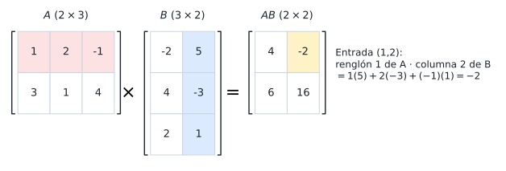

## Objetivos de la clase

- Calcular el **producto punto** (producto interno) de dos vectores de $\mathbb R^n$.
- Multiplicar matrices y saber **cuándo** el producto está definido.
- Interpretar $A\mathbf x$ como **combinación lineal de las columnas** de $A$.
- Conocer las propiedades del producto… y las que **no** se cumplen.
- Calcular **potencias** de matrices y demostrar fórmulas por **inducción**.

## Ruta de la clase (70 min)

| Tiempo | Actividad |
|:---:|---|
| 0 – 5 | Repaso: suma y producto por escalar |
| 5 – 15 | Producto punto y sus propiedades |
| 15 – 35 | Producto de matrices: definición, regla de tamaños, ejemplos y aplicación |
| 35 – 50 | $A\mathbf x$ como combinación de columnas; propiedades y lo que no se cumple |
| 50 – 70 | Potencias e inducción; práctica en clase |

## Producto punto

::: {.definicion}
Sean $\mathbf a=(a_1,\dots,a_n)$ y $\mathbf b=(b_1,\dots,b_n)$ en $\mathbb R^n$. Su **producto punto** es el **número**
$$
\mathbf a\cdot\mathbf b = a_1b_1 + a_2b_2 + \cdots + a_nb_n = \sum_{i=1}^n a_ib_i .
$$
:::

. . .

::: {.ejemplo}
$\mathbf u=(1,-2,3,4)$, $\mathbf v=(2,3,-2,1)$: $\quad\mathbf u\cdot\mathbf v = 2 - 6 - 6 + 4 = -6.$
:::

. . .

::: {.ejemplo}
Halle $x$ si $\mathbf a = (x, 2, 3)$, $\mathbf b = (4, 1, 2)$ y $\mathbf a\cdot\mathbf b = -4$.
:::

. . .

$4x + 2 + 6 = -4 \Rightarrow 4x = -12 \Rightarrow x = -3$.

## Propiedades del producto punto {.compacto}

::: {.teorema}
Para $\mathbf a,\mathbf b,\mathbf c\in\mathbb R^n$ y $\alpha\in\mathbb R$:

1. $\mathbf a\cdot\mathbf 0 = 0$.
2. $\mathbf a\cdot\mathbf b = \mathbf b\cdot\mathbf a$ (conmutativa).
3. $\mathbf a\cdot(\mathbf b+\mathbf c) = \mathbf a\cdot\mathbf b + \mathbf a\cdot\mathbf c$ (distributiva).
4. $(\alpha\mathbf a)\cdot\mathbf b = \alpha(\mathbf a\cdot\mathbf b)$.
5. $\mathbf a\cdot\mathbf a\ge 0$, y $\mathbf a\cdot\mathbf a = 0 \iff \mathbf a = \mathbf 0$.
:::

. . .

::: {.demo data-t="3 y 5"}
(3) $\;\mathbf a\cdot(\mathbf b+\mathbf c) = \sum a_i(b_i + c_i) = \sum (a_ib_i + a_ic_i) = \sum a_ib_i + \sum a_ic_i$.

(5) $\;\mathbf a\cdot\mathbf a = a_1^2+\cdots+a_n^2$ es suma de cuadrados, luego $\ge 0$. Es $0$ solo si cada $a_i^2 = 0$, es decir, si cada $a_i=0$.
:::

. . .

::: {.obs}
Dos vectores son **ortogonales** si $\mathbf a\cdot\mathbf b = 0$. Su significado geométrico (ángulo de $90^\circ$) se verá en la unidad 4.
:::

## Producto de matrices

::: {.definicion}
Sea $A$ de tamaño $m\times \color{#8c1d2c}{n}$ y $B$ de tamaño $\color{#8c1d2c}{n}\times p$. El producto $AB$ es la matriz $m\times p$ cuya entrada $(i,j)$ es
$$
(AB)_{ij} = (\text{renglón } i \text{ de } A)\cdot(\text{columna } j \text{ de } B) = \sum_{k=1}^n a_{ik}b_{kj}.
$$
:::

. . .

::: {.obs data-t="Regla de los tamaños"}
$$
\underset{m\times \boxed{n}}{A}\;\cdot\;\underset{\boxed{n}\times p}{B}\;=\;\underset{m\times p}{AB}
$$
El número de **columnas** de $A$ debe ser igual al número de **renglones** de $B$.
:::

## Cómo se calcula cada entrada

{fig-align="center" width="95%"}

Cada entrada de $AB$ es el producto punto de **un renglón de $A$** con **una columna de $B$**. Recorra con un dedo de la mano izquierda el renglón y con uno de la derecha la columna.

## Ejemplo resuelto: producto de matrices

::: {.ejemplo}
$A=\begin{pmatrix}1&2&-1\\3&1&4\end{pmatrix}$ ($2\times3$), $\;B=\begin{pmatrix}-2&5\\4&-3\\2&1\end{pmatrix}$ ($3\times2$). Calcule $AB$ y $BA$.
:::

. . .

$$
AB=\begin{pmatrix}
1(-2)+2(4)+(-1)(2) & 1(5)+2(-3)+(-1)(1)\\
3(-2)+1(4)+4(2) & 3(5)+1(-3)+4(1)
\end{pmatrix}
=\begin{pmatrix}4&-2\\6&16\end{pmatrix}\quad(2\times 2).
$$

. . .

$$
BA=\begin{pmatrix}-2&5\\4&-3\\2&1\end{pmatrix}\begin{pmatrix}1&2&-1\\3&1&4\end{pmatrix}=\begin{pmatrix}13&1&22\\-5&5&-16\\5&5&2\end{pmatrix}\quad(3\times 3).
$$

. . .

$AB$ y $BA$ ni siquiera tienen el mismo tamaño. **El producto de matrices no es conmutativo.**

## Una entrada sin calcular todo

::: {.ejemplo}
Sean $A=\begin{pmatrix}1&-2&3\\4&2&1\\0&1&-2\end{pmatrix}$, $B=\begin{pmatrix}1&4\\3&-1\\-2&2\end{pmatrix}$. Calcule la entrada $(3,2)$ de $AB$.
:::

. . .

$$
(AB)_{32} = (\text{renglón }3\text{ de }A)\cdot(\text{columna }2\text{ de }B) = (0,1,-2)\cdot(4,-1,2) = 0 - 1 - 4 = -5.
$$

. . .

::: {.ejemplo}
Halle $x, y$ si $\begin{pmatrix}1&x&3\\2&-1&1\end{pmatrix}\begin{pmatrix}2\\4\\y\end{pmatrix}=\begin{pmatrix}12\\6\end{pmatrix}$.
:::

. . .

$2 + 4x + 3y = 12$ y $4 - 4 + y = 6$. Luego $y = 6$ y $4x = 12 - 2 - 18 = -8$, así que $x=-2$.

## $A\mathbf x$ como combinación lineal de columnas

::: {.teorema}
Si $A = (\mathbf a_1\;\mathbf a_2\;\cdots\;\mathbf a_n)$ tiene columnas $\mathbf a_j$ y $\mathbf x = (x_1,\dots,x_n)^T$, entonces
$$
A\mathbf x = x_1\mathbf a_1 + x_2\mathbf a_2 + \cdots + x_n\mathbf a_n .
$$
:::

. . .

::: {.ejemplo}
$$
\begin{pmatrix}2&-1&-3\\4&2&-2\end{pmatrix}\begin{pmatrix}2\\-3\\4\end{pmatrix}
=2\begin{pmatrix}2\\4\end{pmatrix}-3\begin{pmatrix}-1\\2\end{pmatrix}+4\begin{pmatrix}-3\\-2\end{pmatrix}=\begin{pmatrix}-5\\-6\end{pmatrix}.
$$
:::

. . .

::: {.demo}
La entrada $i$ de $A\mathbf x$ es $\sum_j a_{ij}x_j$. La entrada $i$ de $\sum_j x_j\mathbf a_j$ es $\sum_j x_j a_{ij}$. Son iguales.
:::

. . .

Del mismo modo, la **columna $j$ de $AB$ es $A$ por la columna $j$ de $B$**: $\;AB = (A\mathbf b_1\;\cdots\;A\mathbf b_p)$.

## Propiedades del producto de matrices

::: {.teorema}
Si los tamaños son compatibles y $r\in\mathbb R$:

a) $A(BC) = (AB)C$ (asociativa)
b) $A(B + C) = AB + AC\;$ y $\;(A+B)C = AC + BC$ (distributivas)
c) $r(AB) = (rA)B = A(rB)$
d) $I_mA = A = AI_n$ si $A$ es $m\times n$
:::

. . .

::: {.demo data-t="b) primera distributiva"}
$$
\big(A(B+C)\big)_{ij} = \sum_k a_{ik}(b_{kj}+c_{kj}) = \sum_k a_{ik}b_{kj} + \sum_k a_{ik}c_{kj} = (AB)_{ij} + (AC)_{ij}.
$$
:::

. . .

::: {.demo data-t="d)"}
$(I_mA)_{ij} = \sum_k \delta_{ik}a_{kj} = a_{ij}$, porque $\delta_{ik}$ (entrada de $I$) vale $1$ si $k=i$ y $0$ en otro caso.
:::

## Lo que **no** se cumple

::: {.columns}
::: {.column width="50%"}
**1. No es conmutativo** ($AB\neq BA$ en general):
$$
\begin{pmatrix}1&2\\-1&3\end{pmatrix}\!\begin{pmatrix}2&0\\1&-2\end{pmatrix}=\begin{pmatrix}4&-4\\1&-6\end{pmatrix}
$$
$$
\begin{pmatrix}2&0\\1&-2\end{pmatrix}\!\begin{pmatrix}1&2\\-1&3\end{pmatrix}=\begin{pmatrix}2&4\\3&-4\end{pmatrix}
$$
:::
::: {.column width="50%"}
**2. Hay divisores de cero** ($AB=O$ con $A,B\neq O$):
$$
\begin{pmatrix}1&1\\1&1\end{pmatrix}\begin{pmatrix}1&-1\\-1&1\end{pmatrix}=\begin{pmatrix}0&0\\0&0\end{pmatrix}
$$

**3. No se puede cancelar** ($AB=AC\not\Rightarrow B=C$):
$$
\begin{pmatrix}1&2\\2&4\end{pmatrix}\!\begin{pmatrix}1&1\\1&1\end{pmatrix}=\begin{pmatrix}1&2\\2&4\end{pmatrix}\!\begin{pmatrix}3&-1\\0&2\end{pmatrix}=\begin{pmatrix}3&3\\6&6\end{pmatrix}
$$
:::
:::

. . .

::: {.obs data-t="Consecuencia"}
$(A+B)^2 = A^2 + AB + BA + B^2$, que en general **no** es $A^2 + 2AB + B^2$.
:::

## Potencias de una matriz {.compacto}

::: {.definicion}
Si $A$ es cuadrada y $p\in\mathbb N$: $\;A^p = \underbrace{A\,A\cdots A}_{p\text{ factores}}$, y $A^0 = I_n$. Se cumplen $A^pA^q = A^{p+q}$ y $(A^p)^q = A^{pq}$.
:::

. . .

::: {.ejemplo}
Sea $A=\begin{pmatrix}1&0\\3&1\end{pmatrix}$. Entonces $A^2=\begin{pmatrix}1&0\\6&1\end{pmatrix}$, $A^3=\begin{pmatrix}1&0\\9&1\end{pmatrix}$, $A^4=\begin{pmatrix}1&0\\12&1\end{pmatrix}$.
:::

. . .

Se conjetura $A^n=\begin{pmatrix}1&0\\3n&1\end{pmatrix}$. **Demostrémoslo.**

. . .

::: {.demo data-t="Por inducción sobre n"}
**Base:** $n=1$ es cierto. **Paso inductivo:** si $A^k=\begin{pmatrix}1&0\\3k&1\end{pmatrix}$, entonces
$$
A^{k+1}=A^kA=\begin{pmatrix}1&0\\3k&1\end{pmatrix}\begin{pmatrix}1&0\\3&1\end{pmatrix}=\begin{pmatrix}1&0\\3k+3&1\end{pmatrix}=\begin{pmatrix}1&0\\3(k+1)&1\end{pmatrix}.
$$
:::

. . .

Así, por ejemplo, $A^{850}-A^{250}=\begin{pmatrix}0&0\\2550-750&0\end{pmatrix}=\begin{pmatrix}0&0\\1800&0\end{pmatrix}$.

## Aplicación: costos con producto de matrices

::: {.ejemplo}
Para fabricar dos productos se usan tres materiales. $C$ indica las unidades de material por producto y $P$ el precio por unidad de material en dos proveedores:
$$
C=\begin{pmatrix}2&1&0\\1&3&1\end{pmatrix}\;(\text{filas: productos}),\qquad
P=\begin{pmatrix}1500&2000\\800&1200\\3000&2500\end{pmatrix}\;(\text{filas: materiales; columnas: proveedores}).
$$
¿Cuánto cuesta cada producto con cada proveedor?
:::

. . .

$$
CP=\begin{pmatrix}2(1500)+1(800)+0&2(2000)+1(1200)+0\\1500+3(800)+3000&2000+3(1200)+2500\end{pmatrix}=\begin{pmatrix}3800&5200\\6900&8100\end{pmatrix}.
$$

. . .

El producto 1 cuesta \$3800 con el proveedor 1 y \$5200 con el 2: conviene el **proveedor 1** para ambos productos. El tamaño $(2\times3)(3\times2)=2\times2$ coincide con "productos × proveedores".

## Práctica en clase

::: {.ejercicio data-t="1"}
Si $A$ es $3\times4$, $B$ es $4\times2$ y $C$ es $2\times3$, ¿cuáles están definidos y de qué tamaño son: $AB$, $BA$, $ABC$, $CA$, $BC$?
:::

::: {.solucion .fragment}
$AB$: $3\times2$. $\;BA$: no ($2\neq3$). $\;ABC$: $3\times3$. $\;CA$: $2\times4$. $\;BC$: $4\times3$.
:::

::: {.ejercicio data-t="2"}
Con $\mathbf u=(1,2,-2)$ y $\mathbf v=(3,-1,4)$, calcule $\mathbf u\cdot\mathbf v$ y $(2\mathbf u)\cdot(\mathbf u-\mathbf v)$.
:::

::: {.solucion .fragment}
$\mathbf u\cdot\mathbf v=3-2-8=-7$. $\;(2\mathbf u)\cdot(\mathbf u-\mathbf v)=2(\mathbf u\cdot\mathbf u-\mathbf u\cdot\mathbf v)=2(9+7)=32$.
:::

## Ejercicios propuestos

::: {.ejercicio data-t="1"}
Halle todas las matrices $B=\begin{pmatrix}a&b\\c&d\end{pmatrix}$ que conmutan con $A=\begin{pmatrix}1&1\\0&1\end{pmatrix}$, es decir, $AB = BA$.
:::

::: {.solucion .fragment}
$AB=\begin{pmatrix}a+c&b+d\\c&d\end{pmatrix}$ y $BA=\begin{pmatrix}a&a+b\\c&c+d\end{pmatrix}$. Igualando: $a + c = a \Rightarrow c = 0$; $b+d = a+b \Rightarrow d = a$. **Respuesta:** $B=\begin{pmatrix}a&b\\0&a\end{pmatrix}$, con $a,b\in\mathbb R$ arbitrarios.
:::

## Ejercicios propuestos

::: {.ejercicio data-t="2"}
Sea $A=\begin{pmatrix}4&2\\1&3\end{pmatrix}$. Calcule $A^2+3A$ y $2A^3+3A^2+4A+5I_2$.
:::

::: {.solucion .fragment}
$A^2=\begin{pmatrix}18&14\\7&11\end{pmatrix}$, $A^3 = A^2A=\begin{pmatrix}86&78\\39&47\end{pmatrix}$. $\;A^2+3A=\begin{pmatrix}30&20\\10&20\end{pmatrix}$, $\;2A^3+3A^2+4A+5I=\begin{pmatrix}247&206\\103&144\end{pmatrix}$.
:::

## Ejercicios propuestos

::: {.ejercicio data-t="3 · Demostración"}
Sea $R_\theta=\begin{pmatrix}\cos\theta&-\operatorname{sen}\theta\\ \operatorname{sen}\theta&\cos\theta\end{pmatrix}$ (rotación). Demuestre que $R_\alpha R_\beta = R_{\alpha+\beta}$ y deduzca que $R_\theta^n = R_{n\theta}$.
:::

::: {.solucion .fragment}
$$
R_\alpha R_\beta=\begin{pmatrix}\cos\alpha\cos\beta-\operatorname{sen}\alpha\operatorname{sen}\beta & -(\cos\alpha\operatorname{sen}\beta+\operatorname{sen}\alpha\cos\beta)\\ \operatorname{sen}\alpha\cos\beta+\cos\alpha\operatorname{sen}\beta & \cos\alpha\cos\beta-\operatorname{sen}\alpha\operatorname{sen}\beta\end{pmatrix}=R_{\alpha+\beta}
$$
por las fórmulas de suma de ángulos. Por inducción: $R_\theta^{k+1}=R_\theta^kR_\theta = R_{k\theta}R_\theta = R_{(k+1)\theta}$.
:::

## Ejercicios propuestos

::: {.ejercicio data-t="4 · Verdadero o falso"}
(a) Si $A^2 = O$ entonces $A = O$. (b) Si $A$ y $B$ son triangulares inferiores $n\times n$, $AB$ también lo es.
:::

::: {.solucion .fragment}
(a) **Falso:** $A=\begin{pmatrix}2&2\\-2&-2\end{pmatrix}$ cumple $A^2=O$. (b) **Verdadero:** si $i<j$, $(AB)_{ij}=\sum_k a_{ik}b_{kj}$; si $k>i$ entonces $a_{ik}=0$, y si $k\le i<j$ entonces $b_{kj}=0$. Todos los sumandos son cero.
:::

## Ejercicios del texto guía {.texto-guia}

Grossman y Flores, *Álgebra lineal*, 8.ª ed.:

| Sección | Ejercicios |
|---|---|
| 2.2 Productos vectorial y matricial | 1, 6, 9, 10, 17, 19, 22, 24, 25, 26, 30, 36, 37, 51, 53, 57, 60, 60a, 60b, 62, 62a, 62b, 64, 66 |

## Resumen

- $\mathbf a\cdot\mathbf b=\sum a_ib_i$ es un **número**.
- $(AB)_{ij}$ = renglón $i$ de $A$ · columna $j$ de $B$; requiere (columnas de $A$) = (renglones de $B$).
- $A\mathbf x$ es una combinación lineal de las columnas de $A$.
- Asociativa y distributivas **sí**; conmutativa y cancelación **no**; puede ser $AB=O$ con $A,B\neq O$.
- Las fórmulas para $A^n$ se demuestran por **inducción**.

 

[← Clase 3](clase_03.qmd) · [Programa del curso](../algebra_lineal.qmd) · [Clase 5: Matrices y sistemas →](clase_05.qmd)
