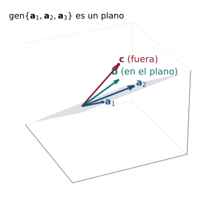

## Objetivos de la clase

- Escribir un sistema lineal en **forma matricial** $A\mathbf x = \mathbf b$ y en **forma vectorial**.
- Caracterizar la consistencia: $A\mathbf x=\mathbf b$ tiene solución $\iff$ $\mathbf b$ es **combinación lineal** de las columnas de $A$.
- Multiplicar matrices **particionadas en bloques**.
- Usar la notación matricial para razonar y demostrar.

## Tres formas de escribir el mismo sistema

$$
\begin{aligned}
2x_1 + 3x_2 - x_3 &= 1\\
x_1 - 2x_2 + 4x_3 &= 5
\end{aligned}
$$

. . .

::: {.columns}
::: {.column width="50%"}
**Forma matricial** $A\mathbf x=\mathbf b$:
$$
\underbrace{\begin{pmatrix}2&3&-1\\1&-2&4\end{pmatrix}}_{A}
\underbrace{\begin{pmatrix}x_1\\x_2\\x_3\end{pmatrix}}_{\mathbf x}
=\underbrace{\begin{pmatrix}1\\5\end{pmatrix}}_{\mathbf b}
$$
:::
::: {.column width="50%"}
**Forma vectorial** (combinación de columnas):
$$
x_1\begin{pmatrix}2\\1\end{pmatrix}+x_2\begin{pmatrix}3\\-2\end{pmatrix}+x_3\begin{pmatrix}-1\\4\end{pmatrix}=\begin{pmatrix}1\\5\end{pmatrix}
$$
:::
:::

. . .

Las tres formas (ecuaciones, matricial y vectorial) tienen **exactamente las mismas soluciones**. La forma vectorial pregunta: *¿con qué pesos combino las columnas de $A$ para obtener $\mathbf b$?*

## Consistencia y combinaciones lineales

::: {.teorema}
El sistema $A\mathbf x = \mathbf b$ es consistente si y solo si $\mathbf b$ es una combinación lineal de las columnas de $A$.
:::

. . .

::: {.demo}
Sea $A=(\mathbf a_1\,\cdots\,\mathbf a_n)$. Por la clase 4, $A\mathbf x = x_1\mathbf a_1+\cdots+x_n\mathbf a_n$ para cualquier $\mathbf x$.

($\Rightarrow$) Si $\mathbf s$ es solución, $\mathbf b = A\mathbf s = s_1\mathbf a_1 + \cdots + s_n\mathbf a_n$: $\mathbf b$ es combinación lineal de las columnas.

($\Leftarrow$) Si $\mathbf b = c_1\mathbf a_1 + \cdots + c_n\mathbf a_n$, el vector $\mathbf c = (c_1,\dots,c_n)^T$ cumple $A\mathbf c = \mathbf b$.
:::

## Ejemplo resuelto: ¿es $\mathbf b$ combinación de las columnas?

::: {.ejemplo}
¿Es $\mathbf b=\begin{pmatrix}1\\4\\3\end{pmatrix}$ combinación lineal de $\mathbf a_1=\begin{pmatrix}1\\2\\1\end{pmatrix}$, $\mathbf a_2=\begin{pmatrix}2\\5\\3\end{pmatrix}$, $\mathbf a_3=\begin{pmatrix}-1\\1\\2\end{pmatrix}$?
:::

. . .

Planteamos $x_1\mathbf a_1 + x_2\mathbf a_2 + x_3\mathbf a_3 = \mathbf b$ y reducimos:
$$
\left(\begin{array}{ccc|c}1&2&-1&1\\2&5&1&4\\1&3&2&3\end{array}\right)
\xrightarrow[F_3\to F_3-F_1]{F_2\to F_2-2F_1}
\left(\begin{array}{ccc|c}1&2&-1&1\\0&1&3&2\\0&1&3&2\end{array}\right)
\xrightarrow[F_1\to F_1-2F_2]{F_3\to F_3-F_2}
\left(\begin{array}{ccc|c}1&0&-7&-3\\0&1&3&2\\0&0&0&0\end{array}\right)
$$

. . .

Es consistente, con infinitas soluciones: $x_1 = -3 + 7t$, $x_2 = 2 - 3t$, $x_3 = t$. Con $t = 0$:
$$
\mathbf b = -3\,\mathbf a_1 + 2\,\mathbf a_2 \qquad\text{(compruebe: } (-3+4,\,-6+10,\,-3+6) = (1,4,3)\ ✓).
$$

## Ejemplo: un vector que **no** es combinación

::: {.ejemplo}
Con las mismas columnas, ¿es $\mathbf c=\begin{pmatrix}1\\4\\4\end{pmatrix}$ combinación lineal de $\mathbf a_1,\mathbf a_2,\mathbf a_3$?
:::

. . .

Las mismas operaciones producen
$$
\left(\begin{array}{ccc|c}1&2&-1&1\\2&5&1&4\\1&3&2&4\end{array}\right)
\sim
\left(\begin{array}{ccc|c}1&0&-7&-3\\0&1&3&2\\0&0&0&1\end{array}\right).
$$

. . .

La última fila es $0=1$: **no** es combinación lineal. Las tres columnas están en un mismo plano de $\mathbb R^3$ (porque $\mathbf a_3 = -7\mathbf a_1 + 3\mathbf a_2$), y $\mathbf c$ está fuera de ese plano.

. . .

::: {.obs}
Reducir $(A\mid\mathbf b)$ responde a la vez **si** hay combinación y **cuáles** son los coeficientes.
:::

## Interpretación geométrica

{fig-align="center" width="46%"}

Las columnas $\mathbf a_1,\mathbf a_2,\mathbf a_3$ generan un **plano**. $A\mathbf x=\mathbf b$ tiene solución porque $\mathbf b$ está en ese plano; $A\mathbf x=\mathbf c$ no, porque $\mathbf c$ está fuera.

## Partición de matrices en bloques

::: {.definicion}
**Particionar** una matriz es dividirla con líneas horizontales y verticales en submatrices (bloques):
$$
A=\left(\begin{array}{cc|cc}a_{11}&a_{12}&a_{13}&a_{14}\\a_{21}&a_{22}&a_{23}&a_{24}\\\hline a_{31}&a_{32}&a_{33}&a_{34}\end{array}\right)=\begin{pmatrix}A_{11}&A_{12}\\A_{21}&A_{22}\end{pmatrix}.
$$
:::

. . .

::: {.teorema data-t="Multiplicación por bloques"}
Si las particiones son compatibles (las columnas de $A$ se dividen igual que los renglones de $B$), entonces
$$
\begin{pmatrix}A_{11}&A_{12}\\A_{21}&A_{22}\end{pmatrix}\begin{pmatrix}B_{11}&B_{12}\\B_{21}&B_{22}\end{pmatrix}
=\begin{pmatrix}A_{11}B_{11}+A_{12}B_{21}&A_{11}B_{12}+A_{12}B_{22}\\A_{21}B_{11}+A_{22}B_{21}&A_{21}B_{12}+A_{22}B_{22}\end{pmatrix}.
$$
Se multiplica "como si los bloques fueran números", **respetando el orden** de los factores.
:::

## Ejemplo resuelto: producto por bloques

::: {.ejemplo}
Calcule $\;\left(\begin{array}{cc|cc}1&0&0&0\\0&1&0&0\\\hline0&0&a&b\\0&0&c&d\end{array}\right)\left(\begin{array}{cc|cc}e&f&0&0\\g&h&0&0\\\hline0&0&1&0\\0&0&0&1\end{array}\right)$ usando bloques.
:::

. . .

Los bloques son $\begin{pmatrix}I&O\\O&M\end{pmatrix}\begin{pmatrix}N&O\\O&I\end{pmatrix}$ con $M=\begin{pmatrix}a&b\\c&d\end{pmatrix}$, $N=\begin{pmatrix}e&f\\g&h\end{pmatrix}$:
$$
\begin{pmatrix}IN + OO & IO + OI\\ ON + MO & OO + MI\end{pmatrix} = \begin{pmatrix}N & O\\ O & M\end{pmatrix}
=\left(\begin{array}{cc|cc}e&f&0&0\\g&h&0&0\\\hline0&0&a&b\\0&0&c&d\end{array}\right).
$$

. . .

Con bloques el cálculo se hace **sin multiplicar 16 productos punto**. Esta técnica se usa para matrices grandes y en computación.

## Ejemplo resuelto: bloques numéricos

::: {.ejemplo}
Sea $A=\left(\begin{array}{cc|c}1&2&0\\3&4&0\\\hline0&0&5\end{array}\right)$. Calcule $A^2$ por bloques.
:::

. . .

$A = \begin{pmatrix}P&\mathbf 0\\\mathbf 0^T&5\end{pmatrix}$ con $P=\begin{pmatrix}1&2\\3&4\end{pmatrix}$. Entonces
$$
A^2=\begin{pmatrix}P^2&\mathbf 0\\\mathbf 0^T&25\end{pmatrix},\qquad P^2=\begin{pmatrix}7&10\\15&22\end{pmatrix}
\quad\Longrightarrow\quad
A^2=\left(\begin{array}{cc|c}7&10&0\\15&22&0\\\hline0&0&25\end{array}\right).
$$

. . .

::: {.obs data-t="Matrices diagonales por bloques"}
Si $A = \operatorname{diag}(A_1,\dots,A_k)$ por bloques, entonces $A^p = \operatorname{diag}(A_1^p,\dots,A_k^p)$.
:::

## Ejemplo resuelto: combinación lineal con parámetro

::: {.ejemplo}
¿Para qué valor de $h$ el vector $(4,3,h)$ es combinación lineal de $(1,0,2)$ y $(2,1,5)$? Halle los coeficientes.
:::

. . .

$$
\left(\begin{array}{cc|c}1&2&4\\0&1&3\\2&5&h\end{array}\right)
\xrightarrow{F_3\to F_3-2F_1}
\left(\begin{array}{cc|c}1&2&4\\0&1&3\\0&1&h-8\end{array}\right)
\xrightarrow{F_3\to F_3-F_2}
\left(\begin{array}{cc|c}1&2&4\\0&1&3\\0&0&h-11\end{array}\right).
$$

. . .

Es consistente **solo si $h=11$**. Entonces $y=3$, $x=4-2(3)=-2$:
$$
(4,3,11)=-2(1,0,2)+3(2,1,5).\ ✓
$$

## Práctica en clase

::: {.ejercicio data-t="1"}
Escriba el sistema $\;2x_1-x_2=5,\;\;x_1+3x_2=-1\;$ en forma vectorial y dibuje (mentalmente) la combinación de columnas que da $\mathbf b$.
:::

::: {.solucion .fragment}
$x_1(2,1)+x_2(-1,3)=(5,-1)$. La solución es $x_1=2$, $x_2=-1$: $2(2,1)-(-1,3)=(5,-1)$ ✓.
:::

::: {.ejercicio data-t="2"}
¿Generan las columnas de $\begin{pmatrix}1&2\\2&4\end{pmatrix}$ todo $\mathbb R^2$? Dé un $\mathbf b$ para el cual $A\mathbf x=\mathbf b$ no tiene solución.
:::

::: {.solucion .fragment}
No: la segunda columna es el doble de la primera, generan solo la recta $y=2x$. Por ejemplo $\mathbf b=(1,0)$ no tiene solución.
:::

## Ejercicios propuestos

::: {.ejercicio data-t="1"}
Escriba en forma matricial y vectorial: $\;x - y + 2z = 4,\quad 3x + z = -1,\quad -x + 4y - z = 2.$
:::

::: {.solucion .fragment}
$\begin{pmatrix}1&-1&2\\3&0&1\\-1&4&-1\end{pmatrix}\begin{pmatrix}x\\y\\z\end{pmatrix}=\begin{pmatrix}4\\-1\\2\end{pmatrix}$ y $\;x\begin{pmatrix}1\\3\\-1\end{pmatrix}+y\begin{pmatrix}-1\\0\\4\end{pmatrix}+z\begin{pmatrix}2\\1\\-1\end{pmatrix}=\begin{pmatrix}4\\-1\\2\end{pmatrix}$.
:::

## Ejercicios propuestos

::: {.ejercicio data-t="2"}
Determine si $(3,1,5)$ es combinación lineal de $(1,0,1)$ y $(1,1,3)$.
:::

::: {.solucion .fragment}
$\left(\begin{array}{cc|c}1&1&3\\0&1&1\\1&3&5\end{array}\right)\sim\left(\begin{array}{cc|c}1&0&2\\0&1&1\\0&0&0\end{array}\right)$: **sí**, $(3,1,5)=2(1,0,1)+1(1,1,3)$.
:::

## Ejercicios propuestos

::: {.ejercicio data-t="3 · Demostración"}
Sean $\mathbf x_1$ y $\mathbf x_2$ soluciones de $A\mathbf x=\mathbf b$. Demuestre que $\tfrac12(\mathbf x_1+\mathbf x_2)$ también es solución. ¿Qué combinaciones $\alpha\mathbf x_1+\beta\mathbf x_2$ son soluciones?
:::

::: {.solucion .fragment}
$A(\alpha\mathbf x_1+\beta\mathbf x_2) = \alpha A\mathbf x_1 + \beta A\mathbf x_2 = (\alpha+\beta)\mathbf b$. Si $\mathbf b\neq\mathbf 0$, es solución exactamente cuando $\alpha+\beta = 1$ (por ejemplo $\alpha=\beta=\tfrac12$). Si $\mathbf b=\mathbf 0$, toda combinación lo es.
:::

## Ejercicios propuestos

::: {.ejercicio data-t="4"}
Sean $A=\begin{pmatrix}I_2&B\\O&I_2\end{pmatrix}$ con $B$ una matriz $2\times2$. Muestre por bloques que $A^n=\begin{pmatrix}I_2&nB\\O&I_2\end{pmatrix}$.
:::

::: {.solucion .fragment}
Por inducción: $A^{k+1}=A^kA=\begin{pmatrix}I&kB\\O&I\end{pmatrix}\begin{pmatrix}I&B\\O&I\end{pmatrix}=\begin{pmatrix}I&B+kB\\O&I\end{pmatrix}=\begin{pmatrix}I&(k+1)B\\O&I\end{pmatrix}$.
:::

## Ejercicios del texto guía {.texto-guia}

Grossman y Flores, *Álgebra lineal*, 8.ª ed.:

| Sección | Ejercicios |
|---|---|
| 2.3 Matrices y sistemas de ecuaciones lineales | 5, 7, 8, 13, 16, 19, 20, 21, 25, 28 |

. . .

::: {.obs data-t="Evaluación"}
Hasta aquí llega la **Evaluación intermedia del primer tercio** (secciones 1.1 a 2.3).
:::

## Resumen

- Sistema $\iff$ $A\mathbf x = \mathbf b$ $\iff$ $x_1\mathbf a_1+\cdots+x_n\mathbf a_n=\mathbf b$.
- $A\mathbf x=\mathbf b$ es consistente $\iff$ $\mathbf b$ es combinación lineal de las columnas de $A$.
- El producto por bloques funciona como el producto usual, respetando el orden.

 

[← Clase 4](clase_04.qmd) · [Programa del curso](../algebra_lineal.qmd) · [Clase 6: Inversa de una matriz →](clase_06.qmd)
