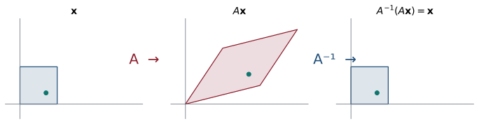

## Objetivos de la clase

- Definir la **inversa** de una matriz cuadrada y demostrar que es **única**.
- Calcular inversas $2\times 2$ con fórmula y $n\times n$ con el método $(A\mid I)\sim(I\mid A^{-1})$.
- Demostrar las propiedades $(AB)^{-1}=B^{-1}A^{-1}$, $(A^{-1})^{-1}=A$, $(kA)^{-1}=k^{-1}A^{-1}$.
- Resolver sistemas y ecuaciones matriciales usando la inversa.
- Conocer el **teorema de la matriz invertible** (primera versión).

## Ruta de la clase (70 min)

| Tiempo | Actividad |
|:---:|---|
| 0 – 5 | Repaso: producto de matrices; ¿se puede “dividir” entre matrices? |
| 5 – 20 | Definición, unicidad e interpretación geométrica; fórmula $2\times2$ |
| 20 – 40 | Método de Gauss-Jordan $(A\mid I)\sim(I\mid A^{-1})$: ejemplos |
| 40 – 55 | Propiedades, sistemas y ecuaciones matriciales; aplicación a criptografía |
| 55 – 70 | Teorema de la matriz invertible y práctica en clase |

## Definición

::: {.definicion}
Una matriz cuadrada $A$ de tamaño $n\times n$ es **invertible** (o **no singular**) si existe $B$ de tamaño $n\times n$ tal que
$$
AB = BA = I_n .
$$
$B$ se llama **inversa** de $A$ y se denota $A^{-1}$. Si no existe, $A$ es **singular**.
:::

. . .

::: {.ejemplo}
$A=\begin{pmatrix}1&2\\-1&5\end{pmatrix}$, $\;B=\dfrac17\begin{pmatrix}5&-2\\1&1\end{pmatrix}$:
$\quad AB=\dfrac17\begin{pmatrix}5+2&-2+2\\-5+5&2+5\end{pmatrix}=I_2$ y también $BA = I_2$. Luego $B = A^{-1}$.
:::

. . .

::: {.obs data-t="Ojo con la notación"}
$A^{-1}$ **no** es $\dfrac1A$: no existe la división entre matrices. Tampoco es la matriz de inversos de las entradas.
:::

## Interpretación geométrica

{fig-align="center" width="92%"}

Si $A$ transforma cada vector $\mathbf x$ en $A\mathbf x$, la inversa **deshace** esa transformación: $A^{-1}(A\mathbf x)=\mathbf x$. Una matriz que "aplasta" el plano en una recta no se puede deshacer: es **singular**.

## La inversa es única

::: {.teorema}
Si $A$ es invertible, su inversa es única.
:::

. . .

::: {.demo}
Supongamos que $B$ y $C$ cumplen $AB = BA = I$ y $AC = CA = I$. Entonces
$$
B = BI = B(AC) = (BA)C = IC = C.
$$
Se usaron: neutro de la identidad, hipótesis sobre $C$, **asociatividad** del producto, hipótesis sobre $B$ y neutro.
:::

. . .

::: {.obs}
Se puede demostrar que para matrices cuadradas basta verificar **una** de las igualdades: si $AB = I$ entonces automáticamente $BA = I$.
:::

## Inversa de una matriz $2\times 2$

::: {.teorema}
Sea $A=\begin{pmatrix}a&b\\c&d\end{pmatrix}$ y $\det A = ad - bc$. $A$ es invertible si y solo si $\det A\neq 0$, y en ese caso
$$
A^{-1}=\frac{1}{ad-bc}\begin{pmatrix}d&-b\\-c&a\end{pmatrix}.
$$
:::

. . .

::: {.demo data-t="Parte ⇐"}
Si $ad-bc\neq0$, multiplicamos directamente:
$$
\begin{pmatrix}a&b\\c&d\end{pmatrix}\begin{pmatrix}d&-b\\-c&a\end{pmatrix}=\begin{pmatrix}ad-bc&-ab+ab\\cd-cd&-bc+ad\end{pmatrix}=(ad-bc)\,I_2 ,
$$
así que dividiendo por $ad-bc$ se obtiene $I_2$ (y análogamente en el otro orden). La parte $\Rightarrow$ se verá con determinantes (clase 10).
:::

. . .

**Regla práctica:** intercambie la diagonal, cambie el signo de la otra diagonal y divida por $ad-bc$.

## Método de Gauss-Jordan: $(A\mid I)\sim(I\mid A^{-1})$

::: {.definicion data-t="Procedimiento"}
1. Escriba la matriz aumentada $(A\mid I_n)$.
2. Reduzca por filas hasta la forma escalonada reducida.
3. Si a la izquierda se obtiene $I_n$, a la derecha queda $A^{-1}$.
4. Si a la izquierda aparece un renglón de ceros, $A$ **no es invertible**.
:::

. . .

::: {.obs data-t="¿Por qué funciona?"}
Buscar $X$ con $AX = I$ es resolver $n$ sistemas $A\mathbf x_j = \mathbf e_j$ (uno por cada columna de $I$), todos con la **misma** matriz $A$. Reducir $(A\mid I)$ resuelve los $n$ sistemas al mismo tiempo.
:::

## Ejemplo resuelto: inversa $2\times 2$ por tres caminos

::: {.ejemplo}
Halle la inversa de $A=\begin{pmatrix}1&2\\-2&-1\end{pmatrix}$.
:::

. . .

**Fórmula:** $\det A = (1)(-1) - (2)(-2) = 3$, luego $A^{-1}=\dfrac13\begin{pmatrix}-1&-2\\2&1\end{pmatrix}$.

. . .

**Gauss-Jordan:**
$$
\left(\begin{array}{cc|cc}1&2&1&0\\-2&-1&0&1\end{array}\right)
\xrightarrow{F_2\to F_2+2F_1}
\left(\begin{array}{cc|cc}1&2&1&0\\0&3&2&1\end{array}\right)
\xrightarrow{F_2\to\frac13F_2}
\left(\begin{array}{cc|cc}1&2&1&0\\0&1&\frac23&\frac13\end{array}\right)
\xrightarrow{F_1\to F_1-2F_2}
\left(\begin{array}{cc|cc}1&0&-\frac13&-\frac23\\0&1&\frac23&\frac13\end{array}\right)
$$

. . .

**Definición:** resolver $\begin{pmatrix}1&2\\-2&-1\end{pmatrix}\begin{pmatrix}a&b\\c&d\end{pmatrix}=I$ da $a+2c=1$, $-2a-c=0$, $b+2d=0$, $-2b-d=1$, con solución $a=-\tfrac13$, $b=-\tfrac23$, $c=\tfrac23$, $d=\tfrac13$. Los tres caminos coinciden.

## Ejemplo resuelto: inversa $3\times 3$

::: {.ejemplo}
Halle la inversa de $G=\begin{pmatrix}2&1&0\\1&1&1\\0&1&3\end{pmatrix}$.
:::

. . .

$$
\left(\begin{array}{ccc|ccc}2&1&0&1&0&0\\1&1&1&0&1&0\\0&1&3&0&0&1\end{array}\right)
\xrightarrow{F_1\leftrightarrow F_2}
\left(\begin{array}{ccc|ccc}1&1&1&0&1&0\\2&1&0&1&0&0\\0&1&3&0&0&1\end{array}\right)
\xrightarrow{F_2\to -(F_2-2F_1)}
\left(\begin{array}{ccc|ccc}1&1&1&0&1&0\\0&1&2&-1&2&0\\0&1&3&0&0&1\end{array}\right)
$$

. . .

$$
\xrightarrow[F_3\to F_3-F_2]{F_1\to F_1-F_2}
\left(\begin{array}{ccc|ccc}1&0&-1&1&-1&0\\0&1&2&-1&2&0\\0&0&1&1&-2&1\end{array}\right)
\xrightarrow[F_2\to F_2-2F_3]{F_1\to F_1+F_3}
\left(\begin{array}{ccc|ccc}1&0&0&2&-3&1\\0&1&0&-3&6&-2\\0&0&1&1&-2&1\end{array}\right)
$$

. . .

$$
G^{-1}=\begin{pmatrix}2&-3&1\\-3&6&-2\\1&-2&1\end{pmatrix}.\qquad\text{Verifique: } GG^{-1}=I_3.
$$

## Ejemplo: una matriz singular

::: {.ejemplo}
¿Es invertible $L=\begin{pmatrix}1&1&2\\2&3&5\\1&2&3\end{pmatrix}$?
:::

. . .

$$
\left(\begin{array}{ccc|ccc}1&1&2&1&0&0\\2&3&5&0&1&0\\1&2&3&0&0&1\end{array}\right)
\xrightarrow[F_3\to F_3-F_1]{F_2\to F_2-2F_1}
\left(\begin{array}{ccc|ccc}1&1&2&1&0&0\\0&1&1&-2&1&0\\0&1&1&-1&0&1\end{array}\right)
\xrightarrow{F_3\to F_3-F_2}
\left(\begin{array}{ccc|ccc}1&1&2&1&0&0\\0&1&1&-2&1&0\\0&0&0&1&-1&1\end{array}\right)
$$

. . .

Aparece un renglón de ceros a la izquierda: **$L$ no es invertible**. Note que la columna 3 es la suma de las columnas 1 y 2.

## Propiedades de la inversa

::: {.teorema}
Si $A$ y $B$ son invertibles $n\times n$ y $k\neq 0$:

1. $A^{-1}$ es invertible y $(A^{-1})^{-1} = A$.
2. $AB$ es invertible y $(AB)^{-1} = B^{-1}A^{-1}$ (¡orden inverso!).
3. $kA$ es invertible y $(kA)^{-1} = \tfrac1k A^{-1}$.
4. $A^p$ es invertible y $(A^p)^{-1} = (A^{-1})^p$.
:::

. . .

::: {.demo data-t="2"}
Basta verificar que $B^{-1}A^{-1}$ cumple la definición de inversa de $AB$:
$$
(AB)(B^{-1}A^{-1}) = A(BB^{-1})A^{-1} = AIA^{-1} = AA^{-1} = I,
$$
$$
(B^{-1}A^{-1})(AB) = B^{-1}(A^{-1}A)B = B^{-1}IB = B^{-1}B = I.
$$
Por la unicidad de la inversa, $(AB)^{-1}=B^{-1}A^{-1}$.
:::

## Demostraciones de 1 y 3

::: {.demo data-t="1"}
$A^{-1}A = AA^{-1} = I$ dice precisamente que $A$ es la inversa de $A^{-1}$. Por unicidad, $(A^{-1})^{-1} = A$.
:::

. . .

::: {.demo data-t="3"}
$$
(kA)\left(\tfrac1k A^{-1}\right) = \left(k\cdot\tfrac1k\right)(AA^{-1}) = 1\cdot I = I,
$$
y del mismo modo en el otro orden. Se usó la propiedad $r(AB)=(rA)B=A(rB)$ del producto.
:::

. . .

::: {.obs data-t="Generalización"}
Por inducción, $(A_1A_2\cdots A_k)^{-1} = A_k^{-1}\cdots A_2^{-1}A_1^{-1}$. Pero en general $(A+B)^{-1}\neq A^{-1}+B^{-1}$.
:::

## Resolver sistemas con la inversa

::: {.teorema}
Si $A$ es invertible, el sistema $A\mathbf x=\mathbf b$ tiene **solución única** $\;\mathbf x = A^{-1}\mathbf b$.
:::

. . .

::: {.demo}
**Existe:** $A(A^{-1}\mathbf b) = (AA^{-1})\mathbf b = \mathbf b$. **Es única:** si $A\mathbf x = \mathbf b$, multiplicando por $A^{-1}$ a la izquierda, $\mathbf x = A^{-1}A\mathbf x = A^{-1}\mathbf b$.
:::

. . .

::: {.ejemplo}
Resuelva $\;x + 2y = 1,\quad 3x + 7y = 4$. $\quad A=\begin{pmatrix}1&2\\3&7\end{pmatrix}$, $\det A = 1$, $A^{-1}=\begin{pmatrix}7&-2\\-3&1\end{pmatrix}$:
$$
\begin{pmatrix}x\\y\end{pmatrix}=\begin{pmatrix}7&-2\\-3&1\end{pmatrix}\begin{pmatrix}1\\4\end{pmatrix}=\begin{pmatrix}-1\\1\end{pmatrix}.
$$
:::

## Teorema de la matriz invertible (versión 1)

::: {.teorema}
Para una matriz $A$ de tamaño $n\times n$, las siguientes afirmaciones son **equivalentes**:

1. $A$ es invertible.
2. El sistema homogéneo $A\mathbf x = \mathbf 0$ tiene solo la solución trivial.
3. $A$ es equivalente por filas a $I_n$.
4. El sistema $A\mathbf x = \mathbf b$ tiene solución única para cada $\mathbf b\in\mathbb R^n$.
:::

. . .

::: {.demo data-t="Idea de 1 ⇒ 2 ⇒ 3 ⇒ 1"}
(1⇒2) Si $A\mathbf x=\mathbf 0$, entonces $\mathbf x = A^{-1}\mathbf 0 = \mathbf 0$.
(2⇒3) Si solo hay solución trivial, no hay variables libres: hay $n$ pivotes en $n$ columnas, luego la forma reducida es $I_n$.
(3⇒1) Si $A\sim I_n$, la reducción de $(A\mid I)$ termina en $(I\mid X)$ y $AX = I$.
:::

. . .

En la clase 10 añadiremos: **5.** $\det A\neq 0$.

## Ecuaciones matriciales: el orden importa

::: {.ejemplo}
Sean $A=\begin{pmatrix}1&2\\3&7\end{pmatrix}$ y $B=\begin{pmatrix}2&1\\1&1\end{pmatrix}$. Halle $X$ tal que $AXB=I$.
:::

. . .

Multiplicamos por $A^{-1}$ a la **izquierda** y por $B^{-1}$ a la **derecha**:
$$
A^{-1}(AXB)B^{-1}=A^{-1}IB^{-1}\;\Longrightarrow\;X=A^{-1}B^{-1}.
$$

. . .

Con $\det A=1$ y $\det B=1$: $\;A^{-1}=\begin{pmatrix}7&-2\\-3&1\end{pmatrix}$, $\;B^{-1}=\begin{pmatrix}1&-1\\-1&2\end{pmatrix}$:
$$
X=\begin{pmatrix}7&-2\\-3&1\end{pmatrix}\begin{pmatrix}1&-1\\-1&2\end{pmatrix}=\begin{pmatrix}9&-11\\-4&5\end{pmatrix}.
$$

. . .

::: {.obs data-t="Error frecuente"}
Escribir $X=B^{-1}A^{-1}$ o $X=\dfrac{I}{AB}$ es incorrecto. No existe la división de matrices: se multiplica por la inversa **del lado correspondiente**.
:::

## Aplicación: mensajes cifrados

::: {.ejemplo}
Cifre la palabra **HOLA** con la matriz $A=\begin{pmatrix}1&2\\3&7\end{pmatrix}$, usando A=1, B=2, …, H=8, L=12, O=15. Luego descífrela.
:::

. . .

**Cifrar:** HOLA $\to(8,15),(12,1)$.
$$
A\begin{pmatrix}8\\15\end{pmatrix}=\begin{pmatrix}38\\129\end{pmatrix},\qquad A\begin{pmatrix}12\\1\end{pmatrix}=\begin{pmatrix}14\\43\end{pmatrix}.
$$
Mensaje enviado: $38,\,129,\,14,\,43$.

. . .

**Descifrar:** con $A^{-1}=\begin{pmatrix}7&-2\\-3&1\end{pmatrix}$:
$$
A^{-1}\begin{pmatrix}38\\129\end{pmatrix}=\begin{pmatrix}266-258\\-114+129\end{pmatrix}=\begin{pmatrix}8\\15\end{pmatrix},\qquad
A^{-1}\begin{pmatrix}14\\43\end{pmatrix}=\begin{pmatrix}98-86\\-42+43\end{pmatrix}=\begin{pmatrix}12\\1\end{pmatrix}.
$$
Se recupera HOLA. Sin conocer $A^{-1}$ es difícil descifrar el mensaje.

## Ejercicios propuestos

::: {.ejercicio data-t="1"}
Use Gauss-Jordan para hallar, si existe, la inversa de $D=\begin{pmatrix}1&2&1\\0&1&-1\\2&3&0\end{pmatrix}$.
:::

::: {.solucion .fragment}
$(D\mid I)\sim(I\mid D^{-1})$ con $\;D^{-1}=\begin{pmatrix}-1&-1&1\\[2pt]\tfrac23&\tfrac23&-\tfrac13\\[2pt]\tfrac23&-\tfrac13&-\tfrac13\end{pmatrix}$. Compruebe que $DD^{-1}=I_3$.
:::

## Ejercicios propuestos

::: {.ejercicio data-t="2"}
Sean $A=\begin{pmatrix}2&1\\1&1\end{pmatrix}$, $B=\begin{pmatrix}1&0\\0&2\end{pmatrix}$, $C=\begin{pmatrix}4&2\\4&6\end{pmatrix}$. Halle $X$ tal que $AX + BX = C$.
:::

::: {.solucion .fragment}
$(A+B)X = C$ (distributiva), con $A+B=\begin{pmatrix}3&1\\1&3\end{pmatrix}$, $\det = 8$. Entonces $X=(A+B)^{-1}C=\dfrac18\begin{pmatrix}3&-1\\-1&3\end{pmatrix}\begin{pmatrix}4&2\\4&6\end{pmatrix}=\begin{pmatrix}1&0\\1&2\end{pmatrix}$. **Ojo:** $X$ va a la **derecha**, así que $(A+B)^{-1}$ multiplica por la **izquierda**.
:::

## Ejercicios propuestos

::: {.ejercicio data-t="3 · Demostración"}
Demuestre que si $A$ es invertible y $AB = AC$, entonces $B = C$. ¿Por qué esto no contradice la clase 4?
:::

::: {.solucion .fragment}
Multiplicando por $A^{-1}$ a la izquierda: $A^{-1}(AB) = A^{-1}(AC) \Rightarrow (A^{-1}A)B = (A^{-1}A)C \Rightarrow B = C$. En la clase 4 la matriz $\begin{pmatrix}1&2\\2&4\end{pmatrix}$ era **singular**: la cancelación solo vale con matrices invertibles.
:::

## Ejercicios propuestos

::: {.ejercicio data-t="4 · Demostración"}
Demuestre que si $A^2 = O$ entonces $I - A$ es invertible con $(I-A)^{-1} = I + A$.
:::

::: {.solucion .fragment}
$(I-A)(I+A) = I + A - A - A^2 = I - O = I$, y $(I+A)(I-A) = I - A + A - A^2 = I$. Por definición, $I+A$ es la inversa de $I-A$.
:::

## Ejercicios del texto guía {.texto-guia}

Grossman y Flores, *Álgebra lineal*, 8.ª ed.:

| Sección | Ejercicios |
|---|---|
| 2.4 Inversa de una matriz cuadrada | 2, 5, 10, 13, 26, 31, 32, 34, 36, 44, 45, 61 |

## Resumen

- $A^{-1}$ existe solo para matrices cuadradas y es **única**.
- $2\times2$: $\;A^{-1}=\frac{1}{ad-bc}\begin{pmatrix}d&-b\\-c&a\end{pmatrix}$ si $ad-bc\neq0$.
- $n\times n$: $(A\mid I)\sim(I\mid A^{-1})$; un renglón nulo a la izquierda indica que $A$ es singular.
- $(AB)^{-1}=B^{-1}A^{-1}$; $\;A\mathbf x=\mathbf b \Rightarrow \mathbf x=A^{-1}\mathbf b$.

 

[← Clase 5](clase_05.qmd) · [Programa del curso](../algebra_lineal.qmd) · [Clase 7: Transpuesta →](clase_07.qmd)
