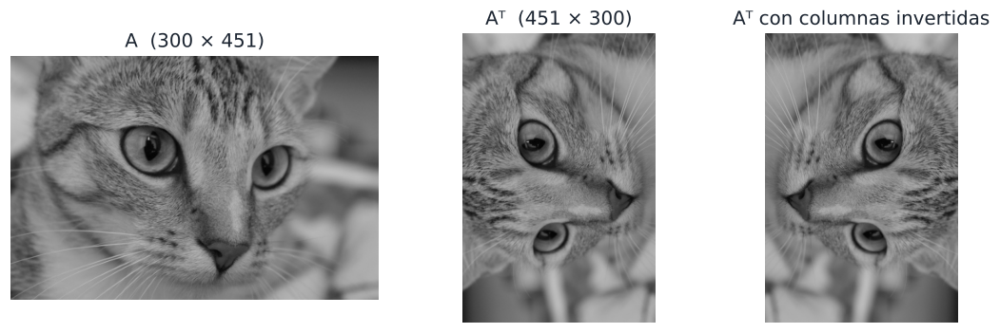
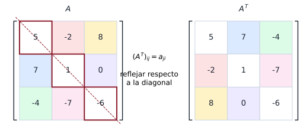

## En la vida diaria: girar una foto {.nostretch}

::: {.aplicacion data-t="Para empezar"}
Cuando gira una foto en el celular, una foto horizontal queda vertical. ¿Qué le pasa a la tabla de números que la representa?
:::

{fig-align="center" height="230px"}

Las filas de la tabla se convierten en columnas: eso es la **transpuesta**. También aparece en tablas que son iguales leídas por filas o por columnas, como una tabla de distancias entre ciudades.

**En esta clase:** aprenderá a transponer matrices, sus propiedades y qué son las matrices simétricas.

## Objetivos de la clase

- Calcular la **transpuesta** de una matriz.
- Demostrar sus propiedades, en particular $(AB)^T = B^TA^T$.
- Reconocer matrices **simétricas** y **antisimétricas**.
- Descomponer una matriz cuadrada como suma de una simétrica y una antisimétrica.
- Repasar la unidad 2 con ejercicios de **verdadero o falso** con justificación.

## Definición

::: {.definicion}
La **transpuesta** de $A=(a_{ij})$ de tamaño $m\times n$ es la matriz $A^T$ de tamaño $n\times m$ que se obtiene intercambiando renglones por columnas:
$$
(A^T)_{ij} = a_{ji}.
$$
:::

::: {.palabras}
Transponer es **convertir las filas en columnas**: la primera fila pasa a ser la primera columna, la segunda fila la segunda columna, y así sucesivamente. Una matriz de $2\times3$ se vuelve de $3\times2$.
:::

## Definición (continuación)

::: {.ejemplo}
$$
A=\begin{pmatrix}5&-2&8\\7&1&0\\-4&-7&-6\end{pmatrix}\Rightarrow A^T=\begin{pmatrix}5&7&-4\\-2&1&-7\\8&0&-6\end{pmatrix},
\qquad
B=\begin{pmatrix}1&0&-5&6\\2&8&4&-9\end{pmatrix}\Rightarrow B^T=\begin{pmatrix}1&2\\0&8\\-5&4\\6&-9\end{pmatrix}.
$$
:::

. . .

El renglón $i$ de $A$ se convierte en la columna $i$ de $A^T$. En particular, un vector columna transpuesto es un vector renglón, y
$$
\mathbf u\cdot\mathbf v = \mathbf u^T\mathbf v \quad(\mathbf u,\mathbf v \text{ columnas}).
$$

## Transponer es reflejar respecto a la diagonal

{fig-align="center" width="78%"}

La diagonal principal **no cambia**; cada entrada $a_{ij}$ se intercambia con $a_{ji}$ (mismo color). Los renglones de $A$ pasan a ser las columnas de $A^T$.

## Propiedades de la transpuesta

::: {.teorema}
Si los tamaños son compatibles y $r\in\mathbb R$:

a) $(A^T)^T = A$
b) $(A+B)^T = A^T + B^T$
c) $(rA)^T = r\,A^T$
d) $(AB)^T = B^TA^T$ (¡orden inverso!)
e) Si $A$ es invertible, $A^T$ también lo es y $(A^T)^{-1} = (A^{-1})^T$.
:::

. . .

::: {.demo data-t="a), b) y c)"}
$\big((A^T)^T\big)_{ij} = (A^T)_{ji} = a_{ij}$. $\quad\big((A+B)^T\big)_{ij} = (A+B)_{ji} = a_{ji}+b_{ji} = (A^T)_{ij} + (B^T)_{ij}$. $\quad\big((rA)^T\big)_{ij} = r\,a_{ji} = r(A^T)_{ij}$.
:::

## Demostración de $(AB)^T = B^TA^T$

Sea $A$ de tamaño $m\times n$ y $B$ de tamaño $n\times p$. Ambos lados son $p\times m$.

. . .

::: {.demo}
Comparamos la entrada $(i,j)$:
$$
\big((AB)^T\big)_{ij} = (AB)_{ji} = \sum_{k=1}^n a_{jk}\,b_{ki}.
$$
Por otra parte,
$$
(B^TA^T)_{ij} = \sum_{k=1}^n (B^T)_{ik}\,(A^T)_{kj} = \sum_{k=1}^n b_{ki}\,a_{jk}.
$$
Como el producto de números reales es conmutativo, $a_{jk}b_{ki} = b_{ki}a_{jk}$ y las dos sumas son iguales.
:::

. . .

::: {.obs}
$A^TB^T$ en general ni siquiera está definida: si $A$ es $2\times 3$ y $B$ es $3\times 4$, $A^T$ es $3\times 2$ y $B^T$ es $4\times 3$.
:::

## Demostración de $(A^T)^{-1} = (A^{-1})^T$

::: {.demo}
Usamos la propiedad d) y que $I^T = I$:
$$
A^T(A^{-1})^T = (A^{-1}A)^T = I^T = I,\qquad (A^{-1})^TA^T = (AA^{-1})^T = I^T = I.
$$
Luego $(A^{-1})^T$ es la inversa de $A^T$. Por unicidad de la inversa, $(A^T)^{-1} = (A^{-1})^T$.
:::

. . .

::: {.ejemplo}
$A=\begin{pmatrix}1&2\\3&7\end{pmatrix}$, $A^{-1}=\begin{pmatrix}7&-2\\-3&1\end{pmatrix}$. Entonces $(A^T)^{-1}=(A^{-1})^T=\begin{pmatrix}7&-3\\-2&1\end{pmatrix}$.
Compruebe: $\begin{pmatrix}1&3\\2&7\end{pmatrix}\begin{pmatrix}7&-3\\-2&1\end{pmatrix}=\begin{pmatrix}1&0\\0&1\end{pmatrix}$ ✓.
:::

## Matrices simétricas y antisimétricas

::: {.definicion}
Una matriz cuadrada $A$ es **simétrica** si $A^T = A$ ($a_{ij}=a_{ji}$), y **antisimétrica** si $A^T = -A$ ($a_{ij}=-a_{ji}$).
:::

::: {.palabras}
Una matriz es **simétrica** si se ve igual al reflejarla en la diagonal, como en un espejo. Es **antisimétrica** si al reflejarla cada número cambia de signo; por eso su diagonal solo tiene ceros.
:::

. . .

::: {.columns}
::: {.column width="50%"}
**Simétrica** (espejo respecto a la diagonal):
$$
M=\begin{pmatrix}2&4&-8\\4&-3&5\\-8&5&0\end{pmatrix}=M^T
$$
:::
::: {.column width="50%"}
**Antisimétrica** (diagonal de ceros):
$$
K=\begin{pmatrix}0&2&-1\\-2&0&3\\1&-3&0\end{pmatrix},\quad K^T=-K
$$
:::
:::

. . .

::: {.teorema}
a) En una antisimétrica, la diagonal es nula. b) Para toda $A$ (de cualquier tamaño), $A^TA$ y $AA^T$ son simétricas. c) Si $A$ es cuadrada, $A + A^T$ es simétrica y $A - A^T$ es antisimétrica.
:::

## Demostraciones

::: {.demo data-t="a)"}
Si $a_{ii} = -a_{ii}$ entonces $2a_{ii} = 0$, luego $a_{ii} = 0$.
:::

. . .

::: {.demo data-t="b)"}
$(A^TA)^T = A^T(A^T)^T = A^TA$. Análogamente $(AA^T)^T = (A^T)^TA^T = AA^T$.
:::

. . .

::: {.demo data-t="c)"}
$(A+A^T)^T = A^T + (A^T)^T = A^T + A = A + A^T$, y $(A-A^T)^T = A^T - A = -(A - A^T)$.
:::

. . .

::: {.teorema data-t="Descomposición"}
Toda matriz cuadrada se escribe de forma **única** como suma de una simétrica y una antisimétrica:
$$
A = \underbrace{\tfrac12(A + A^T)}_{\text{simétrica}} + \underbrace{\tfrac12(A - A^T)}_{\text{antisimétrica}}.
$$
:::

## Ejemplo resuelto: descomposición

::: {.ejemplo}
Escriba $N=\begin{pmatrix}2&4&-1\\0&3&5\\6&1&2\end{pmatrix}$ como suma de una matriz simétrica y una antisimétrica.
:::

. . .

$$
S=\tfrac12(N+N^T)=\tfrac12\begin{pmatrix}4&4&5\\4&6&6\\5&6&4\end{pmatrix}=\begin{pmatrix}2&2&\tfrac52\\2&3&3\\\tfrac52&3&2\end{pmatrix},
$$

. . .

$$
K=\tfrac12(N-N^T)=\tfrac12\begin{pmatrix}0&4&-7\\-4&0&4\\7&-4&0\end{pmatrix}=\begin{pmatrix}0&2&-\tfrac72\\-2&0&2\\\tfrac72&-2&0\end{pmatrix}.
$$

. . .

Compruebe que $S+K=N$, $S^T = S$ y $K^T = -K$.

## Ejemplo 1 · Fácil: calcular una transpuesta {.compacto}

::: {.ejemplo data-t="Nivel fácil"}
Halle $A^T$ y $(A^T)^T$ para $A=\begin{pmatrix}1&4&-2\\0&3&5\end{pmatrix}$.
:::

. . .

**Paso 1 · Regla.** La **fila $i$** de $A$ se escribe como **columna $i$** de $A^T$. Como $A$ es $2\times3$, $A^T$ será $3\times2$.
$$
A^T=\begin{pmatrix}1&0\\4&3\\-2&5\end{pmatrix}.
$$

. . .

**Paso 2.** Transponer otra vez devuelve las filas a su lugar: $(A^T)^T=A$.

::: {.solucion}
$A^T=\begin{pmatrix}1&0\\4&3\\-2&5\end{pmatrix}$ y $(A^T)^T=A$. Comprobación rápida: la entrada $(1,2)$ de $A$ (que es $4$) aparece en la posición $(2,1)$ de $A^T$ ✓.
:::

## Ejemplo 2 · Medio: comprobar $(AB)^T=B^TA^T$ {.compacto}

::: {.ejemplo data-t="Nivel medio"}
Con $A=\begin{pmatrix}1&2&0\\-1&1&3\end{pmatrix}$ y $B=\begin{pmatrix}2&1\\0&-1\\1&4\end{pmatrix}$, verifique que $(AB)^T=B^TA^T$ y que $A^TB^T$ no sirve.
:::

. . .

**Paso 1.** $\;AB=\begin{pmatrix}2+0+0&1-2+0\\-2+0+3&-1-1+12\end{pmatrix}=\begin{pmatrix}2&-1\\1&10\end{pmatrix}\;\Rightarrow\;(AB)^T=\begin{pmatrix}2&1\\-1&10\end{pmatrix}.$

. . .

**Paso 2.** $\;B^TA^T=\begin{pmatrix}2&0&1\\1&-1&4\end{pmatrix}\begin{pmatrix}1&-1\\2&1\\0&3\end{pmatrix}=\begin{pmatrix}2&1\\-1&10\end{pmatrix}$ ✓.

. . .

**Paso 3 · ¿Y $A^TB^T$?** $A^T$ es $3\times2$ y $B^T$ es $2\times3$: el producto es $3\times3$, ni siquiera del tamaño correcto.

::: {.solucion}
$(AB)^T=B^TA^T$: al transponer un producto, **se invierte el orden**, como al quitarse los zapatos y luego las medias.
:::

## Ejercicios propuestos

::: {.ejercicio data-t="3 · Demostración"}
Demuestre que si $A$ y $B$ son simétricas $n\times n$, entonces $AB$ es simétrica **si y solo si** $AB = BA$.
:::

::: {.solucion .fragment}
**Paso 1.** Por la propiedad de la transpuesta de un producto: $(AB)^T = B^TA^T$.

**Paso 2.** Como $A$ y $B$ son simétricas, $A^T=A$ y $B^T=B$, así que $(AB)^T = BA$.

**Paso 3.** $AB$ es simétrica significa $(AB)^T = AB$. Por el paso 2, eso es lo mismo que $BA = AB$. Esto prueba las dos direcciones a la vez.
:::

## Ejercicios propuestos

::: {.ejercicio data-t="4 · Demostración"}
Demuestre que si $A$ es invertible y simétrica, entonces $A^{-1}$ es simétrica.
:::

::: {.solucion .fragment}
Hay que probar que $(A^{-1})^T = A^{-1}$.

**Paso 1.** Por la propiedad e) (la transpuesta de la inversa es la inversa de la transpuesta): $(A^{-1})^T = (A^T)^{-1}$.

**Paso 2.** Como $A$ es simétrica, $A^T = A$, así que $(A^T)^{-1}=A^{-1}$. Juntando: $(A^{-1})^T = A^{-1}$ ✓.
:::

## Ejercicios propuestos

::: {.ejercicio data-t="5"}
Sea $\mathbf u = (1,2,-1)^T$. Calcule $\mathbf u^T\mathbf u$ y $\mathbf u\mathbf u^T$. ¿Qué tamaño tiene cada uno?
:::

::: {.solucion .fragment}
**$\mathbf u^T\mathbf u$:** es $(1\times3)(3\times1)$, así que da $1\times1$ (un número):
$\;\begin{pmatrix}1&2&-1\end{pmatrix}\begin{pmatrix}1\\2\\-1\end{pmatrix}=1\cdot1+2\cdot2+(-1)(-1)=1+4+1 = 6$.

**$\mathbf u\mathbf u^T$:** es $(3\times1)(1\times3)$, así que da $3\times3$; la entrada $(i,j)$ es $u_i\,u_j$:
$$
\begin{pmatrix}1\\2\\-1\end{pmatrix}\begin{pmatrix}1&2&-1\end{pmatrix}=\begin{pmatrix}1\cdot1&1\cdot2&1\cdot(-1)\\2\cdot1&2\cdot2&2\cdot(-1)\\-1\cdot1&-1\cdot2&(-1)(-1)\end{pmatrix}=\begin{pmatrix}1&2&-1\\2&4&-2\\-1&-2&1\end{pmatrix},
$$
que es simétrica, como predice el teorema.
:::

## Ejercicios del texto guía {.texto-guia}

Grossman y Flores, *Álgebra lineal*, 8.ª ed.:

| Sección | Ejercicios |
|---|---|
| 2.5 Transpuesta de una matriz | 2, 6, 8, 9, 15, 16, 17, 19, 20, 21, 22, 25, 26, 29, 30, 34, 40 |

## Resumen

- $(A^T)_{ij} = a_{ji}$; si $A$ es $m\times n$, $A^T$ es $n\times m$.
- $(AB)^T = B^TA^T$ y $(A^T)^{-1} = (A^{-1})^T$.
- Simétrica: $A^T = A$. Antisimétrica: $A^T=-A$ (diagonal nula).
- $A^TA$ y $AA^T$ siempre son simétricas; $A = \tfrac12(A+A^T)+\tfrac12(A-A^T)$.

 

[← Clase 6](clase_06.qmd) · [Programa del curso](../algebra_lineal.qmd) · [Clase 8: Determinantes →](clase_08.qmd)
