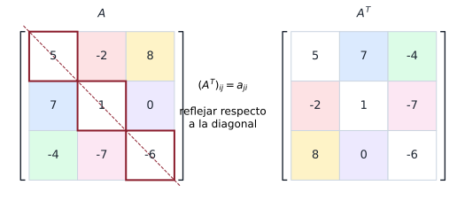
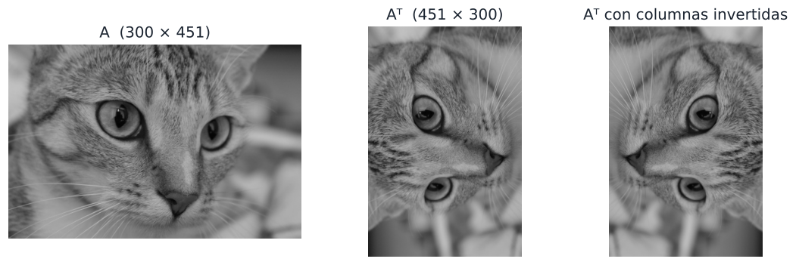

## Objetivos de la clase

- Calcular la **transpuesta** de una matriz.
- Demostrar sus propiedades, en particular $(AB)^T = B^TA^T$.
- Reconocer matrices **simétricas** y **antisimétricas**.
- Descomponer una matriz cuadrada como suma de una simétrica y una antisimétrica.
- Repasar la unidad 2 con ejercicios de **verdadero o falso** con justificación.

## Definición

::: {.definicion}
La **transpuesta** de $A=(a_{ij})$ de tamaño $m\times n$ es la matriz $A^T$ de tamaño $n\times m$ que se obtiene intercambiando renglones por columnas:
$$
(A^T)_{ij} = a_{ji}.
$$
:::

. . .

::: {.ejemplo}
$$
A=\begin{pmatrix}5&-2&8\\7&1&0\\-4&-7&-6\end{pmatrix}\Rightarrow A^T=\begin{pmatrix}5&7&-4\\-2&1&-7\\8&0&-6\end{pmatrix},
\qquad
B=\begin{pmatrix}1&0&-5&6\\2&8&4&-9\end{pmatrix}\Rightarrow B^T=\begin{pmatrix}1&2\\0&8\\-5&4\\6&-9\end{pmatrix}.
$$
:::

. . .

El renglón $i$ de $A$ se convierte en la columna $i$ de $A^T$. En particular, un vector columna transpuesto es un vector renglón, y
$$
\mathbf u\cdot\mathbf v = \mathbf u^T\mathbf v \quad(\mathbf u,\mathbf v \text{ columnas}).
$$

## Transponer es reflejar respecto a la diagonal

{fig-align="center" width="78%"}

La diagonal principal **no cambia**; cada entrada $a_{ij}$ se intercambia con $a_{ji}$ (mismo color). Los renglones de $A$ pasan a ser las columnas de $A^T$.

## En la vida real: transponer una foto {.nostretch}

{fig-align="center" width="88%"}

$A^T$ refleja la foto respecto a su diagonal: las filas pasan a ser columnas y una foto horizontal queda vertical. Si además se invierte el orden de las columnas, se obtiene la foto **girada 90°**. Así rotan las imágenes los programas de edición.

## Propiedades de la transpuesta

::: {.teorema}
Si los tamaños son compatibles y $r\in\mathbb R$:

a) $(A^T)^T = A$
b) $(A+B)^T = A^T + B^T$
c) $(rA)^T = r\,A^T$
d) $(AB)^T = B^TA^T$ (¡orden inverso!)
e) Si $A$ es invertible, $A^T$ también lo es y $(A^T)^{-1} = (A^{-1})^T$.
:::

. . .

::: {.demo data-t="a), b) y c)"}
$\big((A^T)^T\big)_{ij} = (A^T)_{ji} = a_{ij}$. $\quad\big((A+B)^T\big)_{ij} = (A+B)_{ji} = a_{ji}+b_{ji} = (A^T)_{ij} + (B^T)_{ij}$. $\quad\big((rA)^T\big)_{ij} = r\,a_{ji} = r(A^T)_{ij}$.
:::

## Demostración de $(AB)^T = B^TA^T$

Sea $A$ de tamaño $m\times n$ y $B$ de tamaño $n\times p$. Ambos lados son $p\times m$.

. . .

::: {.demo}
Comparamos la entrada $(i,j)$:
$$
\big((AB)^T\big)_{ij} = (AB)_{ji} = \sum_{k=1}^n a_{jk}\,b_{ki}.
$$
Por otra parte,
$$
(B^TA^T)_{ij} = \sum_{k=1}^n (B^T)_{ik}\,(A^T)_{kj} = \sum_{k=1}^n b_{ki}\,a_{jk}.
$$
Como el producto de números reales es conmutativo, $a_{jk}b_{ki} = b_{ki}a_{jk}$ y las dos sumas son iguales.
:::

. . .

::: {.obs}
$A^TB^T$ en general ni siquiera está definida: si $A$ es $2\times 3$ y $B$ es $3\times 4$, $A^T$ es $3\times 2$ y $B^T$ es $4\times 3$.
:::

## Demostración de $(A^T)^{-1} = (A^{-1})^T$

::: {.demo}
Usamos la propiedad d) y que $I^T = I$:
$$
A^T(A^{-1})^T = (A^{-1}A)^T = I^T = I,\qquad (A^{-1})^TA^T = (AA^{-1})^T = I^T = I.
$$
Luego $(A^{-1})^T$ es la inversa de $A^T$. Por unicidad de la inversa, $(A^T)^{-1} = (A^{-1})^T$.
:::

. . .

::: {.ejemplo}
$A=\begin{pmatrix}1&2\\3&7\end{pmatrix}$, $A^{-1}=\begin{pmatrix}7&-2\\-3&1\end{pmatrix}$. Entonces $(A^T)^{-1}=(A^{-1})^T=\begin{pmatrix}7&-3\\-2&1\end{pmatrix}$.
Compruebe: $\begin{pmatrix}1&3\\2&7\end{pmatrix}\begin{pmatrix}7&-3\\-2&1\end{pmatrix}=\begin{pmatrix}1&0\\0&1\end{pmatrix}$ ✓.
:::

## Matrices simétricas y antisimétricas

::: {.definicion}
Una matriz cuadrada $A$ es **simétrica** si $A^T = A$ ($a_{ij}=a_{ji}$), y **antisimétrica** si $A^T = -A$ ($a_{ij}=-a_{ji}$).
:::

. . .

::: {.columns}
::: {.column width="50%"}
**Simétrica** (espejo respecto a la diagonal):
$$
M=\begin{pmatrix}2&4&-8\\4&-3&5\\-8&5&0\end{pmatrix}=M^T
$$
:::
::: {.column width="50%"}
**Antisimétrica** (diagonal de ceros):
$$
K=\begin{pmatrix}0&2&-1\\-2&0&3\\1&-3&0\end{pmatrix},\quad K^T=-K
$$
:::
:::

. . .

::: {.teorema}
a) En una antisimétrica, la diagonal es nula. b) Para toda $A$ (de cualquier tamaño), $A^TA$ y $AA^T$ son simétricas. c) Si $A$ es cuadrada, $A + A^T$ es simétrica y $A - A^T$ es antisimétrica.
:::

## Demostraciones

::: {.demo data-t="a)"}
Si $a_{ii} = -a_{ii}$ entonces $2a_{ii} = 0$, luego $a_{ii} = 0$.
:::

. . .

::: {.demo data-t="b)"}
$(A^TA)^T = A^T(A^T)^T = A^TA$. Análogamente $(AA^T)^T = (A^T)^TA^T = AA^T$.
:::

. . .

::: {.demo data-t="c)"}
$(A+A^T)^T = A^T + (A^T)^T = A^T + A = A + A^T$, y $(A-A^T)^T = A^T - A = -(A - A^T)$.
:::

. . .

::: {.teorema data-t="Descomposición"}
Toda matriz cuadrada se escribe de forma **única** como suma de una simétrica y una antisimétrica:
$$
A = \underbrace{\tfrac12(A + A^T)}_{\text{simétrica}} + \underbrace{\tfrac12(A - A^T)}_{\text{antisimétrica}}.
$$
:::

## Ejemplo resuelto: descomposición

::: {.ejemplo}
Escriba $N=\begin{pmatrix}2&4&-1\\0&3&5\\6&1&2\end{pmatrix}$ como suma de una matriz simétrica y una antisimétrica.
:::

. . .

$$
S=\tfrac12(N+N^T)=\tfrac12\begin{pmatrix}4&4&5\\4&6&6\\5&6&4\end{pmatrix}=\begin{pmatrix}2&2&\tfrac52\\2&3&3\\\tfrac52&3&2\end{pmatrix},
$$

. . .

$$
K=\tfrac12(N-N^T)=\tfrac12\begin{pmatrix}0&4&-7\\-4&0&4\\7&-4&0\end{pmatrix}=\begin{pmatrix}0&2&-\tfrac72\\-2&0&2\\\tfrac72&-2&0\end{pmatrix}.
$$

. . .

Compruebe que $S+K=N$, $S^T = S$ y $K^T = -K$.

## Ejemplo resuelto: ecuación con transpuestas

::: {.ejemplo}
Sean $A=\begin{pmatrix}1&-1\\2&3\end{pmatrix}$, $B=-2A$ y $C=A-B$. Halle $D$ tal que
$$
D^T - C - 2BC = 2A - (I + 2B)C + 2D^T.
$$
:::

. . .

Desarrollamos el lado derecho: $2A - C - 2BC + 2D^T$. Cancelando $-C-2BC$ en ambos lados:
$$
D^T = 2A + 2D^T \;\Longrightarrow\; -D^T = 2A \;\Longrightarrow\; D^T = -2A \;\Longrightarrow\; D = (-2A)^T = -2A^T.
$$

. . .

$$
D=-2\begin{pmatrix}1&2\\-1&3\end{pmatrix}=\begin{pmatrix}-2&-4\\2&-6\end{pmatrix}.
$$
No hizo falta calcular $B$ ni $C$: **despejar primero** ahorra trabajo.

## Ejemplo resuelto: $A^TA$ y $AA^T$

::: {.ejemplo}
Sea $A=\begin{pmatrix}1&2\\0&1\\1&-1\end{pmatrix}$. Calcule $A^TA$ y $AA^T$ y verifique que son simétricas.
:::

. . .

$$
A^TA=\begin{pmatrix}1&0&1\\2&1&-1\end{pmatrix}\begin{pmatrix}1&2\\0&1\\1&-1\end{pmatrix}=\begin{pmatrix}2&1\\1&6\end{pmatrix}\quad(2\times2),
$$
$$
AA^T=\begin{pmatrix}1&2\\0&1\\1&-1\end{pmatrix}\begin{pmatrix}1&0&1\\2&1&-1\end{pmatrix}=\begin{pmatrix}5&2&-1\\2&1&-1\\-1&-1&2\end{pmatrix}\quad(3\times3).
$$

. . .

Ambas son simétricas, aunque tienen tamaños distintos. Las entradas de $A^TA$ son los productos punto entre las **columnas** de $A$: por ejemplo, $(A^TA)_{11}=1^2+0^2+1^2=2$. Esta matriz aparece en mínimos cuadrados y en estadística.

## En la vida real y en ML: matrices simétricas {.compacto .nostretch}

::: {.aplicacion data-t="Tabla de distancias"}
Una tabla de distancias entre ciudades es **simétrica**: la distancia de $i$ a $j$ es la misma que de $j$ a $i$, y la diagonal es cero.
$$
D=\begin{pmatrix}0&120&310\\120&0&240\\310&240&0\end{pmatrix}=D^T .
$$
:::

. . .

::: {.ml data-t="La matriz XᵀX"}
Con la matriz de datos $X$, el producto $X^TX$ aparece en la regresión lineal y siempre es simétrico, pues $(X^TX)^T=X^T(X^T)^T=X^TX$. Por ejemplo,
$$
X=\begin{pmatrix}1&2\\1&3\\1&5\end{pmatrix}\;\Rightarrow\;X^TX=\begin{pmatrix}3&10\\10&38\end{pmatrix}.
$$
Su entrada $(i,j)$ es el producto punto de las columnas $i$ y $j$: mide cómo se relacionan dos características.
:::

## Repaso de la unidad: ¿verdadero o falso?

Justifique: si es verdadero, demuéstrelo; si es falso, dé un contraejemplo.

::: {.ejercicio data-t="1"}
(a) Si $AB = O$ entonces $A = O$ o $B = O$. $\quad$ (b) Si $AB = CB$ entonces $A = C$.
:::

::: {.solucion .fragment}
Ambas **falsas**. (a) $\begin{pmatrix}1&1\\1&1\end{pmatrix}\begin{pmatrix}1&-1\\-1&1\end{pmatrix}=O$. (b) Con $B=O$ y $A\neq C$ cualesquiera: $AO = CO = O$.
:::

## Repaso de la unidad: ¿verdadero o falso?

::: {.ejercicio data-t="2"}
(a) Si $A$ es triangular superior, $A^T$ es triangular inferior. $\quad$ (b) Si $A^2 = I$ entonces $A = \pm I$.
:::

::: {.solucion .fragment}
(a) **Verdadera:** si $i<j$, $(A^T)_{ij} = a_{ji}$ con $j>i$, que es $0$ por ser $A$ triangular superior. (b) **Falsa:** $A=\begin{pmatrix}0&1\\1&0\end{pmatrix}$ cumple $A^2=I$.
:::

## Ejercicios propuestos

::: {.ejercicio data-t="3 · Demostración"}
Demuestre que si $A$ y $B$ son simétricas $n\times n$, entonces $AB$ es simétrica **si y solo si** $AB = BA$.
:::

::: {.solucion .fragment}
$(AB)^T = B^TA^T = BA$. Así, $(AB)^T = AB \iff BA = AB$.
:::

## Ejercicios propuestos

::: {.ejercicio data-t="4 · Demostración"}
Demuestre que si $A$ es invertible y simétrica, entonces $A^{-1}$ es simétrica.
:::

::: {.solucion .fragment}
$(A^{-1})^T = (A^T)^{-1} = A^{-1}$, usando la propiedad e) y que $A^T = A$.
:::

## Ejercicios propuestos

::: {.ejercicio data-t="5"}
Sea $\mathbf u = (1,2,-1)^T$. Calcule $\mathbf u^T\mathbf u$ y $\mathbf u\mathbf u^T$. ¿Qué tamaño tiene cada uno?
:::

::: {.solucion .fragment}
$\mathbf u^T\mathbf u = 1+4+1 = 6$ ($1\times1$). $\;\mathbf u\mathbf u^T=\begin{pmatrix}1&2&-1\\2&4&-2\\-1&-2&1\end{pmatrix}$ ($3\times3$, simétrica, como predice el teorema).
:::

## Ejercicios del texto guía {.texto-guia}

Grossman y Flores, *Álgebra lineal*, 8.ª ed.:

| Sección | Ejercicios |
|---|---|
| 2.5 Transpuesta de una matriz | 2, 6, 8, 9, 15, 16, 17, 19, 20, 21, 22, 25, 26, 29, 30, 34, 40 |

## Resumen

- $(A^T)_{ij} = a_{ji}$; si $A$ es $m\times n$, $A^T$ es $n\times m$.
- $(AB)^T = B^TA^T$ y $(A^T)^{-1} = (A^{-1})^T$.
- Simétrica: $A^T = A$. Antisimétrica: $A^T=-A$ (diagonal nula).
- $A^TA$ y $AA^T$ siempre son simétricas; $A = \tfrac12(A+A^T)+\tfrac12(A-A^T)$.

 

[← Clase 6](clase_06.qmd) · [Programa del curso](../algebra_lineal.qmd) · [Clase 8: Determinantes →](clase_08.qmd)
