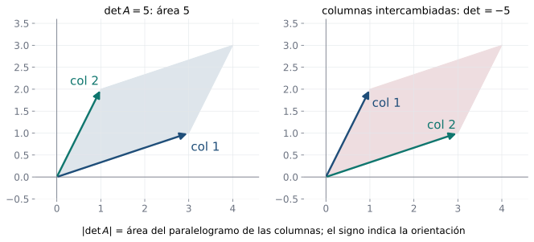
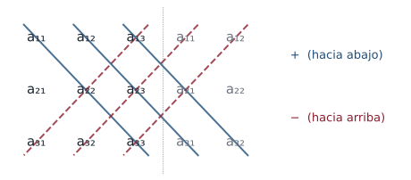

## Objetivos de la clase

- Calcular determinantes $2\times2$ y $3\times3$ (incluida la regla de Sarrus).
- Definir **menor** y **cofactor** de una entrada.
- Calcular determinantes $n\times n$ por **expansión en cofactores** a lo largo de cualquier fila o columna.
- Elegir la fila o columna más conveniente.
- Demostrar que el determinante de una matriz triangular es el producto de su diagonal.

## Ruta de la clase (70 min)

| Tiempo | Actividad |
|:---:|---|
| 0 – 5 | Motivación: un número que decide si una matriz es invertible |
| 5 – 20 | Determinante $2\times2$ y su significado geométrico (área) |
| 20 – 35 | Determinante $3\times3$: cofactores y regla de Sarrus |
| 35 – 55 | Menores, cofactores y expansión de Laplace; caso $4\times4$; triangulares |
| 55 – 70 | Aplicación (área de un triángulo) y práctica en clase |

## Determinante de una matriz $2\times 2$

::: {.definicion}
El determinante es una función $\det: M_{n\times n}(\mathbb R)\to\mathbb R$. Para $n=2$:
$$
\det\begin{pmatrix}a_{11}&a_{12}\\a_{21}&a_{22}\end{pmatrix}=\begin{vmatrix}a_{11}&a_{12}\\a_{21}&a_{22}\end{vmatrix}=a_{11}a_{22}-a_{12}a_{21}.
$$
:::

. . .

::: {.ejemplo}
$\begin{vmatrix}1&0\\5&6\end{vmatrix}=6-0=6,\qquad \begin{vmatrix}3&1\\2&4\end{vmatrix}=12-2=10,\qquad \begin{vmatrix}1&2\\-2&-1\end{vmatrix}=-1+4=3.$
:::

. . .

::: {.obs data-t="Interpretación geométrica"}
$|\det A|$ es el **área** del paralelogramo generado por las columnas de $A$. Si $\det A = 0$, las columnas son paralelas: el paralelogramo es "plano". Ya vimos que $\det A\neq0$ equivale a que $A$ sea invertible ($2\times 2$).
:::

## El determinante como área

{fig-align="center" width="90%"}

$|\det A|$ es el **área** del paralelogramo que forman las columnas. El **signo** indica la orientación: al intercambiar las columnas el área es la misma y el signo cambia.

## Determinante de una matriz $3\times 3$

::: {.definicion}
$$
\begin{vmatrix}a_{11}&a_{12}&a_{13}\\a_{21}&a_{22}&a_{23}\\a_{31}&a_{32}&a_{33}\end{vmatrix}
= a_{11}\begin{vmatrix}a_{22}&a_{23}\\a_{32}&a_{33}\end{vmatrix}
- a_{12}\begin{vmatrix}a_{21}&a_{23}\\a_{31}&a_{33}\end{vmatrix}
+ a_{13}\begin{vmatrix}a_{21}&a_{22}\\a_{31}&a_{32}\end{vmatrix}.
$$
:::

. . .

Desarrollando se obtiene la **regla de Sarrus** (válida **solo** para $3\times3$): repita las dos primeras columnas a la derecha,

$$
\det A = (a_{11}a_{22}a_{33} + a_{12}a_{23}a_{31} + a_{13}a_{21}a_{32}) - (a_{13}a_{22}a_{31} + a_{11}a_{23}a_{32} + a_{12}a_{21}a_{33}).
$$

Tres diagonales "hacia abajo" con signo $+$ y tres "hacia arriba" con signo $-$.

## Regla de Sarrus en una imagen

{fig-align="center" width="70%"}

Se repiten las dos primeras columnas. Los productos de las tres diagonales **descendentes** suman; los de las tres **ascendentes** restan.

::: {.obs data-t="Advertencia"}
Sarrus **solo** funciona para matrices $3\times3$. Para $4\times4$ o más se usa la expansión por cofactores o la reducción por filas (clase 9).
:::

## Ejemplo resuelto: dos métodos

::: {.ejemplo}
Calcule $\det B$ para $B=\begin{pmatrix}4&7&-2\\3&-5&1\\-8&6&9\end{pmatrix}$.
:::

. . .

**Expansión por la primera fila:**
$$
\det B = 4\begin{vmatrix}-5&1\\6&9\end{vmatrix}-7\begin{vmatrix}3&1\\-8&9\end{vmatrix}+(-2)\begin{vmatrix}3&-5\\-8&6\end{vmatrix}
=4(-51)-7(35)-2(-22)=-204-245+44=-405.
$$

. . .

**Sarrus:**
$$
\big[4(-5)(9)+7(1)(-8)+(-2)(3)(6)\big]-\big[(-2)(-5)(-8)+4(1)(6)+7(3)(9)\big]
$$
$$
=(-180-56-36)-(-80+24+189)=-272-133=-405.\ ✓
$$

## Menores y cofactores

::: {.definicion}
Sea $A$ una matriz $n\times n$.

- El **menor** $M_{ij}$ es el determinante de la submatriz $(n-1)\times(n-1)$ que resulta de **eliminar la fila $i$ y la columna $j$**.
- El **cofactor** de $a_{ij}$ es $\;A_{ij} = (-1)^{i+j}M_{ij}$.
:::

. . .

El signo $(-1)^{i+j}$ sigue un patrón de **tablero de ajedrez**:
$$
\begin{pmatrix}+&-\\-&+\end{pmatrix}\qquad
\begin{pmatrix}+&-&+\\-&+&-\\+&-&+\end{pmatrix}\qquad
\begin{pmatrix}+&-&+&-\\-&+&-&+\\+&-&+&-\\-&+&-&+\end{pmatrix}
$$

## Ejemplo resuelto: menores y cofactores

::: {.ejemplo}
Para $A=\begin{pmatrix}3&-1&2\\4&5&6\\7&1&2\end{pmatrix}$, calcule $M_{12}, M_{23}, M_{31}$ y sus cofactores.
:::

. . .

$$
M_{12}=\begin{vmatrix}4&6\\7&2\end{vmatrix}=8-42=-34,\qquad A_{12}=(-1)^{1+2}(-34)=34.
$$

. . .

$$
M_{23}=\begin{vmatrix}3&-1\\7&1\end{vmatrix}=3+7=10,\qquad A_{23}=(-1)^{2+3}(10)=-10.
$$

. . .

$$
M_{31}=\begin{vmatrix}-1&2\\5&6\end{vmatrix}=-6-10=-16,\qquad A_{31}=(-1)^{3+1}(-16)=-16.
$$

## Expansión de Laplace (por cofactores)

::: {.teorema}
Sea $A$ una matriz $n\times n$. Para **cualquier** fila $i$ y **cualquier** columna $j$:
$$
\det A = a_{i1}A_{i1}+a_{i2}A_{i2}+\cdots+a_{in}A_{in}\quad\text{(desarrollo por la fila } i\text{)},
$$
$$
\det A = a_{1j}A_{1j}+a_{2j}A_{2j}+\cdots+a_{nj}A_{nj}\quad\text{(desarrollo por la columna } j\text{)}.
$$
Todos los desarrollos dan el **mismo** número.
:::

. . .

::: {.obs data-t="Estrategia"}
Desarrolle por la fila o columna con **más ceros**: cada cero elimina un determinante de orden $n-1$.
:::

. . .

::: {.ejemplo}
Para $A$ del ejemplo anterior, por la segunda columna:
$\det A = (-1)(34) + 5\begin{vmatrix}3&2\\7&2\end{vmatrix} + 1\cdot(-1)^{5}\begin{vmatrix}3&2\\4&6\end{vmatrix} = -34 + 5(-8) - 10 = -84.$
:::

## Ejemplo resuelto: un determinante $4\times 4$

::: {.ejemplo}
Calcule $\det E$, con $E=\begin{pmatrix}2&0&3&1\\1&0&-1&2\\3&1&2&0\\0&0&4&1\end{pmatrix}$.
:::

. . .

La columna 2 tiene un solo elemento no nulo, $e_{32}=1$, con signo $(-1)^{3+2}=-1$:
$$
\det E = -1\cdot\begin{vmatrix}2&3&1\\1&-1&2\\0&4&1\end{vmatrix}.
$$

. . .

Desarrollando el $3\times 3$ por la primera columna:
$$
\begin{vmatrix}2&3&1\\1&-1&2\\0&4&1\end{vmatrix}=2\begin{vmatrix}-1&2\\4&1\end{vmatrix}-1\begin{vmatrix}3&1\\4&1\end{vmatrix}+0=2(-9)-1(-1)=-17.
$$

. . .

Por tanto $\det E = -(-17) = 17$. **Un solo** determinante $3\times3$ en lugar de cuatro.

## Determinante de una matriz triangular

::: {.teorema}
Si $A=(a_{ij})$ es triangular (superior o inferior), entonces
$$
\det A = a_{11}\,a_{22}\cdots a_{nn}.
$$
En particular $\det I_n = 1$ y el determinante de una matriz diagonal es el producto de su diagonal.
:::

. . .

::: {.demo data-t="Por inducción, caso triangular superior"}
Para $n=1$ es inmediato. Supongamos que vale para matrices $(n-1)\times(n-1)$. Si $A$ es triangular superior $n\times n$, su **primera columna** es $(a_{11},0,\dots,0)^T$. Desarrollando por ella:
$$
\det A = a_{11}A_{11} = a_{11}M_{11}.
$$
$M_{11}$ es el determinante de una matriz triangular superior $(n-1)\times(n-1)$ con diagonal $a_{22},\dots,a_{nn}$; por hipótesis de inducción vale $a_{22}\cdots a_{nn}$. Luego $\det A = a_{11}a_{22}\cdots a_{nn}$. (El caso inferior es análogo, desarrollando por la primera fila.)
:::

## Aplicación: área de un triángulo

::: {.ejemplo}
Halle el área del triángulo con vértices $A=(1,1)$, $B=(4,2)$ y $C=(2,5)$.
:::

. . .

Los lados desde $A$ son $\overrightarrow{AB}=(3,1)$ y $\overrightarrow{AC}=(1,4)$. El paralelogramo que generan tiene área
$$
\left|\det\begin{pmatrix}3&1\\1&4\end{pmatrix}\right|=|12-1|=11 ,
$$
y el triángulo es la mitad: **área $=\tfrac{11}{2}=5.5$**.

. . .

::: {.obs}
Si el determinante es $0$, los tres puntos están **alineados** (el "triángulo" es plano). Es un criterio rápido de colinealidad.
:::

## Ejemplo resuelto: determinante con parámetro

::: {.ejemplo}
Halle los valores de $x$ para los cuales $\det\begin{pmatrix}x&1&0\\1&x&1\\0&1&x\end{pmatrix}=0$.
:::

. . .

Por la primera fila:
$$
x\begin{vmatrix}x&1\\1&x\end{vmatrix}-1\begin{vmatrix}1&1\\0&x\end{vmatrix}+0=x(x^2-1)-x=x^3-2x=x(x^2-2).
$$

. . .

Se anula en $x=0$, $x=\sqrt2$ y $x=-\sqrt2$. Para esos valores la matriz **no** es invertible (lo justificaremos en la clase 10).

## Ejercicios propuestos

::: {.ejercicio data-t="1"}
Calcule $\begin{vmatrix}2&-1&0\\1&3&1\\0&2&-2\end{vmatrix}$ por cofactores y por Sarrus.
:::

::: {.solucion .fragment}
Por la primera fila: $2(-6-2)-(-1)(-2-0)+0 = -16-2 = -18$. Sarrus: $(-12+0+0)-(0+4+2) = -18$ ✓.
:::

## Ejercicios propuestos

::: {.ejercicio data-t="2"}
Use cofactores para hallar $\det C$, con $C=\begin{pmatrix}1&0&2&-1\\3&1&0&2\\0&-2&1&3\\2&1&-1&0\end{pmatrix}$. Indique por qué fila o columna desarrolla.
:::

::: {.solucion .fragment}
Por la columna 2, que tiene un cero: $\det C = 1\cdot A_{22} + (-2)\cdot A_{32} + 1\cdot A_{42}$, con
$A_{22}=+\begin{vmatrix}1&2&-1\\0&1&3\\2&-1&0\end{vmatrix}=17$, $\;A_{32}=-\begin{vmatrix}1&2&-1\\3&0&2\\2&-1&0\end{vmatrix}=-13$, $\;A_{42}=+\begin{vmatrix}1&2&-1\\3&0&2\\0&1&3\end{vmatrix}=-23$.
Luego $\det C = 17 + 26 - 23 = 20$.
:::

## Ejercicios propuestos

::: {.ejercicio data-t="3"}
Halle los valores de $x$ para los cuales $\begin{vmatrix}1&1&1\\x&2&3\\x^2&4&9\end{vmatrix}=0$.
:::

::: {.solucion .fragment}
Desarrollando, el determinante es $(x-2)(x-3)$. Vale cero si $x=2$ o $x=3$: en esos casos dos columnas son iguales.
:::

## Ejercicios propuestos

::: {.ejercicio data-t="4 · Demostración"}
Demuestre que si $A$ es $n\times n$ y tiene una fila (o columna) de ceros, entonces $\det A = 0$.
:::

::: {.solucion .fragment}
Desarrollamos por esa fila $i$: $\det A = \sum_j a_{ij}A_{ij} = \sum_j 0\cdot A_{ij} = 0$. Lo mismo si es una columna.
:::

## Ejercicios propuestos

::: {.ejercicio data-t="5"}
Calcule $\det\begin{pmatrix}2&1&3&5\\0&-1&4&7\\0&0&3&-2\\0&0&0&\tfrac12\end{pmatrix}$ sin desarrollar.
:::

::: {.solucion .fragment}
Es triangular superior: $\det = 2\cdot(-1)\cdot 3\cdot\tfrac12 = -3$.
:::

## Ejercicios del texto guía {.texto-guia}

Grossman y Flores, *Álgebra lineal*, 8.ª ed.:

| Sección | Ejercicios |
|---|---|
| 3.1 Determinantes: definiciones | 1, 5, 10, 12, 19, 23, 25 |

## Resumen

- $2\times2$: $ad-bc$. $\;3\times3$: cofactores o Sarrus.
- $M_{ij}$: borre fila $i$ y columna $j$. $\;A_{ij}=(-1)^{i+j}M_{ij}$ (tablero de ajedrez).
- $\det A$ se puede desarrollar por **cualquier** fila o columna: elija la de más ceros.
- Matriz triangular: $\det A$ = producto de la diagonal.

 

[← Clase 7](clase_07.qmd) · [Programa del curso](../algebra_lineal.qmd) · [Clase 9: Propiedades de los determinantes →](clase_09.qmd)
