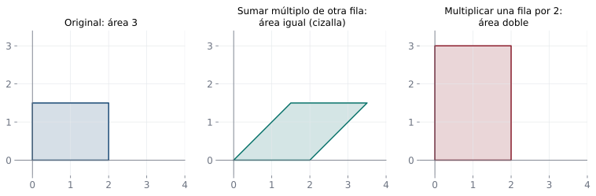
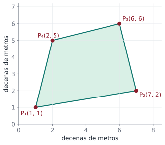

## Objetivos de la clase

- Conocer el efecto de cada **operación elemental** sobre el determinante.
- Usar las propiedades para calcular determinantes **reduciendo por filas**.
- Aplicar $\det(AB)=\det A\det B$, $\det A^T=\det A$ y $\det(cA)=c^n\det A$.
- Demostrar propiedades a partir de otras.

## Las propiedades fundamentales

::: {.teorema}
Sean $A$ y $B$ matrices $n\times n$ y $c\in\mathbb R$.

1. $\det(AB) = \det A\,\det B$.
2. $\det A^T = \det A$. (Por eso **todo** lo que se diga de filas vale para columnas.)
3. Si $A$ tiene una fila (o columna) de ceros, $\det A = 0$.
4. Si se **multiplica** una fila de $A$ por $c$, el determinante queda multiplicado por $c$.
5. Si se **intercambian** dos filas, el determinante cambia de **signo**.
6. Si $A$ tiene dos filas **iguales**, $\det A = 0$.
7. Si una fila es **múltiplo** de otra, $\det A = 0$.
8. Si a una fila se le **suma un múltiplo de otra**, el determinante **no cambia**.
9. Si $A$ es triangular, $\det A$ es el producto de la diagonal.
:::

## Ilustración con una matriz $2\times 2$

Sea $A=\begin{pmatrix}2&1\\3&4\end{pmatrix}$, con $\det A = 8-3 = 5$.

. . .

| Operación | Matriz resultante | Determinante | Relación |
|---|---|---|---|
| $F_1\leftrightarrow F_2$ | $\begin{pmatrix}3&4\\2&1\end{pmatrix}$ | $3-8=-5$ | $-\det A$ |
| $F_1\to 3F_1$ | $\begin{pmatrix}6&3\\3&4\end{pmatrix}$ | $24-9=15$ | $3\det A$ |
| $F_2\to F_2+2F_1$ | $\begin{pmatrix}2&1\\7&6\end{pmatrix}$ | $12-7=5$ | $\det A$ |
| $A^T$ | $\begin{pmatrix}2&3\\1&4\end{pmatrix}$ | $8-3=5$ | $\det A$ |

. . .

::: {.obs data-t="Ojo"}
$\det(A + B)\neq\det A + \det B$ en general. Por ejemplo, $\det(I_2 + I_2) = \det(2I_2)=4$, mientras que $\det I_2 + \det I_2 = 2$.
:::

## Las operaciones por filas vistas como áreas

{fig-align="center" width="95%"}

Sumar a una fila un múltiplo de otra es una **cizalla**: deforma el paralelogramo sin cambiar su área. Multiplicar una fila por $c$ multiplica el área por $|c|$.

## Demostraciones: 6 y 7 a partir de 4 y 5

::: {.demo data-t="6: dos filas iguales"}
Sea $A$ con las filas $i$ y $j$ iguales y sea $B$ la matriz obtenida al intercambiarlas. Por la propiedad 5, $\det B = -\det A$. Pero intercambiar dos filas **iguales** no cambia la matriz: $B = A$. Luego $\det A = -\det A$, es decir $2\det A = 0$, y $\det A = 0$.
:::

. . .

::: {.demo data-t="7: una fila múltiplo de otra"}
Si la fila $j$ es $c$ veces la fila $i$, por la propiedad 4 podemos "sacar" el factor $c$ de la fila $j$: $\det A = c\,\det A'$, donde $A'$ tiene las filas $i$ y $j$ **iguales**. Por 6, $\det A' = 0$, luego $\det A = 0$.
:::

## Demostración de 8: sumar un múltiplo de una fila

Usamos que el determinante es **lineal en cada fila** (se ve al desarrollar por esa fila):
$$
\det\begin{pmatrix}\vdots\\ \mathbf u + \mathbf v\\ \vdots\end{pmatrix}=\det\begin{pmatrix}\vdots\\ \mathbf u\\ \vdots\end{pmatrix}+\det\begin{pmatrix}\vdots\\ \mathbf v\\ \vdots\end{pmatrix}\quad\text{(las demás filas iguales).}
$$

. . .

::: {.demo}
Sea $B$ la matriz obtenida al reemplazar la fila $j$ de $A$, $\mathbf f_j$, por $\mathbf f_j + c\,\mathbf f_i$. Desarrollando por la fila $j$:
$$
\det B = \det\begin{pmatrix}\vdots\\\mathbf f_i\\\vdots\\\mathbf f_j\\\vdots\end{pmatrix}+\det\begin{pmatrix}\vdots\\\mathbf f_i\\\vdots\\c\,\mathbf f_i\\\vdots\end{pmatrix}=\det A + 0 = \det A,
$$
porque la segunda matriz tiene la fila $j$ múltiplo de la fila $i$ (propiedad 7).
:::

## Más consecuencias {.compacto}

::: {.teorema}
Para $A$ de tamaño $n\times n$ y $c\in\mathbb R$:

a) $\det(cA) = c^n\det A$.
b) Si $A$ es invertible, $\det A\neq0$ y $\;\det(A^{-1}) = \dfrac{1}{\det A}$.
c) $\det(A^k) = (\det A)^k$ para todo $k\in\mathbb N$.
:::

. . .

::: {.demo data-t="a)"}
$cA$ se obtiene multiplicando **cada una** de las $n$ filas de $A$ por $c$. Aplicando $n$ veces la propiedad 4: $\det(cA) = c\cdot c\cdots c\,\det A = c^n\det A$.
:::

. . .

::: {.demo data-t="b)"}
$AA^{-1} = I$, luego $\det A\,\det(A^{-1}) = \det(AA^{-1}) = \det I = 1$. Así $\det A\neq0$ y $\det(A^{-1}) = 1/\det A$.
:::

. . .

::: {.demo data-t="c)"}
Por inducción: $\det(A^{k+1}) = \det(A^kA) = \det(A^k)\det A = (\det A)^k\det A = (\det A)^{k+1}$.
:::

## Calcular determinantes reduciendo por filas

::: {.definicion data-t="Método"}
Lleve la matriz a forma **triangular** con operaciones elementales, **registrando** cómo cambia el determinante:

- $F_j\to F_j + cF_i$: no cambia.
- $F_i\leftrightarrow F_j$: cambia de signo.
- $F_i\to cF_i$: se multiplica por $c$ (o, si se "saca" un factor común $c$, se multiplica afuera por $c$).

Al final, multiplique la diagonal.
:::

. . .

::: {.obs}
Para matrices grandes este método es **mucho** más eficiente que la expansión por cofactores: para $n=10$, cofactores requiere del orden de $10! \approx 3.6$ millones de productos; la reducción, unos pocos cientos.
:::

## Ejemplo resuelto: reducción por filas

::: {.ejemplo}
Calcule $\det F$, con $F=\begin{pmatrix}1&2&3&4\\2&5&7&9\\-1&0&2&3\\3&6&10&15\end{pmatrix}$.
:::

. . .

$$
\det F \overset{\substack{F_2-2F_1\\F_3+F_1\\F_4-3F_1}}{=}
\begin{vmatrix}1&2&3&4\\0&1&1&1\\0&2&5&7\\0&0&1&3\end{vmatrix}
\overset{F_3-2F_2}{=}
\begin{vmatrix}1&2&3&4\\0&1&1&1\\0&0&3&5\\0&0&1&3\end{vmatrix}
\overset{F_3\leftrightarrow F_4}{=}
-\begin{vmatrix}1&2&3&4\\0&1&1&1\\0&0&1&3\\0&0&3&5\end{vmatrix}
$$

. . .

$$
\overset{F_4-3F_3}{=}
-\begin{vmatrix}1&2&3&4\\0&1&1&1\\0&0&1&3\\0&0&0&-4\end{vmatrix}
=-\big(1\cdot1\cdot1\cdot(-4)\big)=4.
$$

## Ejemplo resuelto: usar las propiedades sin calcular

::: {.ejemplo}
Si $\begin{vmatrix}a&b&c\\d&e&f\\g&h&i\end{vmatrix}=7$, calcule
$\;\text{(i)}\begin{vmatrix}a&b&c\\3d&3e&3f\\g&h&i\end{vmatrix}\quad\text{(ii)}\begin{vmatrix}g&h&i\\d&e&f\\a&b&c\end{vmatrix}\quad\text{(iii)}\begin{vmatrix}a&b&c\\d+2a&e+2b&f+2c\\g&h&i\end{vmatrix}$
:::

. . .

(i) Una fila multiplicada por 3: $\;3\cdot7=21$.

. . .

(ii) Se intercambiaron las filas 1 y 3: $\;-7$.

. . .

(iii) A la fila 2 se le sumó 2 veces la fila 1: $\;7$.

. . .

::: {.ejemplo}
Con la misma matriz $A$ ($3\times3$, $\det A = 7$): $\;\det(2A)=2^3\cdot7=56$, $\;\det(A^{-1})=\tfrac17$, $\;\det(A^TA)=7\cdot7=49$.
:::

## Demostración: determinante de Vandermonde

::: {.teorema}
$$
\det\begin{pmatrix}1&1&1\\a&b&c\\a^2&b^2&c^2\end{pmatrix}=(b-a)(c-a)(c-b).
$$
:::

. . .

::: {.demo}
Restamos la primera **columna** a las otras dos (no cambia el determinante):
$$
\begin{vmatrix}1&0&0\\a&b-a&c-a\\a^2&b^2-a^2&c^2-a^2\end{vmatrix}
=\begin{vmatrix}b-a&c-a\\(b-a)(b+a)&(c-a)(c+a)\end{vmatrix}.
$$
Sacamos el factor $(b-a)$ de la primera columna y $(c-a)$ de la segunda:
$$
=(b-a)(c-a)\begin{vmatrix}1&1\\b+a&c+a\end{vmatrix}=(b-a)(c-a)\big[(c+a)-(b+a)\big]=(b-a)(c-a)(c-b).
$$
:::

. . .

Consecuencia: el determinante es $0$ si y solo si dos de los números $a,b,c$ coinciden (dos columnas iguales).

## En la vida real: el área de un lote {.compacto .nostretch}

:::: {.columns}
::: {.column width="58%"}
::: {.aplicacion data-t="Topografía"}
Las esquinas de un lote, medidas con GPS en decenas de metros, son $P_1(1,1)$, $P_2(7,2)$, $P_3(6,6)$ y $P_4(2,5)$.
:::

Sumando los determinantes de vértices consecutivos (**fórmula del zapato**):
$$
\text{Área}=\tfrac12\left|\,\begin{vmatrix}1&7\\1&2\end{vmatrix}+\begin{vmatrix}7&6\\2&6\end{vmatrix}+\begin{vmatrix}6&2\\6&5\end{vmatrix}+\begin{vmatrix}2&1\\5&1\end{vmatrix}\,\right|
$$
$$
=\tfrac12\,|-5+30+18-3|=20 .
$$
El lote mide $20\times100=2\,000\ \text{m}^2$.
:::
::: {.column width="42%"}
{width="100%"}
:::
::::

Funciona porque cada determinante es el área (con signo) de un triángulo con vértice en el origen, y los signos cancelan lo que sobra. Así calculan áreas los programas de mapas.

## Ejemplo 1 · Fácil: matriz triangular y cambio de filas {.compacto}

::: {.ejemplo data-t="Nivel fácil"}
Calcule $\det A$ para $A=\begin{pmatrix}2&7&-1\\0&3&5\\0&0&-4\end{pmatrix}$, y el de la matriz que resulta al intercambiar sus filas 1 y 3.
:::

. . .

**Paso 1 · Triangular.** El determinante es el producto de la diagonal: $\;2\cdot3\cdot(-4)=-24$. No hace falta expandir.

. . .

**Paso 2 · Intercambio de filas.** Cada intercambio **cambia el signo** del determinante.

::: {.solucion}
$\det A=-24$ y, tras el intercambio, $\det=+24$.
:::

## Ejemplo 2 · Fácil: usar las propiedades {.compacto}

::: {.ejemplo data-t="Nivel fácil"}
$A$ es $3\times3$ y $\det A=3$. Calcule $\det(2A)$, $\det(A^T)$, $\det(A^{-1})$ y $\det(A^2)$.
:::

. . .

- $\det(2A)=2^3\det A=24$. **Cuidado:** el $2$ multiplica las **tres** filas, por eso sale $2^3$ y no $2$.
- $\det(A^T)=\det A=3$: transponer no cambia el determinante.

. . .

- $\det(A^{-1})=\dfrac{1}{\det A}=\dfrac13$, porque $\det A\cdot\det A^{-1}=\det I=1$.
- $\det(A^2)=\det A\cdot\det A=9$.

::: {.solucion}
$24,\;3,\;\tfrac13,\;9$.
:::

## Ejemplo 3 · Medio: determinante $4\times4$ reduciendo por filas {.compacto}

::: {.ejemplo data-t="Nivel medio"}
Calcule $\det\begin{pmatrix}1&2&0&1\\2&5&1&3\\1&3&2&0\\0&1&4&2\end{pmatrix}$ llevando la matriz a forma triangular.
:::

. . .

**Idea.** Sumar a una fila un múltiplo de otra **no cambia** el determinante.

. . .

**Paso 1** ($F_2-2F_1$, $F_3-F_1$), **paso 2** ($F_3-F_2$, $F_4-F_2$) y **paso 3** ($F_4-3F_3$):
$$
\begin{pmatrix}1&2&0&1\\0&1&1&1\\0&1&2&-1\\0&1&4&2\end{pmatrix}\sim
\begin{pmatrix}1&2&0&1\\0&1&1&1\\0&0&1&-2\\0&0&3&1\end{pmatrix}\sim
\begin{pmatrix}1&2&0&1\\0&1&1&1\\0&0&1&-2\\0&0&0&7\end{pmatrix}.
$$

::: {.solucion}
Solo se usaron operaciones del tipo "sumar un múltiplo": $\det=1\cdot1\cdot1\cdot7=7$. Con cofactores se necesitarían varios menores $3\times3$.
:::

## Ejemplo 4 · Difícil: un determinante sin calcular {.compacto}

::: {.ejemplo data-t="Nivel difícil"}
Demuestre que, para cualesquiera $a,b,c$: $\quad\begin{vmatrix}1&a&b+c\\1&b&c+a\\1&c&a+b\end{vmatrix}=0.$
:::

. . .

**Paso 1 · Buscar una operación que simplifique.** Sumar la columna 2 a la columna 3 **no cambia** el determinante:
$$
\begin{vmatrix}1&a&b+c\\1&b&c+a\\1&c&a+b\end{vmatrix}=\begin{vmatrix}1&a&a+b+c\\1&b&a+b+c\\1&c&a+b+c\end{vmatrix}.
$$

. . .

**Paso 2 · Sacar el factor común** de la columna 3:
$$
=(a+b+c)\begin{vmatrix}1&a&1\\1&b&1\\1&c&1\end{vmatrix}.
$$

. . .

**Paso 3.** El último determinante tiene **dos columnas iguales** (la 1 y la 3), así que vale $0$.

::: {.solucion}
El determinante es $(a+b+c)\cdot0=0$ para cualesquiera $a,b,c$. Con propiedades se evita expandir un determinante con letras.
:::

## Práctica en clase

::: {.ejercicio data-t="1"}
Si $A$ es $4\times4$ con $\det A=3$, calcule $\det(2A^TA^{-1})$.
:::

::: {.solucion .fragment}
$\det(2A^TA^{-1})=2^4\det A^T\det A^{-1}=16\cdot3\cdot\tfrac13=16$.
:::

::: {.ejercicio data-t="2"}
Use Vandermonde para calcular $\det\begin{pmatrix}1&1&1\\2&3&5\\4&9&25\end{pmatrix}$.
:::

::: {.solucion .fragment}
$a=2$, $b=3$, $c=5$: $(3-2)(5-2)(5-3)=1\cdot3\cdot2=6$.
:::

## Ejercicios propuestos

::: {.ejercicio data-t="1"}
Calcule por reducción por filas $\det\begin{pmatrix}2&1&3\\4&-1&2\\-2&5&1\end{pmatrix}$.
:::

::: {.solucion .fragment}
$F_2-2F_1$, $F_3+F_1$: $\begin{vmatrix}2&1&3\\0&-3&-4\\0&6&4\end{vmatrix}$; $F_3+2F_2$: $\begin{vmatrix}2&1&3\\0&-3&-4\\0&0&-4\end{vmatrix}=2(-3)(-4)=24$.
:::

## Ejercicios propuestos

::: {.ejercicio data-t="2"}
Sean $A$, $B$ matrices $3\times3$ con $\det A = -2$ y $\det B = 5$. Calcule $\det(A^2B^{-1})$, $\det(-3A^T)$ y $\det(B^{-1}AB)$.
:::

::: {.solucion .fragment}
$\det(A^2B^{-1}) = \dfrac{(-2)^2}{5}=\dfrac45$; $\;\det(-3A^T) = (-3)^3(-2) = 54$; $\;\det(B^{-1}AB) = \dfrac15\cdot(-2)\cdot5 = -2$.
:::

## Ejercicios propuestos

::: {.ejercicio data-t="3 · Demostración"}
Una matriz $Q$ es **ortogonal** si $Q^TQ = I$. Demuestre que $\det Q = \pm1$.
:::

::: {.solucion .fragment}
$1 = \det I = \det(Q^TQ) = \det Q^T\det Q = (\det Q)^2$. Luego $\det Q = \pm1$.
:::

## Ejercicios propuestos

::: {.ejercicio data-t="4 · Demostración"}
Demuestre que si $A$ es antisimétrica de tamaño $n\times n$ con $n$ **impar**, entonces $\det A = 0$.
:::

::: {.solucion .fragment}
$\det A = \det A^T = \det(-A) = (-1)^n\det A = -\det A$ (por ser $n$ impar). Luego $2\det A = 0$ y $\det A = 0$.
:::

## Ejercicios propuestos

::: {.ejercicio data-t="5 · Demostración"}
Demuestre que si $A$ es invertible, $\det(A^{-1}BA) = \det B$.
:::

::: {.solucion .fragment}
$\det(A^{-1}BA)=\det A^{-1}\det B\det A = \tfrac{1}{\det A}\det B\det A = \det B$. (Matrices **semejantes** tienen el mismo determinante; ver unidad 7.)
:::

## Ejercicios del texto guía {.texto-guia}

Grossman y Flores, *Álgebra lineal*, 8.ª ed.:

| Sección | Ejercicios |
|---|---|
| 3.2 Propiedades de los determinantes | 1, 5, 9, 13, 29, 33, 36, 41, 42, 43 |

. . .

::: {.obs data-t="Evaluación"}
Hasta aquí llega la **Evaluación final del primer tercio** (secciones 1.1 a 3.1) y comienza el material de la **intermedia del segundo tercio** (3.2 a 4.3).
:::

## Resumen

| Operación sobre $A$ | Efecto en $\det$ |
|---|---|
| Intercambiar dos filas | cambia el signo |
| Multiplicar una fila por $c$ | se multiplica por $c$ |
| Sumar a una fila un múltiplo de otra | no cambia |
| Transponer | no cambia |
| $cA$ ($n\times n$) | $c^n\det A$ |
| $AB$, $A^{-1}$ | $\det A\det B$, $\;1/\det A$ |

 

[← Clase 8](clase_08.qmd) · [Programa del curso](../algebra_lineal.qmd) · [Clase 10: Determinantes, inversas y Cramer →](clase_10.qmd)
