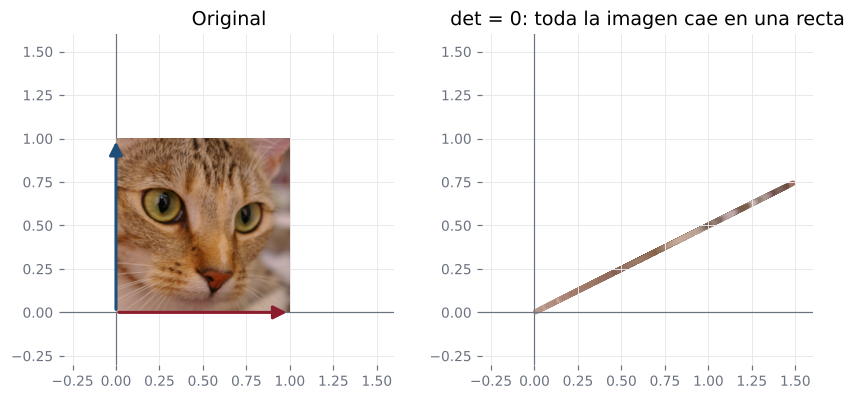
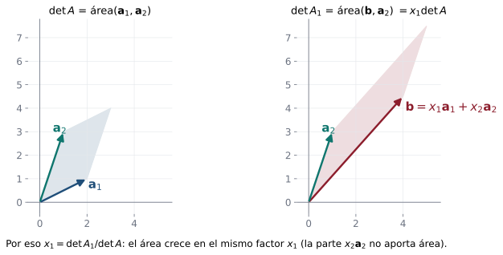

## Objetivos de la clase

- Construir la **matriz adjunta** $\operatorname{adj}A$ a partir de los cofactores.
- Demostrar que $A\,\operatorname{adj}A = (\det A)\,I$ y deducir $A^{-1}=\dfrac{1}{\det A}\operatorname{adj}A$.
- Caracterizar las matrices invertibles por su determinante.
- Resolver sistemas $n\times n$ con la **regla de Cramer** y demostrarla.

## Matriz de cofactores y matriz adjunta

::: {.definicion}
Sea $A$ una matriz $n\times n$ y $A_{ij}$ el cofactor de $a_{ij}$. La **matriz adjunta** de $A$ es la **transpuesta** de la matriz de cofactores:
$$
\operatorname{adj}A=\begin{pmatrix}A_{11}&A_{12}&\cdots&A_{1n}\\A_{21}&A_{22}&\cdots&A_{2n}\\\vdots&&\ddots&\vdots\\A_{n1}&A_{n2}&\cdots&A_{nn}\end{pmatrix}^{T}=\begin{pmatrix}A_{11}&A_{21}&\cdots&A_{n1}\\A_{12}&A_{22}&\cdots&A_{n2}\\\vdots&&\ddots&\vdots\\A_{1n}&A_{2n}&\cdots&A_{nn}\end{pmatrix}.
$$
:::

. . .

::: {.obs data-t="Caso 2×2"}
Para $A=\begin{pmatrix}a&b\\c&d\end{pmatrix}$: $A_{11}=d$, $A_{12}=-c$, $A_{21}=-b$, $A_{22}=a$, así que $\operatorname{adj}A=\begin{pmatrix}d&-b\\-c&a\end{pmatrix}$. Es la matriz de la fórmula de la inversa $2\times2$.
:::

## Ejemplo resuelto: adjunta de una matriz $3\times 3$

::: {.ejemplo}
Calcule $\operatorname{adj}A$ y $\det A$ para $A=\begin{pmatrix}3&-2&1\\5&6&2\\1&0&-3\end{pmatrix}$.
:::

. . .

$$
\begin{aligned}
A_{11}&=+\begin{vmatrix}6&2\\0&-3\end{vmatrix}=-18, & A_{12}&=-\begin{vmatrix}5&2\\1&-3\end{vmatrix}=17, & A_{13}&=+\begin{vmatrix}5&6\\1&0\end{vmatrix}=-6,\\
A_{21}&=-\begin{vmatrix}-2&1\\0&-3\end{vmatrix}=-6, & A_{22}&=+\begin{vmatrix}3&1\\1&-3\end{vmatrix}=-10, & A_{23}&=-\begin{vmatrix}3&-2\\1&0\end{vmatrix}=-2,\\
A_{31}&=+\begin{vmatrix}-2&1\\6&2\end{vmatrix}=-10, & A_{32}&=-\begin{vmatrix}3&1\\5&2\end{vmatrix}=-1, & A_{33}&=+\begin{vmatrix}3&-2\\5&6\end{vmatrix}=28.
\end{aligned}
$$

. . .

$$
\operatorname{adj}A=\begin{pmatrix}-18&-6&-10\\17&-10&-1\\-6&-2&28\end{pmatrix},\qquad
\det A = 3(-18)+(-2)(17)+1(-6) = -94.
$$

(El determinante sale "gratis": es el desarrollo por la fila 1 con los cofactores ya calculados.)

## El teorema de la adjunta

::: {.teorema}
Para toda matriz $A$ de tamaño $n\times n$:
$$
A\,(\operatorname{adj}A) = (\operatorname{adj}A)\,A = (\det A)\,I_n .
$$
:::

. . .

::: {.demo}
La entrada $(i,j)$ de $A\,\operatorname{adj}A$ es
$$
\sum_{k=1}^n a_{ik}(\operatorname{adj}A)_{kj} = \sum_{k=1}^n a_{ik}A_{jk}.
$$

- Si $i = j$: es $\sum_k a_{ik}A_{ik}$, el desarrollo de $\det A$ por la fila $i$. Vale $\det A$.
- Si $i\neq j$: es el desarrollo por la fila $j$ de la matriz $B$ que resulta de **reemplazar la fila $j$ de $A$ por la fila $i$** (los cofactores $A_{jk}$ no dependen de la fila $j$). $B$ tiene dos filas iguales, así que vale $0$.

Por tanto $A\,\operatorname{adj}A = (\det A)I$. La otra igualdad se prueba igual con columnas.
:::

## Inversa mediante la adjunta {.compacto}

::: {.teorema}
$A$ es invertible si y solo si $\det A\neq0$. En ese caso
$$
A^{-1}=\frac{1}{\det A}\operatorname{adj}A .
$$
:::

. . .

::: {.demo}
($\Rightarrow$) Visto en la clase 9: $\det A\det A^{-1}=1$.
($\Leftarrow$) Si $\det A\neq0$, dividiendo el teorema anterior por $\det A$:
$$
A\left(\frac{1}{\det A}\operatorname{adj}A\right) = \frac{1}{\det A}(\det A)I = I,
$$
y lo mismo en el otro orden.
:::

. . .

::: {.ejemplo}
Para la matriz del ejemplo: $\;A^{-1}=-\dfrac{1}{94}\begin{pmatrix}-18&-6&-10\\17&-10&-1\\-6&-2&28\end{pmatrix}$.
:::

## Teorema de la matriz invertible (versión 2)

::: {.teorema}
Para $A$ de tamaño $n\times n$ son equivalentes:

1. $A$ es invertible.
2. $A\mathbf x=\mathbf 0$ tiene solo la solución trivial.
3. $A$ es equivalente por filas a $I_n$.
4. $A\mathbf x=\mathbf b$ tiene solución única para cada $\mathbf b$.
5. $\det A\neq0$.
:::

. . .

::: {.ejemplo}
¿Para qué valores de $k$ es invertible $P=\begin{pmatrix}k&1&1\\1&k&1\\1&1&k\end{pmatrix}$?
:::

. . .

$\det P = k^3 - 3k + 2 = (k-1)^2(k+2)$. $P$ es invertible si y solo si $k\neq1$ y $k\neq-2$.

## En la vida real: cuando $\det A=0$ se pierde información {.nostretch}

{fig-align="center" height="300px"}

Con $A=\begin{pmatrix}1&0.5\\0.5&0.25\end{pmatrix}$ ($\det A=0$), **toda la foto cae sobre una recta**: miles de píxeles distintos van al mismo punto, y no hay forma de deshacerlo. Por eso una matriz con determinante cero **no tiene inversa**.

::: {.ml}
Si dos columnas de la matriz de datos dicen lo mismo (por ejemplo, la misma medida en dos unidades), $\det(X^TX)=0$ y la regresión lineal no tiene solución única.
:::

## Regla de Cramer

::: {.teorema}
Sea $A$ una matriz $n\times n$ con $\det A\neq0$. La solución única de $A\mathbf x=\mathbf b$ es
$$
x_i=\frac{\det A_i}{\det A},\qquad i=1,\dots,n,
$$
donde $A_i$ es la matriz que se obtiene de $A$ **reemplazando su columna $i$ por $\mathbf b$**.
:::

. . .

::: {.demo}
$\mathbf x = A^{-1}\mathbf b = \dfrac{1}{\det A}(\operatorname{adj}A)\,\mathbf b$. La componente $i$ es
$$
x_i=\frac{1}{\det A}\sum_{k=1}^n(\operatorname{adj}A)_{ik}b_k=\frac{1}{\det A}\sum_{k=1}^n b_kA_{ki}.
$$
La suma $\sum_k b_kA_{ki}$ es el desarrollo por la **columna $i$** de la matriz $A_i$ (cuya columna $i$ es $\mathbf b$ y cuyos cofactores de esa columna coinciden con los de $A$). Luego $\sum_k b_kA_{ki}=\det A_i$.
:::

## ¿Por qué funciona Cramer? Una imagen

{fig-align="center" width="90%"}

Reemplazar $\mathbf a_1$ por $\mathbf b=x_1\mathbf a_1+x_2\mathbf a_2$ multiplica el área por $x_1$: la parte $x_2\mathbf a_2$ es paralela al otro lado y no aporta área. Por eso $\det A_1=x_1\det A$.

## Ejemplo resuelto: regla de Cramer

::: {.ejemplo}
Resuelva $\;-2x_1 + 3x_2 - x_3 = 1,\quad x_1 + 2x_2 - x_3 = 4,\quad -2x_1 - x_2 + x_3 = -3.$
:::

. . .

$$
\det A=\begin{vmatrix}-2&3&-1\\1&2&-1\\-2&-1&1\end{vmatrix}=-2\neq0.
$$

. . .

$$
x_1=\frac{\begin{vmatrix}1&3&-1\\4&2&-1\\-3&-1&1\end{vmatrix}}{-2}=\frac{-4}{-2}=2,\quad
x_2=\frac{\begin{vmatrix}-2&1&-1\\1&4&-1\\-2&-3&1\end{vmatrix}}{-2}=\frac{-6}{-2}=3,\quad
x_3=\frac{\begin{vmatrix}-2&3&1\\1&2&4\\-2&-1&-3\end{vmatrix}}{-2}=\frac{-8}{-2}=4.
$$

. . .

**Verificación** en la primera ecuación: $-4 + 9 - 4 = 1$ ✓.

## Procedimiento y alcance de Cramer

::: {.definicion data-t="Procedimiento"}
**Paso 1.** Calcule $\det A$. Si $\det A = 0$, Cramer **no se aplica** (el sistema tiene cero o infinitas soluciones): use Gauss-Jordan.

**Paso 2.** Si $\det A\neq0$, para cada $i$ calcule $\det A_i$ y $x_i=\det A_i/\det A$.
:::

. . .

::: {.obs data-t="¿Cuándo conviene?"}
Cramer es útil para sistemas **pequeños**, para obtener **una sola** incógnita, o cuando los coeficientes dependen de **parámetros**. Para sistemas grandes, Gauss es mucho más eficiente: Cramer requiere $n+1$ determinantes.
:::

## Ejemplo tipo parcial: Cramer con selección múltiple

::: {.ejemplo}
Para el sistema $\;x+y+z=6,\quad2x-y+z=3,\quad x+2y-z=2$, marque las afirmaciones verdaderas:
(A) $D=6$. (B) $D_y=14$. (C) La solución es $(2,1,3)$. (D) $z=2$.
:::

. . .

$$
D=\begin{vmatrix}1&1&1\\2&-1&1\\1&2&-1\end{vmatrix}=7,\quad
D_x=\begin{vmatrix}6&1&1\\3&-1&1\\2&2&-1\end{vmatrix}=7,\quad
D_y=\begin{vmatrix}1&6&1\\2&3&1\\1&2&-1\end{vmatrix}=14,\quad
D_z=\begin{vmatrix}1&1&6\\2&-1&3\\1&2&2\end{vmatrix}=21.
$$

. . .

$x=1$, $y=2$, $z=3$. **Solo (B) es verdadera.** (A) falla porque $D=7$; (C) intercambia $x$ e $y$; (D) da $z=3$.

## Práctica en clase

::: {.ejercicio data-t="1"}
Halle $\operatorname{adj}\begin{pmatrix}1&2\\3&4\end{pmatrix}$ y verifique que $A\operatorname{adj}A=(\det A)I$.
:::

::: {.solucion .fragment}
$\operatorname{adj}A=\begin{pmatrix}4&-2\\-3&1\end{pmatrix}$, $\det A=-2$, y $\begin{pmatrix}1&2\\3&4\end{pmatrix}\begin{pmatrix}4&-2\\-3&1\end{pmatrix}=\begin{pmatrix}-2&0\\0&-2\end{pmatrix}=-2I$ ✓.
:::

::: {.ejercicio data-t="2"}
Para $A=\begin{pmatrix}1&2&0\\0&1&3\\2&1&1\end{pmatrix}$, calcule la entrada $(2,1)$ de $\operatorname{adj}A$.
:::

::: {.solucion .fragment}
$(\operatorname{adj}A)_{21}=A_{12}$ (¡transpuesta!) $=-\begin{vmatrix}0&3\\2&1\end{vmatrix}=-(0-6)=6$.
:::

## Ejercicios propuestos

::: {.ejercicio data-t="1"}
Resuelva por Cramer: $\;2x + y - z = 3,\quad x - y + 2z = 1,\quad 3x + 2y + z = 8$.
:::

::: {.solucion .fragment}
$\det A = -10$, $\det A_1 = -10$, $\det A_2 = -20$, $\det A_3=-10$. Luego $x=1$, $y=2$, $z=1$ (compare con el ejercicio 1 de la clase 1).
:::

## Ejercicios propuestos

::: {.ejercicio data-t="2"}
Para $A=\begin{pmatrix}5&2\\1&3\end{pmatrix}$ halle $\operatorname{adj}A$ y $A^{-1}$. Luego resuelva $5x+2y=7$, $x+3y=4$ con Cramer.
:::

::: {.solucion .fragment}
$\det A=13$, $\operatorname{adj}A=\begin{pmatrix}3&-2\\-1&5\end{pmatrix}$, $A^{-1}=\tfrac1{13}\begin{pmatrix}3&-2\\-1&5\end{pmatrix}$. Cramer: $x=\dfrac{\begin{vmatrix}7&2\\4&3\end{vmatrix}}{13}=\dfrac{13}{13}=1$, $\;y=\dfrac{\begin{vmatrix}5&7\\1&4\end{vmatrix}}{13}=\dfrac{13}{13}=1$.
:::

## Ejercicios propuestos

::: {.ejercicio data-t="3 · Demostración"}
Sea $A$ invertible $n\times n$. Demuestre que $\operatorname{adj}A$ es invertible y que $\det(\operatorname{adj}A) = (\det A)^{n-1}$.
:::

::: {.solucion .fragment}
Tomando determinante en $A\,\operatorname{adj}A = (\det A)I_n$: $\;\det A\,\det(\operatorname{adj}A) = (\det A)^n$ (propiedad $\det(cI_n)=c^n$). Como $\det A\neq0$, dividimos: $\det(\operatorname{adj}A)=(\det A)^{n-1}\neq0$, así que $\operatorname{adj}A$ es invertible. Además $(\operatorname{adj}A)^{-1}=\dfrac{1}{\det A}A$.
:::

## Ejercicios propuestos

::: {.ejercicio data-t="4"}
Determine para qué valores de $k$ el sistema $\;kx + y = 1,\quad x + ky = 1\;$ tiene solución única y hállela con Cramer.
:::

::: {.solucion .fragment}
$\det A = k^2-1$. Solución única si $k\neq\pm1$. Entonces $x = \dfrac{k-1}{k^2-1}=\dfrac{1}{k+1}$ y, por simetría, $y=\dfrac1{k+1}$. (Si $k=1$ hay infinitas soluciones; si $k=-1$, ninguna.)
:::

## Ejercicios del texto guía {.texto-guia}

Grossman y Flores, *Álgebra lineal*, 8.ª ed.:

| Sección | Ejercicios |
|---|---|
| 3.3 Determinantes e inversas | 1, 2, 6, 17, 18, 20, 21 |
| 3.4 Regla de Cramer | 4, 8, 10 |

## Resumen

- $\operatorname{adj}A$ = transpuesta de la matriz de cofactores.
- $A\,\operatorname{adj}A=(\det A)I$, de modo que $A^{-1}=\dfrac{1}{\det A}\operatorname{adj}A$.
- $A$ invertible $\iff\det A\neq0$.
- Cramer: $x_i=\det A_i/\det A$ (solo si $\det A\neq0$).

 

[← Clase 9](clase_09.qmd) · [Programa del curso](../algebra_lineal.qmd) · [Clase 11: Vectores en el plano →](clase_11.qmd)
