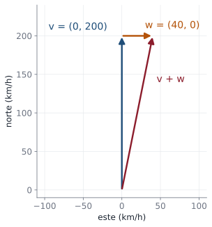
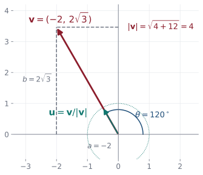
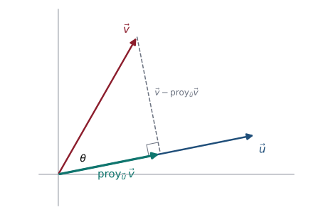

## En la vida diaria: el viento y el avión {.nostretch}

::: {.aplicacion data-t="Para empezar"}
Un avión apunta al norte, pero el viento lo empuja hacia el este. ¿Hacia dónde avanza en realidad y qué tan rápido?
:::

{fig-align="center" height="250px"}

Velocidades, fuerzas y desplazamientos tienen **tamaño y dirección**: son **vectores**, y se combinan sumándolos. El ángulo entre dos vectores también sirve para comparar gustos en las apps de recomendaciones.

**En esta clase:** aprenderá a medir vectores, calcular ángulos entre ellos y proyectar uno sobre otro.

## Objetivos de la clase

- Representar vectores de $\mathbb R^2$ como segmentos dirigidos y calcular su **magnitud** y **dirección**.
- Obtener **vectores unitarios** y escribir vectores en términos de $\mathbf i$ y $\mathbf j$.
- Calcular el **ángulo** entre dos vectores con el producto escalar.
- Decidir si dos vectores son **paralelos** u **ortogonales**.
- Calcular la **proyección ortogonal** de un vector sobre otro y demostrar sus propiedades.

## Vectores en el plano

::: {.definicion}
Un vector en $\mathbb R^2$ es un par ordenado $\mathbf v=(a,b)$. Geométricamente, es un **segmento dirigido**: todos los segmentos con la misma longitud y dirección representan el mismo vector. El representante que parte del origen termina en el punto $(a,b)$.
:::

. . .

- El vector de $P=(x_1,y_1)$ a $Q=(x_2,y_2)$ es $\;\overrightarrow{PQ}=(x_2-x_1,\;y_2-y_1)$.
- **Suma** (regla del paralelogramo): $(a,b)+(c,d)=(a+c,b+d)$.
- **Múltiplo escalar:** $\alpha(a,b)=(\alpha a,\alpha b)$; si $\alpha<0$ invierte el sentido.

. . .

::: {.definicion data-t="Magnitud y dirección"}
La **magnitud** (longitud, norma) de $\mathbf v=(a,b)$ es $\;|\mathbf v| = \sqrt{a^2+b^2}$.
La **dirección** es el ángulo $\theta\in[0,2\pi)$ que forma $\mathbf v$ con el eje $x$ positivo: $\;\cos\theta = \dfrac{a}{|\mathbf v|},\;\operatorname{sen}\theta=\dfrac{b}{|\mathbf v|}$ (si $a\neq0$, $\tan\theta = b/a$, cuidando el cuadrante).
:::

## Ejemplos resueltos: magnitud y dirección

::: {.ejemplo}
Halle la magnitud y la dirección de $\mathbf u = (3,-4)$.
:::

. . .

$|\mathbf u| = \sqrt{9+16}=5$. Como $\tan\theta = -\tfrac43$ y el punto $(3,-4)$ está en el **cuarto cuadrante**:
$\;\theta = 2\pi - \arctan\tfrac43 \approx 360^\circ - 53.13^\circ = 306.87^\circ$.

. . .

::: {.ejemplo}
Un vector tiene magnitud $6$ y dirección $150^\circ$. Halle sus componentes.
:::

. . .

$\mathbf v=(6\cos150^\circ,\;6\operatorname{sen}150^\circ)=\left(6\cdot\left(-\tfrac{\sqrt3}{2}\right),\;6\cdot\tfrac12\right)=(-3\sqrt3,\;3)$.

. . .

::: {.obs data-t="Ojo con la calculadora"}
$\arctan$ devuelve ángulos en $(-90^\circ,90^\circ)$. Si $a<0$, hay que sumar $180^\circ$. Dibuje siempre el vector para ubicar el cuadrante.
:::

## Magnitud, dirección y vector unitario en una figura

{fig-align="center" width="46%"}

Para $\mathbf v=(-2,2\sqrt3)$: $|\mathbf v|=4$, la dirección es $120^\circ$ (segundo cuadrante) y el unitario $\mathbf u=\left(-\tfrac12,\tfrac{\sqrt3}{2}\right)$ está sobre el círculo de radio 1.

## Vectores unitarios

::: {.definicion}
Un **vector unitario** es un vector de magnitud 1. Los vectores $\mathbf i=(1,0)$ y $\mathbf j=(0,1)$ son unitarios y todo vector se escribe como $\;(a,b) = a\,\mathbf i + b\,\mathbf j$.
:::

. . .

::: {.teorema}
Si $\mathbf v\neq\mathbf 0$, entonces $\;\mathbf u=\dfrac{\mathbf v}{|\mathbf v|}\;$ es un vector unitario con la misma dirección que $\mathbf v$. Además, todo unitario es de la forma $\mathbf u = (\cos\theta,\operatorname{sen}\theta)$.
:::

. . .

::: {.demo}
$\left|\dfrac{\mathbf v}{|\mathbf v|}\right| = \dfrac{1}{|\mathbf v|}|\mathbf v| = 1$, porque $|\alpha\mathbf v| = \sqrt{\alpha^2a^2+\alpha^2b^2}=|\alpha|\,|\mathbf v|$ y aquí $\alpha=1/|\mathbf v|>0$.
:::

. . .

::: {.ejemplo}
Unitario en la dirección de $\mathbf v = 2\mathbf i - 3\mathbf j$: $\;\mathbf u = \dfrac{1}{\sqrt{13}}(2,-3) = \left(\tfrac{2}{\sqrt{13}},-\tfrac{3}{\sqrt{13}}\right)$.
:::

## Producto escalar y ángulo entre vectores

::: {.definicion}
El **producto escalar** de $\mathbf u=(a_1,b_1)$ y $\mathbf v=(a_2,b_2)$ es $\;\mathbf u\cdot\mathbf v = a_1a_2+b_1b_2$. Note que $\mathbf v\cdot\mathbf v = |\mathbf v|^2$.
:::

. . .

::: {.teorema}
Si $\mathbf u,\mathbf v\neq\mathbf 0$ y $\varphi\in[0,\pi]$ es el ángulo entre ellos:
$$
\cos\varphi=\frac{\mathbf u\cdot\mathbf v}{|\mathbf u|\,|\mathbf v|}.
$$
:::

. . .

::: {.demo}
Por la **ley de los cosenos** en el triángulo de lados $\mathbf u$, $\mathbf v$ y $\mathbf v-\mathbf u$:
$|\mathbf v-\mathbf u|^2 = |\mathbf u|^2+|\mathbf v|^2-2|\mathbf u||\mathbf v|\cos\varphi$. Por otra parte,
$|\mathbf v-\mathbf u|^2=(\mathbf v-\mathbf u)\cdot(\mathbf v-\mathbf u)=|\mathbf v|^2-2\,\mathbf u\cdot\mathbf v+|\mathbf u|^2$.
Igualando: $\;-2\,\mathbf u\cdot\mathbf v = -2|\mathbf u||\mathbf v|\cos\varphi$.
:::

## En la vida real: el viento y el avión {.nostretch}

:::: {.columns}
::: {.column width="60%"}
::: {.aplicacion data-t="Navegación"}
Un avión vuela hacia el norte a $200$ km/h respecto al aire y sopla viento hacia el este a $40$ km/h.
:::

La velocidad real es la **suma de vectores**:
$$
\mathbf v+\mathbf w=(0,200)+(40,0)=(40,200).
$$

- Rapidez: $\|(40,200)\|=\sqrt{41\,600}\approx204$ km/h.
- Desvío: $\tan\theta=\tfrac{40}{200}\Rightarrow\theta\approx11.3^\circ$ al este del norte.
:::
::: {.column width="40%"}
{width="95%"}
:::
::::

## Paralelismo y ortogonalidad

::: {.definicion}
Dos vectores no nulos $\mathbf u$, $\mathbf v$ son

- **paralelos** si el ángulo entre ellos es $0$ o $\pi$, es decir, si $\mathbf v=\alpha\mathbf u$ para algún $\alpha\neq0$;
- **ortogonales** (perpendiculares) si el ángulo es $\pi/2$, es decir, si $\;\mathbf u\cdot\mathbf v = 0$.
:::

. . .

::: {.ejemplo}
**(a)** $\mathbf a=(1,2)$, $\mathbf b=(-3,1)$: $\mathbf a\cdot\mathbf b = -3+2=-1$, $\cos\varphi = \dfrac{-1}{\sqrt5\sqrt{10}}$, $\varphi\approx98.13^\circ$.
**(b)** $(2,-3)$ y $(-4,6)$: $(-4,6)=-2(2,-3)$, **paralelos** de sentido opuesto.
**(c)** $(2,3)$ y $(-6,4)$: producto escalar $-12+12=0$, **ortogonales**.
:::

. . .

::: {.ejemplo}
Halle $\alpha$ para que $(3,-2)$ y $(\alpha, 6)$ sean ortogonales: $3\alpha - 12 = 0\Rightarrow\alpha=4$.
:::

## Machine learning: similitud entre gustos {.compacto .nostretch}

::: {.ml data-t="Sistemas de recomendación"}
Cada persona califica cuatro películas de 0 a 5: $\;\mathbf u=(5,1,0,4)$, $\;\mathbf v=(4,0,1,5)$, $\;\mathbf w=(0,5,4,1)$. Las tres tienen norma $\sqrt{42}$.
:::

La **similitud coseno** es el coseno del ángulo entre los vectores:
$$
\cos(\mathbf u,\mathbf v)=\frac{\mathbf u\cdot\mathbf v}{\|\mathbf u\|\|\mathbf v\|}=\frac{20+0+0+20}{42}\approx0.95,
\qquad
\cos(\mathbf u,\mathbf w)=\frac{0+5+0+4}{42}\approx0.21 .
$$

. . .

$\mathbf u$ y $\mathbf v$ "apuntan" casi en la misma dirección: tienen gustos parecidos, y a $\mathbf u$ se le recomiendan películas que le gustaron a $\mathbf v$. Los buscadores y los asistentes de IA comparan textos de la misma forma, representándolos como vectores.

. . .

::: {.aplicacion data-t="Trabajo"}
Arrastrar una maleta $10$ m con una fuerza de $50$ N inclinada $30^\circ$: $\;W=\mathbf F\cdot\mathbf d=50\cdot10\cos30^\circ\approx433$ J. Solo cuenta la **proyección** de la fuerza sobre el desplazamiento.
:::

## Proyección ortogonal

{fig-align="center" width="52%"}

::: {.definicion}
La **proyección** de $\mathbf v$ sobre $\mathbf u\neq\mathbf 0$ es el vector
$$
\operatorname{proy}_{\mathbf u}\mathbf v=\frac{\mathbf u\cdot\mathbf v}{|\mathbf u|^2}\,\mathbf u .
$$
Su **componente escalar** es $\dfrac{\mathbf u\cdot\mathbf v}{|\mathbf u|}=|\mathbf v|\cos\theta$, positiva si $\theta$ es agudo y negativa si es obtuso.
:::

## ¿De dónde sale la fórmula?

::: {.demo}
Buscamos $\operatorname{proy}_{\mathbf u}\mathbf v = k\,\mathbf u$ tal que $\mathbf v - k\mathbf u$ sea **ortogonal** a $\mathbf u$:
$$
(\mathbf v - k\mathbf u)\cdot\mathbf u = 0 \iff \mathbf v\cdot\mathbf u - k\,\mathbf u\cdot\mathbf u = 0 \iff k=\frac{\mathbf u\cdot\mathbf v}{|\mathbf u|^2}.
$$
Alternativamente, en el triángulo rectángulo de la figura, la longitud del cateto adyacente es $|\mathbf v|\cos\theta=|\mathbf v|\dfrac{\mathbf u\cdot\mathbf v}{|\mathbf u||\mathbf v|}=\dfrac{\mathbf u\cdot\mathbf v}{|\mathbf u|}$, y se multiplica por el unitario $\dfrac{\mathbf u}{|\mathbf u|}$.
:::

. . .

::: {.teorema}
$\mathbf v = \operatorname{proy}_{\mathbf u}\mathbf v + (\mathbf v - \operatorname{proy}_{\mathbf u}\mathbf v)$, donde el primer vector es paralelo a $\mathbf u$ y el segundo es ortogonal a $\mathbf u$.
:::

## Ejemplo resuelto: proyección

::: {.ejemplo}
Sean $\mathbf u = (4,1)$ y $\mathbf v = (2,3)$. Calcule $\operatorname{proy}_{\mathbf u}\mathbf v$ y descomponga $\mathbf v$ en una parte paralela y otra ortogonal a $\mathbf u$.
:::

. . .

$\mathbf u\cdot\mathbf v = 8+3=11$, $\;|\mathbf u|^2=17$:
$$
\operatorname{proy}_{\mathbf u}\mathbf v=\frac{11}{17}(4,1)=\left(\frac{44}{17},\frac{11}{17}\right).
$$

. . .

$$
\mathbf v - \operatorname{proy}_{\mathbf u}\mathbf v = \left(2-\frac{44}{17},\;3-\frac{11}{17}\right)=\left(-\frac{10}{17},\frac{40}{17}\right).
$$

. . .

**Verificación:** $\left(-\tfrac{10}{17},\tfrac{40}{17}\right)\cdot(4,1) = \tfrac{-40+40}{17} = 0$ ✓. La componente escalar es $\tfrac{11}{\sqrt{17}}\approx2.67$.

## Desigualdad de Cauchy-Schwarz

::: {.teorema}
Para todo $\mathbf u,\mathbf v$: $\;|\mathbf u\cdot\mathbf v|\le|\mathbf u|\,|\mathbf v|$, y en consecuencia $|\mathbf u+\mathbf v|\le|\mathbf u|+|\mathbf v|$ (**desigualdad triangular**).
:::

. . .

::: {.demo}
Si alguno es $\mathbf 0$ es trivial. Si no, $|\mathbf u\cdot\mathbf v| = |\mathbf u||\mathbf v||\cos\varphi|\le|\mathbf u||\mathbf v|$ porque $|\cos\varphi|\le1$. Luego
$$
|\mathbf u+\mathbf v|^2=|\mathbf u|^2+2\,\mathbf u\cdot\mathbf v+|\mathbf v|^2\le|\mathbf u|^2+2|\mathbf u||\mathbf v|+|\mathbf v|^2=(|\mathbf u|+|\mathbf v|)^2.
$$
:::

. . .

::: {.obs}
La igualdad $|\mathbf u\cdot\mathbf v| = |\mathbf u||\mathbf v|$ ocurre exactamente cuando $\mathbf u$ y $\mathbf v$ son paralelos (o uno es cero).
:::

## Aplicación: fuerza resultante (tipo parcial)

::: {.ejemplo}
Dos fuerzas $\mathbf u$ y $\mathbf v$, ambas de magnitud $10$, forman ángulos de $30^\circ$ y $150^\circ$ con el eje $x$ positivo. Halle la magnitud y la dirección de la resultante $\mathbf R=\mathbf u+\mathbf v$.
:::

. . .

$$
\mathbf u=(10\cos30^\circ,\;10\operatorname{sen}30^\circ)=(5\sqrt3,\;5),\qquad
\mathbf v=(10\cos150^\circ,\;10\operatorname{sen}150^\circ)=(-5\sqrt3,\;5).
$$

. . .

$\mathbf R=(0,\;10)$, así que $\|\mathbf R\|=10$ y $\theta=90^\circ$: las componentes horizontales se **cancelan** por simetría.

## Ejemplo 1 · Fácil: magnitud, vector unitario y dirección {.compacto}

::: {.ejemplo data-t="Nivel fácil"}
Para $\mathbf v=(-3,4)$, halle $\|\mathbf v\|$, un vector unitario en su dirección y el ángulo que forma con el eje $x$.
:::

. . .

**Paso 1.** $\;\|\mathbf v\|=\sqrt{(-3)^2+4^2}=\sqrt{25}=5.$

. . .

**Paso 2 · Unitario:** dividir el vector por su norma: $\;\mathbf u=\tfrac15(-3,4)=\left(-\tfrac35,\tfrac45\right)$, y $\|\mathbf u\|=1$ ✓.

. . .

**Paso 3 · Ángulo.** $\tan\theta=\tfrac{4}{-3}$, pero $\mathbf v$ está en el **segundo cuadrante**: $\theta=180^\circ-\arctan\tfrac43\approx180^\circ-53.13^\circ=126.87^\circ$.

::: {.solucion}
$\|\mathbf v\|=5$, $\;\mathbf u=(-\tfrac35,\tfrac45)$, $\;\theta\approx126.87^\circ$. La calculadora da $-53.13^\circ$: siempre hay que revisar el cuadrante.
:::

## Ejemplo 2 · Fácil: ángulo entre dos vectores {.compacto}

::: {.ejemplo data-t="Nivel fácil"}
Halle el ángulo entre $\mathbf u=(1,2)$ y $\mathbf v=(3,1)$.
:::

. . .

**Paso 1 · Fórmula:** $\cos\theta=\dfrac{\mathbf u\cdot\mathbf v}{\|\mathbf u\|\|\mathbf v\|}$.

. . .

**Paso 2.** $\;\mathbf u\cdot\mathbf v=3+2=5$, $\;\|\mathbf u\|=\sqrt5$, $\;\|\mathbf v\|=\sqrt{10}$:
$$
\cos\theta=\frac{5}{\sqrt5\sqrt{10}}=\frac{5}{\sqrt{50}}=\frac{1}{\sqrt2}.
$$

::: {.solucion}
$\theta=45^\circ$. Como $\mathbf u\cdot\mathbf v>0$, el ángulo es agudo.
:::

## Ejemplo 3 · Medio: proyección y descomposición {.compacto}

::: {.ejemplo data-t="Nivel medio"}
Descomponga $\mathbf u=(4,2)$ como suma de un vector paralelo a $\mathbf v=(3,-1)$ y otro ortogonal a $\mathbf v$.
:::

. . .

**Paso 1 · Proyección:** $\;\operatorname{proj}_{\mathbf v}\mathbf u=\dfrac{\mathbf u\cdot\mathbf v}{\|\mathbf v\|^2}\,\mathbf v=\dfrac{12-2}{10}(3,-1)=(3,-1).$

. . .

**Paso 2 · Lo que sobra es la parte ortogonal:** $\;\mathbf w=\mathbf u-\operatorname{proj}_{\mathbf v}\mathbf u=(4,2)-(3,-1)=(1,3).$

. . .

**Paso 3 · Verificar.** $\mathbf w\cdot\mathbf v=3-3=0$ ✓ y $(3,-1)+(1,3)=(4,2)$ ✓.

::: {.solucion}
$\mathbf u=\underbrace{(3,-1)}_{\parallel\,\mathbf v}+\underbrace{(1,3)}_{\perp\,\mathbf v}$. Así se separa una fuerza en la parte que empuja en una dirección y la que no aporta en ella.
:::

## Ejemplo 4 · Difícil: un parámetro y tres condiciones {.compacto}

::: {.ejemplo data-t="Nivel difícil"}
Sean $\mathbf u=(\alpha,2)$ y $\mathbf v=(3,-4)$. Halle $\alpha$ para que (a) sean ortogonales, (b) sean paralelos, (c) la componente de $\mathbf u$ en la dirección de $\mathbf v$ sea $2$.
:::

. . .

**(a) Ortogonales:** $\mathbf u\cdot\mathbf v=3\alpha-8=0\Rightarrow\alpha=\tfrac83$.

. . .

**(b) Paralelos:** $\mathbf u=c\,\mathbf v$ para algún $c$. De la segunda componente, $2=-4c\Rightarrow c=-\tfrac12$; entonces $\alpha=3c=-\tfrac32$.

. . .

**(c) Componente escalar:** $\;\operatorname{comp}_{\mathbf v}\mathbf u=\dfrac{\mathbf u\cdot\mathbf v}{\|\mathbf v\|}=\dfrac{3\alpha-8}{5}=2\Rightarrow\alpha=6.$

::: {.solucion}
**(a)** $\alpha=\tfrac83$; **(b)** $\alpha=-\tfrac32$; **(c)** $\alpha=6$. Comprobación de (c): $\mathbf u=(6,2)$, $\;\tfrac{18-8}{5}=2$ ✓. Cada condición se traduce en una ecuación distinta con el producto punto.
:::

## Práctica en clase

::: {.ejercicio data-t="1"}
Sean $\mathbf u=(3,4)$ y $\mathbf v=(1,0)$. Calcule $\left\|\operatorname{proy}_{\mathbf v}\mathbf u\right\|$.
:::

::: {.solucion .fragment}
$\operatorname{proy}_{\mathbf v}\mathbf u=\dfrac{3}{1}(1,0)=(3,0)$: magnitud $3$ (la "sombra" de $\mathbf u$ sobre el eje $x$).
:::

::: {.ejercicio data-t="2"}
Halle un vector de magnitud $6$ en la dirección de $(1,-2)$ y otro ortogonal a él con la misma magnitud.
:::

::: {.solucion .fragment}
$6\cdot\dfrac{(1,-2)}{\sqrt5}=\left(\tfrac{6}{\sqrt5},-\tfrac{12}{\sqrt5}\right)$. Ortogonal: intercambiar y cambiar un signo, $\left(\tfrac{12}{\sqrt5},\tfrac{6}{\sqrt5}\right)$.
:::

## Ejercicios propuestos

::: {.ejercicio data-t="1"}
Halle la magnitud y la dirección de $\mathbf v = (-2, 2\sqrt3)$ y un vector unitario en su dirección.
:::

::: {.solucion .fragment}
$|\mathbf v| = \sqrt{4+12}=4$. Segundo cuadrante: $\tan\theta = -\sqrt3$, $\theta = 120^\circ$. Unitario: $\left(-\tfrac12,\tfrac{\sqrt3}{2}\right)=(\cos120^\circ,\operatorname{sen}120^\circ)$.
:::

## Ejercicios propuestos

::: {.ejercicio data-t="2"}
Sean $\mathbf u = (1,-2)$ y $\mathbf v = (3,4)$. Calcule el ángulo entre ellos, $\operatorname{proy}_{\mathbf v}\mathbf u$ y $\operatorname{proy}_{\mathbf u}\mathbf v$.
:::

::: {.solucion .fragment}
$\mathbf u\cdot\mathbf v = 3-8=-5$, $\cos\varphi = \dfrac{-5}{\sqrt5\cdot5}=-\dfrac{1}{\sqrt5}$, $\varphi\approx116.57^\circ$. $\;\operatorname{proy}_{\mathbf v}\mathbf u=\dfrac{-5}{25}(3,4)=\left(-\tfrac35,-\tfrac45\right)$, $\;\operatorname{proy}_{\mathbf u}\mathbf v=\dfrac{-5}{5}(1,-2)=(-1,2)$. Las dos proyecciones son **distintas**.
:::

## Ejercicios propuestos

::: {.ejercicio data-t="3 · Demostración"}
Demuestre que $\operatorname{proy}_{\mathbf u}(\operatorname{proy}_{\mathbf u}\mathbf v)=\operatorname{proy}_{\mathbf u}\mathbf v$. Interprételo geométricamente.
:::

::: {.solucion .fragment}
Sea $\mathbf p = k\mathbf u$ con $k = \frac{\mathbf u\cdot\mathbf v}{|\mathbf u|^2}$. Entonces $\operatorname{proy}_{\mathbf u}\mathbf p = \frac{\mathbf u\cdot(k\mathbf u)}{|\mathbf u|^2}\mathbf u = k\frac{|\mathbf u|^2}{|\mathbf u|^2}\mathbf u = k\mathbf u=\mathbf p$. Proyectar un vector que ya está sobre la recta de $\mathbf u$ no lo cambia.
:::

## Ejercicios propuestos

::: {.ejercicio data-t="4 · Demostración"}
Demuestre que $\mathbf u$ y $\mathbf v$ son ortogonales si y solo si $|\mathbf u+\mathbf v|^2 = |\mathbf u|^2 + |\mathbf v|^2$ (teorema de Pitágoras).
:::

::: {.solucion .fragment}
$|\mathbf u+\mathbf v|^2 = |\mathbf u|^2 + 2\,\mathbf u\cdot\mathbf v+|\mathbf v|^2$. Esta expresión es igual a $|\mathbf u|^2+|\mathbf v|^2$ si y solo si $\mathbf u\cdot\mathbf v=0$.
:::

## Ejercicios del texto guía {.texto-guia}

Grossman y Flores, *Álgebra lineal*, 8.ª ed.:

| Sección | Ejercicios |
|---|---|
| 4.1 Vectores en el plano | 5, 9, 15, 17, 22, 28, 39, 50 |
| 4.2 El producto escalar y las proyecciones en $\mathbb R^2$ | 5, 8, 12, 13, 14, 15, 21, 25, 28, 41 |

## Resumen

- $|\mathbf v|=\sqrt{a^2+b^2}$; dirección: $\cos\theta=a/|\mathbf v|$, $\operatorname{sen}\theta=b/|\mathbf v|$ (¡cuadrante!).
- Unitario: $\mathbf v/|\mathbf v|$.
- $\cos\varphi = \dfrac{\mathbf u\cdot\mathbf v}{|\mathbf u||\mathbf v|}$; ortogonales $\iff\mathbf u\cdot\mathbf v=0$; paralelos $\iff\mathbf v=\alpha\mathbf u$.
- $\operatorname{proy}_{\mathbf u}\mathbf v=\dfrac{\mathbf u\cdot\mathbf v}{|\mathbf u|^2}\mathbf u$ y $\mathbf v-\operatorname{proy}_{\mathbf u}\mathbf v\perp\mathbf u$.

 

[← Clase 10](clase_10.qmd) · [Programa del curso](../algebra_lineal.qmd) · [Clase 12: Vectores en el espacio y producto cruz →](clase_12.qmd)
