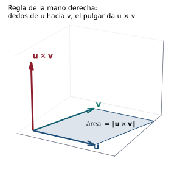
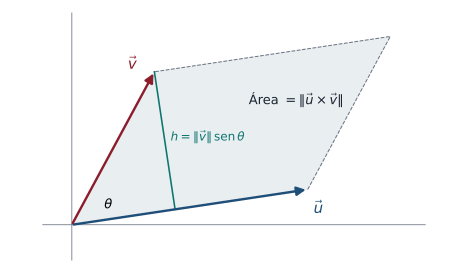
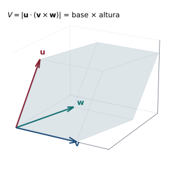

## Objetivos de la clase

- Trabajar con vectores en $\mathbb R^3$: magnitud, distancia, **cosenos directores**.
- Calcular el **producto cruz** y demostrar sus propiedades.
- Usar $\mathbf u\times\mathbf v$ para hallar vectores **ortogonales**, **áreas** de paralelogramos y triángulos.
- Calcular **volúmenes** de paralelepípedos con el **triple producto escalar**.

## Ruta de la clase (70 min)

| Tiempo | Actividad |
|:---:|---|
| 0 – 5 | Repaso: producto escalar y proyección en $\mathbb R^2$ |
| 5 – 20 | Vectores en $\mathbb R^3$: magnitud, cosenos directores, ángulos |
| 20 – 40 | Producto cruz: definición, regla de la mano derecha, propiedades |
| 40 – 55 | Áreas y volúmenes (paralelogramo, triángulo, paralelepípedo) |
| 55 – 70 | Aplicaciones y práctica en clase |

## Vectores en $\mathbb R^3$

::: {.definicion}
Para $\mathbf v=(x,y,z)$: $\;|\mathbf v|=\sqrt{x^2+y^2+z^2}$. La distancia entre $P=(x_1,y_1,z_1)$ y $Q=(x_2,y_2,z_2)$ es $\;\overline{PQ}=|\overrightarrow{PQ}|=\sqrt{(x_2-x_1)^2+(y_2-y_1)^2+(z_2-z_1)^2}$.
Los vectores canónicos son $\mathbf i=(1,0,0)$, $\mathbf j=(0,1,0)$, $\mathbf k=(0,0,1)$, y $(x,y,z)=x\mathbf i+y\mathbf j+z\mathbf k$.
:::

. . .

Producto escalar, ángulo, paralelismo, ortogonalidad y proyección se definen **exactamente igual** que en $\mathbb R^2$.

. . .

::: {.definicion data-t="Cosenos directores"}
La **dirección** de $\mathbf v\neq\mathbf 0$ se describe con los ángulos $\alpha,\beta,\gamma\in[0,\pi]$ que forma con los ejes $x$, $y$, $z$:
$$
\cos\alpha=\frac{x}{|\mathbf v|},\qquad\cos\beta=\frac{y}{|\mathbf v|},\qquad\cos\gamma=\frac{z}{|\mathbf v|},\qquad\cos^2\alpha+\cos^2\beta+\cos^2\gamma=1.
$$
:::

## Ejemplos resueltos en $\mathbb R^3$

::: {.ejemplo}
Halle la magnitud y los ángulos directores de $\mathbf v = (2,-1,2)$.
:::

. . .

$|\mathbf v| = \sqrt{4+1+4}=3$. $\;\cos\alpha=\tfrac23$, $\cos\beta=-\tfrac13$, $\cos\gamma=\tfrac23$, de donde $\alpha=\gamma\approx48.19^\circ$ y $\beta\approx109.47^\circ$. El vector $\left(\tfrac23,-\tfrac13,\tfrac23\right)$ es unitario.

. . .

::: {.ejemplo}
Calcule el ángulo entre $\mathbf a=(2,-1,3)$ y $\mathbf b=(1,4,-2)$.
:::

. . .

$\mathbf a\cdot\mathbf b = 2-4-6=-8$, $|\mathbf a| = \sqrt{14}$, $|\mathbf b|=\sqrt{21}$. $\;\cos\varphi = \dfrac{-8}{\sqrt{294}}\approx-0.4666$, así que $\varphi\approx117.81^\circ$.

## Producto cruz

::: {.definicion}
Sean $\mathbf u=(a_1,b_1,c_1)$ y $\mathbf v=(a_2,b_2,c_2)$. El **producto cruz** es el **vector**
$$
\mathbf u\times\mathbf v=\begin{vmatrix}\mathbf i&\mathbf j&\mathbf k\\a_1&b_1&c_1\\a_2&b_2&c_2\end{vmatrix}
=\begin{vmatrix}b_1&c_1\\b_2&c_2\end{vmatrix}\mathbf i-\begin{vmatrix}a_1&c_1\\a_2&c_2\end{vmatrix}\mathbf j+\begin{vmatrix}a_1&b_1\\a_2&b_2\end{vmatrix}\mathbf k .
$$
Solo está definido en $\mathbb R^3$.
:::

. . .

::: {.ejemplo}
$\mathbf u=(1,-1,2)$, $\mathbf v=(2,1,-1)$:
$$
\mathbf u\times\mathbf v=\begin{vmatrix}\mathbf i&\mathbf j&\mathbf k\\1&-1&2\\2&1&-1\end{vmatrix}=(1-2)\mathbf i-(-1-4)\mathbf j+(1+2)\mathbf k=(-1,5,3).
$$
Verificación: $(-1,5,3)\cdot(1,-1,2)=-1-5+6=0$ y $(-1,5,3)\cdot(2,1,-1)=-2+5-3=0$ ✓.
:::

## Regla de la mano derecha

{fig-align="center" width="44%"}

$\mathbf u\times\mathbf v$ es perpendicular al plano de $\mathbf u$ y $\mathbf v$; su longitud es el área del paralelogramo que forman, y su sentido lo da el pulgar derecho al girar los dedos de $\mathbf u$ hacia $\mathbf v$.

## Propiedades del producto cruz

::: {.teorema}
Para $\mathbf u,\mathbf v,\mathbf w\in\mathbb R^3$ y $\alpha\in\mathbb R$:

::: {.columns}
::: {.column width="50%"}
1. $\mathbf u\times\mathbf 0=\mathbf 0\times\mathbf u=\mathbf 0$
2. $\mathbf u\times\mathbf v=-(\mathbf v\times\mathbf u)$ (anticonmutativo)
3. $(\alpha\mathbf u)\times\mathbf v=\alpha(\mathbf u\times\mathbf v)$
4. $\mathbf u\times(\mathbf v+\mathbf w)=\mathbf u\times\mathbf v+\mathbf u\times\mathbf w$
:::
::: {.column width="50%"}
5. $\mathbf u\times\mathbf u=\mathbf 0$; si $\mathbf u\parallel\mathbf v$, $\mathbf u\times\mathbf v=\mathbf 0$
6. $(\mathbf u\times\mathbf v)\cdot\mathbf u=(\mathbf u\times\mathbf v)\cdot\mathbf v=0$
7. $\mathbf i\times\mathbf j=\mathbf k$, $\;\mathbf j\times\mathbf k=\mathbf i$, $\;\mathbf k\times\mathbf i=\mathbf j$
8. $|\mathbf u\times\mathbf v|=|\mathbf u||\mathbf v|\operatorname{sen}\varphi$
:::
:::
:::

. . .

::: {.demo data-t="2, 5 y 6 usando determinantes"}
(2) Intercambiar $\mathbf u$ y $\mathbf v$ es intercambiar dos filas del determinante: cambia el signo.
(5) Si $\mathbf v=\alpha\mathbf u$, el determinante tiene dos filas proporcionales: vale $\mathbf 0$.
(6) $(\mathbf u\times\mathbf v)\cdot\mathbf w=\begin{vmatrix}w_1&w_2&w_3\\a_1&b_1&c_1\\a_2&b_2&c_2\end{vmatrix}$ (desarrollo por la primera fila). Con $\mathbf w=\mathbf u$ o $\mathbf w=\mathbf v$ hay dos filas iguales: vale $0$.
:::

## Magnitud del producto cruz

::: {.demo data-t="Propiedad 8"}
Desarrollando ambos lados (identidad de Lagrange):
$$
|\mathbf u\times\mathbf v|^2=(b_1c_2-c_1b_2)^2+(a_1c_2-c_1a_2)^2+(a_1b_2-b_1a_2)^2=|\mathbf u|^2|\mathbf v|^2-(\mathbf u\cdot\mathbf v)^2 .
$$
Como $\mathbf u\cdot\mathbf v=|\mathbf u||\mathbf v|\cos\varphi$:
$$
|\mathbf u\times\mathbf v|^2=|\mathbf u|^2|\mathbf v|^2(1-\cos^2\varphi)=|\mathbf u|^2|\mathbf v|^2\operatorname{sen}^2\varphi,
$$
y como $\operatorname{sen}\varphi\ge0$ para $\varphi\in[0,\pi]$, se toma la raíz positiva.
:::

. . .

::: {.obs data-t="Dirección: regla de la mano derecha"}
$\mathbf u\times\mathbf v$ es perpendicular al plano de $\mathbf u$ y $\mathbf v$, y su sentido es el del pulgar derecho cuando los dedos giran de $\mathbf u$ hacia $\mathbf v$.
:::

## Áreas con el producto cruz

{fig-align="center" width="48%"}

::: {.teorema}
El **área** del paralelogramo con lados $\mathbf u$ y $\mathbf v$ es $\;|\mathbf u\times\mathbf v|$. El área del **triángulo** con vértices $P,Q,R$ es $\;\tfrac12\left|\overrightarrow{PQ}\times\overrightarrow{PR}\right|$.
:::

. . .

::: {.demo}
Área = base × altura $=|\mathbf u|\,(|\mathbf v|\operatorname{sen}\varphi)=|\mathbf u\times\mathbf v|$. El triángulo es la mitad del paralelogramo.
:::

## Ejemplo resuelto: área de un triángulo

::: {.ejemplo}
Halle el área del triángulo con vértices $P=(1,0,2)$, $Q=(3,1,1)$, $R=(2,2,4)$ y un vector normal a su plano.
:::

. . .

$\overrightarrow{PQ}=(2,1,-1)$, $\;\overrightarrow{PR}=(1,2,2)$.

. . .

$$
\overrightarrow{PQ}\times\overrightarrow{PR}=\begin{vmatrix}\mathbf i&\mathbf j&\mathbf k\\2&1&-1\\1&2&2\end{vmatrix}=(2+2)\mathbf i-(4+1)\mathbf j+(4-1)\mathbf k=(4,-5,3).
$$

. . .

$$
\text{Área}=\tfrac12\sqrt{16+25+9}=\tfrac12\sqrt{50}=\frac{5\sqrt2}{2}\approx3.54 .
$$
El vector $(4,-5,3)$ es **normal** al plano que contiene al triángulo (lo usaremos en la clase 14).

## El paralelepípedo

{fig-align="center" width="44%"}

Base: paralelogramo de lados $\mathbf v,\mathbf w$ (área $\|\mathbf v\times\mathbf w\|$). Altura: componente de $\mathbf u$ en la dirección de $\mathbf v\times\mathbf w$.

## Triple producto escalar y volumen {.compacto}

::: {.teorema}
El **volumen** del paralelepípedo generado por $\mathbf u,\mathbf v,\mathbf w$ es
$$
V=\left|\mathbf u\cdot(\mathbf v\times\mathbf w)\right|=\left|\det\begin{pmatrix}u_1&u_2&u_3\\v_1&v_2&v_3\\w_1&w_2&w_3\end{pmatrix}\right|.
$$
:::

. . .

::: {.demo}
La base es el paralelogramo de lados $\mathbf v,\mathbf w$, de área $|\mathbf v\times\mathbf w|$. La altura es la longitud de la proyección de $\mathbf u$ sobre la normal $\mathbf v\times\mathbf w$: $h=\dfrac{|\mathbf u\cdot(\mathbf v\times\mathbf w)|}{|\mathbf v\times\mathbf w|}$. Entonces $V = |\mathbf v\times\mathbf w|\,h=|\mathbf u\cdot(\mathbf v\times\mathbf w)|$.
:::

. . .

::: {.ejemplo}
$\mathbf u=(1,2,0)$, $\mathbf v=(0,1,3)$, $\mathbf w=(2,0,1)$: $\;\begin{vmatrix}1&2&0\\0&1&3\\2&0&1\end{vmatrix}=1(1)-2(0-6)+0=13$. Volumen $=13$.
:::

. . .

**Consecuencia:** $\mathbf u,\mathbf v,\mathbf w$ son **coplanares** $\iff$ $\mathbf u\cdot(\mathbf v\times\mathbf w)=0$.

## Aplicación: vectores unitarios ortogonales a dos vectores

::: {.ejemplo}
Encuentre dos vectores unitarios ortogonales a $\mathbf u=\mathbf i-3\mathbf j+\mathbf k$ y $\mathbf v=2\mathbf i+\mathbf j-\mathbf k$.
:::

. . .

$$
\mathbf u\times\mathbf v=\begin{vmatrix}\mathbf i&\mathbf j&\mathbf k\\1&-3&1\\2&1&-1\end{vmatrix}=(3-1)\mathbf i-(-1-2)\mathbf j+(1+6)\mathbf k=(2,3,7),\qquad\|\mathbf u\times\mathbf v\|=\sqrt{62}.
$$

. . .

Los dos unitarios son $\;\pm\dfrac{1}{\sqrt{62}}(2,3,7)$. Compruebe: $(2,3,7)\cdot(1,-3,1)=0$ y $(2,3,7)\cdot(2,1,-1)=0$ ✓.

## Ángulo con el producto cruz: cuidado

::: {.ejemplo}
Calcule el ángulo entre $\mathbf u=(1,-3,1)$ y $\mathbf v=(2,1,-1)$ usando $\|\mathbf u\times\mathbf v\|=\|\mathbf u\|\|\mathbf v\|\operatorname{sen}\theta$.
:::

. . .

$\operatorname{sen}\theta=\dfrac{\sqrt{62}}{\sqrt{11}\,\sqrt6}\approx0.969$, y $\arcsin(0.969)\approx75.75^\circ$.

. . .

Pero $\mathbf u\cdot\mathbf v=2-3-1=-2<0$: el ángulo es **obtuso**. El valor correcto es $\theta=180^\circ-75.75^\circ\approx104.25^\circ$.

. . .

::: {.obs data-t="Moraleja"}
El seno no distingue $\theta$ de $180^\circ-\theta$. Para el ángulo entre vectores use $\cos\theta=\dfrac{\mathbf u\cdot\mathbf v}{\|\mathbf u\|\|\mathbf v\|}$, o revise el signo del producto punto.
:::

## Ejercicios propuestos

::: {.ejercicio data-t="1"}
Calcule $(\mathbf i+2\mathbf j)\times(3\mathbf k)$ y verifique la regla de la mano derecha con $\mathbf i\times\mathbf j$.
:::

::: {.solucion .fragment}
Por linealidad: $3(\mathbf i\times\mathbf k)+6(\mathbf j\times\mathbf k)=3(-\mathbf j)+6\mathbf i=(6,-3,0)$. Y $\mathbf i\times\mathbf j=\begin{vmatrix}\mathbf i&\mathbf j&\mathbf k\\1&0&0\\0&1&0\end{vmatrix}=\mathbf k$.
:::

## Ejercicios propuestos

::: {.ejercicio data-t="2"}
Halle el área del paralelogramo con vértices consecutivos $A=(1,1,0)$, $B=(3,1,0)$, $C=(4,3,0)$, $D=(2,3,0)$.
:::

::: {.solucion .fragment}
$\overrightarrow{AB}=(2,0,0)$, $\overrightarrow{AD}=(1,2,0)$, $\overrightarrow{AB}\times\overrightarrow{AD}=(0,0,4)$. Área $=4$ (base $2$ por altura $2$ ✓).
:::

## Ejercicios propuestos

::: {.ejercicio data-t="3"}
¿Son coplanares $(1,2,3)$, $(2,1,0)$ y $(3,3,3)$?
:::

::: {.solucion .fragment}
$\begin{vmatrix}1&2&3\\2&1&0\\3&3&3\end{vmatrix}=1(3)-2(6)+3(3)=0$: **sí** son coplanares (de hecho, el tercero es la suma de los dos primeros).
:::

## Ejercicios propuestos

::: {.ejercicio data-t="4 · Demostración"}
Demuestre que $(\mathbf u\times\mathbf v)\cdot\mathbf w=\mathbf u\cdot(\mathbf v\times\mathbf w)$.
:::

::: {.solucion .fragment}
Ambos lados son determinantes con filas $\mathbf u,\mathbf v,\mathbf w$: $(\mathbf u\times\mathbf v)\cdot\mathbf w=\det(\mathbf w;\mathbf u;\mathbf v)$ y $\mathbf u\cdot(\mathbf v\times\mathbf w)=\det(\mathbf u;\mathbf v;\mathbf w)$. Pasar de $(\mathbf w,\mathbf u,\mathbf v)$ a $(\mathbf u,\mathbf v,\mathbf w)$ requiere **dos** intercambios de filas, que no cambian el signo.
:::

## Ejercicios del texto guía {.texto-guia}

Grossman y Flores, *Álgebra lineal*, 8.ª ed.:

| Sección | Ejercicios |
|---|---|
| 4.3 Vectores en el espacio | 3, 12, 14, 16, 27, 30, 40, 48, 50 |
| 4.4 El producto cruz de dos vectores | 5, 14, 28, 30, 32, 46 |

## Resumen

- En $\mathbb R^3$: $|\mathbf v|$, distancia, cosenos directores con $\cos^2\alpha+\cos^2\beta+\cos^2\gamma=1$.
- $\mathbf u\times\mathbf v$ es un **vector** ortogonal a $\mathbf u$ y $\mathbf v$; $\;\mathbf u\times\mathbf v=-\mathbf v\times\mathbf u$.
- $|\mathbf u\times\mathbf v|=|\mathbf u||\mathbf v|\operatorname{sen}\varphi$ = área del paralelogramo.
- Volumen del paralelepípedo $=|\mathbf u\cdot(\mathbf v\times\mathbf w)|$.

 

[← Clase 11](clase_11.qmd) · [Programa del curso](../algebra_lineal.qmd) · [Clase 13: Rectas en el espacio →](clase_13.qmd)
