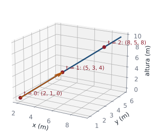
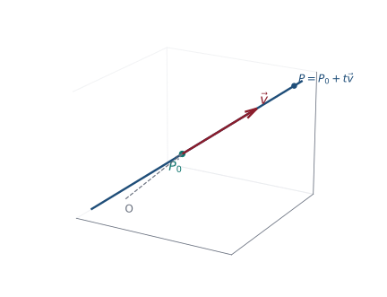
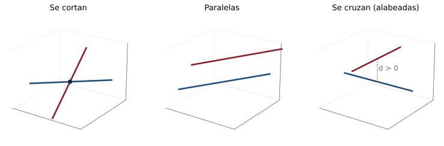

## En la vida diaria: la ruta de un dron {.nostretch}

::: {.aplicacion data-t="Para empezar"}
Un dron despega y avanza siempre en la misma dirección. ¿Dónde estará dentro de 5 segundos? ¿Pasará por encima de cierto edificio?
:::

{fig-align="center" height="250px"}

Su trayectoria es una **recta en el espacio**: un punto de partida más un número de pasos en una dirección fija. Lo mismo describe un rayo láser o la trayectoria de un satélite en un tramo corto.

**En esta clase:** aprenderá a escribir rectas en el espacio y a decidir si dos rectas se cortan.

## Objetivos de la clase

- Deducir las ecuaciones **vectorial**, **paramétricas** y **simétricas** de una recta en $\mathbb R^3$.
- Pasar de una forma a otra y leer un punto y un vector director en cada una.
- Decidir si dos rectas son **paralelas**, **perpendiculares**, **se cortan** o **se cruzan**.
- Hallar el **punto de intersección** de dos rectas y el **ángulo** entre ellas.

## Repaso rápido

::: {.columns}
::: {.column width="50%"}
- $\overrightarrow{PQ} = Q - P$.
- $\mathbf u\cdot\mathbf v = 0 \iff \mathbf u\perp\mathbf v$.
- $\mathbf u\times\mathbf v=\mathbf 0 \iff \mathbf u\parallel\mathbf v$.
- $\mathbf u\times\mathbf v$ es perpendicular a $\mathbf u$ y a $\mathbf v$.

::: {.obs .fragment data-t="Pregunta para empezar"}
¿Qué información mínima necesito para dibujar **una única** recta en el espacio? Piense un minuto antes de avanzar.
:::
:::
::: {.column width="50%"}
{width="75%"}
:::
:::

## La idea: un punto y una dirección

{fig-align="center" width="40%"}

::: {.definicion}
La recta $L$ que pasa por $P_0=(x_0,y_0,z_0)$ con **vector director** $\mathbf v=(a,b,c)\neq\mathbf 0$ es el conjunto de puntos $P$ tales que $\overrightarrow{P_0P}$ es **paralelo** a $\mathbf v$:
$$
\overrightarrow{P_0P}=t\,\mathbf v,\qquad t\in\mathbb R .
$$
:::

## Deducción de las tres formas

Como $\overrightarrow{OP}=\overrightarrow{OP_0}+\overrightarrow{P_0P}$ y $\overrightarrow{P_0P}=t\,\mathbf v$:

. . .

$$
\textbf{1. Vectorial: }\;(x,y,z)=(x_0,y_0,z_0)+t\,(a,b,c),\qquad t\in\mathbb R.
$$

. . .

Igualando componente a componente:
$$
\textbf{2. Paramétricas: }\;x=x_0+at,\qquad y=y_0+bt,\qquad z=z_0+ct .
$$

. . .

Despejando $t$ en cada una (si $a,b,c\neq 0$) e igualando:
$$
\textbf{3. Simétricas: }\;\frac{x-x_0}{a}=\frac{y-y_0}{b}=\frac{z-z_0}{c}\;(=t).
$$

. . .

::: {.obs data-t="Cómo leer las simétricas"}
El **punto** es lo que se **resta** en cada numerador; el **vector director** son los **denominadores**. Ojo: el coeficiente de $x$, $y$, $z$ en el numerador debe ser $1$.
:::

## En la vida real: la ruta de un dron {.nostretch}

:::: {.columns}
::: {.column width="52%"}
::: {.aplicacion data-t="Movimiento rectilíneo"}
Un dron despega de $P(2,1,0)$ y cada segundo se desplaza $\mathbf d=(3,2,4)$ metros.
:::

Su posición es la recta
$$
\mathbf r(t)=(2,1,0)+t(3,2,4),
$$
donde el parámetro $t$ es el **tiempo**.

- A los 2 s está en $(8,5,8)$.
- Llega a $20$ m de altura cuando $4t=20$, es decir en $t=5$ s, en $(17,11,20)$.
:::
::: {.column width="48%"}
{width="100%"}
:::
::::

## Ejemplo 1 (cuaderno)

::: {.ejemplo}
Halle las ecuaciones de la recta que pasa por $(4,3,5)$ y tiene vector director $\mathbf a=(1,1,1)$.
:::

. . .

- **Vectorial:** $(x,y,z)=(4,3,5)+t(1,1,1)$, $t\in\mathbb R$.

. . .

- **Paramétricas:** $x=4+t,\quad y=3+t,\quad z=5+t$.

. . .

- **Simétricas:** $x-4=y-3=z-5$.

. . .

::: {.obs}
Con $t=0$ se obtiene el punto dado; con $t=1$, el punto $(5,4,6)$; con $t=-4$, el punto $(0,-1,1)$, donde la recta cruza el plano $yz$.
:::

## Ejemplo 2 (cuaderno): recta paralela a un vector

::: {.ejemplo}
Encuentre las ecuaciones de la recta que pasa por $(1,-2,4)$ y es paralela al vector $\mathbf v=\mathbf i+\mathbf j-\mathbf k$.
:::

. . .

El vector director es $\mathbf v=(1,1,-1)$:

- **Vectorial:** $(x,y,z)=(1,-2,4)+t(1,1,-1)$.
- **Paramétricas:** $x=1+t,\quad y=-2+t,\quad z=4-t$.
- **Simétricas:** $x-1=y+2=\dfrac{z-4}{-1}$, es decir, $x-1=y+2=4-z$.

. . .

::: {.obs data-t="Comprobación"}
Un punto está en la recta si **el mismo** $t$ sirve en las tres coordenadas. ¿Está $(3,0,2)$? $\;3=1+t\Rightarrow t=2$; $\;0=-2+2$ ✓; $\;2=4-2$ ✓. **Sí.** ¿Está $(3,0,3)$? Con $t=2$, $z=2\neq3$: **no**.
:::

## Ejemplo 3 (cuaderno): recta por dos puntos

::: {.ejemplo}
Encuentre las ecuaciones de la recta $L$ que pasa por $P=(2,-1,6)$ y $Q=(3,1,-2)$.
:::

. . .

El vector director es $\mathbf v=\overrightarrow{PQ}=Q-P=(3-2,\;1-(-1),\;-2-6)=(1,2,-8)$.

. . .

- **Vectorial:** $(x,y,z)=(2,-1,6)+t(1,2,-8)$.
- **Paramétricas:** $x=2+t,\quad y=-1+2t,\quad z=6-8t$.
- **Simétricas:** $x-2=\dfrac{y+1}{2}=\dfrac{z-6}{-8}$.

. . .

::: {.obs}
Se puede usar $Q$ como punto o $\overrightarrow{QP}=(-1,-2,8)$ como director: las ecuaciones cambian, pero la **recta es la misma**. Con $t=1$ se obtiene $Q$ ✓.
:::

## Ejemplo 4 (cuaderno): simétricas "disfrazadas"

::: {.ejemplo}
Halle un punto $P_0$ y un vector director de la recta $\;\dfrac{3-2x}{4}=\dfrac{6-y}{2}=\dfrac{3z-5}{3}$.
:::

. . .

Hay que dejar **cada variable con coeficiente 1** en el numerador:
$$
\frac{-2\left(x-\tfrac32\right)}{4}=\frac{-(y-6)}{2}=\frac{3\left(z-\tfrac53\right)}{3}
\;\Longrightarrow\;
\frac{x-\tfrac32}{-2}=\frac{y-6}{-2}=\frac{z-\tfrac53}{1}.
$$

. . .

$$
P_0=\left(\tfrac32,\;6,\;\tfrac53\right),\qquad \mathbf v=(-2,-2,1).
$$

. . .

::: {.obs data-t="Error frecuente"}
Leer directamente $\mathbf v=(4,2,3)$ y $P_0=(3,6,5)$ es **incorrecto**: los coeficientes $-2$, $-1$ y $3$ de las variables cambian tanto el punto como la dirección.
:::

## Ejemplo 5 (cuaderno): otro vector director

::: {.ejemplo}
Para la recta $(x,y,z)=(1,1,1)+t(2,4,3)$, encuentre otro punto y otro vector director.
:::

. . .

Con $t=\tfrac12$: $\;P=(1,1,1)+\tfrac12(2,4,3)=\left(2,\;3,\;\tfrac52\right)$.

. . .

El vector entre dos puntos de la recta también es director:
$$
\mathbf v_1=P-(1,1,1)=\left(1,\;2,\;\tfrac32\right)=\tfrac12(2,4,3).
$$

. . .

::: {.teorema}
Si $\mathbf v$ es director de $L$, entonces $k\mathbf v$ (con $k\neq0$) también lo es. Dos ecuaciones describen la misma recta si sus directores son paralelos y comparten un punto.
:::

## Ejemplo 6 (cuaderno): recta paralela a otra recta

::: {.ejemplo}
Una recta pasa por $(0,-1,3)$ y es paralela a la recta $\dfrac{x-1}{8}=\dfrac{y+3}{-2}=\dfrac{z}{5}$. Halle sus ecuaciones.
:::

. . .

Rectas paralelas tienen el **mismo director**: $\mathbf v=(8,-2,5)$.

. . .

- (a) Vectorial: $(x,y,z)=(0,-1,3)+t(8,-2,5)$.
- (b) Paramétricas: $x=8t,\quad y=-1-2t,\quad z=3+5t$.
- (c) Simétricas: $\dfrac{x}{8}=\dfrac{y+1}{-2}=\dfrac{z-3}{5}$.

## Posiciones relativas de dos rectas

{fig-align="center" width="92%"}

| Directores | ¿Punto común? | Posición |
|---|---|---|
| paralelos ($\mathbf v_1\times\mathbf v_2=\mathbf 0$) | sí | **coincidentes** (la misma recta) |
| paralelos | no | **paralelas** distintas |
| no paralelos | sí | **se cortan** en un punto |
| no paralelos | no | **se cruzan** (alabeadas) |

## Ejemplo 7 (cuaderno): ¿son paralelas?

::: {.ejemplo}
Determine si las rectas $\;P(t):\;x=3-2t,\;y=4+t,\;z=1-t\;$ y $\;Q(t):\;x=5+2t,\;y=1-t,\;z=2+t\;$ son paralelas.
:::

. . .

$\mathbf v_1=(-2,1,-1)$ y $\mathbf v_2=(2,-1,1)$:
$$
\mathbf v_1\times\mathbf v_2=\begin{vmatrix}\mathbf i&\mathbf j&\mathbf k\\-2&1&-1\\2&-1&1\end{vmatrix}=(1-1)\mathbf i-(-2+2)\mathbf j+(2-2)\mathbf k=\mathbf 0 .
$$
**Son paralelas** (de hecho $\mathbf v_2=-\mathbf v_1$).

. . .

¿Son la **misma** recta? El punto $(5,1,2)$ de $Q$ estaría en $P$ si $5=3-2t\Rightarrow t=-1$, pero entonces $y=4-1=3\neq1$. **Paralelas distintas.**

## Ejemplo 8 (cuaderno): ¿son perpendiculares?

::: {.ejemplo}
Determine si las rectas $\;\dfrac{x-1}{1}=\dfrac{y-2}{3}=\dfrac{z-2}{4}\;$ y $\;\dfrac{x-4}{-2}=\dfrac{y-3}{-2}=\dfrac{z+1}{2}\;$ son perpendiculares.
:::

. . .

$\mathbf v_1=(1,3,4)$, $\;\mathbf v_2=(-2,-2,2)$:
$$
\mathbf v_1\cdot\mathbf v_2=(1)(-2)+(3)(-2)+(4)(2)=-2-6+8=0 .
$$

. . .

Los directores son ortogonales. ¿Se cortan? Igualando $(1+t,\,2+3t,\,2+4t)=(4-2s,\,3-2s,\,-1+2s)$: de las dos primeras $t=-1$, $s=2$, pero la tercera da $-2\neq3$.

. . .

No se cortan: son rectas **ortogonales que se cruzan** (el cuaderno las llama perpendiculares atendiendo solo a los directores).

## Ejemplo 9 (cuaderno): punto de intersección

::: {.ejemplo}
Halle el punto de intersección de $\;L_1:(\mathbf i-6\mathbf j+2\mathbf k)+t(\mathbf i+2\mathbf j+\mathbf k)\;$ y $\;L_2:(4\mathbf j+\mathbf k)+u(2\mathbf i+\mathbf j+2\mathbf k)$.
:::

. . .

Se usan **parámetros distintos** ($t$ y $u$) e igualamos coordenadas: $(1+t,\;-6+2t,\;2+t)=(2u,\;4+u,\;1+2u)$.
$$
\begin{cases}1+t=2u\\-6+2t=4+u\\2+t=1+2u\end{cases}
\;\Longrightarrow\;
\begin{cases}t-2u=-1 & (1)\\2t-u=10 & (2)\\t-2u=-1 & (3)\end{cases}
$$

. . .

De (1): $t=2u-1$. En (2): $2(2u-1)-u=10\Rightarrow3u=12\Rightarrow u=4$, y $t=7$. **Se verifica (3):** $7-8=-1$ ✓.

. . .

$$
L_1(7)=(1+7,\;-6+14,\;2+7)=(8,8,9)=L_2(4)=(8,\;4+4,\;1+8).\ ✓
$$

## Rectas que se cruzan

::: {.ejemplo}
¿Se cortan $\;L_1:(1,0,0)+t(1,1,0)\;$ y $\;L_2:(0,0,3)+s(0,1,1)$?
:::

. . .

$(1+t,\;t,\;0)=(0,\;s,\;3+s)$: de la primera, $t=-1$; de la segunda, $s=t=-1$; la tercera exige $0=3+s=2$. **Contradicción.**

. . .

Los directores $(1,1,0)$ y $(0,1,1)$ no son paralelos y no hay punto común: las rectas **se cruzan**. En la clase 15 calcularemos la distancia entre ellas: $\tfrac{2}{\sqrt3}$.

. . .

::: {.obs data-t="Procedimiento"}
1. ¿Directores paralelos? (producto cruz). 2. Iguale coordenadas con **parámetros distintos**. 3. Resuelva con **dos** ecuaciones y **verifique en la tercera**: si se cumple, se cortan; si no, se cruzan (o son paralelas).
:::

## Ángulo entre dos rectas

::: {.definicion}
El ángulo $\theta\in\left[0,\tfrac{\pi}{2}\right]$ entre dos rectas con directores $\mathbf v_1,\mathbf v_2$ es
$$
\cos\theta=\frac{|\mathbf v_1\cdot\mathbf v_2|}{\|\mathbf v_1\|\,\|\mathbf v_2\|}.
$$
Se toma el **valor absoluto** porque una recta no tiene sentido preferido: se reporta el ángulo agudo.
:::

. . .

::: {.ejemplo}
Ángulo entre $L_1:(1,0,0)+t(1,1,0)$ y $L_2:(0,0,3)+s(0,1,1)$.
:::

. . .

$\cos\theta=\dfrac{|0+1+0|}{\sqrt2\,\sqrt2}=\dfrac12$, así que $\theta=60^\circ$.

## Ejemplo 1 · Fácil: las tres formas de una recta {.compacto}

::: {.ejemplo data-t="Nivel fácil"}
Escriba las ecuaciones vectorial, paramétricas y simétricas de la recta que pasa por $P(1,-2,3)$ con dirección $\mathbf d=(2,1,-1)$.
:::

. . .

**Paso 1 · Vectorial:** punto + $t\cdot$dirección: $\;\mathbf r(t)=(1,-2,3)+t(2,1,-1)$.

. . .

**Paso 2 · Paramétricas:** una ecuación por coordenada: $\;x=1+2t,\;\;y=-2+t,\;\;z=3-t$.

. . .

**Paso 3 · Simétricas:** despejar $t$ en cada una e igualar:
$$
\frac{x-1}{2}=\frac{y+2}{1}=\frac{z-3}{-1}.
$$

::: {.solucion}
Las tres describen la misma recta. Con $t=1$ se obtiene otro punto: $(3,-1,2)$.
:::

## Ejemplo 2 · Fácil: ¿el punto está en la recta? {.compacto}

::: {.ejemplo data-t="Nivel fácil"}
Con la recta $x=1+2t,\;y=-2+t,\;z=3-t$, decida si $A(5,0,1)$ y $B(3,0,2)$ están sobre ella.
:::

. . .

**Idea.** Un punto está en la recta si **un mismo valor de $t$** produce sus tres coordenadas.

. . .

**Punto $A$.** De $x$: $1+2t=5\Rightarrow t=2$. Con $t=2$: $y=0$ ✓, $z=1$ ✓.

. . .

**Punto $B$.** De $x$: $t=1$, pero entonces $y=-1\neq0$ ✗.

::: {.solucion}
$A$ sí está en la recta ($t=2$); $B$ no.
:::

## Ejemplo 3 · Medio: recta por dos puntos y su cruce con un plano coordenado {.compacto}

::: {.ejemplo data-t="Nivel medio"}
Halle la recta que pasa por $A(2,1,0)$ y $B(4,-1,3)$, y el punto donde corta al plano $yz$ ($x=0$).
:::

. . .

**Paso 1 · Dirección:** $\;\mathbf d=\overrightarrow{AB}=(2,-2,3)$. Recta: $\;x=2+2t,\;\;y=1-2t,\;\;z=3t$.

. . .

**Paso 2 · Imponer $x=0$:** $\;2+2t=0\Rightarrow t=-1$.

. . .

**Paso 3 · Sustituir $t=-1$:** $\;(0,\;1+2,\;-3)=(0,3,-3)$.

::: {.solucion}
Corta al plano $yz$ en $(0,3,-3)$. Comprobación: $(0,3,-3)-(2,1,0)=(-2,2,-3)=-\mathbf d$ ✓, así que está en la recta.
:::

## Ejemplo 4 · Difícil: ¿se cortan o se cruzan? {.compacto}

::: {.ejemplo data-t="Nivel difícil"}
Determine la posición relativa de $\;L_1:\;(1,2,3)+t(1,-1,2)\;$ y $\;L_2:\;(3,1,5)+s(2,1,0)$, y el ángulo entre ellas.
:::

. . .

**Paso 1 · ¿Paralelas?** $(1,-1,2)$ no es múltiplo de $(2,1,0)$: **no**.

. . .

**Paso 2 · ¿Se cortan?** Igualando coordenadas:
$$
1+t=3+2s,\qquad 2-t=1+s,\qquad 3+2t=5 .
$$
La tercera da $t=1$. En la primera: $2=3+2s\Rightarrow s=-\tfrac12$. En la segunda: $1=1+s\Rightarrow s=0$. **Contradicción**: no hay punto común.

. . .

**Paso 3 · Ángulo** entre las direcciones: $\;\cos\theta=\dfrac{|(1,-1,2)\cdot(2,1,0)|}{\sqrt6\sqrt5}=\dfrac{1}{\sqrt{30}}\approx0.18\Rightarrow\theta\approx79.5^\circ$.

::: {.solucion}
Las rectas **se cruzan**: no son paralelas ni se cortan, algo que solo pasa en el espacio. En la clase 15 se calcula la distancia entre ellas.
:::

## Práctica en clase (10 min)

::: {.ejercicio data-t="1"}
Escriba en forma vectorial y simétrica la recta $x=1+2t$, $y=-3+t$, $z=4-t$.
:::

::: {.solucion .fragment}
$(x,y,z)=(1,-3,4)+t(2,1,-1)$; $\;\dfrac{x-1}{2}=\dfrac{y+3}{1}=\dfrac{z-4}{-1}$.
:::

::: {.ejercicio data-t="2"}
Halle el punto de intersección (si existe) de $L_1:(1,0,2)+t(1,1,-1)$ y $L_2:(2,1,1)+s(-1,1,1)$.
:::

::: {.solucion .fragment}
$1+t=2-s$, $t=1+s$, $2-t=1+s$. De las dos primeras: $t=1$, $s=0$. Tercera: $2-1=1$ ✓. Punto $(2,1,1)$.
:::

## Práctica en clase (continuación)

::: {.ejercicio data-t="3"}
¿Son paralelas las rectas $L_1$: $P(1,-2,3)$, $\mathbf u=(2,-4,6)$ y $L_2$: $Q(0,1,-1)$, $\mathbf v=(-1,2,-3)$? ¿Son la misma recta?
:::

::: {.solucion .fragment}
$\mathbf u=-2\mathbf v$: paralelas. $\overrightarrow{PQ}=(-1,3,-4)$ no es múltiplo de $\mathbf v$ (el cociente sería $1$, $\tfrac32$, $\tfrac43$), así que son **paralelas distintas**.
:::

::: {.ejercicio data-t="4 · Demostración"}
Demuestre que si $P_1$ y $P_2$ están en la recta $L:P_0+t\mathbf v$, entonces $\overrightarrow{P_1P_2}$ es paralelo a $\mathbf v$.
:::

::: {.solucion .fragment}
$P_1=P_0+t_1\mathbf v$ y $P_2=P_0+t_2\mathbf v$, luego $\overrightarrow{P_1P_2}=P_2-P_1=(t_2-t_1)\mathbf v$, un múltiplo escalar de $\mathbf v$.
:::

## Ejercicios del texto guía {.texto-guia}

Grossman y Flores, *Álgebra lineal*, 8.ª ed. (parte de rectas):

| Sección | Ejercicios |
|---|---|
| 4.5 Rectas y planos en el espacio | 4, 9, 19, 21, 22, 23, 24 |

## Resumen

| Forma | Ecuación | Punto | Director |
|---|---|---|---|
| Vectorial | $(x,y,z)=P_0+t\mathbf v$ | $P_0$ | $\mathbf v$ |
| Paramétricas | $x=x_0+at,\;y=y_0+bt,\;z=z_0+ct$ | términos constantes | coeficientes de $t$ |
| Simétricas | $\frac{x-x_0}{a}=\frac{y-y_0}{b}=\frac{z-z_0}{c}$ | lo que se resta | denominadores |

- Paralelas: $\mathbf v_1\times\mathbf v_2=\mathbf 0$. Perpendiculares: $\mathbf v_1\cdot\mathbf v_2=0$.
- Intersección: parámetros distintos, resolver dos ecuaciones, **verificar la tercera**.

 

[← Clase 12](clase_12.qmd) · [Programa del curso](../algebra_lineal.qmd) · [Clase 14: Planos →](clase_14.qmd)
