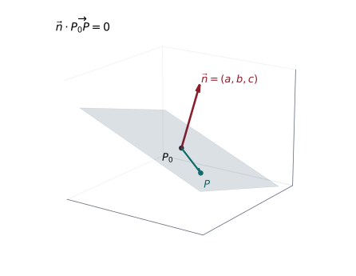
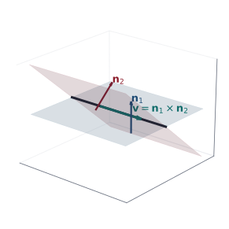
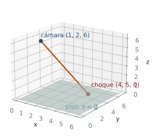
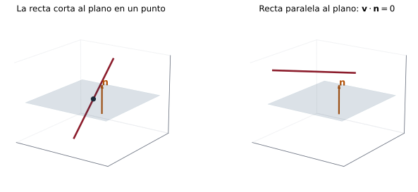

## Objetivos de la clase

- Deducir la ecuación de un plano a partir de un **punto** y un **vector normal**.
- Construir planos con tres puntos, con dos vectores directores, paralelos o perpendiculares a otros planos.
- Hallar la **recta de intersección** de dos planos por dos métodos.
- Resolver problemas que combinan rectas y planos: intersección, paralelismo, planos que contienen rectas.

## Repaso: lo que necesita cada objeto

::: {.columns}
::: {.column width="50%"}
**Recta**

- Un **punto** $P_0$.
- Un **vector director** $\mathbf v$ (paralelo a la recta).
- $P=P_0+t\mathbf v$.
:::
::: {.column width="50%"}
**Plano**

- Un **punto** $P_0$.
- Un **vector normal** $\mathbf n$ (perpendicular al plano).
- $\mathbf n\cdot\overrightarrow{P_0P}=0$.
:::
:::

. . .

::: {.obs data-t="Idea clave"}
Un plano tiene **infinitas** direcciones dentro de él, pero **una sola** dirección perpendicular. Por eso el plano se describe con su normal: el director de una recta contenida en el plano es siempre perpendicular a $\mathbf n$ ($\mathbf v\perp\mathbf n$).
:::

## Deducción de la ecuación del plano

::: {.columns}
::: {.column width="38%"}
{width="100%"}
:::
::: {.column width="62%"}
Sean $P_0=(x_0,y_0,z_0)$ en el plano y $\mathbf n=(a,b,c)$ normal. Un punto $P=(x,y,z)$ está en el plano si y solo si $\overrightarrow{P_0P}\perp\mathbf n$:

$$
(x-x_0,\;y-y_0,\;z-z_0)\cdot(a,b,c)=0
$$
$$
a(x-x_0)+b(y-y_0)+c(z-z_0)=0 .
$$

$$
\boxed{\;ax+by+cz=d\;},\qquad d=ax_0+by_0+cz_0 .
$$

Los **coeficientes** de $x,y,z$ forman el vector normal.
:::
:::

## Machine learning: un plano que separa clases {.compacto .nostretch}

::: {.ml data-t="Clasificador lineal"}
Un clasificador lineal decide con el signo de $\;\mathbf w\cdot\mathbf x+b$. La frontera entre las dos clases es el **plano** $\mathbf w\cdot\mathbf x+b=0$, y $\mathbf w$ es su **vector normal**.
:::

Con $\mathbf w=(2,-1,1)$ y $b=-3$, la frontera es el plano $2x-y+z=3$.

- $\mathbf x=(2,1,1)$: $\;4-1+1-3=1>0$ → clase **positiva** (por ejemplo, "correo spam").
- $\mathbf x=(0,1,1)$: $\;0-1+1-3=-3<0$ → clase **negativa** ("correo normal").

. . .

Entrenar el clasificador es **elegir el plano**: su normal y su posición. Con más características, el "plano" vive en $\mathbb R^n$ y se llama **hiperplano**.

## Ejemplo 1 (cuaderno): punto y normal

::: {.ejemplo}
Encuentre el plano $\Pi$ que pasa por $(2,5,1)$ y tiene vector normal $\mathbf n=\mathbf i-2\mathbf j+3\mathbf k$.
:::

. . .

Con $\mathbf n=(1,-2,3)$ la ecuación es $x-2y+3z=d$. Para hallar $d$, sustituimos el punto:
$$
d=2-2(5)+3(1)=-5 .
$$

. . .

$$
\Pi:\;x-2y+3z=-5 .
$$

. . .

::: {.obs data-t="Dos caminos equivalentes"}
Forma punto-normal: $(x-2)-2(y-5)+3(z-1)=0$. Desarrollando se obtiene lo mismo. Use el que le resulte más cómodo, pero **verifique** siempre sustituyendo el punto.
:::

## Ejemplo 2 (cuaderno): plano por tres puntos

::: {.ejemplo}
Determine la ecuación del plano que contiene a $P=(1,2,1)$, $Q=(-2,3,-1)$ y $R=(1,0,4)$.
:::

. . .

Dos vectores **dentro** del plano: $\;\mathbf u=\overrightarrow{PQ}=(-3,1,-2)$, $\;\mathbf v=\overrightarrow{PR}=(0,-2,3)$. La normal es perpendicular a ambos:
$$
\mathbf n=\mathbf v\times\mathbf u=\begin{vmatrix}\mathbf i&\mathbf j&\mathbf k\\0&-2&3\\-3&1&-2\end{vmatrix}=(4-3)\mathbf i-(0+9)\mathbf j+(0-6)\mathbf k=(1,-9,-6).
$$

. . .

$(x-1)-9(y-2)-6(z-1)=0\;\Longrightarrow\;x-9y-6z=-23$.

. . .

**Verificación:** $Q$: $-2-27+6=-23$ ✓; $\;R$: $1-0-24=-23$ ✓.

## Ejemplo 3 (cuaderno): plano paralelo a otro plano

::: {.ejemplo}
Halle la ecuación del plano que pasa por $(1,2,3)$ y es paralelo al plano $3x-y+4z=2$.
:::

. . .

Planos paralelos tienen **la misma normal**: $\mathbf n=(3,-1,4)$, $P_0=(1,2,3)$.
$$
3(x-1)-1(y-2)+4(z-3)=0\;\Longrightarrow\;3x-3-y+2+4z-12=0\;\Longrightarrow\;3x-y+4z=13 .
$$

. . .

::: {.obs}
Solo cambia el término independiente: $d=2$ en el plano dado y $d=13$ en el nuevo. Planos $ax+by+cz=d_1$ y $ax+by+cz=d_2$ con $d_1\neq d_2$ nunca se cortan.
:::

## Ejemplo 4 (cuaderno): plano perpendicular a un vector

::: {.ejemplo}
Halle la ecuación del plano que pasa por $(3,2,1)$ y es perpendicular al vector $(4,6,7)$.
:::

. . .

"Perpendicular al vector" significa que ese vector es la **normal**: $\mathbf n=(4,6,7)$.
$$
4(x-3)+6(y-2)+7(z-1)=0\;\Longrightarrow\;4x-12+6y-12+7z-7=0\;\Longrightarrow\;4x+6y+7z=31 .
$$

. . .

**Verificación:** $4(3)+6(2)+7(1)=12+12+7=31$ ✓.

## Ejemplo 5 (cuaderno): plano paralelo a dos vectores

::: {.ejemplo}
Halle la ecuación del plano que pasa por $(1,1,1)$ y es paralelo a los vectores $(1,0,1)$ y $(2,1,-1)$.
:::

. . .

Los vectores son directores del plano; la normal es su producto cruz:
$$
\mathbf n=(1,0,1)\times(2,1,-1)=\begin{vmatrix}\mathbf i&\mathbf j&\mathbf k\\1&0&1\\2&1&-1\end{vmatrix}=(0-1)\mathbf i-(-1-2)\mathbf j+(1-0)\mathbf k=(-1,3,1).
$$

. . .

$-1(x-1)+3(y-1)+1(z-1)=0\;\Longrightarrow\;-x+1+3y-3+z-1=0\;\Longrightarrow\;-x+3y+z=3 .$

. . .

::: {.obs data-t="Revise los signos"}
Al pasar $1-3-1=-3$ al otro lado queda $+3$. Verificación con $(1,1,1)$: $-1+3+1=3$ ✓.
:::

## Ejemplo 6 (cuaderno): perpendicular a dos planos

::: {.ejemplo}
Halle el plano que pasa por $(4,0,-2)$ y es perpendicular a cada uno de los planos $x-y+z=0$ y $2x+y-4z=5$.
:::

. . .

Si $\Pi\perp\Pi_1$, la normal de $\Pi_1$ es **paralela** a $\Pi$. Así, $\mathbf n_1=(1,-1,1)$ y $\mathbf n_2=(2,1,-4)$ son directores de $\Pi$:
$$
\mathbf n=\mathbf n_1\times\mathbf n_2=\begin{vmatrix}\mathbf i&\mathbf j&\mathbf k\\1&-1&1\\2&1&-4\end{vmatrix}=(4-1)\mathbf i-(-4-2)\mathbf j+(1+2)\mathbf k=(3,6,3)=3(1,2,1).
$$

. . .

$3(x-4)+6(y-0)+3(z+2)=0\;\Longrightarrow\;3x+6y+3z=6\;\Longrightarrow\;x+2y+z=2 .$

## Ejemplo 7 (cuaderno): por dos puntos y perpendicular a un plano

::: {.ejemplo}
Halle el plano que pasa por $A(-1,2,5)$ y $B(2,1,4)$ y es perpendicular al plano $8x-2y+6z=1$.
:::

. . .

Directores del plano buscado: $\overrightarrow{AB}=(3,-1,-1)$ y la normal del plano dado, $(8,-2,6)$:
$$
\mathbf n=\begin{vmatrix}\mathbf i&\mathbf j&\mathbf k\\3&-1&-1\\8&-2&6\end{vmatrix}=(-6-2)\mathbf i-(18+8)\mathbf j+(-6+8)\mathbf k=(-8,-26,2).
$$

. . .

Con $B$: $-8(x-2)-26(y-1)+2(z-4)=0\Rightarrow-8x-26y+2z=-34\Rightarrow\boxed{4x+13y-z=17}$.

. . .

**Verificación:** $A$: $-4+26-5=17$ ✓; $\;B$: $8+13-4=17$ ✓; $\;(4,13,-1)\cdot(8,-2,6)=32-26-6=0$ ✓.

## Recta de intersección de dos planos

::: {.columns}
::: {.column width="45%"}
{width="100%"}
:::
::: {.column width="55%"}
Si dos planos no son paralelos, se cortan en una **recta**. Su director es perpendicular a **ambas** normales:
$$
\mathbf v=\mathbf n_1\times\mathbf n_2 .
$$
Falta un punto: se obtiene dando un valor a una variable y resolviendo el sistema $2\times2$ que queda.
:::
:::

## Ejemplo 8 (cuaderno): método I, eliminación

::: {.ejemplo}
Halle la recta de intersección de los planos $\;x-y+z=1\;$ y $\;2x+3y-2z=4$.
:::

. . .

**Eliminar $y$:** $3\times$(1.ª) $+$ (2.ª): $\;3x-3y+3z+2x+3y-2z=3+4\Rightarrow5x+z=7\Rightarrow x=\dfrac{7-z}{5}$.

**Eliminar $z$:** $2\times$(1.ª) $+$ (2.ª): $\;2x-2y+2z+2x+3y-2z=2+4\Rightarrow4x+y=6\Rightarrow x=\dfrac{6-y}{4}$.

. . .

$$
x=\frac{6-y}{4}=\frac{7-z}{5}\;\Longrightarrow\;\frac{x-0}{1}=\frac{y-6}{-4}=\frac{z-7}{-5}.
$$

. . .

Punto $P=(0,6,7)$ y director $(1,-4,-5)$. **Verificación:** $0-6+7=1$ ✓; $\;0+18-14=4$ ✓.

## Ejemplo 8: método II, producto cruz y Gauss-Jordan

$$
\mathbf v=\mathbf n_1\times\mathbf n_2=\begin{vmatrix}\mathbf i&\mathbf j&\mathbf k\\1&-1&1\\2&3&-2\end{vmatrix}=(2-3)\mathbf i-(-2-2)\mathbf j+(3+2)\mathbf k=(-1,4,5)\parallel(1,-4,-5).
$$

. . .

O bien, resolviendo el sistema por Gauss-Jordan:
$$
\left(\begin{array}{ccc|c}1&-1&1&1\\2&3&-2&4\end{array}\right)
\xrightarrow{F_2\to F_2-2F_1}
\left(\begin{array}{ccc|c}1&-1&1&1\\0&5&-4&2\end{array}\right)
\xrightarrow[F_1\to F_1+F_2]{F_2\to\frac15F_2}
\left(\begin{array}{ccc|c}1&0&\frac15&\frac75\\0&1&-\frac45&\frac25\end{array}\right)
$$

. . .

Con $z=t$: $\;x=\tfrac75-\tfrac15t,\quad y=\tfrac25+\tfrac45t,\quad z=t$. Director $\left(-\tfrac15,\tfrac45,1\right)\parallel(-1,4,5)$ y, con $t=7$, el punto $(0,6,7)$: **la misma recta** de los tres métodos.

## En la vida real: cómo se dibuja una escena 3D {.nostretch}

:::: {.columns}
::: {.column width="52%"}
Las películas animadas y los videojuegos lanzan **rayos** desde la cámara y calculan dónde chocan con los planos de la escena (*ray tracing*).

Cámara en $C(1,2,6)$, rayo con dirección $(1,1,-2)$:
$$
\mathbf r(t)=(1+t,\;2+t,\;6-2t).
$$

Choque con el piso $z=0$: $\;6-2t=0\Rightarrow t=3$, en el punto $(4,5,0)$. Ese píxel de la pantalla se pinta con el color del piso en $(4,5,0)$.
:::
::: {.column width="48%"}
{width="100%"}
:::
::::

## Rectas y planos: posiciones

{fig-align="center" width="85%"}

Si $\mathbf v\cdot\mathbf n\neq0$ la recta "atraviesa" el plano; si $\mathbf v\cdot\mathbf n=0$ la recta va "a lo largo" del plano.

## Rectas y planos: resumen de casos

| Condición | Posición de $L$ respecto a $\Pi$ |
|---|---|
| $\mathbf v\cdot\mathbf n\neq0$ | corta a $\Pi$ en **un punto** |
| $\mathbf v\cdot\mathbf n=0$, un punto de $L$ en $\Pi$ | **contenida** en $\Pi$ |
| $\mathbf v\cdot\mathbf n=0$, ningún punto en $\Pi$ | **paralela** a $\Pi$ |
| $\mathbf v\parallel\mathbf n$ | **perpendicular** a $\Pi$ |

$\mathbf v$: director de la recta $L$; $\;\mathbf n$: normal del plano $\Pi$.

## Ejemplo 9 (cuaderno): recta paralela a un plano

::: {.ejemplo}
Demuestre que la recta $\;x-5=-t,\;\;y+3=2t,\;\;z+1=-5t\;$ es paralela al plano $\;-3x+y+z=9$.
:::

. . .

Director $\mathbf v=(-1,2,-5)$ y normal $\mathbf n=(-3,1,1)$:
$$
\mathbf n\cdot\mathbf v=(-3)(-1)+(1)(2)+(1)(-5)=3+2-5=0 .
$$
La recta es perpendicular a la normal, es decir, **paralela al plano**.

. . .

¿Está contenida? El punto $(5,-3,-1)$ de la recta da $-15-3-1=-19\neq9$: **no** está en el plano. La recta es paralela y exterior.

## Ejemplo 10 (cuaderno): intersección recta–plano

::: {.ejemplo}
Halle el punto de intersección de la recta $(9,-1,3)+t(-5,-1,1)$ y el plano $x-y+z=4$.
:::

. . .

Paramétricas: $x=9-5t$, $y=-1-t$, $z=3+t$. Sustituimos en el plano:
$$
(9-5t)-(-1-t)+(3+t)=4\;\Longrightarrow\;13-3t=4\;\Longrightarrow\;t=3 .
$$

. . .

Punto: $\;x=9-15=-6,\quad y=-1-3=-4,\quad z=3+3=6$, es decir $(-6,-4,6)$.

. . .

**Verificación:** $-6-(-4)+6=4$ ✓.

## Ejemplo 11 (cuaderno): plano que contiene una recta y un punto

::: {.ejemplo}
Un plano contiene a la recta $\;\dfrac{x}{2}=y-1=z+1\;$ y al punto $Q=(2,1,0)$. Halle su ecuación.
:::

. . .

De la recta: $P_0=(0,1,-1)$ y $\mathbf v=(2,1,1)$. Como $P_0$ y $Q$ están en el plano, $\overrightarrow{P_0Q}=(2,0,1)$ también es director:
$$
\mathbf n=\overrightarrow{P_0Q}\times\mathbf v=\begin{vmatrix}\mathbf i&\mathbf j&\mathbf k\\2&0&1\\2&1&1\end{vmatrix}=(0-1)\mathbf i-(2-2)\mathbf j+(2-0)\mathbf k=(-1,0,2).
$$

. . .

$-1(x-2)+0(y-1)+2(z-0)=0\;\Longrightarrow\;x-2z=2$. **Verificación** con $P_0$: $0-2(-1)=2$ ✓.

## Ejemplo 12 (cuaderno): plano que contiene dos rectas

::: {.ejemplo}
Un plano contiene a las rectas $\;x-1=\dfrac{y-2}{2}=z\;$ y $\;\dfrac{x}{-4}=\dfrac{y}{-2}=\dfrac{z+1}{2}$. Halle su ecuación.
:::

. . .

Puntos: $Q=(1,2,0)$ en la primera y $R=(0,0,-1)$ en la segunda; directores $(1,2,1)$ y $(-4,-2,2)$. Note que $\overrightarrow{RQ}=(1,2,1)$.
$$
\mathbf n=(1,2,1)\times(-4,-2,2)=\begin{vmatrix}\mathbf i&\mathbf j&\mathbf k\\1&2&1\\-4&-2&2\end{vmatrix}=(4+2)\mathbf i-(2+4)\mathbf j+(-2+8)\mathbf k=6(1,-1,1).
$$

. . .

$1(x-1)-1(y-2)+1(z-0)=0\;\Longrightarrow\;x-y+z=-1$. Verificación con $R$: $0-0-1=-1$ ✓.

. . .

::: {.obs data-t="Antes de calcular"}
Dos rectas están en un mismo plano solo si **se cortan o son paralelas**. Aquí se cortan en $R=(0,0,-1)$. Si se cruzaran, no existiría tal plano: compruébelo siempre.
:::

## Ejemplo 13 (cuaderno): recta perpendicular a dos rectas

::: {.ejemplo}
Halle la recta que pasa por $(1,2,2)$ y es perpendicular a las rectas $L_1:\{x+2y-3z=1,\;x+2y-z=0\}$ y $L_2:\{3x-y+3z=0,\;x+4y=2\}$.
:::

. . .

Cada recta es intersección de dos planos, así que su director es el producto cruz de las normales:
$$
\mathbf v_1=(1,2,-3)\times(1,2,-1)=(4,-2,0)\parallel(2,-1,0),
$$
$$
\mathbf v_2=(3,-1,3)\times(1,4,0)=(-12,3,13).
$$

. . .

La recta buscada es perpendicular a ambos directores:
$$
\mathbf v=(2,-1,0)\times(-12,3,13)=(-13,-26,-6)\parallel(13,26,6).
$$

. . .

$$
L:\;(x,y,z)=(1,2,2)+t\,(13,26,6),\qquad t\in\mathbb R .
$$

## Ángulo entre planos

::: {.definicion}
El ángulo entre dos planos es el ángulo agudo entre sus normales:
$$
\cos\theta=\frac{|\mathbf n_1\cdot\mathbf n_2|}{\|\mathbf n_1\|\,\|\mathbf n_2\|}.
$$
:::

. . .

::: {.ejemplo}
Ángulo entre $x+y=3$ y $y+z=1$.
:::

. . .

$\cos\theta=\dfrac{|(1,1,0)\cdot(0,1,1)|}{\sqrt2\sqrt2}=\dfrac12$, de modo que $\theta=60^\circ$.

## Práctica en clase

::: {.ejercicio data-t="1"}
Halle la recta que pasa por $(1,2,-2)$ y es perpendicular al plano $3x-y+5z=7$.
:::

::: {.solucion .fragment}
Director = normal del plano: $(x,y,z)=(1,2,-2)+t(3,-1,5)$.
:::

::: {.ejercicio data-t="2"}
Halle el plano que pasa por $P_1(1,0,2)$ y $P_2(3,1,-1)$ y es perpendicular al plano $x+2y-z=5$.
:::

::: {.solucion .fragment}
$\mathbf n=\overrightarrow{P_1P_2}\times(1,2,-1)=(2,1,-3)\times(1,2,-1)=(5,-1,3)$. Plano: $5(x-1)-y+3(z-2)=0\Rightarrow5x-y+3z=11$.
:::

## Práctica en clase (continuación)

::: {.ejercicio data-t="3"}
Halle el plano que pasa por $A(1,2,3)$ y es perpendicular al vector que va de $B(2,0,1)$ a $C(5,4,-2)$.
:::

::: {.solucion .fragment}
$\mathbf n=\overrightarrow{BC}=(3,4,-3)$: $\;3(x-1)+4(y-2)-3(z-3)=0\Rightarrow3x+4y-3z=2$.
:::

::: {.ejercicio data-t="4 · Demostración"}
Demuestre que si la recta $P_0+t\mathbf v$ cumple $\mathbf v\cdot\mathbf n=0$ y $P_0$ está en el plano $\mathbf n\cdot\mathbf x=d$, entonces **toda** la recta está en el plano.
:::

::: {.solucion .fragment}
$\mathbf n\cdot(P_0+t\mathbf v)=\mathbf n\cdot P_0+t(\mathbf n\cdot\mathbf v)=d+t\cdot0=d$ para todo $t$.
:::

## Ejercicios del texto guía {.texto-guia}

Grossman y Flores, *Álgebra lineal*, 8.ª ed. (parte de planos):

| Sección | Ejercicios |
|---|---|
| 4.5 Rectas y planos en el espacio | 31, 45, 51, 56, 57, 62, 64 |

. . .

::: {.obs data-t="Taller"}
El **Taller 2.2** (rectas y planos en el espacio) está en la sección de [parciales y talleres](../alli_evaluaciones/parciales_talleres.qmd).
:::

## Resumen

| Dato | Normal del plano |
|---|---|
| Punto y normal $\mathbf n$ | $\mathbf n$ |
| Tres puntos $P,Q,R$ | $\overrightarrow{PQ}\times\overrightarrow{PR}$ |
| Punto y dos directores $\mathbf u,\mathbf v$ | $\mathbf u\times\mathbf v$ |
| Paralelo a $\Pi_1$ | $\mathbf n_1$ |
| Perpendicular a $\Pi_1$ y $\Pi_2$ | $\mathbf n_1\times\mathbf n_2$ |
| Contiene a $L$ ($P_0,\mathbf v$) y a $Q$ | $\overrightarrow{P_0Q}\times\mathbf v$ |

- Recta de intersección de dos planos: director $\mathbf n_1\times\mathbf n_2$ y un punto común.
- **Verifique siempre** sustituyendo los puntos en la ecuación final.

 

[← Clase 13](clase_13.qmd) · [Programa del curso](../algebra_lineal.qmd) · [Clase 15: Proyecciones y distancias →](clase_15.qmd)
