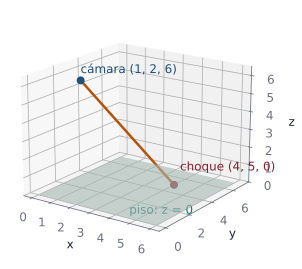
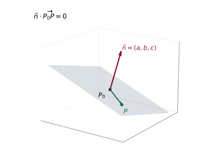
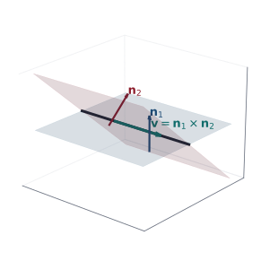
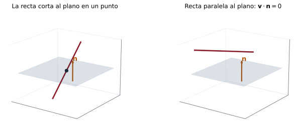

## En la vida diaria: dibujar una escena 3D {.nostretch}

::: {.aplicacion data-t="Para empezar"}
En las películas animadas, cada punto de la pantalla se pinta según el lugar donde un "rayo" desde la cámara choca con el piso, una pared o un objeto.
:::

{fig-align="center" height="250px"}

Pisos, paredes, techos y pantallas son **planos**. Saber dónde choca una recta con un plano es la base del *ray tracing*. Y un clasificador de inteligencia artificial separa dos grupos de datos con un plano.

**En esta clase:** aprenderá a escribir la ecuación de un plano y a encontrar intersecciones con rectas y con otros planos.

## Objetivos de la clase

- Deducir la ecuación de un plano a partir de un **punto** y un **vector normal**.
- Construir planos con tres puntos, con dos vectores directores, paralelos o perpendiculares a otros planos.
- Hallar la **recta de intersección** de dos planos por dos métodos.
- Resolver problemas que combinan rectas y planos: intersección, paralelismo, planos que contienen rectas.

## Repaso: lo que necesita cada objeto

::: {.columns}
::: {.column width="50%"}
**Recta**

- Un **punto** $P_0$.
- Un **vector director** $\mathbf v$ (paralelo a la recta).
- $P=P_0+t\mathbf v$.
:::
::: {.column width="50%"}
**Plano**

- Un **punto** $P_0$.
- Un **vector normal** $\mathbf n$ (perpendicular al plano).
- $\mathbf n\cdot\overrightarrow{P_0P}=0$.
:::
:::

. . .

::: {.obs data-t="Idea clave"}
Un plano tiene **infinitas** direcciones dentro de él, pero **una sola** dirección perpendicular. Por eso el plano se describe con su normal: el director de una recta contenida en el plano es siempre perpendicular a $\mathbf n$ ($\mathbf v\perp\mathbf n$).
:::

## Deducción de la ecuación del plano

::: {.columns}
::: {.column width="38%"}
{width="100%"}
:::
::: {.column width="62%"}
Sean $P_0=(x_0,y_0,z_0)$ en el plano y $\mathbf n=(a,b,c)$ normal. Un punto $P=(x,y,z)$ está en el plano si y solo si $\overrightarrow{P_0P}\perp\mathbf n$:

$$
(x-x_0,\;y-y_0,\;z-z_0)\cdot(a,b,c)=0
$$
$$
a(x-x_0)+b(y-y_0)+c(z-z_0)=0 .
$$

$$
\boxed{\;ax+by+cz=d\;},\qquad d=ax_0+by_0+cz_0 .
$$

Los **coeficientes** de $x,y,z$ forman el vector normal.
:::
:::

## Ejemplo 1 (cuaderno): punto y normal

::: {.ejemplo}
Encuentre el plano $\Pi$ que pasa por $(2,5,1)$ y tiene vector normal $\mathbf n=\mathbf i-2\mathbf j+3\mathbf k$.
:::

. . .

Con $\mathbf n=(1,-2,3)$ la ecuación es $x-2y+3z=d$. Para hallar $d$, sustituimos el punto:
$$
d=2-2(5)+3(1)=-5 .
$$

. . .

$$
\Pi:\;x-2y+3z=-5 .
$$

. . .

::: {.obs data-t="Dos caminos equivalentes"}
Forma punto-normal: $(x-2)-2(y-5)+3(z-1)=0$. Desarrollando se obtiene lo mismo. Use el que le resulte más cómodo, pero **verifique** siempre sustituyendo el punto.
:::

## Ejemplo 2 (cuaderno): plano por tres puntos

::: {.ejemplo}
Determine la ecuación del plano que contiene a $P=(1,2,1)$, $Q=(-2,3,-1)$ y $R=(1,0,4)$.
:::

. . .

Dos vectores **dentro** del plano: $\;\mathbf u=\overrightarrow{PQ}=(-3,1,-2)$, $\;\mathbf v=\overrightarrow{PR}=(0,-2,3)$. La normal es perpendicular a ambos:
$$
\mathbf n=\mathbf v\times\mathbf u=\begin{vmatrix}\mathbf i&\mathbf j&\mathbf k\\0&-2&3\\-3&1&-2\end{vmatrix}=(4-3)\mathbf i-(0+9)\mathbf j+(0-6)\mathbf k=(1,-9,-6).
$$

. . .

$(x-1)-9(y-2)-6(z-1)=0\;\Longrightarrow\;x-9y-6z=-23$.

. . .

**Verificación:** $Q$: $-2-27+6=-23$ ✓; $\;R$: $1-0-24=-23$ ✓.

## Ejemplo 6 (cuaderno): perpendicular a dos planos

::: {.ejemplo}
Halle el plano que pasa por $(4,0,-2)$ y es perpendicular a cada uno de los planos $x-y+z=0$ y $2x+y-4z=5$.
:::

. . .

Si $\Pi\perp\Pi_1$, la normal de $\Pi_1$ es **paralela** a $\Pi$. Así, $\mathbf n_1=(1,-1,1)$ y $\mathbf n_2=(2,1,-4)$ son directores de $\Pi$:
$$
\mathbf n=\mathbf n_1\times\mathbf n_2=\begin{vmatrix}\mathbf i&\mathbf j&\mathbf k\\1&-1&1\\2&1&-4\end{vmatrix}=(4-1)\mathbf i-(-4-2)\mathbf j+(1+2)\mathbf k=(3,6,3)=3(1,2,1).
$$

. . .

$3(x-4)+6(y-0)+3(z+2)=0\;\Longrightarrow\;3x+6y+3z=6\;\Longrightarrow\;x+2y+z=2 .$

## Recta de intersección de dos planos

::: {.columns}
::: {.column width="45%"}
{width="100%"}
:::
::: {.column width="55%"}
Si dos planos no son paralelos, se cortan en una **recta**. Su director es perpendicular a **ambas** normales:
$$
\mathbf v=\mathbf n_1\times\mathbf n_2 .
$$
Falta un punto: se obtiene dando un valor a una variable y resolviendo el sistema $2\times2$ que queda.
:::
:::

## Ejemplo 8 (cuaderno): método I, eliminación

::: {.ejemplo}
Halle la recta de intersección de los planos $\;x-y+z=1\;$ y $\;2x+3y-2z=4$.
:::

. . .

**Eliminar $y$:** $3\times$(1.ª) $+$ (2.ª): $\;3x-3y+3z+2x+3y-2z=3+4\Rightarrow5x+z=7\Rightarrow x=\dfrac{7-z}{5}$.

**Eliminar $z$:** $2\times$(1.ª) $+$ (2.ª): $\;2x-2y+2z+2x+3y-2z=2+4\Rightarrow4x+y=6\Rightarrow x=\dfrac{6-y}{4}$.

. . .

$$
x=\frac{6-y}{4}=\frac{7-z}{5}\;\Longrightarrow\;\frac{x-0}{1}=\frac{y-6}{-4}=\frac{z-7}{-5}.
$$

. . .

Punto $P=(0,6,7)$ y director $(1,-4,-5)$. **Verificación:** $0-6+7=1$ ✓; $\;0+18-14=4$ ✓.

## Rectas y planos: posiciones

{fig-align="center" width="85%"}

Si $\mathbf v\cdot\mathbf n\neq0$ la recta "atraviesa" el plano; si $\mathbf v\cdot\mathbf n=0$ la recta va "a lo largo" del plano.

## Rectas y planos: resumen de casos

| Condición | Posición de $L$ respecto a $\Pi$ |
|---|---|
| $\mathbf v\cdot\mathbf n\neq0$ | corta a $\Pi$ en **un punto** |
| $\mathbf v\cdot\mathbf n=0$, un punto de $L$ en $\Pi$ | **contenida** en $\Pi$ |
| $\mathbf v\cdot\mathbf n=0$, ningún punto en $\Pi$ | **paralela** a $\Pi$ |
| $\mathbf v\parallel\mathbf n$ | **perpendicular** a $\Pi$ |

$\mathbf v$: director de la recta $L$; $\;\mathbf n$: normal del plano $\Pi$.

## Ejemplo 10 (cuaderno): intersección recta–plano

::: {.ejemplo}
Halle el punto de intersección de la recta $(9,-1,3)+t(-5,-1,1)$ y el plano $x-y+z=4$.
:::

. . .

Paramétricas: $x=9-5t$, $y=-1-t$, $z=3+t$. Sustituimos en el plano:
$$
(9-5t)-(-1-t)+(3+t)=4\;\Longrightarrow\;13-3t=4\;\Longrightarrow\;t=3 .
$$

. . .

Punto: $\;x=9-15=-6,\quad y=-1-3=-4,\quad z=3+3=6$, es decir $(-6,-4,6)$.

. . .

**Verificación:** $-6-(-4)+6=4$ ✓.

## Ejemplo 11 (cuaderno): plano que contiene una recta y un punto

::: {.ejemplo}
Un plano contiene a la recta $\;\dfrac{x}{2}=y-1=z+1\;$ y al punto $Q=(2,1,0)$. Halle su ecuación.
:::

. . .

De la recta: $P_0=(0,1,-1)$ y $\mathbf v=(2,1,1)$. Como $P_0$ y $Q$ están en el plano, $\overrightarrow{P_0Q}=(2,0,1)$ también es director:
$$
\mathbf n=\overrightarrow{P_0Q}\times\mathbf v=\begin{vmatrix}\mathbf i&\mathbf j&\mathbf k\\2&0&1\\2&1&1\end{vmatrix}=(0-1)\mathbf i-(2-2)\mathbf j+(2-0)\mathbf k=(-1,0,2).
$$

. . .

$-1(x-2)+0(y-1)+2(z-0)=0\;\Longrightarrow\;x-2z=2$. **Verificación** con $P_0$: $0-2(-1)=2$ ✓.

## Ejemplo 12 (cuaderno): plano que contiene dos rectas

::: {.ejemplo}
Un plano contiene a las rectas $\;x-1=\dfrac{y-2}{2}=z\;$ y $\;\dfrac{x}{-4}=\dfrac{y}{-2}=\dfrac{z+1}{2}$. Halle su ecuación.
:::

. . .

Puntos: $Q=(1,2,0)$ en la primera y $R=(0,0,-1)$ en la segunda; directores $(1,2,1)$ y $(-4,-2,2)$. Note que $\overrightarrow{RQ}=(1,2,1)$.
$$
\mathbf n=(1,2,1)\times(-4,-2,2)=\begin{vmatrix}\mathbf i&\mathbf j&\mathbf k\\1&2&1\\-4&-2&2\end{vmatrix}=(4+2)\mathbf i-(2+4)\mathbf j+(-2+8)\mathbf k=6(1,-1,1).
$$

. . .

$1(x-1)-1(y-2)+1(z-0)=0\;\Longrightarrow\;x-y+z=-1$. Verificación con $R$: $0-0-1=-1$ ✓.

. . .

::: {.obs data-t="Antes de calcular"}
Dos rectas están en un mismo plano solo si **se cortan o son paralelas**. Aquí se cortan en $R=(0,0,-1)$. Si se cruzaran, no existiría tal plano: compruébelo siempre.
:::

## Ángulo entre planos

::: {.definicion}
El ángulo entre dos planos es el ángulo agudo entre sus normales:
$$
\cos\theta=\frac{|\mathbf n_1\cdot\mathbf n_2|}{\|\mathbf n_1\|\,\|\mathbf n_2\|}.
$$
:::

::: {.palabras}
La inclinación entre dos planos se mide con sus **normales** (las flechas perpendiculares a cada plano): el ángulo entre los planos es el ángulo agudo entre esas flechas.
:::

. . .

::: {.ejemplo}
Ángulo entre $x+y=3$ y $y+z=1$.
:::

. . .

$\cos\theta=\dfrac{|(1,1,0)\cdot(0,1,1)|}{\sqrt2\sqrt2}=\dfrac12$, de modo que $\theta=60^\circ$.

## Práctica en clase

::: {.ejercicio data-t="1"}
Halle la recta que pasa por $(1,2,-2)$ y es perpendicular al plano $3x-y+5z=7$.
:::

::: {.solucion .fragment}
**Paso 1 · Dirección.** Una recta perpendicular al plano va en la dirección de la **normal** del plano. La normal se lee de los coeficientes de $3x-y+5z=7$: $\mathbf n=(3,-1,5)$.

**Paso 2 · Recta** (punto + $t\cdot$dirección): $(x,y,z)=(1,2,-2)+t(3,-1,5)$.
:::

## Práctica en clase (continuación)

::: {.ejercicio data-t="2"}
Halle el plano que pasa por $P_1(1,0,2)$ y $P_2(3,1,-1)$ y es perpendicular al plano $x+2y-z=5$.
:::

::: {.solucion .fragment}
**Paso 1 · Dos direcciones dentro del plano buscado:** $\overrightarrow{P_1P_2}=(3-1,\,1-0,\,-1-2)=(2,1,-3)$ y la normal del otro plano, $(1,2,-1)$ (por ser perpendiculares, esa normal queda "acostada" en el plano buscado).

**Paso 2 · Normal** = producto cruz de las dos:
$\;\begin{vmatrix}\mathbf i&\mathbf j&\mathbf k\\2&1&-3\\1&2&-1\end{vmatrix}=\mathbf i(-1+6)-\mathbf j(-2+3)+\mathbf k(4-1)=(5,-1,3)$.

**Paso 3 · Plano por $P_1$:** $5(x-1)-1(y-0)+3(z-2)=0\Rightarrow 5x-5-y+3z-6=0\Rightarrow 5x-y+3z=11$.
:::

## Ejercicios del texto guía {.texto-guia}

Grossman y Flores, *Álgebra lineal*, 8.ª ed. (parte de planos):

| Sección | Ejercicios |
|---|---|
| 4.5 Rectas y planos en el espacio | 31, 45, 51, 56, 57, 62, 64 |

. . .

::: {.obs data-t="Taller"}
El **Taller 2.2** (rectas y planos en el espacio) está en la sección de [parciales y talleres](../alli_evaluaciones/parciales_talleres.qmd).
:::

## Resumen

| Dato | Normal del plano |
|---|---|
| Punto y normal $\mathbf n$ | $\mathbf n$ |
| Tres puntos $P,Q,R$ | $\overrightarrow{PQ}\times\overrightarrow{PR}$ |
| Punto y dos directores $\mathbf u,\mathbf v$ | $\mathbf u\times\mathbf v$ |
| Paralelo a $\Pi_1$ | $\mathbf n_1$ |
| Perpendicular a $\Pi_1$ y $\Pi_2$ | $\mathbf n_1\times\mathbf n_2$ |
| Contiene a $L$ ($P_0,\mathbf v$) y a $Q$ | $\overrightarrow{P_0Q}\times\mathbf v$ |

- Recta de intersección de dos planos: director $\mathbf n_1\times\mathbf n_2$ y un punto común.
- **Verifique siempre** sustituyendo los puntos en la ecuación final.

 

[← Clase 13](clase_13.qmd) · [Programa del curso](../algebra_lineal.qmd) · [Clase 15: Proyecciones y distancias →](clase_15.qmd)
