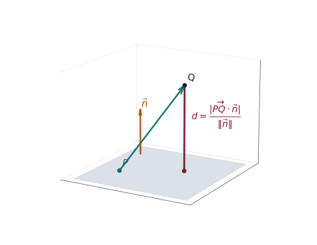
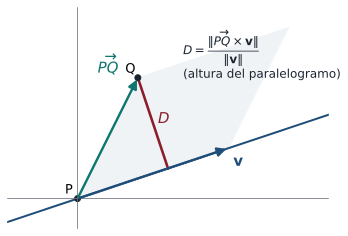

## Objetivos de la clase

- Usar la **proyección ortogonal** como herramienta para medir distancias.
- Calcular la distancia de un punto a una **recta** (en $\mathbb R^2$ y $\mathbb R^3$) y a un **plano**.
- Calcular la distancia entre **planos paralelos** y entre **rectas que se cruzan**.
- Deducir cada fórmula en lugar de memorizarla.

## La idea central

::: {.obs data-t="Principio"}
La **distancia** de un punto a un objeto (recta o plano) es la longitud del segmento **perpendicular** que va del punto al objeto. Esa longitud se obtiene **proyectando** un vector conocido sobre una dirección perpendicular.
:::

. . .

Recordemos (clase 11):
$$
\operatorname{proy}_{\mathbf u}\mathbf v=\frac{\mathbf u\cdot\mathbf v}{|\mathbf u|^2}\mathbf u,\qquad
\left|\operatorname{proy}_{\mathbf u}\mathbf v\right|=\frac{|\mathbf u\cdot\mathbf v|}{|\mathbf u|}.
$$

. . .

y (clase 12) $\;|\mathbf u\times\mathbf v|=|\mathbf u||\mathbf v|\operatorname{sen}\varphi$ = área del paralelogramo.

## Distancia de un punto a un plano

{fig-align="center" width="40%"}

::: {.teorema}
La distancia del punto $Q$ al plano $\Pi: ax+by+cz=d$ es
$$
D=\frac{\left|\overrightarrow{PQ}\cdot\mathbf n\right|}{|\mathbf n|}=\frac{|ax_1+by_1+cz_1-d|}{\sqrt{a^2+b^2+c^2}},
$$
donde $P$ es cualquier punto del plano, $\mathbf n=(a,b,c)$ y $Q=(x_1,y_1,z_1)$.
:::

## Deducción y ejemplo

::: {.demo}
El segmento perpendicular de $Q$ al plano es paralelo a $\mathbf n$. Su longitud es la de la proyección de $\overrightarrow{PQ}$ sobre $\mathbf n$: $D=\dfrac{|\overrightarrow{PQ}\cdot\mathbf n|}{|\mathbf n|}$. Si $P=(x_0,y_0,z_0)$ está en el plano, $ax_0+by_0+cz_0=d$, y
$$
\overrightarrow{PQ}\cdot\mathbf n=a(x_1-x_0)+b(y_1-y_0)+c(z_1-z_0)=ax_1+by_1+cz_1-d .
$$
:::

. . .

::: {.ejemplo}
Distancia de $Q=(1,2,-1)$ al plano $2x-y+2z=5$.
:::

. . .

$$
D=\frac{|2(1)-2+2(-1)-5|}{\sqrt{4+1+4}}=\frac{|-7|}{3}=\frac73 .
$$

## Distancia de un punto a una recta en $\mathbb R^2$

::: {.teorema}
La distancia de $Q=(x_1,y_1)$ a la recta $ax+by=c$ es $\;D=\dfrac{|ax_1+by_1-c|}{\sqrt{a^2+b^2}}$.
:::

. . .

::: {.demo}
Es el mismo argumento que para el plano: $\mathbf n=(a,b)$ es normal a la recta, y $D$ es la longitud de la proyección de $\overrightarrow{PQ}$ sobre $\mathbf n$, con $P$ cualquier punto de la recta.
:::

. . .

::: {.ejemplo}
Distancia de $(1,2)$ a la recta $3x+4y=1$: $\;D=\dfrac{|3+8-1|}{5}=\dfrac{10}{5}=2$.
:::

## Distancia de un punto a una recta en $\mathbb R^3$

::: {.teorema}
La distancia del punto $Q$ a la recta que pasa por $P$ con director $\mathbf v$ es
$$
D=\frac{\left|\overrightarrow{PQ}\times\mathbf v\right|}{|\mathbf v|}.
$$
:::

. . .

::: {.demo}
Sea $\varphi$ el ángulo entre $\overrightarrow{PQ}$ y $\mathbf v$. En el triángulo rectángulo formado por $\overrightarrow{PQ}$, su proyección sobre la recta y el segmento perpendicular, $D=|\overrightarrow{PQ}|\operatorname{sen}\varphi$. Como $|\overrightarrow{PQ}\times\mathbf v|=|\overrightarrow{PQ}||\mathbf v|\operatorname{sen}\varphi$, se obtiene $D=\dfrac{|\overrightarrow{PQ}\times\mathbf v|}{|\mathbf v|}$.
(Otra lectura: área del paralelogramo dividida por la base.)
:::

## La distancia como altura de un paralelogramo

{fig-align="center" width="56%"}

El paralelogramo de lados $\overrightarrow{PQ}$ y $\mathbf v$ tiene área $\|\overrightarrow{PQ}\times\mathbf v\|$ y base $\|\mathbf v\|$. Su altura es exactamente la distancia $D$.

## Ejemplo resuelto: punto a recta en $\mathbb R^3$

::: {.ejemplo}
Distancia de $Q=(2,-1,3)$ a la recta $(x,y,z)=(1,0,0)+t(1,2,2)$.
:::

. . .

$P=(1,0,0)$, $\;\overrightarrow{PQ}=(1,-1,3)$, $\;\mathbf v=(1,2,2)$, $\;|\mathbf v|=3$.

. . .

$$
\overrightarrow{PQ}\times\mathbf v=\begin{vmatrix}\mathbf i&\mathbf j&\mathbf k\\1&-1&3\\1&2&2\end{vmatrix}=(-2-6)\mathbf i-(2-3)\mathbf j+(2+1)\mathbf k=(-8,1,3).
$$

. . .

$$
D=\frac{\sqrt{64+1+9}}{3}=\frac{\sqrt{74}}{3}\approx2.87 .
$$

. . .

**Comprobación alternativa:** el pie de la perpendicular es $P+\operatorname{proy}_{\mathbf v}\overrightarrow{PQ}=(1,0,0)+\tfrac{5}{9}(1,2,2)$, y la distancia de $Q$ a ese punto es $\sqrt{74}/3$.

## Distancia entre planos paralelos {.compacto}

::: {.teorema}
La distancia entre los planos paralelos $ax+by+cz=d_1$ y $ax+by+cz=d_2$ es
$$
D=\frac{|d_1-d_2|}{\sqrt{a^2+b^2+c^2}}.
$$
:::

. . .

::: {.demo}
Tome $Q$ en el primer plano ($ax_1+by_1+cz_1=d_1$) y aplique la fórmula de punto a plano al segundo: $D=\dfrac{|ax_1+by_1+cz_1-d_2|}{|\mathbf n|}=\dfrac{|d_1-d_2|}{|\mathbf n|}$.
:::

. . .

::: {.ejemplo}
$x+2y-2z=7$ y $x+2y-2z=-3$: $\;D=\dfrac{|7-(-3)|}{\sqrt{1+4+4}}=\dfrac{10}{3}$.
:::

. . .

::: {.obs data-t="Cuidado"}
Antes de usar la fórmula, escriba ambos planos con **la misma** normal: $2x+4y-4z=-6$ debe dividirse por 2.
:::

## Distancia entre rectas que se cruzan

::: {.teorema}
Si $L_1: P_1+t\mathbf v_1$ y $L_2: P_2+s\mathbf v_2$ no son paralelas, la distancia entre ellas es
$$
D=\frac{\left|\overrightarrow{P_1P_2}\cdot(\mathbf v_1\times\mathbf v_2)\right|}{|\mathbf v_1\times\mathbf v_2|}.
$$
:::

. . .

::: {.demo}
$\mathbf n=\mathbf v_1\times\mathbf v_2$ es perpendicular a ambas rectas. Los planos paralelos que contienen a cada recta tienen normal $\mathbf n$, y la distancia entre las rectas es la distancia entre esos planos: la proyección de $\overrightarrow{P_1P_2}$ sobre $\mathbf n$.
:::

. . .

::: {.ejemplo}
$L_1:(1,0,0)+t(1,1,0)$ y $L_2:(0,0,3)+s(0,1,1)$. $\;\mathbf n=(1,1,0)\times(0,1,1)=(1,-1,1)$, $\;\overrightarrow{P_1P_2}=(-1,0,3)$.
$\;D=\dfrac{|-1+0+3|}{\sqrt3}=\dfrac{2}{\sqrt3}\approx1.15$. Como $D\neq0$, las rectas **no** se cortan.
:::

## Distancia entre rectas paralelas

::: {.ejemplo}
Halle la distancia entre $L_1:(1,0,0)+t(1,2,2)$ y $L_2:(0,1,1)+s(1,2,2)$.
:::

. . .

Son paralelas (mismo director). La distancia es la de cualquier punto de $L_2$ a $L_1$: con $P=(1,0,0)$, $Q=(0,1,1)$, $\overrightarrow{PQ}=(-1,1,1)$:
$$
\overrightarrow{PQ}\times\mathbf v=\begin{vmatrix}\mathbf i&\mathbf j&\mathbf k\\-1&1&1\\1&2&2\end{vmatrix}=(0,3,-3),\qquad
D=\frac{\sqrt{18}}{3}=\sqrt2\approx1.41 .
$$

. . .

::: {.obs}
La fórmula de rectas que se cruzan **no** sirve aquí: $\mathbf v_1\times\mathbf v_2=\mathbf 0$ y se dividiría por cero.
:::

## Resumen de fórmulas

| Distancia | Fórmula |
|---|---|
| Punto $Q$ – plano $ax+by+cz=d$ | $\dfrac{\lvert ax_1+by_1+cz_1-d\rvert}{\sqrt{a^2+b^2+c^2}}$ |
| Punto $Q$ – recta en $\mathbb R^2$ $ax+by=c$ | $\dfrac{\lvert ax_1+by_1-c\rvert}{\sqrt{a^2+b^2}}$ |
| Punto $Q$ – recta $P+t\mathbf v$ en $\mathbb R^3$ | $\dfrac{\lvert\overrightarrow{PQ}\times\mathbf v\rvert}{\lvert\mathbf v\rvert}$ |
| Planos paralelos | $\dfrac{\lvert d_1-d_2\rvert}{\lvert\mathbf n\rvert}$ |
| Rectas que se cruzan | $\dfrac{\lvert\overrightarrow{P_1P_2}\cdot(\mathbf v_1\times\mathbf v_2)\rvert}{\lvert\mathbf v_1\times\mathbf v_2\rvert}$ |

Todas son **longitudes de proyecciones** o **alturas de paralelogramos**.

## Ejercicios propuestos

::: {.ejercicio data-t="1"}
Halle la distancia del punto $(3,1,-2)$ al plano $x+2y-2z=4$ y el punto del plano más cercano a él.
:::

::: {.solucion .fragment}
$D=\dfrac{|3+2+4-4|}{3}=\dfrac53$. El punto más cercano se obtiene moviéndose desde $Q$ en dirección $-\mathbf n$: $Q-\dfrac{5}{9}(1,2,-2)=\left(\tfrac{22}{9},-\tfrac19,-\tfrac89\right)$. Compruebe que está en el plano: $\tfrac{22}{9}-\tfrac29+\tfrac{16}{9}=4$ ✓.
:::

## Ejercicios propuestos

::: {.ejercicio data-t="2"}
Halle la distancia del punto $(0,0,0)$ a la recta que pasa por $(1,1,1)$ y $(2,3,4)$.
:::

::: {.solucion .fragment}
$\mathbf v=(1,2,3)$, $\overrightarrow{PQ}=(-1,-1,-1)$, $\overrightarrow{PQ}\times\mathbf v=(-3+2,\;-(-3+1),\;-2+1)=(-1,2,-1)$. $\;D=\dfrac{\sqrt6}{\sqrt{14}}=\sqrt{\tfrac37}\approx0.65$.
:::

## Ejercicios propuestos

::: {.ejercicio data-t="3"}
Verifique que los planos $2x-y+2z=3$ y $-4x+2y-4z=12$ son paralelos y halle la distancia entre ellos.
:::

::: {.solucion .fragment}
$(-4,2,-4)=-2(2,-1,2)$: paralelos. Dividiendo el segundo por $-2$: $2x-y+2z=-6$. $\;D=\dfrac{|3-(-6)|}{3}=3$.
:::

## Ejercicios propuestos

::: {.ejercicio data-t="4 · Demostración"}
Demuestre que el punto de la recta $P+t\mathbf v$ más cercano a $Q$ es $P+\operatorname{proy}_{\mathbf v}\overrightarrow{PQ}$.
:::

::: {.solucion .fragment}
Sea $f(t)=|\overrightarrow{PQ}-t\mathbf v|^2=|\overrightarrow{PQ}|^2-2t\,\overrightarrow{PQ}\cdot\mathbf v+t^2|\mathbf v|^2$, una parábola en $t$ con mínimo en $t^*=\dfrac{\overrightarrow{PQ}\cdot\mathbf v}{|\mathbf v|^2}$ (derivada igual a cero). El punto es $P+t^*\mathbf v=P+\operatorname{proy}_{\mathbf v}\overrightarrow{PQ}$.
:::

. . .

::: {.obs data-t="Evaluación"}
Este tema cierra la unidad 4 y entra en la **Evaluación final del segundo tercio** (3.2 a 5.1).
:::

 

[← Clase 14](clase_14.qmd) · [Programa del curso](../algebra_lineal.qmd) · [Clase 16: Espacios vectoriales →](clase_16.qmd)

