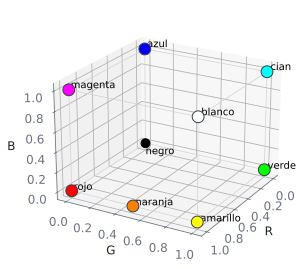
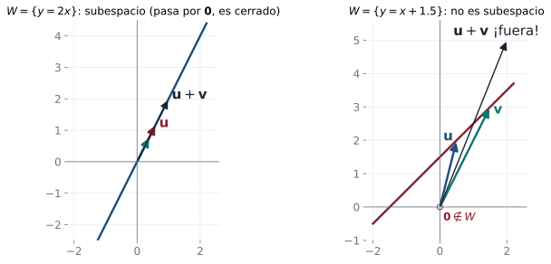

## En la vida diaria: los colores de la pantalla {.nostretch}

::: {.aplicacion data-t="Para empezar"}
Cada color de una pantalla se forma con tres luces: roja, verde y azul. Sumar luz y hacerla más intensa da otros colores.
:::

{fig-align="center" height="250px"}

Los colores se comportan como **vectores**: se suman y se multiplican por números. Las funciones, los polinomios, los sonidos y las fotos también. Un conjunto donde se puede hacer eso con buenas reglas es un **espacio vectorial**.

**En esta clase:** verá qué condiciones debe cumplir un conjunto para ser espacio vectorial o subespacio.

## Objetivos de la clase

- Enunciar los **axiomas** de espacio vectorial y verificarlos en ejemplos.
- Reconocer espacios vectoriales usuales: $\mathbb R^n$, $M_{m\times n}$, $P_n$, funciones.
- Demostrar propiedades básicas a partir de los axiomas.
- Usar el **criterio de subespacio** para decidir si un subconjunto es subespacio.

## ¿Por qué abstraer?

En las unidades anteriores sumamos y multiplicamos por escalares **vectores de $\mathbb R^n$**, **matrices** y **soluciones de sistemas homogéneos**, y en todos los casos valieron las mismas propiedades.

. . .

::: {.obs data-t="Idea"}
Un **espacio vectorial** es cualquier conjunto con una suma y un producto por escalar que cumplen esas propiedades. Lo que demostremos una vez a partir de los axiomas vale **para todos** los ejemplos a la vez: vectores, matrices, polinomios, funciones, señales…
:::

## Definición de espacio vectorial

::: {.definicion}
Un **espacio vectorial real** es un conjunto $V$ con dos operaciones, **suma** $\oplus$ y **multiplicación por escalar** $\odot$, tales que para todos $\mathbf u,\mathbf v,\mathbf w\in V$ y $c,d\in\mathbb R$:

::: {.columns}
::: {.column width="50%"}
**(α)** $\mathbf u\oplus\mathbf v\in V$ (cerradura bajo la suma)
a) $\mathbf u\oplus\mathbf v=\mathbf v\oplus\mathbf u$
b) $\mathbf u\oplus(\mathbf v\oplus\mathbf w)=(\mathbf u\oplus\mathbf v)\oplus\mathbf w$
c) Existe $\mathbf 0\in V$ con $\mathbf u\oplus\mathbf 0=\mathbf u$
d) Para cada $\mathbf u$ existe $-\mathbf u$ con $\mathbf u\oplus(-\mathbf u)=\mathbf 0$
:::
::: {.column width="50%"}
**(β)** $c\odot\mathbf u\in V$ (cerradura bajo el escalar)
e) $c\odot(\mathbf u\oplus\mathbf v)=c\odot\mathbf u\oplus c\odot\mathbf v$
f) $(c+d)\odot\mathbf u=c\odot\mathbf u\oplus d\odot\mathbf u$
g) $c\odot(d\odot\mathbf u)=(cd)\odot\mathbf u$
h) $1\odot\mathbf u=\mathbf u$
:::
:::
Los elementos de $V$ se llaman **vectores**.
:::

## Ejemplos fundamentales

| Espacio | Elementos | Suma y escalar | Cero |
|---|---|---|---|
| $\mathbb R^n$ | $(x_1,\dots,x_n)$ | componente a componente | $(0,\dots,0)$ |
| $M_{m\times n}$ | matrices $m\times n$ | entrada a entrada | matriz $O$ |
| $P_n$ | polinomios de grado $\le n$ | coeficiente a coeficiente | polinomio $0$ |
| $C[a,b]$ | funciones continuas en $[a,b]$ | $(f+g)(x)=f(x)+g(x)$ | función $0$ |
| $\{\mathbf x : A\mathbf x=\mathbf 0\}$ | soluciones homogéneas | las de $\mathbb R^n$ | $\mathbf 0$ |

. . .

::: {.obs}
En $P_n$ se exige "grado **a lo sumo** $n$". El conjunto de polinomios de grado **exactamente** $2$ no es espacio vectorial: $(t^2+t)+(-t^2)=t$ tiene grado $1$.
:::

## En la vida real y en ML: más espacios vectoriales {.compacto .nostretch}

:::: {.columns}
::: {.column width="55%"}
::: {.aplicacion data-t="Colores"}
Los colores de una pantalla son vectores $(r,g,b)$ de $\mathbb R^3$: la luz se **suma** y se **escala**. Ojo: el cubo $[0,1]^3$ de colores visibles **no** es un subespacio, porque al escalar por $2$ o por $-1$ se sale de él.
:::

::: {.aplicacion data-t="Imágenes y sonido"}
Las imágenes de $m\times n$ forman $M_{m\times n}$, y una grabación de audio es un vector con miles de muestras.
:::
:::
::: {.column width="45%"}
{width="100%"}
:::
::::

. . .

::: {.ml data-t="Embeddings"}
Los modelos de lenguaje representan cada palabra como un vector. Con dos coordenadas (realeza, femenino): rey $=(0.9,0.1)$, hombre $=(0.1,0.1)$, mujer $=(0.1,0.9)$. Entonces rey $-$ hombre $+$ mujer $=(0.9,0.9)\approx$ reina.
:::

## Ejemplos que **no** son espacios vectoriales

::: {.ejemplo data-t="Falla (α)"}
$V=\{1\}$ con la suma usual: $1+1=2\notin V$. No es cerrado bajo la suma.
:::

. . .

::: {.ejemplo data-t="Falla (β)"}
$V=\{(x,y): x\ge0,\;y\ge0\}$ (primer cuadrante) con las operaciones usuales. La suma es cerrada, pero $(-1)\odot(1,2)=(-1,-2)\notin V$.
:::

. . .

::: {.ejemplo data-t="Falla (α) y (β)"}
$V=\{at^2+bt+c : b=a+1\}$. Con $3t^2+4t+5$ y $t^2+2t+3$ en $V$, la suma $4t^2+6t+8$ tiene $b=6\neq a+1=5$. Tampoco contiene al polinomio $0$ (pues $0\neq 0+1$).
:::

. . .

::: {.obs data-t="Prueba rápida"}
Si $\mathbf 0\notin V$, $V$ **no** es espacio vectorial (con las operaciones usuales). Es lo primero que conviene revisar.
:::

## Un ejemplo sorprendente

::: {.ejemplo}
$V=\mathbb R^+$ (reales positivos) con $\;u\oplus v=uv\;$ y $\;c\odot u=u^{c}$. ¿Es espacio vectorial?
:::

. . .

- **(α)** $uv>0$ si $u,v>0$ ✓. $\quad$ **(β)** $u^c>0$ ✓.
- a) $uv=vu$ ✓. b) asociatividad del producto ✓.
- c) El "cero" es $\mathbf 0=1$: $u\oplus1=u\cdot1=u$ ✓.
- d) El "opuesto" de $u$ es $1/u$: $u\oplus\tfrac1u=1=\mathbf 0$ ✓.

. . .

- e) $c\odot(u\oplus v)=(uv)^c=u^cv^c=(c\odot u)\oplus(c\odot v)$ ✓.
- f) $(c+d)\odot u=u^{c+d}=u^cu^d$ ✓. $\;$ g) $(u^d)^c=u^{cd}$ ✓. $\;$ h) $u^1=u$ ✓.

. . .

**Sí** es un espacio vectorial. Los "vectores" no tienen por qué parecerse a flechas.

## Propiedades que se deducen de los axiomas

::: {.teorema}
En todo espacio vectorial $V$, para $\mathbf u\in V$ y $c\in\mathbb R$:

1. $0\,\mathbf u=\mathbf 0$. $\quad$ 2. $c\,\mathbf 0=\mathbf 0$. $\quad$ 3. $(-1)\mathbf u=-\mathbf u$. $\quad$ 4. Si $c\,\mathbf u=\mathbf 0$, entonces $c=0$ o $\mathbf u=\mathbf 0$.
:::

. . .

::: {.demo data-t="1"}
Por f), $0\mathbf u=(0+0)\mathbf u=0\mathbf u+0\mathbf u$. Sumando $-(0\mathbf u)$ a ambos lados (axioma d) y usando b) y c): $\mathbf 0=0\mathbf u$.
:::

. . .

::: {.demo data-t="3"}
$\mathbf u+(-1)\mathbf u=1\mathbf u+(-1)\mathbf u=(1-1)\mathbf u=0\mathbf u=\mathbf 0$ (por h, f y la propiedad 1). Como el opuesto es único, $(-1)\mathbf u=-\mathbf u$.
:::

. . .

::: {.demo data-t="4"}
Si $c\neq0$: $\mathbf u=1\mathbf u=\left(\tfrac1c c\right)\mathbf u=\tfrac1c(c\mathbf u)=\tfrac1c\mathbf 0=\mathbf 0$ (por g y la propiedad 2).
:::

## Subespacios

::: {.definicion}
Un subconjunto no vacío $W$ de un espacio vectorial $V$ es un **subespacio** si $W$ es, por sí mismo, un espacio vectorial con las operaciones de $V$.
:::

. . .

::: {.teorema data-t="Criterio de subespacio"}
Un subconjunto **no vacío** $W\subseteq V$ es subespacio si y solo si:

**(α)** si $\mathbf u,\mathbf v\in W$, entonces $\mathbf u+\mathbf v\in W$; $\qquad$ **(β)** si $\mathbf u\in W$ y $c\in\mathbb R$, entonces $c\,\mathbf u\in W$.
:::

. . .

::: {.demo}
($\Rightarrow$) Son axiomas de espacio vectorial. ($\Leftarrow$) Los axiomas a), b), e)–h) se **heredan** de $V$ porque valen para todos los vectores de $V$. Falta c) y d): tomando $\mathbf u\in W$, por (β) $0\mathbf u=\mathbf 0\in W$ y $(-1)\mathbf u=-\mathbf u\in W$.
:::

. . .

Todo espacio $V$ tiene los subespacios **triviales** $\{\mathbf 0\}$ y $V$.

## Subespacios de $\mathbb R^2$: una imagen

{fig-align="center" width="92%"}

Las rectas **por el origen** son subespacios: sumar dos vectores de la recta o estirarlos no nos saca de ella. Una recta que no pasa por el origen no contiene al $\mathbf 0$ y no es cerrada bajo la suma.

::: {.obs data-t="Catálogo completo"}
Los subespacios de $\mathbb R^2$ son: $\{\mathbf 0\}$, las rectas por el origen y $\mathbb R^2$. Los de $\mathbb R^3$: $\{\mathbf 0\}$, rectas y planos por el origen, y $\mathbb R^3$.
:::

## Ejemplos resueltos: ¿subespacio de $\mathbb R^2$?

::: {.ejemplo}
$W_1=\{(x,y): y=2x\}$.
:::

. . .

Si $(x_1,2x_1),(x_2,2x_2)\in W_1$: la suma es $(x_1+x_2,\,2(x_1+x_2))\in W_1$ ✓ y $k(x_1,2x_1)=(kx_1,2kx_1)\in W_1$ ✓. **Es subespacio** (recta por el origen).

. . .

::: {.ejemplo}
$W_2=\{(x,y): y=x+4\}$.
:::

. . .

$(0,0)\notin W_2$ porque $0\neq4$. **No es subespacio** (recta que no pasa por el origen). Contraejemplo explícito: $(3,7)+(2,6)=(5,13)$, y $13\neq5+4$.

. . .

::: {.ejemplo}
$W_3=\{(x,y): x=0\}$ (eje $y$).
:::

. . .

$(0,y_1)+(0,y_2)=(0,y_1+y_2)$ ✓, $k(0,y)=(0,ky)$ ✓. **Es subespacio**.

## Ejemplos resueltos: matrices y polinomios

::: {.ejemplo}
$W=\left\{\begin{pmatrix}a&b&0\\0&c&d\end{pmatrix}: a,b,c,d\in\mathbb R\right\}\subseteq M_{2\times3}$.
:::

. . .

$\begin{pmatrix}a_1&b_1&0\\0&c_1&d_1\end{pmatrix}+\begin{pmatrix}a_2&b_2&0\\0&c_2&d_2\end{pmatrix}=\begin{pmatrix}a_1+a_2&b_1+b_2&0\\0&c_1+c_2&d_1+d_2\end{pmatrix}\in W$ y $k\begin{pmatrix}a&b&0\\0&c&d\end{pmatrix}=\begin{pmatrix}ka&kb&0\\0&kc&kd\end{pmatrix}\in W$. **Es subespacio.**

. . .

::: {.ejemplo}
$W=\{p\in P_2 : p(1)=0\}$.
:::

. . .

Si $p(1)=q(1)=0$, entonces $(p+q)(1)=p(1)+q(1)=0$ y $(kp)(1)=k\,p(1)=0$. **Es subespacio.**

## Ejemplos resueltos: más subespacios

::: {.ejemplo data-t="Un plano por el origen"}
$W_1=\{(x,y,z)\in\mathbb R^3: x=2y-z\}$.
:::

. . .

Si $x_1=2y_1-z_1$ y $x_2=2y_2-z_2$, entonces $x_1+x_2=2(y_1+y_2)-(z_1+z_2)$ y $cx_1=2(cy_1)-(cz_1)$. **Es subespacio**: el plano $x-2y+z=0$.

. . .

::: {.ejemplo data-t="Funciones"}
$W=\{f\in C[0,1]: f(0)=0\}$.
:::

. . .

La función cero está en $W$. Si $f(0)=g(0)=0$, entonces $(f+g)(0)=0$ y $(cf)(0)=c\cdot0=0$. **Es subespacio** de $C[0,1]$. En cambio, $\{f: f(0)=1\}$ **no** lo es: no contiene a la función cero.

## Ejemplo 1 · Fácil: una recta por el origen {.compacto}

::: {.ejemplo data-t="Nivel fácil"}
¿Es $W=\{(x,y)\in\mathbb R^2:\;y=3x\}$ un subespacio de $\mathbb R^2$?
:::

. . .

**Paso 1 · ¿Contiene al cero?** $0=3\cdot0$ ✓.

. . .

**Paso 2 · ¿Cerrado bajo la suma?** Si $(x_1,3x_1)$ y $(x_2,3x_2)$ están en $W$, su suma $(x_1+x_2,\;3(x_1+x_2))$ también cumple $y=3x$ ✓.

. . .

**Paso 3 · ¿Cerrado bajo escalares?** $c(x,3x)=(cx,\;3(cx))$ ✓.

::: {.solucion}
Sí: $W$ es un subespacio. Es la recta generada por $(1,3)$.
:::

## Ejemplo 2 · Fácil: una recta que no pasa por el origen {.compacto}

::: {.ejemplo data-t="Nivel fácil"}
¿Es $W=\{(x,y)\in\mathbb R^2:\;y=x+1\}$ un subespacio?
:::

. . .

**Paso 1 · Revisar primero el cero** (es la prueba más rápida): $(0,0)$ no cumple $0=0+1$.

. . .

**Paso 2 · Un contraejemplo más,** para ver qué falla: $(0,1)$ y $(1,2)$ están en $W$, pero su suma $(1,3)$ no ($3\neq2$).

::: {.solucion}
No es subespacio. **Regla práctica:** si el conjunto no contiene al vector cero, se descarta de inmediato.
:::

## Ejemplo 3 · Medio: polinomios con una raíz fija {.compacto}

::: {.ejemplo data-t="Nivel medio"}
¿Es $W=\{p\in P_2:\;p(1)=0\}$ un subespacio de $P_2$? Dé dos elementos de $W$.
:::

. . .

**Paso 1 · Cero.** El polinomio cero cumple $0(1)=0$ ✓.

. . .

**Paso 2 · Suma.** Si $p(1)=0$ y $q(1)=0$, entonces $(p+q)(1)=p(1)+q(1)=0$ ✓.

. . .

**Paso 3 · Escalar.** $(cp)(1)=c\,p(1)=c\cdot0=0$ ✓.

::: {.solucion}
Sí es subespacio. Ejemplos: $x-1$ y $x^2-1$, que se anulan en $x=1$. Lo que hace funcionar la prueba es que **evaluar en un punto** respeta sumas y múltiplos.
:::

## Ejemplo 4 · Difícil: las matrices que conmutan con $B$ {.compacto}

::: {.ejemplo data-t="Nivel difícil"}
Sea $B=\begin{pmatrix}1&1\\0&1\end{pmatrix}$. Demuestre que $W=\{A\in M_{2\times2}:\;AB=BA\}$ es un subespacio y descríbalo.
:::

. . .

**Paso 1 · Cero:** $0B=0=B0$ ✓.

. . .

**Paso 2 · Suma y escalares**, usando las propiedades del producto:
$$
(A_1+A_2)B=A_1B+A_2B=BA_1+BA_2=B(A_1+A_2),\qquad (cA)B=c(AB)=c(BA)=B(cA)\;✓ .
$$

. . .

**Paso 3 · Describirlo.** Con $A=\begin{pmatrix}a&b\\c&d\end{pmatrix}$, la igualdad $AB=BA$ da $c=0$ y $d=a$ (clase 4):
$$
W=\left\{\begin{pmatrix}a&b\\0&a\end{pmatrix}\right\}=\left\{a\begin{pmatrix}1&0\\0&1\end{pmatrix}+b\begin{pmatrix}0&1\\0&0\end{pmatrix}\right\}.
$$

::: {.solucion}
$W$ es un subespacio de $M_{2\times2}$ generado por $I$ y $\begin{pmatrix}0&1\\0&0\end{pmatrix}$. La prueba general (pasos 1 y 2) sirve para **cualquier** $B$.
:::

## Práctica en clase

::: {.ejercicio data-t="1"}
En $\mathbb R^2$ se define la suma usual y el producto $\alpha\odot(x,y)=(\alpha x,0)$. ¿Qué axioma falla?
:::

::: {.solucion .fragment}
Falla h): $1\odot(x,y)=(x,0)\neq(x,y)$ si $y\neq0$. Con un solo axioma que falle, **no** es espacio vectorial.
:::

::: {.ejercicio data-t="2"}
¿Es $W=\{(x,y,z): z=x+1\}$ un subespacio de $\mathbb R^3$? ¿Y $W=\{(x,y,z): xy=0\}$?
:::

::: {.solucion .fragment}
Ninguno. El primero no contiene a $\mathbf 0$. El segundo contiene a $(1,0,0)$ y $(0,1,0)$ pero no a su suma $(1,1,0)$.
:::

## Ejercicios propuestos

::: {.ejercicio data-t="1"}
¿Es $V=\{(x,y,z): x=0\}$ con las operaciones usuales un espacio vectorial? ¿Y $\{(x,y,z): z=x+1\}$?
:::

::: {.solucion .fragment}
El primero sí (es un subespacio de $\mathbb R^3$: $(0,y,z)+(0,y',z')=(0,y+y',z+z')$, $c(0,y,z)=(0,cy,cz)$). El segundo no: $(0,0,0)$ no cumple $0=0+1$.
:::

## Ejercicios propuestos

::: {.ejercicio data-t="2"}
¿Es $W=\{A\in M_{2\times2}: \det A=0\}$ un subespacio?
:::

::: {.solucion .fragment}
**No.** $\begin{pmatrix}1&0\\0&0\end{pmatrix}$ y $\begin{pmatrix}0&0\\0&1\end{pmatrix}$ tienen determinante $0$, pero su suma es $I_2$, con determinante $1$. Falla la cerradura bajo la suma.
:::

## Ejercicios propuestos

::: {.ejercicio data-t="3 · Demostración"}
Sea $A$ una matriz $m\times n$. Demuestre que $N_A=\{\mathbf x\in\mathbb R^n: A\mathbf x=\mathbf 0\}$ es un subespacio de $\mathbb R^n$.
:::

::: {.solucion .fragment}
$N_A\neq\varnothing$ porque $A\mathbf 0=\mathbf 0$. Si $\mathbf x,\mathbf y\in N_A$: $A(\mathbf x+\mathbf y)=A\mathbf x+A\mathbf y=\mathbf 0$, y $A(c\mathbf x)=cA\mathbf x=\mathbf 0$. Por el criterio, es subespacio. Se llama **espacio nulo** de $A$ (clase 20).
:::

## Ejercicios propuestos

::: {.ejercicio data-t="4 · Demostración"}
Demuestre que si $W_1$ y $W_2$ son subespacios de $V$, entonces $W_1\cap W_2$ es subespacio. ¿Es $W_1\cup W_2$ siempre subespacio?
:::

::: {.solucion .fragment}
$\mathbf 0\in W_1\cap W_2$. Si $\mathbf u,\mathbf v\in W_1\cap W_2$, ambos están en $W_1$ y en $W_2$, luego $\mathbf u+\mathbf v$ y $c\mathbf u$ también. La unión **no**: en $\mathbb R^2$, eje $x$ ∪ eje $y$ contiene $(1,0)$ y $(0,1)$ pero no su suma $(1,1)$.
:::

## Ejercicios del texto guía {.texto-guia}

Grossman y Flores, *Álgebra lineal*, 8.ª ed.:

| Sección | Ejercicios |
|---|---|
| 5.1 Espacios vectoriales: definición y propiedades básicas | 2, 4, 6, 17, 22 |
| 5.2 Subespacios vectoriales | 1, 4, 5, 11, 16, 22, 23, 32, 39 |

## Resumen

- Espacio vectorial: conjunto con suma y escalar que cumplen **10 axiomas** (dos de cerradura y ocho algebraicos).
- Ejemplos: $\mathbb R^n$, $M_{m\times n}$, $P_n$, $C[a,b]$, soluciones de $A\mathbf x=\mathbf 0$.
- Primera prueba: ¿está el $\mathbf 0$?
- Subespacio $\iff$ no vacío y **cerrado** bajo suma y producto por escalar.

 

[← Clase 15](clase_15.qmd) · [Programa del curso](../algebra_lineal.qmd) · [Clase 17: Combinación lineal y espacio generado →](clase_17.qmd)
