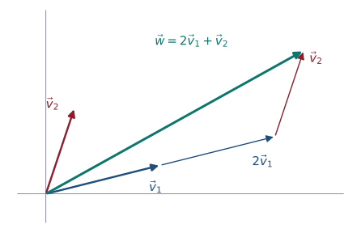
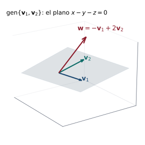

## Objetivos de la clase

- Decidir si un vector es **combinación lineal** de otros y hallar los coeficientes.
- Definir el **espacio generado** $\operatorname{gen}\{\mathbf v_1,\dots,\mathbf v_k\}$ y demostrar que es un subespacio.
- Describir geométricamente espacios generados en $\mathbb R^2$ y $\mathbb R^3$.
- Determinar si un conjunto **genera** un espacio vectorial.

## Combinación lineal

::: {.definicion}
Sean $\mathbf v_1,\dots,\mathbf v_k$ vectores de un espacio $V$. Un vector $\mathbf w$ es **combinación lineal** de ellos si existen escalares $c_1,\dots,c_k$ tales que
$$
\mathbf w=c_1\mathbf v_1+c_2\mathbf v_2+\cdots+c_k\mathbf v_k .
$$
:::

{fig-align="center" width="42%"}

. . .

En $\mathbb R^n$, decidir si $\mathbf w$ es combinación lineal equivale a decidir si el sistema $\big(\mathbf v_1\;\cdots\;\mathbf v_k\mid\mathbf w\big)$ es **consistente** (clase 5).

## Ejemplo resuelto: en $\mathbb R^3$

::: {.ejemplo}
Sean $\mathbf v_1=(1,2,-1)$ y $\mathbf v_2=(3,1,2)$. (a) ¿Es $\mathbf w=(5,0,5)$ combinación lineal de $\mathbf v_1,\mathbf v_2$? (b) ¿Y $\mathbf u=(1,1,1)$?
:::

. . .

(a)
$$
\left(\begin{array}{cc|c}1&3&5\\2&1&0\\-1&2&5\end{array}\right)
\xrightarrow[F_3\to F_3+F_1]{F_2\to F_2-2F_1}
\left(\begin{array}{cc|c}1&3&5\\0&-5&-10\\0&5&10\end{array}\right)
\sim
\left(\begin{array}{cc|c}1&0&-1\\0&1&2\\0&0&0\end{array}\right)
$$
**Sí:** $\mathbf w=-\mathbf v_1+2\mathbf v_2$. Compruebe: $(-1+6,\;-2+2,\;1+4)=(5,0,5)$ ✓.

. . .

(b) $\left(\begin{array}{cc|c}1&3&1\\2&1&1\\-1&2&1\end{array}\right)\sim\left(\begin{array}{cc|c}1&0&0\\0&1&0\\0&0&1\end{array}\right)$: la última fila es $0=1$. **No** es combinación lineal.

## Ejemplo resuelto: en $P_2$

::: {.ejemplo}
Exprese $p(x)=3+5x+2x^2$ como combinación lineal de $p_1=1+x$, $p_2=x+x^2$, $p_3=1+x^2$.
:::

. . .

$c_1(1+x)+c_2(x+x^2)+c_3(1+x^2)=(c_1+c_3)+(c_1+c_2)x+(c_2+c_3)x^2$. Igualando coeficientes:
$$
\begin{cases}c_1+c_3=3\\c_1+c_2=5\\c_2+c_3=2\end{cases}
\qquad
\left(\begin{array}{ccc|c}1&0&1&3\\1&1&0&5\\0&1&1&2\end{array}\right)\sim\left(\begin{array}{ccc|c}1&0&0&3\\0&1&0&2\\0&0&1&0\end{array}\right).
$$

. . .

$p=3p_1+2p_2+0\,p_3$. Compruebe: $3+3x+2x+2x^2=3+5x+2x^2$ ✓.

. . .

::: {.obs}
En $P_n$ (y en $M_{m\times n}$) el problema **también** se reduce a un sistema lineal: se igualan coeficientes (o entradas).
:::

## Espacio generado

::: {.definicion}
El **espacio generado** por $\mathbf v_1,\dots,\mathbf v_k$ es el conjunto de **todas** sus combinaciones lineales:
$$
\operatorname{gen}\{\mathbf v_1,\dots,\mathbf v_k\}=\{c_1\mathbf v_1+\cdots+c_k\mathbf v_k : c_1,\dots,c_k\in\mathbb R\}.
$$
Si $\operatorname{gen}\{\mathbf v_1,\dots,\mathbf v_k\}=V$, se dice que $\{\mathbf v_1,\dots,\mathbf v_k\}$ **genera** a $V$.
:::

. . .

::: {.teorema}
$\operatorname{gen}\{\mathbf v_1,\dots,\mathbf v_k\}$ es un **subespacio** de $V$. Además, es el **menor** subespacio que contiene a $\mathbf v_1,\dots,\mathbf v_k$.
:::

. . .

::: {.demo}
Contiene a $\mathbf 0=0\mathbf v_1+\cdots+0\mathbf v_k$. Si $\mathbf u=\sum a_i\mathbf v_i$ y $\mathbf w=\sum b_i\mathbf v_i$, entonces $\mathbf u+\mathbf w=\sum(a_i+b_i)\mathbf v_i$ y $c\,\mathbf u=\sum(ca_i)\mathbf v_i$ son combinaciones lineales. Por el criterio, es subespacio. Cualquier subespacio que contenga a los $\mathbf v_i$ contiene, por cerradura, todas sus combinaciones lineales.
:::

## Interpretación geométrica

| Generadores | $\operatorname{gen}$ |
|---|---|
| un vector $\mathbf v\neq\mathbf 0$ | la **recta** por el origen con dirección $\mathbf v$ |
| dos vectores no paralelos de $\mathbb R^3$ | el **plano** por el origen que los contiene |
| tres vectores de $\mathbb R^3$ no coplanares | **todo** $\mathbb R^3$ |

. . .

::: {.ejemplo}
$\operatorname{gen}\{(1,2,-1),(3,1,2)\}$ es un plano de $\mathbb R^3$. Su normal es $(1,2,-1)\times(3,1,2)=(5,-5,-5)\parallel(1,-1,-1)$, así que
$$
\operatorname{gen}\{(1,2,-1),(3,1,2)\}=\{(x,y,z): x-y-z=0\}.
$$
Comprobación con el ejemplo anterior: $(5,0,5)$ cumple $5-0-5=0$ ✓; $(1,1,1)$ da $-1\neq0$ ✓.
:::

## Un plano generado por dos vectores

{fig-align="center" width="46%"}

Todas las combinaciones $a\mathbf v_1+b\mathbf v_2$ "barren" un plano por el origen. El vector $\mathbf w=-\mathbf v_1+2\mathbf v_2$ está en él; un vector fuera del plano no se puede obtener con ningún par $(a,b)$.

## ¿Genera el conjunto a todo el espacio?

::: {.teorema}
$n$ vectores $\mathbf v_1,\dots,\mathbf v_n$ de $\mathbb R^n$ generan $\mathbb R^n$ si y solo si la matriz $A=(\mathbf v_1\;\cdots\;\mathbf v_n)$ tiene $\det A\neq0$.
:::

. . .

::: {.demo}
Generan $\mathbb R^n$ $\iff$ $A\mathbf c=\mathbf b$ es consistente para todo $\mathbf b$. Si $\det A\neq0$, la solución es $\mathbf c=A^{-1}\mathbf b$. Si $\det A=0$, la forma escalonada de $A$ tiene un renglón nulo, y eligiendo $\mathbf b$ adecuado aparece la fila $(0\cdots0\mid1)$: hay un $\mathbf b$ sin solución.
:::

. . .

::: {.ejemplo}
(a) $\{(1,1,0),(0,1,1),(1,0,1)\}$: $\;\begin{vmatrix}1&0&1\\1&1&0\\0&1&1\end{vmatrix}=2\neq0$. **Genera** $\mathbb R^3$.
(b) $\{(1,0,1),(2,1,3),(3,1,4)\}$: el determinante es $0$ (el tercero es la suma de los dos primeros). **No** genera $\mathbb R^3$; genera un plano.
:::

## Ejemplo: conjuntos generadores de $P_2$ y $M_{2\times2}$

::: {.ejemplo}
Los polinomios $1, x, x^2$ generan $P_2$, porque todo $p=a+bx+cx^2$ es combinación de ellos. Las matrices
$$
E_{11}=\begin{pmatrix}1&0\\0&0\end{pmatrix},\;E_{12}=\begin{pmatrix}0&1\\0&0\end{pmatrix},\;E_{21}=\begin{pmatrix}0&0\\1&0\end{pmatrix},\;E_{22}=\begin{pmatrix}0&0\\0&1\end{pmatrix}
$$
generan $M_{2\times2}$: $\begin{pmatrix}a&b\\c&d\end{pmatrix}=aE_{11}+bE_{12}+cE_{21}+dE_{22}$.
:::

. . .

::: {.ejemplo}
¿Genera $\{1+x,\;1-x,\;x^2\}$ a $P_2$? Dado $a+bx+cx^2$, buscamos $c_1(1+x)+c_2(1-x)+c_3x^2$: $c_1+c_2=a$, $c_1-c_2=b$, $c_3=c$. Siempre hay solución: $c_1=\tfrac{a+b}{2}$, $c_2=\tfrac{a-b}{2}$, $c_3=c$. **Sí** genera.
:::

## Ejemplo resuelto (taller 3.1): ¿generan $\mathbb R^3$?

::: {.ejemplo}
Determine si cada conjunto genera $\mathbb R^3$: (a) $\{(1,2,0),(0,1,-1),(2,1,1)\}$; (b) $\{(1,2,0),(0,1,-1),(1,3,-1)\}$.
:::

. . .

(a) $\det\begin{pmatrix}1&0&2\\2&1&1\\0&-1&1\end{pmatrix}=1(1+1)-0+2(-2-0)=-2\neq0$: **genera** $\mathbb R^3$.

. . .

(b) $\det\begin{pmatrix}1&0&1\\2&1&3\\0&-1&-1\end{pmatrix}=1(-1+3)-0+1(-2)=0$: **no** genera $\mathbb R^3$. En efecto, $(1,3,-1)=(1,2,0)+(0,1,-1)$: el tercero es redundante y los tres están en un plano.

## Práctica en clase

::: {.ejercicio data-t="1"}
¿Está $(1,0,0)$ en $H=\operatorname{gen}\{(1,2,1),(2,1,-1)\}$?
:::

::: {.solucion .fragment}
$\left(\begin{array}{cc|c}1&2&1\\2&1&0\\1&-1&0\end{array}\right)\sim\left(\begin{array}{cc|c}1&2&1\\0&-3&-2\\0&0&1\end{array}\right)$: inconsistente. **No** está en $H$. (Ecuación de $H$: $x-y+z=0$, y $1-0+0\neq0$.)
:::

::: {.ejercicio data-t="2"}
Describa $\operatorname{gen}\{(1,1)\}$ y $\operatorname{gen}\{(1,1),(2,2)\}$ en $\mathbb R^2$.
:::

::: {.solucion .fragment}
Ambos son la recta $y=x$: $(2,2)$ es múltiplo de $(1,1)$ y no agrega nada.
:::

## Ejercicios propuestos

::: {.ejercicio data-t="1"}
¿Pertenece $(4,5,1)$ a $H=\operatorname{gen}\{(1,2,1),(2,1,-1)\}$? Si es así, escríbalo como combinación lineal.
:::

::: {.solucion .fragment}
$\left(\begin{array}{cc|c}1&2&4\\2&1&5\\1&-1&1\end{array}\right)\sim\left(\begin{array}{cc|c}1&0&2\\0&1&1\\0&0&0\end{array}\right)$. **Sí:** $(4,5,1)=2(1,2,1)+1(2,1,-1)$.
:::

## Ejercicios propuestos

::: {.ejercicio data-t="2"}
Describa con una ecuación el plano $\operatorname{gen}\{(1,0,2),(0,1,-1)\}$.
:::

::: {.solucion .fragment}
$(x,y,z)=a(1,0,2)+b(0,1,-1)=(a,b,2a-b)$, luego $z=2x-y$, es decir $2x-y-z=0$. (O con la normal $(1,0,2)\times(0,1,-1)=(-2,1,1)$.)
:::

## Ejercicios propuestos

::: {.ejercicio data-t="3 · Problema"}
Un fertilizante $A$ aporta por bulto $(10,5,5)$ kg de nitrógeno, fósforo y potasio, y uno $B$ aporta $(5,5,10)$ kg. ¿Se puede obtener exactamente $(25,15,20)$? ¿Y $(20,20,20)$?
:::

::: {.solucion .fragment}
$(25,15,20)=x(10,5,5)+y(5,5,10)$: de las dos primeras, $x=2$, $y=1$, y la tercera da $10+10=20$ ✓. **Sí**: 2 bultos de $A$ y 1 de $B$. Para $(20,20,20)$: $x=0$, $y=4$ de las dos primeras, pero la tercera da $40\neq20$. **No**: $(20,20,20)\notin\operatorname{gen}\{A,B\}$.
:::

## Ejercicios propuestos

::: {.ejercicio data-t="4 · Demostración"}
Demuestre que si $\mathbf v_3\in\operatorname{gen}\{\mathbf v_1,\mathbf v_2\}$, entonces $\operatorname{gen}\{\mathbf v_1,\mathbf v_2,\mathbf v_3\}=\operatorname{gen}\{\mathbf v_1,\mathbf v_2\}$.
:::

::: {.solucion .fragment}
"$\supseteq$" es claro (tomando coeficiente $0$ para $\mathbf v_3$). "$\subseteq$": si $\mathbf v_3=a\mathbf v_1+b\mathbf v_2$, entonces $c_1\mathbf v_1+c_2\mathbf v_2+c_3\mathbf v_3=(c_1+c_3a)\mathbf v_1+(c_2+c_3b)\mathbf v_2$. Un vector **redundante** no agranda el espacio generado.
:::

## Ejercicios del texto guía {.texto-guia}

Grossman y Flores, *Álgebra lineal*, 8.ª ed.:

| Sección | Ejercicios |
|---|---|
| 5.3 Combinación lineal y espacio generado | 1, 7, 8, 10, 18, 19, 23, 28, 32 |

## Resumen

- $\mathbf w$ es combinación lineal de $\mathbf v_1,\dots,\mathbf v_k$ $\iff$ $(\mathbf v_1\cdots\mathbf v_k\mid\mathbf w)$ es consistente.
- $\operatorname{gen}\{\mathbf v_1,\dots,\mathbf v_k\}$ es el menor subespacio que los contiene.
- En $\mathbb R^n$, $n$ vectores generan $\mathbb R^n$ $\iff$ $\det\neq0$.
- Los vectores redundantes no cambian el espacio generado.

 

[← Clase 16](clase_16.qmd) · [Programa del curso](../algebra_lineal.qmd) · [Clase 18: Independencia lineal →](clase_18.qmd)
