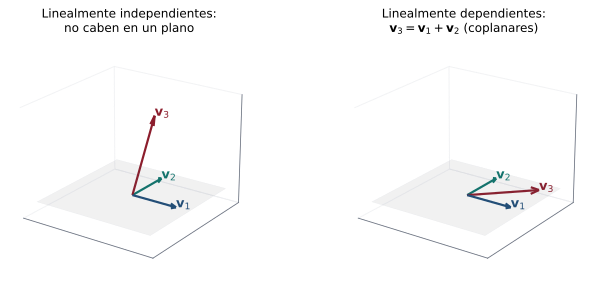
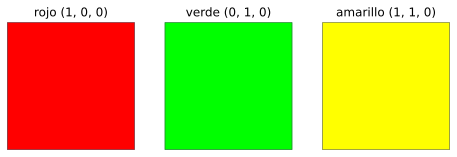

## Objetivos de la clase

- Definir **dependencia** e **independencia lineal**.
- Decidir si un conjunto es linealmente independiente resolviendo un sistema homogéneo.
- Usar el **determinante** para $n$ vectores de $\mathbb R^n$.
- Demostrar los teoremas básicos: más de $n$ vectores en $\mathbb R^n$ son dependientes; dependencia $\iff$ un vector es combinación de los otros.

## Definición

::: {.definicion}
Los vectores $\mathbf v_1,\dots,\mathbf v_k$ de $V$ son **linealmente dependientes** (LD) si existen escalares $c_1,\dots,c_k$, **no todos cero**, tales que
$$
c_1\mathbf v_1+c_2\mathbf v_2+\cdots+c_k\mathbf v_k=\mathbf 0 .
$$
Si la **única** solución es $c_1=c_2=\cdots=c_k=0$, son **linealmente independientes** (LI).
:::

. . .

::: {.ejemplo}
$\mathbf v_1=(2,-1,0,3)$ y $\mathbf v_2=(-6,3,0,-9)$ son LD, pues $\mathbf v_2=-3\mathbf v_1$, es decir, $3\mathbf v_1+1\mathbf v_2=\mathbf 0$.
:::

. . .

::: {.teorema data-t="Dos vectores"}
Dos vectores son LD si y solo si uno es múltiplo escalar del otro.
:::

## Independencia en una imagen

{fig-align="center" width="88%"}

Tres vectores de $\mathbb R^3$ son **dependientes** cuando están en un mismo plano: uno se obtiene combinando los otros dos. Si "salen" del plano, son **independientes**.

## Procedimiento

::: {.definicion data-t="Cómo decidir"}
1. Plantee $c_1\mathbf v_1+\cdots+c_k\mathbf v_k=\mathbf 0$.
2. Escriba el **sistema homogéneo** correspondiente (en $\mathbb R^n$, la matriz tiene a los $\mathbf v_i$ como **columnas**).
3. Si solo tiene la solución trivial → **LI**. Si hay variables libres → **LD** (y las soluciones dan la relación de dependencia).
:::

. . .

::: {.ejemplo}
¿Son LI $(1,2,4)$ y $(2,5,-3)$?
:::

. . .

$$
\begin{pmatrix}1&2\\2&5\\4&-3\end{pmatrix}
\xrightarrow[F_3\to F_3-4F_1]{F_2\to F_2-2F_1}
\begin{pmatrix}1&2\\0&1\\0&-11\end{pmatrix}
\sim\begin{pmatrix}1&0\\0&1\\0&0\end{pmatrix}.
$$
Hay pivote en cada columna: solo la trivial. **Son LI** (y no son múltiplos uno del otro, como era de esperar).

## Ejemplo resuelto: tres vectores en $\mathbb R^3$

::: {.ejemplo}
¿Son LI $\mathbf v_1=(1,-1,1)$, $\mathbf v_2=(2,1,5)$, $\mathbf v_3=(0,3,3)$?
:::

. . .

$$
\begin{pmatrix}1&2&0\\-1&1&3\\1&5&3\end{pmatrix}
\xrightarrow[F_3\to F_3-F_1]{F_2\to F_2+F_1}
\begin{pmatrix}1&2&0\\0&3&3\\0&3&3\end{pmatrix}
\sim\begin{pmatrix}1&0&-2\\0&1&1\\0&0&0\end{pmatrix}.
$$

. . .

$c_3=t$ es libre: $c_1=2t$, $c_2=-t$. Con $t=1$: $\;2\mathbf v_1-\mathbf v_2+\mathbf v_3=\mathbf 0$. **Son LD**, y $\mathbf v_3=\mathbf v_2-2\mathbf v_1$.

. . .

::: {.obs data-t="Atajo con determinante"}
$\det\begin{pmatrix}1&2&0\\-1&1&3\\1&5&3\end{pmatrix}=0$, lo cual ya indica dependencia (teorema de la diapositiva siguiente).
:::

## En la vida real y en ML: información repetida {.compacto .nostretch}

:::: {.columns}
::: {.column width="50%"}
::: {.aplicacion data-t="Colores"}
Rojo, verde y amarillo son **dependientes**: amarillo $=$ rojo $+$ verde. Una pantalla con esas tres luces no muestra más colores que con dos.
:::
:::
::: {.column width="50%"}
{width="100%"}
:::
::::

. . .

::: {.ml data-t="Características redundantes"}
Si una tabla de datos tiene el precio en pesos y también en dólares, con 1 dólar = 4 000 pesos, las columnas cumplen $\mathbf c_{\text{pesos}}=4000\,\mathbf c_{\text{dólares}}$: son **linealmente dependientes**. La segunda columna no aporta información nueva, y en regresión hace que $X^TX$ no sea invertible. Por eso se eliminan las columnas dependientes antes de entrenar.
:::

## Criterios en $\mathbb R^n$ {.compacto}

::: {.teorema}
Sean $\mathbf v_1,\dots,\mathbf v_k\in\mathbb R^n$ y $A=(\mathbf v_1\;\cdots\;\mathbf v_k)$ de tamaño $n\times k$.

1. Son LI $\iff$ $A\mathbf c=\mathbf 0$ tiene solo la solución trivial.
2. Si $k>n$, son **LD**.
3. Si $k=n$: son LI $\iff$ $\det A\neq0$.
:::

. . .

::: {.demo data-t="2"}
$A\mathbf c=\mathbf 0$ es un sistema homogéneo con $n$ ecuaciones y $k>n$ incógnitas. Por el teorema de la clase 2 tiene infinitas soluciones, en particular una no trivial.
:::

. . .

::: {.demo data-t="3"}
Por el teorema de la matriz invertible: $\det A\neq0\iff A\mathbf c=\mathbf 0$ tiene solo la trivial.
:::

. . .

::: {.ejemplo}
Cuatro vectores cualesquiera de $\mathbb R^3$, como $(1,0,0),(0,1,0),(0,0,1),(1,1,1)$, son LD **sin hacer cuentas**.
:::

## Dependencia y combinaciones lineales

::: {.teorema}
Un conjunto de $k\ge2$ vectores es LD si y solo si **al menos uno** de ellos es combinación lineal de los demás.
:::

. . .

::: {.demo}
($\Rightarrow$) Si $c_1\mathbf v_1+\cdots+c_k\mathbf v_k=\mathbf 0$ con algún $c_j\neq0$, despejamos:
$$
\mathbf v_j=-\frac{c_1}{c_j}\mathbf v_1-\cdots-\frac{c_{j-1}}{c_j}\mathbf v_{j-1}-\frac{c_{j+1}}{c_j}\mathbf v_{j+1}-\cdots-\frac{c_k}{c_j}\mathbf v_k .
$$
($\Leftarrow$) Si $\mathbf v_j=\sum_{i\neq j}a_i\mathbf v_i$, entonces $\sum_{i\neq j}a_i\mathbf v_i+(-1)\mathbf v_j=\mathbf 0$, con el coeficiente $-1\neq0$.
:::

. . .

::: {.obs}
Consecuencias inmediatas: todo conjunto que contenga al vector $\mathbf 0$ es LD ($1\cdot\mathbf 0=\mathbf 0$), y todo subconjunto de un conjunto LI es LI.
:::

## Ejemplo resuelto: polinomios

::: {.ejemplo}
En $P_2$, ¿son LI $p_1=x-2x^2$, $p_2=x^2-4x$, $p_3=-7x+8x^2$?
:::

. . .

$c_1(x-2x^2)+c_2(x^2-4x)+c_3(-7x+8x^2)=(c_1-4c_2-7c_3)x+(-2c_1+c_2+8c_3)x^2=0$:
$$
\begin{pmatrix}1&-4&-7\\-2&1&8\end{pmatrix}\xrightarrow{F_2\to F_2+2F_1}\begin{pmatrix}1&-4&-7\\0&-7&-6\end{pmatrix}\sim\begin{pmatrix}1&0&-\frac{25}{7}\\0&1&\frac67\end{pmatrix}.
$$

. . .

Hay una variable libre (de hecho, son 3 vectores en el subespacio $\operatorname{gen}\{x,x^2\}$ de dimensión 2). Con $c_3=7$: $c_1=25$, $c_2=-6$, es decir, $25p_1-6p_2+7p_3=0$. **Son LD.**

## Ejemplo resuelto: matrices

::: {.ejemplo}
En $M_{2\times2}$, ¿son LI $A_1=\begin{pmatrix}1&0\\0&1\end{pmatrix}$, $A_2=\begin{pmatrix}0&1\\1&0\end{pmatrix}$, $A_3=\begin{pmatrix}1&1\\1&1\end{pmatrix}$?
:::

. . .

$c_1A_1+c_2A_2+c_3A_3=\begin{pmatrix}c_1+c_3&c_2+c_3\\c_2+c_3&c_1+c_3\end{pmatrix}=O$ da $c_1=-c_3$, $c_2=-c_3$.

. . .

Con $c_3=1$: $-A_1-A_2+A_3=O$, es decir, $A_3=A_1+A_2$. **Son LD.**

## Ejemplo resuelto (taller 3.1)

::: {.ejemplo}
Determine si $\mathbf v_1=(1,-1,2)$, $\mathbf v_2=(2,1,0)$, $\mathbf v_3=(0,3,-4)$ son LI. Si son LD, escriba uno como combinación de los otros.
:::

. . .

$$
\begin{pmatrix}1&2&0\\-1&1&3\\2&0&-4\end{pmatrix}
\xrightarrow[F_3\to F_3-2F_1]{F_2\to F_2+F_1}
\begin{pmatrix}1&2&0\\0&3&3\\0&-4&-4\end{pmatrix}
\sim\begin{pmatrix}1&0&-2\\0&1&1\\0&0&0\end{pmatrix}.
$$

. . .

$c_3=t$ libre: $c_1=2t$, $c_2=-t$. Con $t=1$: $2\mathbf v_1-\mathbf v_2+\mathbf v_3=\mathbf 0$, es decir
$$
\mathbf v_3=\mathbf v_2-2\mathbf v_1=(2,1,0)-(2,-2,4)=(0,3,-4).\ ✓
$$
**Son LD.**

## Ejemplo 1 · Fácil: dos vectores paralelos {.compacto}

::: {.ejemplo data-t="Nivel fácil"}
¿Son linealmente independientes $\mathbf u=(1,2)$ y $\mathbf v=(2,4)$?
:::

. . .

**Paso 1.** Con dos vectores basta mirar si uno es múltiplo del otro: $\mathbf v=2\mathbf u$.

. . .

**Paso 2 · Combinación no trivial que da cero:** $\;2\mathbf u-\mathbf v=\mathbf 0$.

::: {.solucion}
Son **dependientes**: están sobre la misma recta. También $\det\begin{pmatrix}1&2\\2&4\end{pmatrix}=0$.
:::

## Ejemplo 2 · Fácil: tres vectores "escalonados" {.compacto}

::: {.ejemplo data-t="Nivel fácil"}
¿Son independientes $(1,0,0)$, $(1,1,0)$ y $(1,1,1)$?
:::

. . .

**Paso 1 · Plantear** $c_1(1,0,0)+c_2(1,1,0)+c_3(1,1,1)=\mathbf 0$:
$\quad c_1+c_2+c_3=0,\quad c_2+c_3=0,\quad c_3=0.$

. . .

**Paso 2 · De abajo hacia arriba:** $c_3=0$, luego $c_2=0$, luego $c_1=0$.

::: {.solucion}
Solo la solución trivial: son **independientes**. La matriz con esos vectores como columnas es triangular con diagonal $1,1,1$ (determinante $1\neq0$).
:::

## Ejemplo 3 · Medio: independencia de polinomios {.compacto}

::: {.ejemplo data-t="Nivel medio"}
¿Son linealmente independientes $p_1=1+x$, $p_2=x+x^2$ y $p_3=1+x^2$ en $P_2$?
:::

. . .

**Paso 1 · Pasar a coordenadas** en la base $\{1,x,x^2\}$: $\;p_1\to(1,1,0)$, $p_2\to(0,1,1)$, $p_3\to(1,0,1)$.

. . .

**Paso 2 · Determinante** de la matriz con esas columnas:
$$
\begin{vmatrix}1&0&1\\1&1&0\\0&1&1\end{vmatrix}=1(1-0)-0+1(1-0)=2\neq0 .
$$

::: {.solucion}
Son **independientes**. Compare con la clase 17: $\{1+x,\;x+x^2,\;1-x^2\}$ es dependiente; un solo signo cambia la respuesta.
:::

## Ejemplo 4 · Difícil: ¿para qué $k$ son dependientes? {.compacto}

::: {.ejemplo data-t="Nivel difícil"}
Halle $k$ para que $\mathbf v_1=(1,0,k)$, $\mathbf v_2=(0,1,1)$, $\mathbf v_3=(k,1,2)$ sean dependientes, y escriba la relación entre ellos.
:::

. . .

**Paso 1 · Determinante** (expansión por la primera fila de la matriz con los vectores como filas):
$$
\begin{vmatrix}1&0&k\\0&1&1\\k&1&2\end{vmatrix}=1(2-1)-0+k(0-k)=1-k^2 .
$$
Son dependientes si y solo si $1-k^2=0$, es decir, $k=\pm1$.

. . .

**Paso 2 · Caso $k=1$:** $\mathbf v_3=(1,1,2)=(1,0,1)+(0,1,1)=\mathbf v_1+\mathbf v_2$.

. . .

**Paso 3 · Caso $k=-1$:** $\mathbf v_3=(-1,1,2)$ y $-\mathbf v_1+\mathbf v_2=(-1,0,1)+(0,1,1)=(-1,1,2)$ ✓.

::: {.solucion}
Dependientes solo si $k=1$ ($\mathbf v_3=\mathbf v_1+\mathbf v_2$) o $k=-1$ ($\mathbf v_3=-\mathbf v_1+\mathbf v_2$). Para cualquier otro $k$ son independientes y forman una base de $\mathbb R^3$.
:::

## Ejercicios propuestos

::: {.ejercicio data-t="1"}
¿Son LI $(2,1,1)$, $(1,2,1)$, $(1,1,2)$? ¿Forman una base de $\mathbb R^3$ (clase 19)?
:::

::: {.solucion .fragment}
$\det\begin{pmatrix}2&1&1\\1&2&1\\1&1&2\end{pmatrix}=2(3)-1(1)+1(-1)=4\neq0$. **Son LI**, y como son 3 vectores LI en $\mathbb R^3$, forman una base.
:::

## Ejercicios propuestos

::: {.ejercicio data-t="2"}
¿Para qué valores de $k$ son LD $(1,2,k)$, $(0,1,k-1)$, $(3,4,3)$?
:::

::: {.solucion .fragment}
$\begin{vmatrix}1&0&3\\2&1&4\\k&k-1&3\end{vmatrix}=1\big(3-4(k-1)\big)-0+3\big(2(k-1)-k\big)=7-4k+3k-6=1-k$. Son LD si y solo si $k=1$.
:::

## Ejercicios propuestos

::: {.ejercicio data-t="3 · Demostración"}
Sean $\mathbf v_1,\mathbf v_2$ LI. Demuestre que $\mathbf v_1+\mathbf v_2$ y $\mathbf v_1-\mathbf v_2$ son LI.
:::

::: {.solucion .fragment}
Si $a(\mathbf v_1+\mathbf v_2)+b(\mathbf v_1-\mathbf v_2)=\mathbf 0$, entonces $(a+b)\mathbf v_1+(a-b)\mathbf v_2=\mathbf 0$. Por independencia, $a+b=0$ y $a-b=0$, luego $a=b=0$.
:::

## Ejercicios propuestos

::: {.ejercicio data-t="4 · Demostración"}
Demuestre que si $\{\mathbf v_1,\dots,\mathbf v_k\}$ es LI y $\mathbf w\notin\operatorname{gen}\{\mathbf v_1,\dots,\mathbf v_k\}$, entonces $\{\mathbf v_1,\dots,\mathbf v_k,\mathbf w\}$ es LI.
:::

::: {.solucion .fragment}
Sea $c_1\mathbf v_1+\cdots+c_k\mathbf v_k+d\,\mathbf w=\mathbf 0$. Si $d\neq0$, despejando, $\mathbf w$ sería combinación de los $\mathbf v_i$: contradicción. Luego $d=0$, y queda $\sum c_i\mathbf v_i=\mathbf 0$, de donde todos los $c_i=0$ por ser LI.
:::

## Ejercicios del texto guía {.texto-guia}

Grossman y Flores, *Álgebra lineal*, 8.ª ed.:

| Sección | Ejercicios |
|---|---|
| 5.4 Independencia lineal | 2, 5, 8, 9, 19, 24, 31, 33, 43, 44, 66 |

## Resumen

- LI: la única combinación que da $\mathbf 0$ es la trivial.
- Se decide resolviendo un **sistema homogéneo** (vectores como columnas).
- Más de $n$ vectores en $\mathbb R^n$ ⇒ LD. $\;n$ vectores en $\mathbb R^n$: LI $\iff\det\neq0$.
- LD $\iff$ algún vector es combinación lineal de los otros.

 

[← Clase 17](clase_17.qmd) · [Programa del curso](../algebra_lineal.qmd) · [Clase 19: Bases y dimensión →](clase_19.qmd)
