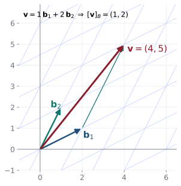
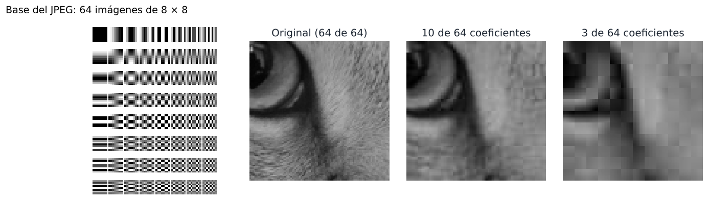

## Objetivos de la clase

- Definir **base** y **dimensión** de un espacio vectorial.
- Verificar si un conjunto es base y hallar bases de subespacios.
- Calcular el **vector de coordenadas** $[\mathbf v]_B$ respecto a una base.
- Construir **matrices de transición** (cambio de base).

## Base

::: {.definicion}
Un conjunto finito $B=\{\mathbf v_1,\dots,\mathbf v_n\}$ es una **base** del espacio vectorial $V$ si:

1. $B$ es **linealmente independiente**, y
2. $B$ **genera** a $V$.
:::

. . .

| Espacio | Base canónica | Dimensión |
|---|---|---|
| $\mathbb R^n$ | $\mathbf e_1=(1,0,\dots,0),\;\dots,\;\mathbf e_n=(0,\dots,0,1)$ | $n$ |
| $P_n$ | $1,\;t,\;t^2,\;\dots,\;t^n$ | $n+1$ |
| $M_{m\times n}$ | $E_{ij}$ (un $1$ en la posición $(i,j)$) | $mn$ |
| $\{\mathbf 0\}$ | $\varnothing$ | $0$ |

## Dimensión

::: {.teorema}
Si un espacio vectorial $V$ tiene una base con $n$ vectores, **toda** base de $V$ tiene exactamente $n$ vectores.
:::

. . .

::: {.definicion}
Ese número común es la **dimensión** de $V$, $\;\dim V=n$.
:::

. . .

::: {.teorema data-t="Consecuencias útiles"}
Si $\dim V=n$:

a) Todo conjunto con **más** de $n$ vectores es LD.
b) Ningún conjunto con **menos** de $n$ vectores genera a $V$.
c) $n$ vectores **LI** forman una base (no hace falta verificar que generan).
d) $n$ vectores que **generan** forman una base (no hace falta verificar independencia).
e) Si $W$ es subespacio de $V$, $\dim W\le\dim V$.
:::

## Ejemplo resuelto: una base de $P_2$

::: {.ejemplo}
Demuestre que $S=\{t^2+1,\;t-1,\;2t+2\}$ es una base de $P_2$.
:::

. . .

Como $\dim P_2=3$ y $S$ tiene 3 vectores, basta probar que es **LI** (consecuencia c).
$$
x(t^2+1)+y(t-1)+z(2t+2)=xt^2+(y+2z)t+(x-y+2z)=0\;\Longrightarrow\;
\begin{cases}x=0\\y+2z=0\\x-y+2z=0\end{cases}
$$

. . .

De la 1.ª, $x=0$; entonces $y+2z=0$ y $-y+2z=0$, que sumadas dan $4z=0$. Así $x=y=z=0$: **LI**, luego **base**.

. . .

(Equivalente: la matriz de coeficientes $\begin{pmatrix}1&-1&2\\0&1&2\\1&0&0\end{pmatrix}$, con columnas en el orden (constante, $t$, $t^2$), tiene determinante $-4\neq0$.)

## Ejemplo resuelto: bases de subespacios

::: {.ejemplo}
Halle una base y la dimensión de $W=\{(a,b,c)\in\mathbb R^3: a-b+5c=0\}$.
:::

. . .

Despejamos $a=b-5c$: $\;(b-5c,\,b,\,c)=b(1,1,0)+c(-5,0,1)$. Los vectores $(1,1,0)$ y $(-5,0,1)$ **generan** $W$ y no son múltiplos: son **LI**. Base $\{(1,1,0),(-5,0,1)\}$, $\;\dim W=2$ (un plano).

. . .

::: {.ejemplo}
Halle una base y la dimensión de $W=\{(a+c,\;a-b,\;b+c,\;-a+b): a,b,c\in\mathbb R\}$.
:::

. . .

$W=\operatorname{gen}\{(1,1,0,-1),(0,-1,1,1),(1,0,1,0)\}$. ¡Cuidado! $(1,0,1,0)=(1,1,0,-1)+(0,-1,1,1)$: el tercer generador es **redundante**. Los dos primeros son LI, así que base $=\{(1,1,0,-1),(0,-1,1,1)\}$ y $\dim W=2$, **no** 3.

. . .

::: {.obs}
Contar los parámetros **no** basta para hallar la dimensión: hay que verificar que los generadores sean LI.
:::

## Vector de coordenadas

::: {.teorema}
Si $B=\{\mathbf v_1,\dots,\mathbf v_n\}$ es una base de $V$, todo $\mathbf v\in V$ se escribe de **manera única** como $\mathbf v=c_1\mathbf v_1+\cdots+c_n\mathbf v_n$.
:::

. . .

::: {.demo}
Existe porque $B$ genera $V$. Si $\mathbf v=\sum c_i\mathbf v_i=\sum d_i\mathbf v_i$, restando: $\sum(c_i-d_i)\mathbf v_i=\mathbf 0$, y por independencia $c_i=d_i$ para todo $i$.
:::

. . .

::: {.definicion}
El **vector de coordenadas** de $\mathbf v$ respecto a la base **ordenada** $B$ es $\;[\mathbf v]_B=\begin{pmatrix}c_1\\\vdots\\c_n\end{pmatrix}$.
:::

## Coordenadas: medir con otra cuadrícula

{fig-align="center" width="46%"}

La base $B=\{\mathbf b_1,\mathbf b_2\}$ define una cuadrícula inclinada. El mismo punto $\mathbf v=(4,5)$ tiene coordenadas $(4,5)$ en la base canónica y $(1,2)$ en la base $B$.

## Ejemplos resueltos: coordenadas

::: {.ejemplo}
$S=\{(1,1,0,0),(2,0,1,0),(0,1,2,-1),(0,1,-1,0)\}$ es base de $\mathbb R^4$. Halle $[\mathbf v]_S$ para $\mathbf v=(1,2,-6,2)$.
:::

. . .

$$
\left(\begin{array}{cccc|c}1&2&0&0&1\\1&0&1&1&2\\0&1&2&-1&-6\\0&0&-1&0&2\end{array}\right)\sim\left(\begin{array}{cccc|c}1&0&0&0&3\\0&1&0&0&-1\\0&0&1&0&-2\\0&0&0&1&1\end{array}\right)
\quad\Longrightarrow\quad [\mathbf v]_S=\begin{pmatrix}3\\-1\\-2\\1\end{pmatrix}.
$$

. . .

::: {.ejemplo}
En $P_1$ sean $S=\{t,1\}$ y $T=\{t+1,\;t-1\}$. Halle las coordenadas de $p(t)=5t-2$.
:::

. . .

$[p]_S=\begin{pmatrix}5\\-2\end{pmatrix}$. Para $T$: $x(t+1)+y(t-1)=5t-2\Rightarrow x+y=5,\;x-y=-2$, de donde $x=\tfrac32$, $y=\tfrac72$, y $[p]_T=\begin{pmatrix}3/2\\7/2\end{pmatrix}$.

## En la vida real: el JPEG cambia de base {.nostretch}

{fig-align="center" width="100%"}

Un bloque de $8\times8$ píxeles es un vector de $\mathbb R^{64}$. La base usual es "un píxel encendido a la vez". El formato **JPEG** usa otra base de $64$ imágenes (izquierda) y guarda las **coordenadas** del bloque en esa base.

. . .

En la base JPEG casi todas las coordenadas son muy pequeñas: se descartan las de detalle fino y la foto se ve casi igual ocupando mucho menos espacio. **Cambiar de base** es lo que permite comprimir.

## Matriz de transición (cambio de base)

::: {.teorema}
Sean $S=\{\mathbf v_1,\dots,\mathbf v_n\}$ y $T=\{\mathbf w_1,\dots,\mathbf w_n\}$ bases de $V$. La matriz
$$
P_{S\leftarrow T}=\Big([\mathbf w_1]_S\;\;[\mathbf w_2]_S\;\;\cdots\;\;[\mathbf w_n]_S\Big)
$$
cumple $\;[\mathbf v]_S=P_{S\leftarrow T}\,[\mathbf v]_T\;$ para todo $\mathbf v\in V$. Además es invertible y $\;P_{T\leftarrow S}=P_{S\leftarrow T}^{-1}$.
:::

. . .

::: {.demo}
Si $[\mathbf v]_T=(c_1,\dots,c_n)^T$, entonces $\mathbf v=\sum c_j\mathbf w_j$, y como tomar coordenadas es lineal, $[\mathbf v]_S=\sum c_j[\mathbf w_j]_S=P_{S\leftarrow T}[\mathbf v]_T$ (combinación lineal de las columnas). La segunda afirmación sale de aplicar la fórmula en los dos sentidos.
:::

. . .

::: {.obs data-t="Cálculo práctico en ℝⁿ"}
Reduzca $\big(\mathbf v_1\;\cdots\;\mathbf v_n\mid\mathbf w_1\;\cdots\;\mathbf w_n\big)\sim\big(I\mid P_{S\leftarrow T}\big)$.
:::

## Ejemplo resuelto: cambio de base en $\mathbb R^3$

::: {.ejemplo}
$S=\{(2,0,1),(1,2,0),(1,1,1)\}$, $\;T=\{(6,3,3),(4,-1,3),(5,5,2)\}$. Halle $P_{S\leftarrow T}$ y verifique con $\mathbf v=(4,-9,5)$.
:::

. . .

$$
\left(\begin{array}{ccc|ccc}2&1&1&6&4&5\\0&2&1&3&-1&5\\1&0&1&3&3&2\end{array}\right)\sim\left(\begin{array}{ccc|ccc}1&0&0&2&2&1\\0&1&0&1&-1&2\\0&0&1&1&1&1\end{array}\right),\qquad P_{S\leftarrow T}=\begin{pmatrix}2&2&1\\1&-1&2\\1&1&1\end{pmatrix}.
$$

. . .

Coordenadas en $T$: $\mathbf v=1(6,3,3)+2(4,-1,3)-2(5,5,2)$, así que $[\mathbf v]_T=(1,2,-2)^T$. Entonces
$$
[\mathbf v]_S=P_{S\leftarrow T}[\mathbf v]_T=\begin{pmatrix}2+4-2\\1-2-4\\1+2-2\end{pmatrix}=\begin{pmatrix}4\\-5\\1\end{pmatrix}.
$$
Comprobación: $4(2,0,1)-5(1,2,0)+1(1,1,1)=(4,-9,5)$ ✓.

## Ejemplo resuelto: matrices simétricas

::: {.ejemplo}
Halle una base y la dimensión de $W=\{A\in M_{2\times2}: A^T=A\}$.
:::

. . .

$A=\begin{pmatrix}a&b\\b&c\end{pmatrix}=a\begin{pmatrix}1&0\\0&0\end{pmatrix}+b\begin{pmatrix}0&1\\1&0\end{pmatrix}+c\begin{pmatrix}0&0\\0&1\end{pmatrix}$.

. . .

Las tres matrices generan $W$ y son LI (la combinación es $O$ solo si $a=b=c=0$). **Base de 3 matrices, $\dim W=3$**, dentro de $M_{2\times2}$, que tiene dimensión 4.

## Ejercicios propuestos

::: {.ejercicio data-t="1"}
Verifique que $B=\{(1,0,1),(1,1,0),(0,1,1)\}$ es base de $\mathbb R^3$ y halle $[(2,3,5)]_B$.
:::

::: {.solucion .fragment}
$\det=2\neq0$ ⇒ LI ⇒ base. Resolviendo $a(1,0,1)+b(1,1,0)+c(0,1,1)=(2,3,5)$: $a=2$, $b=0$, $c=3$. $[(2,3,5)]_B=(2,0,3)^T$.
:::

## Ejercicios propuestos

::: {.ejercicio data-t="2"}
Halle una base y la dimensión de $W=\{(a+c,\;a-b,\;b+c,\;a): a,b,c\in\mathbb R\}$. Compare con el ejemplo resuelto.
:::

::: {.solucion .fragment}
$W=\operatorname{gen}\{(1,1,0,1),(0,-1,1,0),(1,0,1,0)\}$. La matriz con esas columnas tiene rango 3 (verifíquelo reduciendo), luego son LI: $\dim W=3$.
:::

## Ejercicios propuestos

::: {.ejercicio data-t="3"}
Complete $\{(1,1,0),(0,1,1)\}$ hasta obtener una base de $\mathbb R^3$.
:::

::: {.solucion .fragment}
Basta añadir un vector fuera del plano que generan, por ejemplo $(0,0,1)$: $\det\begin{pmatrix}1&0&0\\1&1&0\\0&1&1\end{pmatrix}=1\neq0$.
:::

## Ejercicios propuestos

::: {.ejercicio data-t="4 · Demostración"}
Demuestre que si $\dim V=n$ y $W$ es un subespacio con $\dim W=n$, entonces $W=V$.
:::

::: {.solucion .fragment}
Una base de $W$ tiene $n$ vectores LI de $V$. Por la consecuencia c), es base de $V$, luego genera $V$: $V=\operatorname{gen}(\text{base de }W)=W$.
:::

## Ejercicios propuestos

::: {.ejercicio data-t="5"}
Con las bases $S$ y $T$ del último ejemplo, calcule $P_{T\leftarrow S}$.
:::

::: {.solucion .fragment}
$P_{T\leftarrow S}=P_{S\leftarrow T}^{-1}=\begin{pmatrix}\tfrac32&\tfrac12&-\tfrac52\\-\tfrac12&-\tfrac12&\tfrac32\\-1&0&2\end{pmatrix}$.
:::

## Ejercicios del texto guía {.texto-guia}

Grossman y Flores, *Álgebra lineal*, 8.ª ed.:

| Sección | Ejercicios |
|---|---|
| 5.5 Bases y dimensión | 1, 3, 9, 15, 17, 20, 28, 31, 32, 46 |

. . .

::: {.obs data-t="Evaluación"}
Hasta aquí: **Evaluación intermedia 1 del tercer tercio** (secciones 5.3 a 5.5).
:::

## Resumen

- Base = LI + genera. $\;\dim V$ = número de vectores de cualquier base.
- Si $\dim V=n$: $n$ vectores LI (o que generan) ya forman una base.
- Coordenadas únicas: $\mathbf v=\sum c_i\mathbf v_i$, $[\mathbf v]_B=(c_1,\dots,c_n)^T$.
- $[\mathbf v]_S=P_{S\leftarrow T}[\mathbf v]_T$, columnas de $P$: coordenadas en $S$ de los vectores de $T$.

 

[← Clase 18](clase_18.qmd) · [Programa del curso](../algebra_lineal.qmd) · [Clase 20: Rango y nulidad →](clase_20.qmd)
