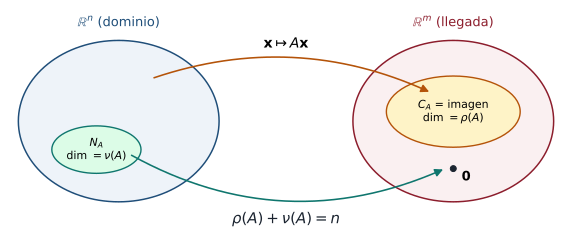

## Objetivos de la clase

- Definir el **espacio nulo**, la **nulidad**, la **imagen** (espacio columna) y el **rango** de una matriz.
- Hallar bases de $N_A$, $C_A$ y $R_A$ a partir de la forma escalonada.
- Usar el **teorema rango-nulidad** $\rho(A)+\nu(A)=n$.
- Relacionar el rango con la invertibilidad y con la consistencia de sistemas.

## Ruta de la clase (70 min)

| Tiempo | Actividad |
|:---:|---|
| 0 – 5 | Repaso: bases y dimensión |
| 5 – 20 | Espacio nulo, imagen, espacio renglón; rango y nulidad (con diagrama) |
| 20 – 40 | Cómo hallar las bases desde la forma escalonada: ejemplos |
| 40 – 55 | Teorema rango-nulidad; rango y sistemas; matriz invertible (versión 3) |
| 55 – 70 | Práctica en clase (taller 3.1) y cierre |

## Los cuatro conceptos

::: {.definicion}
Sea $A$ una matriz $m\times n$.

- **Espacio nulo:** $N_A=\{\mathbf x\in\mathbb R^n: A\mathbf x=\mathbf 0\}$. **Nulidad:** $\nu(A)=\dim N_A$.
- **Espacio columna (imagen):** $C_A=\operatorname{Im}A=\operatorname{gen}\{\text{columnas de }A\}=\{A\mathbf x:\mathbf x\in\mathbb R^n\}\subseteq\mathbb R^m$.
- **Espacio renglón:** $R_A=\operatorname{gen}\{\text{renglones de }A\}\subseteq\mathbb R^n$.
- **Rango:** $\rho(A)=\dim C_A$.
:::

. . .

::: {.teorema}
$\dim R_A=\dim C_A=\rho(A)=$ número de pivotes de la forma escalonada de $A$.
:::

. . .

::: {.obs}
Las operaciones por filas **no cambian** el espacio renglón (cada nueva fila es combinación de las anteriores, y viceversa), pero **sí cambian** el espacio columna. Por eso las bases se toman de lugares distintos.
:::

## Diagrama: dominio, núcleo e imagen

{fig-align="center" width="78%"}

El núcleo $N_A$ es lo que $A$ envía al $\mathbf 0$; la imagen $C_A$ es todo lo que $A$ alcanza. Lo que se "pierde" más lo que se "conserva" suma $n$.

## Cómo hallar las bases

::: {.definicion data-t="Procedimiento"}
Reduzca $A$ a su forma escalonada reducida $R$.

1. **Base de $R_A$:** los renglones **no nulos** de $R$.
2. **Base de $C_A$:** las columnas **de $A$ original** que están en las posiciones de los pivotes de $R$.
3. **Base de $N_A$:** resuelva $R\mathbf x=\mathbf 0$, escriba la solución en función de las variables libres y separe un vector por cada variable libre.
:::

## Ejemplo resuelto

::: {.ejemplo}
Halle bases de $R_A$, $C_A$, $N_A$ y el rango y la nulidad de $A=\begin{pmatrix}1&-2&1&3\\2&-4&3&7\\-1&2&1&-1\end{pmatrix}$.
:::

. . .

$$
A\xrightarrow[F_3\to F_3+F_1]{F_2\to F_2-2F_1}\begin{pmatrix}1&-2&1&3\\0&0&1&1\\0&0&2&2\end{pmatrix}
\xrightarrow[F_1\to F_1-F_2]{F_3\to F_3-2F_2}\begin{pmatrix}\boxed1&-2&0&2\\0&0&\boxed1&1\\0&0&0&0\end{pmatrix}=R .
$$

. . .

- **Rango:** 2 pivotes (columnas 1 y 3) ⇒ $\rho(A)=2$.
- **Base de $R_A$:** $\{(1,-2,0,2),\;(0,0,1,1)\}$.
- **Base de $C_A$:** columnas 1 y 3 de $A$: $\left\{(1,2,-1)^T,\;(1,3,1)^T\right\}$.

## Ejemplo resuelto (continuación): espacio nulo

De $R\mathbf x=\mathbf 0$: $\;x_1-2x_2+2x_4=0$, $\;x_3+x_4=0$. Libres: $x_2=s$, $x_4=t$.

. . .

$$
\mathbf x=\begin{pmatrix}2s-2t\\s\\-t\\t\end{pmatrix}=s\begin{pmatrix}2\\1\\0\\0\end{pmatrix}+t\begin{pmatrix}-2\\0\\-1\\1\end{pmatrix}.
$$

. . .

Base de $N_A$: $\{(2,1,0,0),\;(-2,0,-1,1)\}$, y $\nu(A)=2$.

. . .

**Comprobación:** $\rho(A)+\nu(A)=2+2=4=n$ (número de columnas). Y $A(2,1,0,0)^T=(2-2,\;4-4,\;-2+2)^T=\mathbf 0$ ✓.

## Teorema rango-nulidad

::: {.teorema}
Para toda matriz $A$ de tamaño $m\times n$:
$$
\rho(A)+\nu(A)=n .
$$
:::

. . .

::: {.demo}
En la forma escalonada de $A$, cada una de las $n$ columnas tiene pivote o corresponde a una variable libre. El número de columnas con pivote es $\rho(A)$. El número de variables libres es la cantidad de vectores de la base de $N_A$ que construye el procedimiento (uno por variable libre, y son LI porque cada uno tiene un $1$ en la posición de "su" variable libre y $0$ en la de las demás). Luego $\nu(A)$ = número de variables libres $=n-\rho(A)$.
:::

. . .

::: {.ejemplo}
Si $A$ es $5\times7$ y $\rho(A)=3$, entonces $\nu(A)=4$: el sistema $A\mathbf x=\mathbf 0$ tiene soluciones con 4 parámetros.
:::

## Rango y sistemas de ecuaciones

::: {.teorema}
Sea $A$ de tamaño $m\times n$.

1. $A\mathbf x=\mathbf b$ es consistente $\iff$ $\mathbf b\in C_A$ $\iff$ $\rho(A)=\rho(A\mid\mathbf b)$.
2. Si es consistente, la solución es única $\iff$ $\nu(A)=0$ $\iff$ $\rho(A)=n$.
3. Si $A$ es $n\times n$: $\;A$ invertible $\iff\rho(A)=n\iff\nu(A)=0\iff\det A\neq0$.
:::

. . .

::: {.ejemplo}
$A=\begin{pmatrix}2&1&1\\3&5&5\end{pmatrix}\sim\begin{pmatrix}1&0&0\\0&1&1\end{pmatrix}$: $\rho(A)=2$, $\nu(A)=1$. Como $C_A\subseteq\mathbb R^2$ tiene dimensión 2, $C_A=\mathbb R^2$: $A\mathbf x=\mathbf b$ es consistente para **todo** $\mathbf b$, con infinitas soluciones (un parámetro).
:::

## Teorema de la matriz invertible (versión 3)

::: {.teorema}
Para $A$ de tamaño $n\times n$, son equivalentes:

::: {.columns}
::: {.column width="50%"}
1. $A$ es invertible.
2. $A\mathbf x=\mathbf 0$ solo tiene la solución trivial.
3. $A\sim I_n$.
4. $A\mathbf x=\mathbf b$ tiene solución única para todo $\mathbf b$.
5. $\det A\neq0$.
:::
::: {.column width="50%"}
6. $\rho(A)=n$.
7. $\nu(A)=0$.
8. Las columnas de $A$ son LI.
9. Las columnas de $A$ generan $\mathbb R^n$.
10. Las columnas (o renglones) de $A$ son una base de $\mathbb R^n$.
:::
:::
:::

## Ejemplo resuelto (taller 3.1)

::: {.ejemplo}
Para $A=\begin{pmatrix}1&2&0&1\\2&4&1&4\\3&6&1&5\end{pmatrix}$, halle la forma escalonada reducida, una base de $N_A$, $\nu(A)$ y $\rho(A)$.
:::

. . .

$$
A\xrightarrow[F_3\to F_3-3F_1]{F_2\to F_2-2F_1}\begin{pmatrix}1&2&0&1\\0&0&1&2\\0&0&1&2\end{pmatrix}\xrightarrow{F_3\to F_3-F_2}\begin{pmatrix}1&2&0&1\\0&0&1&2\\0&0&0&0\end{pmatrix}.
$$

. . .

Pivotes en las columnas 1 y 3: $\rho(A)=2$. Libres $x_2=s$, $x_4=t$: $x_1=-2s-t$, $x_3=-2t$:
$$
\mathbf x=s(-2,1,0,0)+t(-1,0,-2,1),\qquad \nu(A)=2,\qquad 2+2=4\ ✓.
$$

## Ejercicios propuestos

::: {.ejercicio data-t="1"}
Halle una base del espacio solución de $\;2x-y-2z=0,\;\;-4x+2y+4z=0,\;\;-8x+4y+8z=0$ y su dimensión.
:::

::: {.solucion .fragment}
Todas las filas son múltiplos de $(2,-1,-2)$: $\rho=1$, $\nu=2$. De $x=\tfrac12y+z$: $\;\mathbf x=s\left(\tfrac12,1,0\right)+t(1,0,1)$. Base $\{(1,2,0),(1,0,1)\}$ (escalando el primero), dimensión 2.
:::

## Ejercicios propuestos

::: {.ejercicio data-t="2"}
Halle el rango de $B=\begin{pmatrix}1&0&-1\\1&1&1\\2&1&0\end{pmatrix}$ y decida si es invertible.
:::

::: {.solucion .fragment}
$B\sim\begin{pmatrix}1&0&-1\\0&1&2\\0&0&0\end{pmatrix}$: $\rho(B)=2<3$. **No** es invertible ($F_3=F_1+F_2$).
:::

## Ejercicios propuestos

::: {.ejercicio data-t="3"}
Sea $A$ una matriz $4\times6$. ¿Cuál es el mínimo valor posible de $\nu(A)$? ¿Puede $A\mathbf x=\mathbf b$ tener solución única?
:::

::: {.solucion .fragment}
$\rho(A)\le4$ (a lo sumo un pivote por fila), luego $\nu(A)=6-\rho(A)\ge2$. Nunca hay solución única: si el sistema es consistente, tiene al menos 2 parámetros libres.
:::

## Ejercicios propuestos

::: {.ejercicio data-t="4 · Demostración"}
Demuestre que $C_A=\{A\mathbf x:\mathbf x\in\mathbb R^n\}$ coincide con el espacio generado por las columnas de $A$ y que es un subespacio de $\mathbb R^m$.
:::

::: {.solucion .fragment}
$A\mathbf x=x_1\mathbf a_1+\cdots+x_n\mathbf a_n$ (clase 4): los vectores $A\mathbf x$ son exactamente las combinaciones lineales de las columnas. Todo espacio generado es subespacio (clase 17).
:::

## Ejercicios del texto guía {.texto-guia}

Grossman y Flores, *Álgebra lineal*, 8.ª ed.:

| Sección | Ejercicios |
|---|---|
| 5.7 Rango, nulidad, espacio renglón y espacio columna | 8, 18, 24, 27, 30 |

## Resumen

| Objeto | Vive en | Base a partir de $R$ | Dimensión |
|---|---|---|---|
| $R_A$ | $\mathbb R^n$ | renglones no nulos de $R$ | $\rho(A)$ |
| $C_A$ | $\mathbb R^m$ | columnas pivote **de $A$** | $\rho(A)$ |
| $N_A$ | $\mathbb R^n$ | un vector por variable libre | $\nu(A)$ |

$$\rho(A)+\nu(A)=n$$

 

[← Clase 19](clase_19.qmd) · [Programa del curso](../algebra_lineal.qmd) · [Clase 21: Bases ortonormales →](clase_21.qmd)
