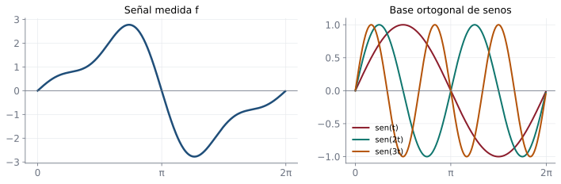
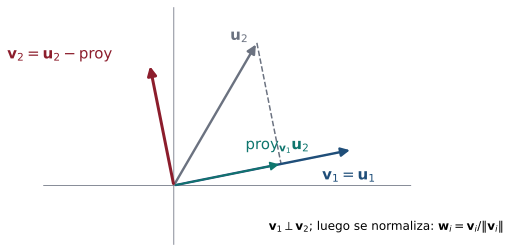

## Objetivos de la clase

- Definir conjuntos **ortogonales** y **ortonormales** en $\mathbb R^n$.
- Demostrar que un conjunto ortogonal de vectores no nulos es **linealmente independiente**.
- Calcular coordenadas en una base ortonormal con productos punto.
- Aplicar el **proceso de Gram-Schmidt** para construir bases ortonormales.

::: {.obs data-t="Nota"}
Este tema complementa las secciones 5.4–5.5 y conecta la geometría de la unidad 4 con los espacios vectoriales. Es la base de métodos como mínimos cuadrados y la factorización $QR$.
:::

## Conjuntos ortogonales y ortonormales

::: {.definicion}
Un conjunto $S=\{\mathbf u_1,\dots,\mathbf u_k\}\subseteq\mathbb R^n$ es

- **ortogonal** si $\mathbf u_i\cdot\mathbf u_j=0$ para todo $i\neq j$;
- **ortonormal** si además cada vector es unitario: $\mathbf u_i\cdot\mathbf u_i=1$.
:::

. . .

::: {.ejemplo}
$\mathbf x_1=(1,0,2)$, $\mathbf x_2=(-2,0,1)$, $\mathbf x_3=(0,1,0)$ es un conjunto ortogonal de $\mathbb R^3$: $\mathbf x_1\cdot\mathbf x_2=-2+0+2=0$, $\mathbf x_1\cdot\mathbf x_3=0$, $\mathbf x_2\cdot\mathbf x_3=0$.
Normalizando: $\mathbf u_1=\tfrac{1}{\sqrt5}(1,0,2)$, $\mathbf u_2=\tfrac1{\sqrt5}(-2,0,1)$, $\mathbf u_3=(0,1,0)$ forman un conjunto **ortonormal**, y $\operatorname{gen}\{\mathbf x_1,\mathbf x_2,\mathbf x_3\}=\operatorname{gen}\{\mathbf u_1,\mathbf u_2,\mathbf u_3\}$.
:::

## Ortogonalidad implica independencia

::: {.teorema}
Si $S=\{\mathbf u_1,\dots,\mathbf u_k\}$ es un conjunto **ortogonal** de vectores **no nulos**, entonces $S$ es linealmente independiente. En particular, todo conjunto ortonormal es LI.
:::

. . .

::: {.demo}
Supongamos $c_1\mathbf u_1+\cdots+c_k\mathbf u_k=\mathbf 0$. Hacemos producto punto con $\mathbf u_j$:
$$
0=\mathbf 0\cdot\mathbf u_j=c_1(\mathbf u_1\cdot\mathbf u_j)+\cdots+c_j(\mathbf u_j\cdot\mathbf u_j)+\cdots+c_k(\mathbf u_k\cdot\mathbf u_j)=c_j\,|\mathbf u_j|^2 ,
$$
porque los demás productos son $0$. Como $\mathbf u_j\neq\mathbf 0$, $|\mathbf u_j|^2\neq0$, y entonces $c_j=0$. Esto vale para cada $j$.
:::

. . .

**Consecuencia:** $n$ vectores ortogonales no nulos de $\mathbb R^n$ forman una base.

## Coordenadas en una base ortonormal

::: {.teorema}
Si $B=\{\mathbf u_1,\dots,\mathbf u_n\}$ es una base **ortonormal** de $\mathbb R^n$, entonces para todo $\mathbf v$:
$$
\mathbf v=(\mathbf v\cdot\mathbf u_1)\mathbf u_1+(\mathbf v\cdot\mathbf u_2)\mathbf u_2+\cdots+(\mathbf v\cdot\mathbf u_n)\mathbf u_n ,\qquad [\mathbf v]_B=\begin{pmatrix}\mathbf v\cdot\mathbf u_1\\\vdots\\\mathbf v\cdot\mathbf u_n\end{pmatrix}.
$$
:::

. . .

::: {.demo}
Sea $\mathbf v=\sum c_i\mathbf u_i$. Haciendo producto punto con $\mathbf u_j$: $\mathbf v\cdot\mathbf u_j=\sum c_i(\mathbf u_i\cdot\mathbf u_j)=c_j$.
:::

. . .

::: {.ejemplo}
Con la base ortonormal anterior y $\mathbf v=(3,4,1)$: $\;\mathbf v\cdot\mathbf u_1=\tfrac{5}{\sqrt5}=\sqrt5$, $\;\mathbf v\cdot\mathbf u_2=\tfrac{-5}{\sqrt5}=-\sqrt5$, $\;\mathbf v\cdot\mathbf u_3=4$. **Sin resolver sistemas.**
:::

## En la vida real: separar un sonido en tonos {.compacto .nostretch}

{fig-align="center" width="88%"}

Las funciones $\operatorname{sen}t,\;\operatorname{sen}2t,\;\operatorname{sen}3t,\dots$ son **ortogonales**. Como en una base ortonormal, cada coeficiente se obtiene con un **producto punto**, sin resolver sistemas:
$$
c_k=\frac{\langle f,\operatorname{sen}kt\rangle}{\langle\operatorname{sen}kt,\operatorname{sen}kt\rangle}
\;\Rightarrow\; c_1=2,\;c_2=-1,\;c_3=0.5,\;c_4=0 .
$$
Así, $f=2\operatorname{sen}t-\operatorname{sen}2t+0.5\operatorname{sen}3t$. Los ecualizadores de música, el reconocimiento de voz y la compresión MP3 hacen esto con miles de tonos.

## El proceso de Gram-Schmidt

::: {.definicion data-t="Algoritmo"}
Dada una base $\{\mathbf u_1,\dots,\mathbf u_m\}$ de un subespacio $W\subseteq\mathbb R^n$:

**Paso 1.** $\;\mathbf v_1=\mathbf u_1$.

**Paso 2.** Para $i=2,\dots,m$, reste a $\mathbf u_i$ sus proyecciones sobre los vectores ya construidos:
$$
\mathbf v_i=\mathbf u_i-\frac{\mathbf u_i\cdot\mathbf v_1}{\mathbf v_1\cdot\mathbf v_1}\mathbf v_1-\frac{\mathbf u_i\cdot\mathbf v_2}{\mathbf v_2\cdot\mathbf v_2}\mathbf v_2-\cdots-\frac{\mathbf u_i\cdot\mathbf v_{i-1}}{\mathbf v_{i-1}\cdot\mathbf v_{i-1}}\mathbf v_{i-1}.
$$
Entonces $\{\mathbf v_1,\dots,\mathbf v_m\}$ es una base **ortogonal** de $W$.

**Paso 3.** $\;\mathbf w_i=\dfrac{\mathbf v_i}{|\mathbf v_i|}$. Entonces $\{\mathbf w_1,\dots,\mathbf w_m\}$ es una base **ortonormal** de $W$.
:::

. . .

::: {.obs data-t="Idea geométrica"}
$\mathbf v_i$ es la parte de $\mathbf u_i$ que es **perpendicular** a lo ya construido (clase 11: $\mathbf v-\operatorname{proy}_{\mathbf u}\mathbf v\perp\mathbf u$).
:::

## La idea geométrica de Gram-Schmidt

{fig-align="center" width="52%"}

A $\mathbf u_2$ se le quita su "sombra" sobre $\mathbf v_1$; lo que queda, $\mathbf v_2$, es perpendicular a $\mathbf v_1$. Con más vectores se resta la sombra sobre **cada** vector ya construido.

## Ejemplo resuelto: Gram-Schmidt en $\mathbb R^3$

::: {.ejemplo}
Ortonormalice la base $\mathbf u_1=(1,1,1)$, $\mathbf u_2=(-1,0,-1)$, $\mathbf u_3=(-1,2,3)$.
:::

. . .

**Paso 1.** $\mathbf v_1=(1,1,1)$, $\;\mathbf v_1\cdot\mathbf v_1=3$.

. . .

**Paso 2.** $\mathbf u_2\cdot\mathbf v_1=-2$:
$$
\mathbf v_2=(-1,0,-1)-\frac{-2}{3}(1,1,1)=\left(-\tfrac13,\tfrac23,-\tfrac13\right).
$$
Podemos usar el múltiplo $\mathbf v_2=(-1,2,-1)$ (escalar no altera la ortogonalidad), con $\mathbf v_2\cdot\mathbf v_2=6$.

. . .

$\mathbf u_3\cdot\mathbf v_1=4$, $\;\mathbf u_3\cdot\mathbf v_2=1+4-3=2$:
$$
\mathbf v_3=(-1,2,3)-\frac43(1,1,1)-\frac26(-1,2,-1)=\left(-1-\tfrac43+\tfrac13,\;2-\tfrac43-\tfrac23,\;3-\tfrac43+\tfrac13\right)=(-2,0,2).
$$

## Ejemplo resuelto (continuación)

**Verificación de ortogonalidad:**
$$
\mathbf v_1\cdot\mathbf v_2=-1+2-1=0,\qquad\mathbf v_1\cdot\mathbf v_3=-2+0+2=0,\qquad\mathbf v_2\cdot\mathbf v_3=2+0-2=0.\ ✓
$$

. . .

**Paso 3.** Normalizamos:
$$
\mathbf w_1=\frac{1}{\sqrt3}(1,1,1),\qquad\mathbf w_2=\frac{1}{\sqrt6}(-1,2,-1),\qquad\mathbf w_3=\frac{1}{2\sqrt2}(-2,0,2)=\frac{1}{\sqrt2}(-1,0,1).
$$

. . .

$\{\mathbf w_1,\mathbf w_2,\mathbf w_3\}$ es una base **ortonormal** de $\mathbb R^3$.

## Ejemplo: subespacio de $\mathbb R^4$

::: {.ejemplo}
Halle una base ortonormal de $W=\operatorname{gen}\{(1,0,1,0),(1,1,1,1),(0,1,2,1)\}$.
:::

. . .

$\mathbf v_1=(1,0,1,0)$. $\quad\mathbf v_2=(1,1,1,1)-\tfrac22(1,0,1,0)=(0,1,0,1)$.

. . .

$\mathbf v_3=(0,1,2,1)-\tfrac22(1,0,1,0)-\tfrac22(0,1,0,1)=(-1,0,1,0)$.

. . .

Base ortonormal: $\left\{\tfrac1{\sqrt2}(1,0,1,0),\;\tfrac1{\sqrt2}(0,1,0,1),\;\tfrac1{\sqrt2}(-1,0,1,0)\right\}$, y $\dim W=3$.

## Ejemplo 1 · Fácil: ¿ortogonal? ¿ortonormal? {.compacto}

::: {.ejemplo data-t="Nivel fácil"}
¿Es $\{(1,1),(1,-1)\}$ un conjunto ortogonal? Conviértalo en ortonormal.
:::

. . .

**Paso 1 · Ortogonal:** $(1,1)\cdot(1,-1)=1-1=0$ ✓.

. . .

**Paso 2 · Ortonormal:** además cada vector debe tener norma $1$. Ambos tienen norma $\sqrt2$, así que se divide cada uno entre $\sqrt2$.

::: {.solucion}
$\left\{\tfrac{1}{\sqrt2}(1,1),\;\tfrac{1}{\sqrt2}(1,-1)\right\}$ es una base ortonormal de $\mathbb R^2$: los ejes usuales girados $45^\circ$.
:::

## Ejemplo 2 · Fácil: coordenadas con producto punto {.compacto}

::: {.ejemplo data-t="Nivel fácil"}
Con la base ortonormal $\mathbf u_1=(\tfrac35,\tfrac45)$, $\mathbf u_2=(-\tfrac45,\tfrac35)$, halle las coordenadas de $\mathbf v=(2,1)$.
:::

. . .

**Paso 1 · Ventaja de una base ortonormal:** cada coordenada es un producto punto, $c_i=\mathbf v\cdot\mathbf u_i$; no hay que resolver un sistema.

. . .

**Paso 2.** $\;c_1=\tfrac{6+4}{5}=2,\qquad c_2=\tfrac{-8+3}{5}=-1.$

::: {.solucion}
$[\mathbf v]=(2,-1)$. Comprobación: $2(\tfrac35,\tfrac45)-(-\tfrac45,\tfrac35)=(\tfrac{10}{5},\tfrac55)=(2,1)$ ✓.
:::

## Ejemplo 3 · Medio: Gram-Schmidt en $\mathbb R^2$ {.compacto}

::: {.ejemplo data-t="Nivel medio"}
Aplique Gram-Schmidt a $\mathbf v_1=(3,4)$, $\mathbf v_2=(1,0)$.
:::

. . .

**Paso 1 · Normalizar el primero:** $\|\mathbf v_1\|=5$, $\;\mathbf u_1=(\tfrac35,\tfrac45)$.

. . .

**Paso 2 · Quitarle a $\mathbf v_2$ su parte en la dirección de $\mathbf u_1$:**
$$
\mathbf w_2=\mathbf v_2-(\mathbf v_2\cdot\mathbf u_1)\mathbf u_1=(1,0)-\tfrac35\left(\tfrac35,\tfrac45\right)=\left(\tfrac{16}{25},-\tfrac{12}{25}\right).
$$

. . .

**Paso 3 · Normalizar:** $\|\mathbf w_2\|=\tfrac{20}{25}=\tfrac45$, $\;\mathbf u_2=\tfrac54\mathbf w_2=(\tfrac45,-\tfrac35)$.

::: {.solucion}
$\{\mathbf u_1,\mathbf u_2\}=\{(\tfrac35,\tfrac45),(\tfrac45,-\tfrac35)\}$. Comprobación: $\tfrac{12}{25}-\tfrac{12}{25}=0$ ✓.
:::

## Ejemplo 4 · Difícil: Gram-Schmidt en $\mathbb R^3$ {.compacto}

::: {.ejemplo data-t="Nivel difícil"}
Ortonormalice $\mathbf v_1=(1,0,1)$, $\mathbf v_2=(1,1,0)$, $\mathbf v_3=(0,1,1)$.
:::

. . .

**Paso 1.** $\mathbf w_1=\mathbf v_1=(1,0,1)$, $\;\mathbf w_1\cdot\mathbf w_1=2$.

**Paso 2.** $\mathbf w_2=\mathbf v_2-\tfrac{\mathbf v_2\cdot\mathbf w_1}{2}\mathbf w_1=(1,1,0)-\tfrac12(1,0,1)=(\tfrac12,1,-\tfrac12)$. Para evitar fracciones se usa el múltiplo $(1,2,-1)$, con $\|\cdot\|^2=6$.

. . .

**Paso 3.** Se restan las proyecciones sobre **los dos** anteriores:
$$
\mathbf w_3=(0,1,1)-\tfrac{1}{2}(1,0,1)-\tfrac{1}{6}(1,2,-1)=\left(-\tfrac23,\tfrac23,\tfrac23\right)\;\parallel\;(-1,1,1).
$$
Aquí $\mathbf v_3\cdot\mathbf w_1=1$ y $\mathbf v_3\cdot(1,2,-1)=1$.

. . .

::: {.solucion}
Base ortonormal: $\;\tfrac{1}{\sqrt2}(1,0,1),\;\;\tfrac{1}{\sqrt6}(1,2,-1),\;\;\tfrac{1}{\sqrt3}(-1,1,1)$. Comprobación: $(1,0,1)\cdot(-1,1,1)=0$ y $(1,2,-1)\cdot(-1,1,1)=0$ ✓.
:::

## Ejercicios propuestos

::: {.ejercicio data-t="1"}
Aplique Gram-Schmidt a $\{(3,4),(1,0)\}$ en $\mathbb R^2$.
:::

::: {.solucion .fragment}
$\mathbf v_1=(3,4)$, $\mathbf v_2=(1,0)-\tfrac{3}{25}(3,4)=\left(\tfrac{16}{25},-\tfrac{12}{25}\right)\parallel(4,-3)$. Base ortonormal: $\left\{\tfrac15(3,4),\;\tfrac15(4,-3)\right\}$.
:::

## Ejercicios propuestos

::: {.ejercicio data-t="2"}
Escriba $\mathbf v=(1,2,3)$ en la base ortonormal $\{\mathbf w_1,\mathbf w_2,\mathbf w_3\}$ del ejemplo resuelto.
:::

::: {.solucion .fragment}
$\mathbf v\cdot\mathbf w_1=\tfrac{6}{\sqrt3}=2\sqrt3$, $\;\mathbf v\cdot\mathbf w_2=\tfrac{-1+4-3}{\sqrt6}=0$, $\;\mathbf v\cdot\mathbf w_3=\tfrac{-1+3}{\sqrt2}=\sqrt2$. Luego $\mathbf v=2\sqrt3\,\mathbf w_1+0\,\mathbf w_2+\sqrt2\,\mathbf w_3$.
:::

## Ejercicios propuestos

::: {.ejercicio data-t="3 · Demostración"}
Demuestre que en Gram-Schmidt $\mathbf v_2\cdot\mathbf v_1=0$.
:::

::: {.solucion .fragment}
$\mathbf v_2\cdot\mathbf v_1=\mathbf u_2\cdot\mathbf v_1-\dfrac{\mathbf u_2\cdot\mathbf v_1}{\mathbf v_1\cdot\mathbf v_1}(\mathbf v_1\cdot\mathbf v_1)=\mathbf u_2\cdot\mathbf v_1-\mathbf u_2\cdot\mathbf v_1=0$.
:::

## Ejercicios propuestos

::: {.ejercicio data-t="4 · Demostración"}
Sea $Q$ una matriz $n\times n$ cuyas columnas forman una base ortonormal. Demuestre que $Q^TQ=I$, de modo que $Q^{-1}=Q^T$.
:::

::: {.solucion .fragment}
La entrada $(i,j)$ de $Q^TQ$ es (columna $i$ de $Q$)$\cdot$(columna $j$ de $Q$) $=\mathbf w_i\cdot\mathbf w_j$, que vale $1$ si $i=j$ y $0$ si $i\neq j$. Así $Q^TQ=I$. (Recuerde de la clase 9 que entonces $\det Q=\pm1$.)
:::

## Resumen

- Ortogonal: productos punto cruzados nulos. Ortonormal: además unitarios.
- Ortogonal y sin el $\mathbf 0$ ⇒ LI.
- En base ortonormal, las coordenadas son productos punto: $c_i=\mathbf v\cdot\mathbf u_i$.
- Gram-Schmidt: restar proyecciones sobre los vectores anteriores y normalizar.

 

[← Clase 20](clase_20.qmd) · [Programa del curso](../algebra_lineal.qmd) · [Clase 22: Transformaciones lineales →](clase_22.qmd)
