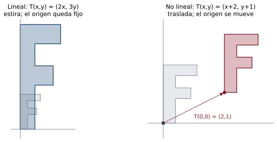
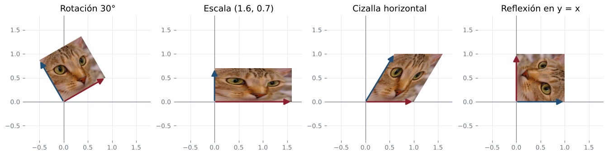

## Objetivos de la clase

- Definir **transformación lineal** y verificar la linealidad de una función.
- Reconocer ejemplos: transformaciones matriciales, rotaciones, proyecciones, derivación, transposición.
- Demostrar propiedades básicas: $T(\mathbf 0)=\mathbf 0$, $T(-\mathbf v)=-T(\mathbf v)$, preservación de combinaciones lineales.
- Demostrar que una transformación lineal queda **determinada por sus valores en una base**.

## Definición

::: {.definicion}
Sean $V$ y $W$ espacios vectoriales. Una función $T:V\to W$ es una **transformación lineal** si para todos $\mathbf u,\mathbf v\in V$ y $\alpha\in\mathbb R$:

- **Propiedad 1 (conserva la suma):** $\;T(\mathbf u+\mathbf v)=T(\mathbf u)+T(\mathbf v)$.
- **Propiedad 2 (conserva los escalares):** $\;T(\alpha\mathbf u)=\alpha\,T(\mathbf u)$.
:::

. . .

::: {.obs data-t="Forma compacta"}
Las dos condiciones equivalen a una sola: $\;T(\alpha\mathbf u+\beta\mathbf v)=\alpha T(\mathbf u)+\beta T(\mathbf v)$ para todos $\mathbf u,\mathbf v$ y $\alpha,\beta$.
**Las transformaciones lineales son las funciones que respetan las combinaciones lineales.**
:::

## Ejemplo 1: una transformación lineal sencilla

::: {.ejemplo}
Sea $T:\mathbb R^2\to\mathbb R^2$, $\;T(x,y)=(2x,\;3y)$: multiplica la primera componente por 2 y la segunda por 3. ¿Es lineal?
:::

. . .

**Propiedad 1 (suma).** Sean $\mathbf u=(x_1,y_1)$ y $\mathbf v=(x_2,y_2)$:
$$
T(\mathbf u+\mathbf v)=T(x_1+x_2,\;y_1+y_2)=(2x_1+2x_2,\;3y_1+3y_2),
$$
$$
T(\mathbf u)+T(\mathbf v)=(2x_1,3y_1)+(2x_2,3y_2)=(2x_1+2x_2,\;3y_1+3y_2).\ ✓
$$

. . .

**Propiedad 2 (escalares).**
$$
T(c\mathbf u)=T(cx_1,cy_1)=(2cx_1,\;3cy_1)=c\,(2x_1,3y_1)=c\,T(\mathbf u).\ ✓
$$

. . .

Por tanto, $T$ **es lineal**. Su matriz es $\begin{pmatrix}2&0\\0&3\end{pmatrix}$.

## Lineal vs. no lineal: la imagen de una figura

{fig-align="center" width="66%"}

Una transformación lineal **deja fijo el origen** y lleva rectas en rectas. Sumar un vector constante (traslación) mueve el origen: **no** es lineal.

## Ejemplo 2: de $\mathbb R^2$ a $\mathbb R^3$

::: {.ejemplo}
Sea $T:\mathbb R^2\to\mathbb R^3$, $\;T(x,y)=(x+y,\;2x-y,\;3y)$. Calcule $T(2,1)$ y escriba $T$ como un producto matriz-vector.
:::

. . .

Recibe un vector de dos componentes y devuelve uno de tres:
$$
T(2,1)=\big(2+1,\;2(2)-1,\;3(1)\big)=\boxed{(3,3,3)} .
$$

. . .

$$
T(x,y)=\begin{pmatrix}1&1\\2&-1\\0&3\end{pmatrix}\begin{pmatrix}x\\y\end{pmatrix}.
$$

. . .

Es lineal porque **cada componente es una combinación lineal de $x$ e $y$**, sin términos independientes ni potencias. En general, **toda** $T(\mathbf x)=A\mathbf x$ es lineal (con $A$ de tamaño compatible): $A(a\mathbf u+b\mathbf v)=aA\mathbf u+bA\mathbf v$.

## Demostración general de linealidad

::: {.ejemplo}
Demuestre que $T(x,y)=(x+y,\;2x-y,\;3y)$ es lineal usando la forma compacta $T(a\mathbf u+b\mathbf v)=aT(\mathbf u)+bT(\mathbf v)$.
:::

. . .

Sean $\mathbf u=(x_1,y_1)$, $\mathbf v=(x_2,y_2)$ y $a,b\in\mathbb R$. Entonces $a\mathbf u+b\mathbf v=(ax_1+bx_2,\;ay_1+by_2)$ y
$$
\begin{aligned}
T(a\mathbf u+b\mathbf v)&=\big((ax_1+bx_2)+(ay_1+by_2),\;2(ax_1+bx_2)-(ay_1+by_2),\;3(ay_1+by_2)\big)\\
&=a\,(x_1+y_1,\;2x_1-y_1,\;3y_1)+b\,(x_2+y_2,\;2x_2-y_2,\;3y_2)\\
&=a\,T(\mathbf u)+b\,T(\mathbf v).\ ✓
\end{aligned}
$$

## Ejemplo 3: una transformación que **no** es lineal

::: {.ejemplo}
Sea $T(x,y)=(x+2,\;y+1)$. Aunque se parece a los anteriores, incluye **términos constantes**. ¿Es lineal?
:::

. . .

::: {.teorema data-t="Condición necesaria"}
Si $T$ es lineal, entonces $T(\mathbf 0)=\mathbf 0$. (Se demuestra más adelante en esta clase.)
:::

. . .

Evaluamos en el vector cero: $\;T(0,0)=(0+2,\;0+1)=(2,1)\neq(0,0)$. **No es lineal.**

. . .

| Lineal | No lineal |
|---|---|
| $T(x,y)=(3x,\;2y)$ | $T(x,y)=(3x+1,\;2y)$ |
| $T(0,0)=(0,0)$ ✓ | $T(0,0)=(1,0)\neq(0,0)$ |

## Ejemplo 4: una transformación con una potencia

::: {.ejemplo}
Sea $T(x,y)=(x^2,\;y)$. ¿Es lineal?
:::

. . .

Evaluamos el cero: $T(0,0)=(0,0)$. Esta condición se cumple, pero **no es suficiente** para garantizar linealidad.

. . .

Probemos la propiedad de los escalares con $\mathbf u=(1,1)$ y $c=2$:
$$
T(2\mathbf u)=T(2,2)=(4,2),\qquad 2\,T(\mathbf u)=2\,T(1,1)=2(1,1)=(2,2).
$$

. . .

Como $(4,2)\neq(2,2)$, la transformación **no es lineal**.

. . .

::: {.obs data-t="Lógica de la prueba"}
$T(\mathbf 0)\neq\mathbf 0$ basta para decir **no lineal**. Pero $T(\mathbf 0)=\mathbf 0$ **no** basta para decir **lineal**: hay que verificar las dos propiedades en general, o hallar un contraejemplo.
:::

## Otros ejemplos no lineales

::: {.ejemplo data-t="Producto de variables"}
$T(x,y)=(xy,\;y)$: $\;T(2(1,1))=T(2,2)=(4,2)$, pero $2T(1,1)=(2,2)$. **No** es lineal.
:::

. . .

::: {.ejemplo data-t="Determinante"}
$T:M_{2\times2}\to\mathbb R$, $T(A)=\det A$. $\;\det(I+I)=4\neq\det I+\det I=2$. **No** es lineal.
:::

. . .

::: {.obs data-t="Señales de alarma"}
Constantes sumadas, potencias, productos de variables, valores absolutos, funciones trigonométricas de las variables… casi siempre rompen la linealidad. Para mostrar que **no** es lineal basta **un** contraejemplo.
:::

## Resumen de los ejemplos

| Función | ¿Es lineal? | Razón |
|---|:---:|---|
| $T(x,y)=(2x,\;3y)$ | Sí | Conserva suma y escalares. |
| $T(x,y)=(x+y,\;2x-y)$ | Sí | Sus componentes son combinaciones lineales. |
| $T(x,y)=(x+1,\;y)$ | No | $T(0,0)\neq(0,0)$. |
| $T(x,y)=(x^2,\;y)$ | No | No conserva la multiplicación por escalares. |
| $T(x,y)=(xy,\;y)$ | No | Contiene un producto de variables. |

. . .

::: {.obs data-t="Regla práctica"}
Busque si la transformación puede escribirse como $A\mathbf x$, **sin** sumarle un vector constante ni introducir operaciones no lineales.
:::

## Practiquemos

::: {.ejercicio}
Determine si $T:\mathbb R^2\to\mathbb R^2$, $\;T(x,y)=(x-2y,\;4x+y)$ es una transformación lineal.

**A.** Sí, es lineal. $\qquad$ **B.** No, porque tiene un número negativo. $\qquad$ **C.** No, porque devuelve dos componentes.
:::

. . .

::: {.solucion}
**A.** $\;T(x,y)=\begin{pmatrix}1&-2\\4&1\end{pmatrix}\begin{pmatrix}x\\y\end{pmatrix}$ es una transformación matricial, luego es lineal.
B es falsa: los coeficientes negativos no afectan la linealidad. C es falsa: el número de componentes de la salida no importa (solo debe ser un espacio vectorial).
:::

. . .

::: {.obs data-t="Conexión con lo que sigue"}
Con las transformaciones lineales se estudian su **representación matricial**, el **núcleo**, la **imagen**, el **rango** y la relación con las **matrices invertibles** (clases 23 y 24).
:::

## Propiedades básicas

::: {.teorema}
Si $T:V\to W$ es lineal, entonces:

a) $T(\mathbf 0)=\mathbf 0$.
b) $T(-\mathbf v)=-T(\mathbf v)$ y $T(\mathbf u-\mathbf v)=T(\mathbf u)-T(\mathbf v)$.
c) $T(\alpha_1\mathbf v_1+\cdots+\alpha_n\mathbf v_n)=\alpha_1T(\mathbf v_1)+\cdots+\alpha_nT(\mathbf v_n)$.
:::

. . .

::: {.demo}
a) $T(\mathbf 0)=T(0\cdot\mathbf 0)=0\cdot T(\mathbf 0)=\mathbf 0$.
b) $T(-\mathbf v)=T((-1)\mathbf v)=(-1)T(\mathbf v)=-T(\mathbf v)$; luego $T(\mathbf u-\mathbf v)=T(\mathbf u)+T(-\mathbf v)=T(\mathbf u)-T(\mathbf v)$.
c) Por inducción sobre $n$: el caso $n=1$ es (ii). Si vale para $n$, entonces $T\!\left(\sum_{i=1}^{n+1}\alpha_i\mathbf v_i\right)=T\!\left(\sum_{i=1}^{n}\alpha_i\mathbf v_i\right)+T(\alpha_{n+1}\mathbf v_{n+1})=\sum_{i=1}^{n+1}\alpha_iT(\mathbf v_i)$.
:::

## Galería de transformaciones lineales

| Transformación | Regla | Matriz (si aplica) |
|---|---|---|
| Cero | $T(\mathbf v)=\mathbf 0$ | $O$ |
| Identidad | $T(\mathbf v)=\mathbf v$ | $I$ |
| Matricial | $T(\mathbf x)=A\mathbf x$ | $A$ |
| Rotación en $\mathbb R^2$ un ángulo $\theta$ | $(x\cos\theta-y\operatorname{sen}\theta,\;x\operatorname{sen}\theta+y\cos\theta)$ | $\begin{pmatrix}\cos\theta&-\operatorname{sen}\theta\\\operatorname{sen}\theta&\cos\theta\end{pmatrix}$ |
| Reflexión respecto al eje $x$ | $(x,-y)$ | $\begin{pmatrix}1&0\\0&-1\end{pmatrix}$ |
| Proyección sobre el plano $xy$ | $(x,y,0)$ | $\begin{pmatrix}1&0&0\\0&1&0\\0&0&0\end{pmatrix}$ |
| Derivación $D:P_n\to P_{n-1}$ | $D(p)=p'$ | (clase 24) |
| Transposición $M_{m\times n}\to M_{n\times m}$ | $T(A)=A^T$ | — |
| Integral $C[0,1]\to\mathbb R$ | $T(f)=\int_0^1 f(x)\,dx$ | — |

## En la vida real: transformar una foto {.nostretch}

{fig-align="center" height="290px"}

Rotar, escalar, inclinar o reflejar una foto son **transformaciones lineales** de $\mathbb R^2$: a cada punto $(x,y)$ de la imagen se le aplica $T(x,y)=A\begin{pmatrix}x\\y\end{pmatrix}$. Las flechas son las imágenes de $\mathbf e_1$ y $\mathbf e_2$, que bastan para saber dónde va todo lo demás.

::: {.ml data-t="Aumento de datos"}
Para que una red reconozca un gato aunque la foto esté girada, se entrena también con copias **rotadas, escaladas y reflejadas** de cada imagen.
:::

## ¿Por qué la derivada y la transpuesta son lineales?

::: {.demo data-t="Derivación"}
Por las reglas del cálculo: $(p+q)'=p'+q'$ y $(\alpha p)'=\alpha p'$.
:::

. . .

::: {.demo data-t="Transposición"}
Clase 7: $(A+B)^T=A^T+B^T$ y $(\alpha A)^T=\alpha A^T$.
:::

. . .

::: {.demo data-t="Transformación matricial"}
Clase 4: $A(\mathbf x+\mathbf y)=A\mathbf x+A\mathbf y$ y $A(\alpha\mathbf x)=\alpha A\mathbf x$.
:::

. . .

::: {.obs}
En la clase 24 veremos el recíproco en dimensión finita: **toda** transformación lineal $\mathbb R^n\to\mathbb R^m$ es una transformación matricial.
:::

## Una base determina la transformación

::: {.teorema}
Sea $\{\mathbf v_1,\dots,\mathbf v_n\}$ una base de $V$ y sean $\mathbf w_1,\dots,\mathbf w_n\in W$ cualesquiera. Existe **una única** transformación lineal $T:V\to W$ con $T(\mathbf v_i)=\mathbf w_i$, y es
$$
T(c_1\mathbf v_1+\cdots+c_n\mathbf v_n)=c_1\mathbf w_1+\cdots+c_n\mathbf w_n .
$$
:::

. . .

::: {.demo data-t="Unicidad"}
Si $T$ y $S$ son lineales y coinciden en la base, para $\mathbf v=\sum c_i\mathbf v_i$: $T(\mathbf v)=\sum c_iT(\mathbf v_i)=\sum c_iS(\mathbf v_i)=S(\mathbf v)$. (La existencia se prueba verificando que la fórmula define una función lineal, usando la unicidad de las coordenadas.)
:::

## Ejemplo resuelto: $T$ a partir de una base

::: {.ejemplo}
$T:\mathbb R^2\to\mathbb R^2$ es lineal con $T(1,1)=(3,1)$ y $T(1,-1)=(1,5)$. Halle $T(x,y)$ y $T(3,1)$.
:::

. . .

Escribimos $(x,y)=c_1(1,1)+c_2(1,-1)$: $c_1+c_2=x$, $c_1-c_2=y$, de donde $c_1=\tfrac{x+y}{2}$, $c_2=\tfrac{x-y}{2}$.

. . .

$$
T(x,y)=\frac{x+y}{2}(3,1)+\frac{x-y}{2}(1,5)=\big(2x+y,\;3x-2y\big).
$$

. . .

$T(3,1)=(7,7)$. Comprobación: $T(1,1)=(3,1)$ ✓, $T(1,-1)=(1,5)$ ✓.

## Ejemplo 1 · Fácil: probar que una transformación es lineal {.compacto}

::: {.ejemplo data-t="Nivel fácil"}
Demuestre que $T(x,y)=(2x,\;x+y)$ es lineal.
:::

. . .

**Paso 1 · Suma.** Con $\mathbf u=(x_1,y_1)$, $\mathbf v=(x_2,y_2)$:
$$
T(\mathbf u+\mathbf v)=(2(x_1+x_2),\;x_1+x_2+y_1+y_2)=(2x_1,x_1+y_1)+(2x_2,x_2+y_2)=T(\mathbf u)+T(\mathbf v)\;✓
$$

. . .

**Paso 2 · Escalar.** $T(c\mathbf u)=(2cx_1,\;cx_1+cy_1)=c\,(2x_1,x_1+y_1)=c\,T(\mathbf u)$ ✓.

::: {.solucion}
Es lineal. De hecho $T(\mathbf x)=\begin{pmatrix}2&0\\1&1\end{pmatrix}\mathbf x$: toda transformación de la forma $A\mathbf x$ es lineal.
:::

## Ejemplo 2 · Fácil: una traslación no es lineal {.compacto}

::: {.ejemplo data-t="Nivel fácil"}
¿Es lineal $T(x,y)=(x+1,\;y)$?
:::

. . .

**Paso 1 · Prueba rápida:** toda transformación lineal cumple $T(\mathbf 0)=\mathbf 0$. Aquí $T(0,0)=(1,0)\neq(0,0)$.

. . .

**Paso 2 · Confirmar con la suma:** $T(1,0)+T(0,1)=(2,0)+(1,1)=(3,1)$, pero $T(1,1)=(2,1)$.

::: {.solucion}
No es lineal: es una **traslación**, que mueve el origen.
:::

## Ejemplo 3 · Medio: un producto de variables {.compacto}

::: {.ejemplo data-t="Nivel medio"}
¿Es lineal $T:\mathbb R^3\to\mathbb R^2$, $\;T(x,y,z)=(x-y,\;yz)$?
:::

. . .

**Paso 1 · El cero no basta.** $T(0,0,0)=(0,0)$: la prueba rápida no la descarta. Hay que mirar las propiedades.

. . .

**Paso 2 · Sospechar del término $yz$** (un producto de variables) y probar con escalares. Con $\mathbf u=(0,1,1)$ y $c=2$:
$$
T(2\mathbf u)=T(0,2,2)=(-2,\;4),\qquad 2\,T(\mathbf u)=2(-1,\;1)=(-2,\;2).
$$

::: {.solucion}
$T(2\mathbf u)\neq2T(\mathbf u)$: **no** es lineal. Productos, potencias o constantes sumadas suelen romper la linealidad; un **contraejemplo concreto** basta para demostrarlo.
:::

## Ejemplo 4 · Difícil: la transformación a partir de una base {.compacto}

::: {.ejemplo data-t="Nivel difícil"}
$T:\mathbb R^2\to\mathbb R^2$ es lineal, con $T(1,1)=(3,1)$ y $T(1,-1)=(1,-1)$. Halle $T(4,2)$ y la fórmula general $T(x,y)$.
:::

. . .

**Paso 1 · Escribir el vector en la base** $\{(1,1),(1,-1)\}$: $\;(4,2)=3(1,1)+1(1,-1)$.

. . .

**Paso 2 · Usar la linealidad:** $\;T(4,2)=3T(1,1)+T(1,-1)=3(3,1)+(1,-1)=(10,2)$.

. . .

**Paso 3 · En general:** $(x,y)=\tfrac{x+y}{2}(1,1)+\tfrac{x-y}{2}(1,-1)$, así que
$$
T(x,y)=\tfrac{x+y}{2}(3,1)+\tfrac{x-y}{2}(1,-1)=(2x+y,\;y).
$$

::: {.solucion}
$T(4,2)=(10,2)$ y $T(x,y)=(2x+y,\;y)$. Comprobación: $T(1,1)=(3,1)$ ✓ y $T(1,-1)=(1,-1)$ ✓. Basta conocer $T$ en una base para conocerla en todas partes.
:::

## Ejercicios propuestos

::: {.ejercicio data-t="1"}
Decida si son lineales: (a) $T(x,y,z)=(x-2y,\;3z)$; (b) $T(x,y)=(xy,\;x)$; (c) $T:P_2\to P_2$, $T(p)(t)=t\,p'(t)$.
:::

::: {.solucion .fragment}
**(a)** **Sí** (es $A\mathbf x$ con $A=\begin{pmatrix}1&-2&0\\0&0&3\end{pmatrix}$). **(b)** **No**: $T(2(1,1))=(4,2)\neq2T(1,1)=(2,2)$. **(c)** **Sí**: $t(p+q)'=tp'+tq'$ y $t(\alpha p)'=\alpha\,tp'$ (y $tp'$ sigue en $P_2$).
:::

## Ejercicios propuestos

::: {.ejercicio data-t="2"}
$T:\mathbb R^3\to\mathbb R^2$ es lineal con $T(\mathbf e_1)=(1,2)$, $T(\mathbf e_2)=(0,-1)$, $T(\mathbf e_3)=(3,1)$. Calcule $T(2,-1,4)$.
:::

::: {.solucion .fragment}
$T(2,-1,4)=2(1,2)-1(0,-1)+4(3,1)=(2+0+12,\;4+1+4)=(14,9)$.
:::

## Ejercicios propuestos

::: {.ejercicio data-t="3 · Demostración"}
Demuestre que la composición de transformaciones lineales $S\circ T$ es lineal.
:::

::: {.solucion .fragment}
$(S\circ T)(\alpha\mathbf u+\beta\mathbf v)=S\big(\alpha T(\mathbf u)+\beta T(\mathbf v)\big)=\alpha S(T(\mathbf u))+\beta S(T(\mathbf v))$, usando primero la linealidad de $T$ y luego la de $S$.
:::

## Ejercicios propuestos

::: {.ejercicio data-t="4 · Demostración"}
Sea $T:V\to W$ lineal. Demuestre que si $\{T(\mathbf v_1),\dots,T(\mathbf v_k)\}$ es LI, entonces $\{\mathbf v_1,\dots,\mathbf v_k\}$ es LI.
:::

::: {.solucion .fragment}
Si $\sum c_i\mathbf v_i=\mathbf 0$, aplicando $T$: $\sum c_iT(\mathbf v_i)=T(\mathbf 0)=\mathbf 0$. Como los $T(\mathbf v_i)$ son LI, todos los $c_i=0$.
:::

## Ejercicios del texto guía {.texto-guia}

Grossman y Flores, *Álgebra lineal*, 8.ª ed.:

| Sección | Ejercicios |
|---|---|
| 7.1 Transformaciones lineales: definición y ejemplos | 7, 8, 13, 18, 26, 27 |

## Resumen

- $T$ lineal $\iff$ $T(\alpha\mathbf u+\beta\mathbf v)=\alpha T(\mathbf u)+\beta T(\mathbf v)$.
- Si $T(\mathbf 0)\neq\mathbf 0$, $T$ **no** es lineal.
- Ejemplos: $A\mathbf x$, rotaciones, reflexiones, proyecciones, derivada, transpuesta, integral.
- Una transformación lineal queda **determinada** por las imágenes de una base.

 

[← Clase 21](clase_21.qmd) · [Programa del curso](../algebra_lineal.qmd) · [Clase 23: Núcleo e imagen →](clase_23.qmd)
