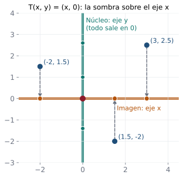
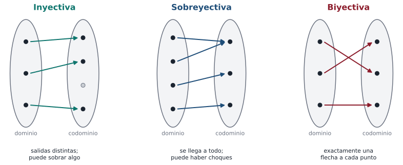

## En la vida diaria: lo que la transformación no ve {.nostretch}

::: {.aplicacion data-t="Para empezar"}
Al pasar una foto a blanco y negro, un naranja y un verde pueden verse exactamente del mismo gris. ¿Qué información se pierde?
:::

{fig-align="center" height="160px"}

Lo que una transformación convierte en cero es su **núcleo**: los cambios que "no ve". Lo que puede producir es su **imagen**.

**En esta clase:** aprenderá a calcular el núcleo y la imagen y qué dicen sobre la transformación.

## Objetivos de la clase

- Entender qué son el **núcleo** y la **imagen** de una transformación lineal.
- Calcularlos paso a paso, sobre todo cuando la transformación es una matriz.
- Usar el **teorema de la dimensión**: lo que se pierde más lo que queda es lo que entra.
- Reconocer cuándo una transformación es **inyectiva**, **sobreyectiva** o **biyectiva**.
- Practicar con una **guía de ejercicios** resueltos paso a paso (sin matrices, con polinomios y con matrices).

## Repaso: una transformación es una máquina

::: {.palabras}
Una transformación $T:V\to W$ es como una **máquina**: entra un vector $\mathbf v$ (del espacio de **salida** $V$) y sale otro vector $T(\mathbf v)$ (en el espacio de **llegada** $W$).
:::

. . .

Ante cualquier máquina hay dos preguntas naturales:

1. **¿Qué entradas producen un resultado nulo?** Es decir, ¿qué vectores salen convertidos en $\mathbf 0$? → **núcleo**.
2. **¿Qué resultados es capaz de producir?** → **imagen**.

## La idea con un ejemplo: la sombra en el piso {.compacto .nostretch}

::: {.ejemplo data-t="Proyección sobre el eje x"}
$T(x,y)=(x,\,0)$: a cada punto le "borra" la altura y lo deja sobre el eje $x$, como la sombra de un objeto cuando el sol está justo encima.
:::

:::: {.columns}
::: {.column width="45%"}
| Entra $\mathbf v$ | Sale $T(\mathbf v)$ |
|---|---|
| $(3,\,5)$ | $(3,\,0)$ |
| $(3,\,-2)$ | $(3,\,0)$ |
| $(0,\,4)$ | $(0,\,0)$ ← cero |
| $(0,\,-7)$ | $(0,\,0)$ ← cero |

- Salen en **cero** los vectores $(0,y)$: el **eje $y$** es el **núcleo**.
- Todo lo que sale es $(a,0)$: el **eje $x$** es la **imagen**.
:::
::: {.column width="55%"}
{height="330px"}
:::
::::

## 1. El núcleo de una transformación

::: {.definicion}
Sea $T:V\to W$ lineal. El **núcleo** de $T$ es el conjunto de todos los vectores del dominio que se transforman en el vector cero:
$$
\boxed{\;\operatorname{nu}T=\ker T=\{\mathbf v\in V:\ T(\mathbf v)=\mathbf 0\}\;}
$$
:::

::: {.palabras}
Buscamos **todos los vectores que, al aplicarles la transformación, producen el vector cero**: lo que la transformación "no ve" o "aplasta". Siempre contiene al $\mathbf 0$, porque $T(\mathbf 0)=\mathbf 0$.
:::

. . .

Se escribe $\operatorname{nu}T$ (como en el libro) o $\ker T$ (del inglés *kernel*): es lo mismo.

## Ejemplo 1: hallar el núcleo (planteamiento)

::: {.ejemplo}
Sea $T:\mathbb R^2\to\mathbb R^2$, $\quad T(x,y)=(x+y,\;2x+2y)$. Halle el núcleo de $T$.
:::

. . .

**Paso 1 · Igualar la transformación al vector cero.** Buscamos los $(x,y)$ tales que
$$
T(x,y)=(0,0)\qquad\Longrightarrow\qquad (x+y,\;2x+2y)=(0,0).
$$

. . .

**Paso 2 · Escribir el sistema.** Dos vectores son iguales si coinciden componente a componente:
$$
\begin{cases} x+y=0\\ 2x+2y=0 \end{cases}
$$

## Ejemplo 1: hallar el núcleo (solución)

**Paso 3 · Resolver el sistema.** La segunda ecuación es **el doble** de la primera ($2x+2y=2(x+y)$), así que no aporta información nueva: las ecuaciones son dependientes. Queda solo
$$
x+y=0\qquad\Longrightarrow\qquad x=-y .
$$

. . .

**Paso 4 · Introducir un parámetro.** Como $y$ puede tomar cualquier valor, hacemos $y=t$; entonces $x=-t$:
$$
(x,y)=(-t,\;t)=t\,(-1,\,1),\qquad t\in\mathbb R .
$$

. . .

**Paso 5 · Escribir la respuesta.**
$$
\boxed{\;\operatorname{nu}T=\operatorname{gen}\{(-1,1)\}\;}
$$

. . .

::: {.obs data-t="Interpretación"}
El núcleo es una **recta que pasa por el origen**, formada por todos los múltiplos de $(-1,1)$. Comprobación: $T(-1,1)=(-1+1,\;-2+2)=(0,0)$ ✓.
:::

## ¿Cómo se halla el núcleo?

1. Se **iguala** $T(\mathbf v)$ al vector cero.
2. Se **escribe el sistema** de ecuaciones (una por componente).
3. Se **resuelve** el sistema (es homogéneo).
4. Se expresa la solución con **parámetros** y se separa un vector por cada parámetro: esos vectores **generan** el núcleo.

. . .

::: {.ejemplo data-t="Mini ejemplo"}
$T(x,y,z)=(x-z,\;y)$. Igualando a cero: $x-z=0$ y $y=0$. Con $z=t$: $(x,y,z)=(t,0,t)=t(1,0,1)$. Entonces $\operatorname{nu}T=\operatorname{gen}\{(1,0,1)\}$.
:::

## 2. La imagen de una transformación

::: {.definicion}
La **imagen** de $T$ es el conjunto de todos los vectores que se obtienen al aplicar $T$ a los vectores del dominio:
$$
\boxed{\;\operatorname{Im}T=\{T(\mathbf v):\ \mathbf v\in V\}\subseteq W\;}
$$
:::

::: {.palabras}
Buscamos **todos los resultados posibles** de la transformación. Un vector $\mathbf w$ está en la imagen si **alguna** entrada da $\mathbf w$ como resultado.
:::

## Ejemplo 2: hallar la imagen

::: {.ejemplo}
Con la misma transformación $T(x,y)=(x+y,\;2x+2y)$, halle la imagen de $T$.
:::

. . .

**Paso 1 · Escribir $T$ en general y buscar algo en común.** La segunda componente es el doble de la primera:
$$
T(x,y)=(x+y,\;2x+2y)=(x+y,\;2(x+y)).
$$

. . .

**Paso 2 · Darle un nombre a lo que se repite.** Llamamos $s=x+y$. Como $x$ e $y$ pueden ser cualquier número, $s$ también puede ser cualquier número:
$$
T(x,y)=(s,\;2s)=s\,(1,\,2),\qquad s\in\mathbb R .
$$

. . .

**Paso 3 · Escribir la respuesta.** Todos los resultados son múltiplos de $(1,2)$:
$$
\boxed{\;\operatorname{Im}T=\operatorname{gen}\{(1,2)\}\;}
$$

. . .

::: {.obs data-t="Interpretación"}
La imagen también es una **recta que pasa por el origen**, pero generada por $(1,2)$: es la recta $y=2x$. Por ejemplo, $T(3,1)=(4,8)$, que cumple $8=2\cdot4$ ✓.
:::

## ¿Cómo se halla la imagen?

1. Se escribe $T(\mathbf v)$ **en general**, con letras.
2. Se **separa** el resultado en una combinación de vectores fijos, uno por cada variable:
$$
T(x,y)=(x+y,\;2x+2y)=x\,(1,2)+y\,(1,2).
$$
3. Esos vectores fijos **generan** la imagen.
4. Se **quitan los que sobran** (los que son combinación de los otros). Aquí $(1,2)$ aparece dos veces, así que basta uno: $\operatorname{Im}T=\operatorname{gen}\{(1,2)\}$.

. . .

::: {.ejemplo data-t="Mini ejemplo"}
$T(x,y,z)=(x+y,\;y+z)=x(1,0)+y(1,1)+z(0,1)$. Los vectores $(1,0)$ y $(0,1)$ ya generan todo $\mathbb R^2$, y $(1,1)=(1,0)+(0,1)$ sobra. Entonces $\operatorname{Im}T=\mathbb R^2$.
:::

## 3. Núcleo frente a imagen

| Característica | Núcleo | Imagen |
|---|---|---|
| ¿Qué buscamos? | Los vectores que producen **cero** | **Todos los resultados** posibles |
| ¿Cómo se calcula? | Resolviendo $T(\mathbf v)=\mathbf 0$ | Escribiendo $T(\mathbf v)$ para todo $\mathbf v$ |
| ¿Dónde vive? | En el **dominio** $V$ (lo que entra) | En el **codominio** $W$ (lo que sale) |
| Su dimensión se llama | **Nulidad**, $\nu(T)$ | **Rango**, $\rho(T)$ |
| En el ejemplo | $\operatorname{gen}\{(-1,1)\}$ | $\operatorname{gen}\{(1,2)\}$ |

## Nulidad y rango: los tamaños

::: {.definicion}
**Nulidad:** $\nu(T)=\dim\operatorname{nu}T$. $\qquad$ **Rango:** $\rho(T)=\dim\operatorname{Im}T$.
:::

::: {.palabras}
Son **dos números** que miden el tamaño de cada conjunto: la nulidad dice **cuántas direcciones se pierden** y el rango, **cuántas direcciones quedan**.
:::

. . .

Las letras $\nu$ ("nu", nulidad) y $\rho$ ("ro", rango) son **griegas**: no son una *v* ni una *p*.

. . .

En el ejemplo $T(x,y)=(x+y,\,2x+2y)$:

- **Nulidad** $=1$: el núcleo tiene una base con **un** vector, $(-1,1)$.
- **Rango** $=1$: la imagen tiene una base con **un** vector, $(1,2)$.
- Entró el plano $\mathbb R^2$, de dimensión $2=1+1$.

## Núcleo e imagen en una figura {.nostretch}

{fig-align="center" height="400px"}

La "sombra" cae sobre la recta $y=x$: los puntos de la recta $y=-x$ caen en el origen (**núcleo**) y todo punto termina sobre $y=x$ (**imagen**). Otra vez $\nu=1$, $\rho=1$ y $1+1=2$.

## 4. Relación con las matrices

Si la transformación está dada por una matriz, $T(\mathbf x)=A\mathbf x$, entonces:

- El **núcleo** se calcula resolviendo $\;\boxed{A\mathbf x=\mathbf 0}\;$ (es el espacio nulo $N_A$, clase 20).
- La **imagen** es el espacio generado por las **columnas** de $A$: $\;\boxed{\operatorname{Im}T=C_A}$.

. . .

¿Por qué las columnas? Porque $A\mathbf x$ es una combinación de las columnas de $A$ (clase 5):
$$
\begin{pmatrix}1&1\\2&2\end{pmatrix}\begin{pmatrix}x\\y\end{pmatrix}=x\begin{pmatrix}1\\2\end{pmatrix}+y\begin{pmatrix}1\\2\end{pmatrix}.
$$
Esta es justamente la matriz del ejemplo: $T(x,y)=(x+y,\,2x+2y)$.

## La receta con matrices

1. **Escalonar** $A$ (forma escalonada reducida).
2. **Núcleo:** resolver $A\mathbf x=\mathbf 0$; cada **variable libre** aporta un vector de la base.
3. **Imagen:** tomar las **columnas originales** de $A$ que quedaron con pivote.
4. **Verificar:** $\nu+\rho=$ número de columnas de $A$.

. . .

::: {.obs}
Error frecuente: tomar como base de la imagen las columnas de la matriz **ya escalonada**. Deben ser las de la matriz **original**.
:::

## Ejemplo guiado (1): escalonar

::: {.ejemplo}
Sea $T(\mathbf x)=A\mathbf x$ con $A=\begin{pmatrix}1&2&-1\\2&4&-2\\0&1&1\end{pmatrix}$. Halle bases del núcleo y de la imagen.
:::

. . .

**Paso 1 · Escalonar.**
$$
A\xrightarrow{F_2\to F_2-2F_1}\begin{pmatrix}1&2&-1\\0&0&0\\0&1&1\end{pmatrix}\xrightarrow{F_2\leftrightarrow F_3}\begin{pmatrix}1&2&-1\\0&1&1\\0&0&0\end{pmatrix}\xrightarrow{F_1\to F_1-2F_2}\begin{pmatrix}1&0&-3\\0&1&1\\0&0&0\end{pmatrix}.
$$

. . .

Hay pivotes en las columnas **1 y 2**; la columna 3 no tiene pivote, así que $z$ es **variable libre**.

## Ejemplo guiado (2): núcleo e imagen

**Paso 2 · Núcleo** (resolver $A\mathbf x=\mathbf 0$ con la matriz escalonada):
$$
x-3z=0,\quad y+z=0\;\Rightarrow\;(x,y,z)=(3z,\,-z,\,z)=z\,(3,-1,1).
$$
$\operatorname{nu}T=\operatorname{gen}\{(3,-1,1)\}$: **una recta**, $\nu(T)=1$. Comprobación: $A(3,-1,1)^T=(3-2-1,\;6-4-2,\;0-1+1)=(0,0,0)$ ✓.

. . .

**Paso 3 · Imagen** (columnas **originales** 1 y 2):
$\operatorname{Im}T=\operatorname{gen}\{(1,2,0),\,(2,4,1)\}$: **un plano**, $\rho(T)=2$.

. . .

**Paso 4 · Verificar:** $\nu+\rho=1+2=3$ columnas ✓. El plano imagen tiene ecuación $2a-b=0$ (normal $(1,2,0)\times(2,4,1)=(2,-1,0)$): todo lo que sale cumple $b=2a$.

## Más ejemplos (1): una matriz $2\times2$ {.compacto}

::: {.ejemplo}
$T(\mathbf x)=A\mathbf x$ con $A=\begin{pmatrix}1&2\\2&4\end{pmatrix}$. Halle el núcleo y la imagen.
:::

. . .

**Escalonar:** $F_2-2F_1$ da $\begin{pmatrix}1&2\\0&0\end{pmatrix}$. Un pivote (columna 1); $y$ es libre.

. . .

**Núcleo:** $x+2y=0\Rightarrow (x,y)=(-2y,\,y)=y\,(-2,1)$. Es la recta generada por $(-2,1)$: $\nu=1$.

. . .

**Imagen:** la columna original con pivote, $(1,2)$. Todo lo que sale es múltiplo de $(1,2)$: la recta $y=2x$, $\rho=1$.

::: {.solucion}
$\nu+\rho=1+1=2$ columnas ✓. Las dos columnas de $A$ son paralelas ($(2,4)=2(1,2)$): por eso la imagen es solo una recta y no todo el plano.
:::

## Más ejemplos (2): de $\mathbb R^3$ a $\mathbb R^2$ {.compacto}

::: {.ejemplo}
$T(\mathbf x)=A\mathbf x$ con $A=\begin{pmatrix}1&0&2\\0&1&-1\end{pmatrix}$. Halle el núcleo y la imagen.
:::

. . .

**Escalonar:** ya está en forma escalonada reducida. Pivotes en las columnas 1 y 2; $z$ es libre.

. . .

**Núcleo:** $x+2z=0$ y $y-z=0$, así que $(x,y,z)=(-2z,\,z,\,z)=z\,(-2,1,1)$. Una recta, $\nu=1$.
Comprobación: $A(-2,1,1)^T=(-2+0+2,\;0+1-1)=(0,0)$ ✓.

. . .

**Imagen:** columnas 1 y 2, $(1,0)$ y $(0,1)$: generan **todo** $\mathbb R^2$, $\rho=2$.

::: {.solucion}
$\nu+\rho=1+2=3$ ✓. $T$ es **sobreyectiva** (alcanza todo $\mathbb R^2$) pero **no inyectiva** (su núcleo no es solo el cero).
:::

## Más ejemplos (3): núcleo trivial {.compacto}

::: {.ejemplo}
$T(\mathbf x)=A\mathbf x$ con $A=\begin{pmatrix}1&1&0\\0&1&1\\1&0&1\end{pmatrix}$. Halle el núcleo y la imagen.
:::

. . .

**Escalonar:** se llega a la identidad $I_3$ (también se ve con $\det A=2\neq0$). Tres pivotes, **ninguna** variable libre.

. . .

**Núcleo:** la única solución de $A\mathbf x=\mathbf 0$ es $\mathbf x=\mathbf 0$. $\operatorname{nu}T=\{\mathbf 0\}$, $\nu=0$.

. . .

**Imagen:** las tres columnas tienen pivote y generan todo $\mathbb R^3$: $\rho=3$.

::: {.solucion}
$\nu+\rho=0+3=3$ ✓. $T$ es **inyectiva y sobreyectiva**: es invertible. Cuando $A$ es cuadrada, núcleo trivial $\iff\det A\neq0$.
:::

## Más ejemplos (4): de $\mathbb R^4$ a $\mathbb R^3$ {.compacto}

::: {.ejemplo}
$T(\mathbf x)=A\mathbf x$ con $A=\begin{pmatrix}1&2&1&0\\2&4&0&2\\1&2&2&-1\end{pmatrix}$. Halle bases del núcleo y de la imagen.
:::

. . .

**Escalonar** ($F_2-2F_1$, $F_3-F_1$; luego $-\tfrac12F_2$, $F_3-F_2$, $F_1-F_2$):
$$
\begin{pmatrix}1&2&0&1\\0&0&1&-1\\0&0&0&0\end{pmatrix}.\qquad\text{Pivotes en las columnas 1 y 3; } x_2 \text{ y } x_4 \text{ libres.}
$$

. . .

**Núcleo:** $x_1=-2x_2-x_4$, $x_3=x_4$. Con $x_2=s$, $x_4=t$:
$\;\mathbf x=s\,(-2,1,0,0)+t\,(-1,0,1,1)$. Un plano dentro de $\mathbb R^4$: $\nu=2$.

. . .

**Imagen:** columnas **originales** 1 y 3: $\operatorname{Im}T=\operatorname{gen}\{(1,2,1),\,(1,0,2)\}$, un plano de $\mathbb R^3$: $\rho=2$.

::: {.solucion}
$\nu+\rho=2+2=4$ columnas ✓. Comprobación del núcleo: $A(-1,0,1,1)^T=(-1+0+1+0,\;-2+0+0+2,\;-1+0+2-1)=(0,0,0)$ ✓.
:::

## Núcleo e imagen son subespacios

::: {.teorema}
$\operatorname{nu}T$ es un subespacio de $V$ e $\operatorname{Im}T$ es un subespacio de $W$.
:::

::: {.palabras}
Por eso siempre resultan ser el origen, una recta, un plano o todo el espacio, y por eso tiene sentido hablar de su **base** y su **dimensión**.
:::

. . .

::: {.demo data-t="Núcleo"}
$T(\mathbf 0)=\mathbf 0$, así que $\mathbf 0\in\operatorname{nu}T$. Si $\mathbf u,\mathbf v\in\operatorname{nu}T$: $T(\mathbf u+\mathbf v)=T(\mathbf u)+T(\mathbf v)=\mathbf 0+\mathbf 0=\mathbf 0$ y $T(\alpha\mathbf u)=\alpha\mathbf 0=\mathbf 0$.
:::

. . .

::: {.demo data-t="Imagen"}
$\mathbf 0=T(\mathbf 0)\in\operatorname{Im}T$. Si $\mathbf w_1=T(\mathbf v_1)$ y $\mathbf w_2=T(\mathbf v_2)$, entonces $\mathbf w_1+\mathbf w_2=T(\mathbf v_1+\mathbf v_2)\in\operatorname{Im}T$ y $\alpha\mathbf w_1=T(\alpha\mathbf v_1)\in\operatorname{Im}T$.
:::

## Fuera de las matrices (1): la derivada

::: {.ejemplo data-t="Derivación D: P₃ → P₂"}
$D(a_0+a_1t+a_2t^2+a_3t^3)=a_1+2a_2t+3a_3t^2$.
:::

. . .

- **Núcleo:** ¿qué polinomios tienen derivada cero? Los **constantes** ($a_1=a_2=a_3=0$). Por ejemplo, $D(5)=0$ y $D(-2)=0$. Base $\{1\}$, $\nu(D)=1$.

. . .

- **Imagen:** ¿se puede obtener cualquier polinomio de grado 2? Sí: para obtener $b_0+b_1t+b_2t^2$ basta tomar $a_1=b_0$, $a_2=\tfrac{b_1}{2}$, $a_3=\tfrac{b_2}{3}$. $\operatorname{Im}D=P_2$, $\rho(D)=3$.

. . .

Verificación: $\nu+\rho=1+3=4=\dim P_3$ ✓.

## Fuera de las matrices (2): transponer y proyectar

::: {.ejemplo data-t="Transposición T: M₂ₓ₃ → M₃ₓ₂"}
- **Núcleo:** la única matriz cuya transpuesta es cero es la matriz cero: $\nu=0$.
- **Imagen:** toda matriz $B$ de $3\times2$ se obtiene transponiendo $B^T$: $\operatorname{Im}T=M_{3\times2}$, $\rho=6$.
:::

. . .

::: {.ejemplo data-t="Proyección sobre el plano xy"}
$T(x,y,z)=(x,y,0)$ "aplasta" la altura:

- **Núcleo:** los puntos $(0,0,z)$, el **eje $z$** ($\nu=1$).
- **Imagen:** los puntos $(x,y,0)$, el **plano $xy$** ($\rho=2$).
:::

## Teorema de la dimensión {.compacto}

::: {.teorema}
Si $T:V\to W$ es lineal y $\dim V=n$, entonces
$$
\nu(T)+\rho(T)=n=\dim V .
$$
:::

::: {.palabras}
**Lo que se pierde** (núcleo) **más lo que queda** (imagen) **es igual a lo que entra** (la dimensión del espacio de salida). También se conoce como **teorema de rango y nulidad**.
:::

. . .

| Ejemplo | $\nu$ | $\rho$ | $\dim V$ |
|---|:-:|:-:|:-:|
| $T(x,y)=(x+y,\,2x+2y)$ (ejemplos 1 y 2) | 1 | 1 | 2 |
| Matriz $3\times3$ del ejemplo guiado | 1 | 2 | 3 |
| Derivación $P_3\to P_2$ | 1 | 3 | 4 |
| Transposición $M_{2\times3}\to M_{3\times2}$ | 0 | 6 | 6 |
| Proyección sobre el plano $xy$ | 1 | 2 | 3 |

. . .

::: {.obs}
Para $T(\mathbf x)=A\mathbf x$ es exactamente el teorema rango-nulidad de la clase 20: $\nu(A)+\rho(A)=n$ (número de columnas).
:::

## 5. Inyectiva y sobreyectiva

::: {.definicion}
$T:V\to W$ es **inyectiva** si $T(\mathbf u)=T(\mathbf v)$ implica $\mathbf u=\mathbf v$. Es **sobreyectiva** si $\operatorname{Im}T=W$.
:::

::: {.palabras}
**Inyectiva:** dos entradas distintas **nunca** dan el mismo resultado (no hay "choques"). **Sobreyectiva:** se alcanza **todo** el espacio de llegada (no sobra nada).
:::

. . .

::: {.ejemplo}
La sombra $T(x,y)=(x,0)$ **no** es inyectiva: $(3,5)$ y $(3,-2)$ dan el mismo resultado $(3,0)$. Tampoco es sobreyectiva: nunca sale $(1,1)$.
:::

## El núcleo decide la inyectividad

::: {.teorema}
Una transformación lineal $T$ es inyectiva **si y solo si** $\operatorname{nu}T=\{\mathbf 0\}$.
:::

::: {.palabras}
Basta revisar **una sola cosa**: si lo único que se convierte en cero es el cero, no hay choques en ningún otro lado.
:::

. . .

::: {.demo}
($\Rightarrow$) Si $T(\mathbf v)=\mathbf 0=T(\mathbf 0)$, por inyectividad $\mathbf v=\mathbf 0$.
($\Leftarrow$) Si $T(\mathbf u)=T(\mathbf v)$, entonces $T(\mathbf u-\mathbf v)=T(\mathbf u)-T(\mathbf v)=\mathbf 0$, luego $\mathbf u-\mathbf v\in\operatorname{nu}T=\{\mathbf 0\}$ y $\mathbf u=\mathbf v$.
:::

## Resumen de casos

| Si… | entonces $T$ es… |
|---|---|
| $\nu(T)=0$ (núcleo solo el cero) | **inyectiva** |
| $\rho(T)=\dim W$ (la imagen es todo $W$) | **sobreyectiva** |
| ambas cosas | **invertible** (biyectiva) |

. . .

::: {.ejemplo}
- La derivación $D:P_3\to P_2$ **no** es inyectiva ($D(5)=D(7)=0$) pero **sí** es sobreyectiva.
- La transposición es inyectiva **y** sobreyectiva.
- La proyección sobre el plano $xy$ no es ninguna de las dos.
:::

## Las tres situaciones en un dibujo {.nostretch}

{fig-align="center" height="400px"}

Cada punto de la izquierda es una entrada y cada flecha lleva a su resultado. **Inyectiva:** nunca llegan dos flechas al mismo punto. **Sobreyectiva:** todo punto de la derecha recibe al menos una flecha. **Biyectiva:** las dos cosas a la vez.

## Biyectiva

::: {.definicion}
$T:V\to W$ es **biyectiva** si es inyectiva **y** sobreyectiva. Para una transformación lineal, biyectiva es lo mismo que **invertible**.
:::

::: {.palabras}
Cada vector de llegada se obtiene **exactamente una vez**: hay una sola entrada para cada salida, y por eso el proceso se puede "deshacer".
:::

. . .

::: {.obs data-t="Ojo con el nombre"}
La palabra correcta es **sobreyectiva** (también se dice *suprayectiva*). Las transformaciones *proyectivas* existen, pero son de otra rama, la geometría proyectiva.
:::

## Probar la inyectividad con la definición {.compacto}

::: {.ejemplo}
Use la definición para probar que $T(x,y)=(2x,\;3y)$ es inyectiva.
:::

**Paso 1 · Suponer dos entradas con la misma salida:** $T(x_1,y_1)=T(x_2,y_2)$, es decir, $(2x_1,\;3y_1)=(2x_2,\;3y_2)$.

**Paso 2 · Igualar componente a componente:** $2x_1=2x_2\Rightarrow x_1=x_2$ (dividiendo entre 2) y $3y_1=3y_2\Rightarrow y_1=y_2$ (dividiendo entre 3).

**Paso 3 · Concluir:** $(x_1,y_1)=(x_2,y_2)$. Dos salidas iguales solo vienen de la misma entrada: **es inyectiva**.

. . .

::: {.obs}
Con el núcleo es más corto: $(2x,3y)=(0,0)$ solo tiene la solución $(0,0)$. Por eso, en la práctica, **para la inyectividad se calcula el núcleo** y **para la sobreyectividad, la imagen**.
:::

## Ejemplo A: una inyectiva y una que no lo es {.compacto}

::: {.ejemplo}
Decida si son inyectivas: $\;T_1(x,y)=(2x,\;y)\;$ y $\;T_2(x,y)=(x+y,\;x+y)$.
:::

**$T_1$ · Paso 1:** igualamos a cero: $(2x,\;y)=(0,0)$, es decir, $2x=0$ y $y=0$.

**Paso 2:** de $2x=0$ sale $x=0$; y $y=0$. La única solución es $(0,0)$: $\operatorname{nu}T_1=\{(0,0)\}$.

**Conclusión:** $T_1$ **es inyectiva**: ningún vector distinto de cero se convierte en cero.

. . .

**$T_2$ · Paso 1:** igualamos a cero: $x+y=0$ (las dos componentes dan la misma ecuación).

**Paso 2:** $x=-y$; con $y=t$: $(x,y)=(-t,t)=t(-1,1)$. Así, $\operatorname{nu}T_2=\operatorname{gen}\{(-1,1)\}$.

**Conclusión:** $T_2$ **no es inyectiva**: por ejemplo $T_2(-1,1)=(0,0)=T_2(0,0)$, dos entradas distintas con el mismo resultado.

## Ejemplo B: una sobreyectiva y una que no lo es {.compacto}

::: {.ejemplo}
Decida si son sobreyectivas: $\;T_3(x,y)=(x+y,\;x-y)\;$ y $\;T_4(x,y)=(x+y,\;2x+2y)$.
:::

**$T_3$ · Paso 1:** tomamos un vector **cualquiera** $(a,b)$ de $\mathbb R^2$ y buscamos $(x,y)$ con $T_3(x,y)=(a,b)$: $\;x+y=a,\;\;x-y=b$.

**Paso 2:** sumando las ecuaciones, $2x=a+b$, así que $x=\frac{a+b}{2}$; restándolas, $2y=a-b$, así que $y=\frac{a-b}{2}$.

**Conclusión:** siempre hay solución, sin importar $a$ y $b$: $\operatorname{Im}T_3=\mathbb R^2$ y $T_3$ **es sobreyectiva**.

. . .

**$T_4$ · Paso 1:** con $s=x+y$, $\;T_4(x,y)=(s,\;2s)=s(1,2)$: $\operatorname{Im}T_4=\operatorname{gen}\{(1,2)\}$, una recta.

**Paso 2 · Un vector que no se alcanza:** para obtener $(1,0)$ haría falta $s=1$ y $2s=0$ a la vez: imposible.

**Conclusión:** $T_4$ **no es sobreyectiva**.

## Ejemplo C: una biyectiva {.compacto}

::: {.ejemplo}
Muestre que $T(x,y)=(3x,\;2y)$ es biyectiva.
:::

**Paso 1 · Inyectiva.** $(3x,\;2y)=(0,0)$ da $3x=0$ y $2y=0$, así que $x=0$, $y=0$. El núcleo es $\{(0,0)\}$: **inyectiva**.

. . .

**Paso 2 · Sobreyectiva.** Dado cualquier $(a,b)$, buscamos $3x=a$ y $2y=b$: basta tomar $x=\frac a3$, $y=\frac b2$. Se alcanza todo $\mathbb R^2$: **sobreyectiva**.

. . .

**Conclusión:** es inyectiva y sobreyectiva, luego **biyectiva** (invertible). Su inversa es $T^{-1}(a,b)=\left(\frac a3,\;\frac b2\right)$.

## ¿Cómo reconocerlas con la matriz?

Si $T(\mathbf x)=A\mathbf x$ con $A$ de tamaño $m\times n$ ($n$ columnas = dimensión de lo que entra, $m$ filas = dimensión de lo que sale):

| Propiedad | Condición | ¿Por qué? |
|---|---|---|
| Inyectiva | $\rho(A)=n$ | pivote en cada columna: no hay variables libres, $\nu=0$ |
| Sobreyectiva | $\rho(A)=m$ | pivote en cada fila: las columnas generan todo $\mathbb R^m$ |
| Biyectiva | $\rho(A)=m=n$ | $A$ cuadrada e invertible ($\det A\neq0$) |

. . .

::: {.ejemplo}
$A=\begin{pmatrix}1&0&0\\0&1&0\end{pmatrix}$ ($2\times3$): ya está escalonada, con pivotes en las columnas 1 y 2. $\rho=2$ y $\nu=3-2=1$.

**No** es inyectiva ($\rho=2\neq3$: $z$ es libre). **Sí** es sobreyectiva ($\rho=2=$ número de filas). Por tanto, no es biyectiva.
:::

## Mini parcial: ¿sí o no?

1. $T:\mathbb R^2\to\mathbb R^2$, $T(x,y)=(x,0)$. ¿Es inyectiva?
2. $T:\mathbb R^2\to\mathbb R^2$, $T(x,y)=(x,y)$. ¿Es sobreyectiva?
3. $T:\mathbb R^3\to\mathbb R^2$ tiene rango 2. ¿Es sobreyectiva?
4. La misma $T$ de la pregunta 3. ¿Es inyectiva?
5. $T:\mathbb R^2\to\mathbb R^2$ tiene núcleo $\{\mathbf 0\}$. ¿Es biyectiva?

::: {.solucion .fragment}
1. **No:** $(0,5)\mapsto(0,0)$, así que el núcleo es el eje $y$.
2. **Sí:** cada $(a,b)$ sale de sí mismo.
3. **Sí:** $\rho=2=\dim\mathbb R^2$.
4. **No:** $\nu=3-2=1\neq0$.
5. **Sí:** $\nu=0$, luego $\rho=2-0=2$: también es sobreyectiva.
:::

## La regla para recordar

$$
\boxed{\begin{aligned}
\text{Inyectiva}&\iff \operatorname{nu}T=\{\mathbf 0\}\iff\nu(T)=0\\
\text{Sobreyectiva}&\iff \operatorname{Im}T=W\iff\rho(T)=\dim W\\
\text{Biyectiva}&\iff\text{las dos a la vez}
\end{aligned}}
$$

. . .

::: {.palabras}
Para la primera se mira el **núcleo** (qué se pierde); para la segunda, la **imagen** (a dónde se llega). El teorema de la dimensión conecta las dos: si $\dim V=\dim W$, basta revisar una.
:::

## Ejemplo resuelto: evaluar un polinomio

::: {.ejemplo}
Sea $T:P_2\to\mathbb R$, $\;T(p)=p(1)$ (evaluar el polinomio en $t=1$). Halle su núcleo, su imagen y verifique el teorema de la dimensión.
:::

. . .

**Paso 1 · Escribir $T$ en general:** $\;T(a+bt+ct^2)=a+b+c$. Es lineal, porque $(p+q)(1)=p(1)+q(1)$ y $(\alpha p)(1)=\alpha\,p(1)$.

. . .

**Paso 2 · Núcleo:** $a+b+c=0\Rightarrow a=-b-c$, así que
$p=(-b-c)+bt+ct^2=b(t-1)+c(t^2-1)$. Base $\{t-1,\;t^2-1\}$, $\nu(T)=2$. Son los polinomios que **valen cero en $t=1$**.

. . .

**Paso 3 · Imagen:** el polinomio constante $a$ da $T(a)=a$, así que sale **cualquier** número real: $\operatorname{Im}T=\mathbb R$, $\rho(T)=1$.

. . .

**Paso 4 · Verificar:** $\nu+\rho=2+1=3=\dim P_2$ ✓.

## Ejemplo 1 · Fácil: núcleo e imagen de una proyección {.compacto}

::: {.ejemplo data-t="Nivel fácil"}
Halle el núcleo y la imagen de $T(x,y)=(x-y,\;2x-2y)$.
:::

. . .

**Paso 1 · Núcleo:** $T(x,y)=(0,0)\iff x-y=0$. Son los vectores $(t,t)$: la recta $y=x$.

. . .

**Paso 2 · Imagen:** $T(x,y)=(x-y)(1,2)$. Todo lo que sale es múltiplo de $(1,2)$: la recta $y=2x$.

::: {.solucion}
$\operatorname{nu}T=\operatorname{gen}\{(1,1)\}$, $\;\operatorname{im}T=\operatorname{gen}\{(1,2)\}$. Dimensiones $1+1=2=\dim\mathbb R^2$ ✓.
:::

## Ejemplo 2 · Fácil: núcleo trivial {.compacto}

::: {.ejemplo data-t="Nivel fácil"}
Halle el núcleo y la imagen de $T(x,y)=(x+y,\;x-y)$. ¿Es inyectiva?
:::

. . .

**Paso 1 · Núcleo:** $x+y=0$ y $x-y=0$ dan $x=y=0$. $\;\operatorname{nu}T=\{\mathbf 0\}$.

. . .

**Paso 2 · Imagen:** por el teorema de la dimensión, $\dim\operatorname{im}T=2-0=2$, así que $\operatorname{im}T=\mathbb R^2$.

::: {.solucion}
$T$ es inyectiva (núcleo trivial) y sobreyectiva: es invertible.
:::

## Ejemplo 3 · Medio: de $\mathbb R^3$ a $\mathbb R^2$ {.compacto}

::: {.ejemplo data-t="Nivel medio"}
Para $T(x,y,z)=(x+y,\;y+z)$, halle una base del núcleo y la imagen, y verifique el teorema de la dimensión.
:::

. . .

**Paso 1 · Núcleo:** $x+y=0$, $y+z=0$. Con $y=t$: $x=-t$, $z=-t$. $\;\operatorname{nu}T=\operatorname{gen}\{(-1,1,-1)\}$, dimensión $1$.

. . .

**Paso 2 · Imagen:** generada por las imágenes de la base canónica: $T(\mathbf e_1)=(1,0)$, $T(\mathbf e_2)=(1,1)$, $T(\mathbf e_3)=(0,1)$. Ya $(1,0)$ y $(0,1)$ generan $\mathbb R^2$.

::: {.solucion}
$\dim\operatorname{nu}T+\dim\operatorname{im}T=1+2=3=\dim\mathbb R^3$ ✓. $T$ es sobreyectiva pero no inyectiva.
:::

## Ejemplo 4 · Difícil: $T(A)=A-A^T$ {.compacto}

::: {.ejemplo data-t="Nivel difícil"}
Sea $T:M_{2\times2}\to M_{2\times2}$, $\;T(A)=A-A^T$. Halle su núcleo y su imagen con sus dimensiones.
:::

. . .

**Paso 1 · Calcular $T$ en general:**
$$
T\begin{pmatrix}a&b\\c&d\end{pmatrix}=\begin{pmatrix}a&b\\c&d\end{pmatrix}-\begin{pmatrix}a&c\\b&d\end{pmatrix}=\begin{pmatrix}0&b-c\\c-b&0\end{pmatrix}=(b-c)\begin{pmatrix}0&1\\-1&0\end{pmatrix}.
$$

. . .

**Paso 2 · Núcleo:** $T(A)=0\iff b=c\iff A$ es **simétrica**. Las simétricas $\begin{pmatrix}a&b\\b&d\end{pmatrix}$ tienen 3 parámetros: dimensión $3$.

. . .

**Paso 3 · Imagen:** todos los múltiplos de $\begin{pmatrix}0&1\\-1&0\end{pmatrix}$, es decir, las **antisimétricas**: dimensión $1$.

::: {.solucion}
$\operatorname{nu}T=$ simétricas ($\dim 3$), $\operatorname{im}T=$ antisimétricas ($\dim1$), y $3+1=4=\dim M_{2\times2}$ ✓.
:::

## 6. Guía de ejercicios: núcleo e imagen

Resolvemos **22 ejercicios** completos, de menos a más, y dejamos **10 propuestos** con sus respuestas.

| Parte | Tipo | Ejercicios |
|---|---|---|
| I | Fórmulas en $\mathbb R^n$, sin matrices | 1–7 |
| II | Polinomios y derivadas | 8–12 |
| III | Matrices (Gauss-Jordan) | 13–16 |
| IV | Clasificar: inyectiva, sobreyectiva o biyectiva | 17–22 |
| V | Propuestos (núcleo, imagen, bases, $\nu$, $\rho$ y tipo), con respuestas | 23–32 |
| VI | Preguntas de concepto y errores frecuentes | — |

## La receta de la guía

**Núcleo** ($\operatorname{nu}T=\{\mathbf v\in V:\ T(\mathbf v)=\mathbf 0\}$):

1. Igualar **cada componente** de $T(\mathbf v)$ a cero.
2. Resolver el sistema.
3. Escribir la solución con parámetros y separar **un vector por parámetro**: esa es una base; su número de vectores es $\nu$.

. . .

**Imagen** ($\operatorname{Im}T=\{T(\mathbf v):\ \mathbf v\in V\}$):

1. Escribir $T(\mathbf v)$ **separado por letras**, como combinación de vectores fijos.
2. Quitar los vectores que sobran (los que son combinación de los otros): lo que queda es una base; su número es $\rho$.

. . .

**Siempre comprobar:** $\;\boxed{\nu(T)+\rho(T)=\dim V}$.

## Parte I · Transformaciones sin matrices

La transformación viene dada por una **fórmula**. No hace falta armar una matriz: basta plantear las ecuaciones que salen de cada componente.

. . .

::: {.obs data-t="Dos trucos que se usan todo el tiempo"}
- Si dos ecuaciones son **múltiplos** una de la otra, una sobra.
- Para la imagen, **separe por letras**: $T(x,y)=(2x-y,\;x+3y)=x(2,1)+y(-1,3)$. Los vectores que acompañan a cada letra generan la imagen.
:::

## Ejercicio 1: núcleo trivial {.compacto}

::: {.ejemplo}
$T:\mathbb R^2\to\mathbb R^2$, $\;T(x,y)=(x+y,\;x-y)$. Halle núcleo, imagen, bases y dimensiones.
:::

**Paso 1 · Núcleo.** Igualamos a cero: $\;x+y=0\;$ y $\;x-y=0$. Sumando las dos ecuaciones: $2x=0\Rightarrow x=0$; en la primera, $0+y=0\Rightarrow y=0$.
Solo sale el cero: $\operatorname{nu}T=\{(0,0)\}$. Su base es el conjunto vacío y $\nu=0$.

. . .

**Paso 2 · Imagen.** Separamos por letras: $T(x,y)=x(1,1)+y(1,-1)$, así que $\operatorname{Im}T=\operatorname{gen}\{(1,1),(1,-1)\}$.
Los dos vectores no son múltiplos (son LI), y dos vectores LI en $\mathbb R^2$ lo generan todo: $\operatorname{Im}T=\mathbb R^2$, $\rho=2$.

. . .

**Paso 3 · Comprobar:** $\nu+\rho=0+2=2=\dim\mathbb R^2$ ✓.

## Ejercicio 2: ecuaciones repetidas {.compacto}

::: {.ejemplo}
$T:\mathbb R^2\to\mathbb R^2$, $\;T(x,y)=(2x+4y,\;x+2y)$.
:::

**Paso 1 · Núcleo.** $\;2x+4y=0\;$ y $\;x+2y=0$. La primera es el doble de la segunda: queda solo $x+2y=0$, es decir, $x=-2y$.
Con $y=t$: $(x,y)=(-2t,\;t)=t(-2,1)$. $\operatorname{nu}T=\operatorname{gen}\{(-2,1)\}$, $\nu=1$.

. . .

**Paso 2 · Imagen.** Separamos por letras: $T(x,y)=x(2,1)+y(4,2)$. Pero $(4,2)=2(2,1)$: sobra.
$\operatorname{Im}T=\operatorname{gen}\{(2,1)\}$, $\rho=1$.

. . .

**Paso 3 · Comprobar:** $1+1=2$ ✓.

## Ejercicio 3: de $\mathbb R^3$ a $\mathbb R^2$ {.compacto}

::: {.ejemplo}
$T:\mathbb R^3\to\mathbb R^2$, $\;T(x,y,z)=(x+y+z,\;x-y)$.
:::

**Paso 1 · Núcleo.** $\;x+y+z=0\;$ y $\;x-y=0$. De la segunda, $x=y$. En la primera: $x+x+z=0\Rightarrow z=-2x$.
Con $x=t$: $(x,y,z)=(t,\;t,\;-2t)=t(1,1,-2)$. $\operatorname{nu}T=\operatorname{gen}\{(1,1,-2)\}$, $\nu=1$.

. . .

**Paso 2 · Imagen.** $T(x,y,z)=x(1,1)+y(1,-1)+z(1,0)$. Los dos primeros no son múltiplos (son LI), así que ya generan todo $\mathbb R^2$; el tercero sobra.
$\operatorname{Im}T=\mathbb R^2$, $\rho=2$.

. . .

**Paso 3 · Comprobar:** $1+2=3=\dim\mathbb R^3$ ✓.

## Ejercicio 4: un núcleo de dimensión 2 {.compacto}

::: {.ejemplo}
$T:\mathbb R^3\to\mathbb R^2$, $\;T(x,y,z)=(x+y+z,\;2x+2y+2z)$.
:::

**Paso 1 · Núcleo.** $\;x+y+z=0\;$ y $\;2x+2y+2z=0$. La segunda es el doble de la primera: sobra. Queda $x=-y-z$, con $y$ y $z$ **libres**.
Con $y=s$, $z=t$: $(x,y,z)=(-s-t,\;s,\;t)=s(-1,1,0)+t(-1,0,1)$.
$\operatorname{nu}T=\operatorname{gen}\{(-1,1,0),(-1,0,1)\}$, $\nu=2$: es un **plano**.

. . .

**Paso 2 · Imagen.** $T(x,y,z)=x(1,2)+y(1,2)+z(1,2)$: el mismo vector tres veces. $\operatorname{Im}T=\operatorname{gen}\{(1,2)\}$, $\rho=1$.

. . .

**Paso 3 · Comprobar:** $2+1=3$ ✓.

## Ejercicio 5: diferencias de coordenadas {.compacto}

::: {.ejemplo}
$T:\mathbb R^3\to\mathbb R^3$, $\;T(x,y,z)=(x-y,\;y-z,\;x-z)$.
:::

**Paso 1 · Núcleo.** $\;x-y=0$, $\;y-z=0$, $\;x-z=0$. Las dos primeras dan $x=y$ y $y=z$, es decir, $x=y=z$ (la tercera se cumple sola).
Con $z=t$: $(x,y,z)=t(1,1,1)$. $\operatorname{nu}T=\operatorname{gen}\{(1,1,1)\}$, $\nu=1$.

. . .

**Paso 2 · Imagen.** $T(x,y,z)=x(1,0,1)+y(-1,1,0)+z(0,-1,-1)$. El tercero sobra:
$-(1,0,1)-(-1,1,0)=(-1+1,\;0-1,\;-1-0)=(0,-1,-1)$ ✓. Los otros dos no son múltiplos.
$\operatorname{Im}T=\operatorname{gen}\{(1,0,1),(-1,1,0)\}$, $\rho=2$.

. . .

**Paso 3 · Comprobar:** $1+2=3$ ✓.

## Ejercicio 6: componentes dependientes {.compacto}

::: {.ejemplo}
$T:\mathbb R^3\to\mathbb R^3$, $\;T(x,y,z)=(x+y,\;y+z,\;x+2y+z)$. Observe que la tercera componente es la suma de las dos primeras.
:::

**Paso 1 · Núcleo.** $\;x+y=0$, $\;y+z=0$, $\;x+2y+z=0$. De la primera, $x=-y$; de la segunda, $z=-y$. La tercera queda $-y+2y-y=0$ ✓.
Con $y=t$: $(x,y,z)=(-t,\;t,\;-t)=t(-1,1,-1)$. $\operatorname{nu}T=\operatorname{gen}\{(-1,1,-1)\}$, $\nu=1$.

. . .

**Paso 2 · Imagen.** $T(x,y,z)=x(1,0,1)+y(1,1,2)+z(0,1,1)$. El del medio sobra: $(1,1,2)=(1,0,1)+(0,1,1)$.
$\operatorname{Im}T=\operatorname{gen}\{(1,0,1),(0,1,1)\}$, $\rho=2$: un **plano** dentro de $\mathbb R^3$.

. . .

**Paso 3 · Comprobar:** $1+2=3$ ✓.

## Ejercicio 7: cuatro variables {.compacto}

::: {.ejemplo}
$T:\mathbb R^4\to\mathbb R^2$, $\;T(a,b,c,d)=(a+b-c,\;2a+2b-2c)$.
:::

**Paso 1 · Núcleo.** $\;a+b-c=0\;$ y $\;2a+2b-2c=0$. La segunda es el doble de la primera: sobra. Queda $c=a+b$, y $d$ no aparece: es libre.
Con $a=s$, $b=t$, $d=u$: $(a,b,c,d)=(s,\;t,\;s+t,\;u)=s(1,0,1,0)+t(0,1,1,0)+u(0,0,0,1)$.
$\operatorname{nu}T=\operatorname{gen}\{(1,0,1,0),(0,1,1,0),(0,0,0,1)\}$, $\nu=3$.

. . .

**Paso 2 · Imagen.** Con $r=a+b-c$: $T=(r,\;2r)=r(1,2)$. $\operatorname{Im}T=\operatorname{gen}\{(1,2)\}$, $\rho=1$.

. . .

**Paso 3 · Comprobar:** $3+1=4=\dim\mathbb R^4$ ✓.

## Parte II · Polinomios y derivadas

Ahora las entradas son **polinomios**. Recuerde que $P_2=\{ax^2+bx+c:\ a,b,c\in\mathbb R\}$, con base $\{1,x,x^2\}$ y dimensión 3.

. . .

::: {.obs data-t="La clave"}
Un polinomio es **el polinomio cero** solo si **todos** sus coeficientes son cero. Así, "$T(p)=0$" se convierte en un sistema: un coeficiente igual a cero por cada potencia de $x$.
:::

. . .

En la imagen, los vectores fijos son ahora polinomios, como $1$, $x$, $x^2$ o $x^2-x$.

## Ejercicio 8: evaluar en cero {.compacto}

::: {.ejemplo}
$T:P_2\to\mathbb R$, $\;T(p)=p(0)$.
:::

**Paso 1 · Escribir $T$ en general.** Con $p(x)=ax^2+bx+c$: $\;T(p)=a\cdot0^2+b\cdot0+c=c$.

. . .

**Paso 2 · Núcleo.** $T(p)=0$ significa $c=0$, con $a$ y $b$ libres: $p(x)=a\,x^2+b\,x$.
$\operatorname{nu}T=\operatorname{gen}\{x,\;x^2\}$, $\nu=2$. Son los polinomios que **pasan por el origen**.

. . .

**Paso 3 · Imagen.** $T(p)=c$ y $c$ puede ser cualquier número real: $\operatorname{Im}T=\mathbb R$, $\rho=1$.

. . .

**Paso 4 · Comprobar:** $2+1=3=\dim P_2$ ✓.

## Ejercicio 9: evaluar en dos puntos {.compacto}

::: {.ejemplo}
$T:P_2\to\mathbb R^2$, $\;T(p)=\big(p(0),\;p(1)\big)$.
:::

**Paso 1 · En general.** Con $p(x)=ax^2+bx+c$: $\;p(0)=c\;$ y $\;p(1)=a+b+c$. Así, $T(p)=(c,\;a+b+c)$.

. . .

**Paso 2 · Núcleo.** $c=0$ y $a+b+c=0$. Con $c=0$ queda $a+b=0$, es decir, $b=-a$.
$p(x)=ax^2-ax=a(x^2-x)$. $\operatorname{nu}T=\operatorname{gen}\{x^2-x\}$, $\nu=1$. (Comprobación: $x^2-x$ vale $0$ en $x=0$ y en $x=1$ ✓.)

. . .

**Paso 3 · Imagen.** Separando por letras: $T(p)=a(0,1)+b(0,1)+c(1,1)$. Quedan $(0,1)$ y $(1,1)$, que son LI: $\operatorname{Im}T=\mathbb R^2$, $\rho=2$.
Comprobación: $1+2=3$ ✓.

## Ejercicio 10: la derivada de $P_2$ en $P_1$ {.compacto}

::: {.ejemplo}
$T:P_2\to P_1$, $\;T(p)=p'$.
:::

**Paso 1 · En general.** Con $p(x)=ax^2+bx+c$: $\;T(p)=2ax+b$.

. . .

**Paso 2 · Núcleo.** $2ax+b$ es el polinomio cero solo si cada coeficiente es cero: $2a=0$ y $b=0$, así que $a=0$, $b=0$, y $c$ queda **libre**.
$p(x)=c\cdot1$: $\operatorname{nu}T=\operatorname{gen}\{1\}$ (las constantes), $\nu=1$. Tiene sentido: la derivada de una constante es cero.

. . .

**Paso 3 · Imagen.** $2ax+b=a(2x)+b(1)$: como $a$ y $b$ son cualesquiera, salen **todos** los polinomios de grado $\le1$.
$\operatorname{Im}T=P_1=\operatorname{gen}\{1,x\}$, $\rho=2$. Comprobación: $1+2=3$ ✓.

::: {.obs}
Si se toma $T:P_2\to P_2$ (misma fórmula, pero llegando a $P_2$), la imagen sigue siendo $P_1$, que ya **no** es todo el espacio de llegada: deja de ser sobreyectiva.
:::

## Ejercicio 11: la derivada de $P_3$ en $P_2$ {.compacto}

::: {.ejemplo}
$T:P_3\to P_2$, $\;T(p)=p'$.
:::

**Paso 1 · En general.** Con $p(x)=ax^3+bx^2+cx+d$: $\;T(p)=3ax^2+2bx+c$.

. . .

**Paso 2 · Núcleo.** Coeficientes en cero: $3a=0$, $2b=0$, $c=0$. Queda $d$ libre: $\operatorname{nu}T=\operatorname{gen}\{1\}$, $\nu=1$.

. . .

**Paso 3 · Imagen.** ¿Sale cualquier $q(x)=Ax^2+Bx+C$? Igualando coeficientes: $3a=A$, $2b=B$, $c=C$. Basta tomar $a=\frac A3$, $b=\frac B2$, $c=C$.
Siempre hay solución: $\operatorname{Im}T=P_2$, $\rho=3$.

. . .

**Paso 4 · Comprobar:** $1+3=4=\dim P_3$ ✓.

## Ejercicio 12: un polinomio más su derivada {.compacto}

::: {.ejemplo}
$T:P_2\to P_2$, $\;T(p)=p+p'$.
:::

**Paso 1 · En general.** Con $p(x)=ax^2+bx+c$, $\;p'(x)=2ax+b$. Sumando y agrupando por potencias:
$\;T(p)=ax^2+(b+2a)x+(c+b)$.

. . .

**Paso 2 · Núcleo.** Cada coeficiente igual a cero: $a=0$, $\;b+2a=0$, $\;c+b=0$.
De la primera, $a=0$; en la segunda, $b+0=0\Rightarrow b=0$; en la tercera, $c+0=0\Rightarrow c=0$. $\operatorname{nu}T=\{0\}$, $\nu=0$.

. . .

**Paso 3 · Imagen.** Por el teorema de la dimensión, $\rho=3-\nu=3-0=3=\dim P_2$, así que $\operatorname{Im}T=P_2$.

::: {.solucion}
Núcleo solo el cero e imagen todo $P_2$: $T$ es **invertible**.
:::

## Parte III · Con matrices

Si $T(\mathbf x)=A\mathbf x$, se usa **Gauss-Jordan** sobre $A$ (la columna de ceros de $A\mathbf x=\mathbf 0$ no cambia con las operaciones, así que no hace falta escribirla).

. . .

::: {.obs data-t="Lo importante"}
- **Columnas con pivote** → sus columnas **originales** forman una base de la imagen.
- **Columnas sin pivote** → variables **libres** → cada una aporta un vector a la base del núcleo.
:::

. . .

Por eso, siempre: $\;\rho=$ número de pivotes, $\;\nu=$ número de variables libres, y $\;\rho+\nu=$ número de columnas.

## Ejercicio 13: matriz $2\times2$ {.compacto}

::: {.ejemplo}
$T(\mathbf x)=A\mathbf x$ con $A=\begin{pmatrix}1&2\\2&4\end{pmatrix}$.
:::

**Paso 1 · Escalonar:**
$$
\begin{pmatrix}1&2\\2&4\end{pmatrix}\xrightarrow{F_{2}\to F_{2}-2F_{1}}\begin{pmatrix}1&2\\0&0\end{pmatrix}
$$

. . .

**Paso 2 · Núcleo.** La fila que queda dice $x+2y=0$, así que $x=-2y$. Con $y=t$: $(x,y)=t(-2,1)$. $\operatorname{nu}T=\operatorname{gen}\{(-2,1)\}$, $\nu=1$.

. . .

**Paso 3 · Imagen.** Solo la columna 1 tiene pivote; tomamos la columna **original**: $\operatorname{Im}T=\operatorname{gen}\{(1,2)\}$, $\rho=1$. (La columna 2, $(2,4)$, es el doble de la 1.)

**Paso 4 · Comprobar:** $1+1=2$ columnas ✓.

## Ejercicio 14: matriz $2\times3$ {.compacto}

::: {.ejemplo}
$T(\mathbf x)=A\mathbf x$ con $A=\begin{pmatrix}1&1&1\\1&-1&0\end{pmatrix}$.
:::

**Paso 1 · Escalonar:**
$$
\begin{pmatrix}1&1&1\\1&-1&0\end{pmatrix}\xrightarrow{F_{2}\to F_{2}-F_{1}}\begin{pmatrix}1&1&1\\0&-2&-1\end{pmatrix}\xrightarrow{F_{2}\to -\tfrac{1}{2}F_{2}}\begin{pmatrix}1&1&1\\0&1&\tfrac{1}{2}\end{pmatrix}\xrightarrow{F_{1}\to F_{1}-F_{2}}\begin{pmatrix}1&0&\tfrac{1}{2}\\0&1&\tfrac{1}{2}\end{pmatrix}
$$

. . .

**Paso 2 · Núcleo.** Las filas dicen $x+\frac12z=0$ y $y+\frac12z=0$, así que $x=-\frac z2$, $y=-\frac z2$. Para evitar fracciones, $z=2t$: $(x,y,z)=(-t,\;-t,\;2t)=t(-1,-1,2)$.
$\operatorname{nu}T=\operatorname{gen}\{(-1,-1,2)\}$, $\nu=1$.

. . .

**Paso 3 · Imagen.** Pivotes en las columnas 1 y 2; columnas originales $(1,1)$ y $(1,-1)$, que son LI: $\operatorname{Im}T=\mathbb R^2$, con base $\{(1,1),(1,-1)\}$ y $\rho=2$. Comprobación: $1+2=3$ ✓.

## Ejercicio 15: matriz $3\times3$ {.compacto}

::: {.ejemplo}
$T(\mathbf x)=A\mathbf x$ con $A=\begin{pmatrix}1&1&1\\1&2&3\\2&3&4\end{pmatrix}$.
:::

**Paso 1 · Escalonar:**
$$
\begin{pmatrix}1&1&1\\1&2&3\\2&3&4\end{pmatrix}\xrightarrow[F_{3}\to F_{3}-2F_{1}]{F_{2}\to F_{2}-F_{1}}\begin{pmatrix}1&1&1\\0&1&2\\0&1&2\end{pmatrix}\xrightarrow[F_{3}\to F_{3}-F_{2}]{F_{1}\to F_{1}-F_{2}}\begin{pmatrix}1&0&-1\\0&1&2\\0&0&0\end{pmatrix}
$$

. . .

**Paso 2 · Núcleo.** Las filas dicen $x-z=0$ y $y+2z=0$. Con $z=t$: $x=t$, $y=-2t$, es decir, $(x,y,z)=t(1,-2,1)$. $\operatorname{nu}T=\operatorname{gen}\{(1,-2,1)\}$, $\nu=1$.

. . .

**Paso 3 · Imagen.** Pivotes en las columnas 1 y 2; columnas **originales**: $\operatorname{Im}T=\operatorname{gen}\{(1,1,2),\;(1,2,3)\}$, $\rho=2$.

::: {.solucion}
$\nu+\rho=1+2=3$ ✓. **No** es invertible: su núcleo no es solo el cero (también se ve en que $\det A=0$).
:::

## Ejercicio 16: matriz $3\times4$ {.compacto}

::: {.ejemplo}
$T(\mathbf x)=A\mathbf x$ con $A=\begin{pmatrix}1&1&0&1\\0&1&1&2\\1&2&1&3\end{pmatrix}$.
:::

**Paso 1 · Escalonar:**
$$
\begin{pmatrix}1&1&0&1\\0&1&1&2\\1&2&1&3\end{pmatrix}\xrightarrow{F_{3}\to F_{3}-F_{1}}\begin{pmatrix}1&1&0&1\\0&1&1&2\\0&1&1&2\end{pmatrix}\xrightarrow[F_{3}\to F_{3}-F_{2}]{F_{1}\to F_{1}-F_{2}}\begin{pmatrix}1&0&-1&-1\\0&1&1&2\\0&0&0&0\end{pmatrix}
$$

## Ejercicio 16 (continuación) {.compacto}

**Paso 2 · Núcleo.** Con incógnitas $(x,y,z,w)$, las filas dicen $x-z-w=0$ y $y+z+2w=0$. Columnas 3 y 4 sin pivote: $z$ y $w$ son libres.
Despejamos: $x=z+w$ y $y=-z-2w$. Con $z=s$, $w=t$:
$$
(x,y,z,w)=(s+t,\;-s-2t,\;s,\;t)=s(1,-1,1,0)+t(1,-2,0,1).
$$
$\operatorname{nu}T=\operatorname{gen}\{(1,-1,1,0),\;(1,-2,0,1)\}$, $\nu=2$.

. . .

**Paso 3 · Imagen.** Pivotes en las columnas 1 y 2; columnas originales: $\operatorname{Im}T=\operatorname{gen}\{(1,0,1),\;(1,1,2)\}$, $\rho=2$.

. . .

**Paso 4 · Comprobar:** $\nu+\rho=2+2=4$ columnas ✓. Y el núcleo: $A(1,-1,1,0)^T=(1-1,\;-1+1,\;1-2+1)=(0,0,0)$ ✓.

## Parte IV · Clasificar: inyectiva, sobreyectiva o biyectiva

Ahora la pregunta es **qué tipo** de transformación es. La respuesta sale de lo que ya sabemos calcular:

| Para saber si es… | se calcula… | y se pregunta… |
|---|---|---|
| inyectiva | el **núcleo** | ¿es solo $\{\mathbf 0\}$? |
| sobreyectiva | la **imagen** | ¿es todo el espacio de llegada $W$? |
| biyectiva | los dos | ¿se cumplen ambas? |

. . .

::: {.obs data-t="Atajo"}
Si $\dim V=\dim W$ (por ejemplo, de $\mathbb R^3$ en $\mathbb R^3$), basta revisar **una** de las dos: por el teorema de la dimensión, inyectiva $\iff$ sobreyectiva.
:::

## Ejercicios 17 y 18: la identidad y la sombra {.compacto}

::: {.ejemplo data-t="Ejercicio 17"}
$T:\mathbb R^2\to\mathbb R^2$, $\;T(x,y)=(x,\;y)$.
:::

**Núcleo:** $(x,y)=(0,0)$ obliga a $x=0$, $y=0$: núcleo $\{\mathbf 0\}$, **inyectiva**.

**Imagen:** dado cualquier $(a,b)$, basta tomar $x=a$, $y=b$: se alcanza todo $\mathbb R^2$, **sobreyectiva**. Conclusión: **biyectiva**.

. . .

::: {.ejemplo data-t="Ejercicio 18"}
$T:\mathbb R^2\to\mathbb R^2$, $\;T(x,y)=(x,\;0)$.
:::

**Núcleo:** $(x,0)=(0,0)$ da $x=0$, pero $y$ queda **libre**: $\operatorname{nu}T=\{(0,y)\}=\operatorname{gen}\{(0,1)\}$. **No** es inyectiva.

**Imagen:** $\{(x,0)\}=\operatorname{gen}\{(1,0)\}$, solo el eje $x$; por ejemplo, $(0,1)$ no se alcanza. **No** es sobreyectiva. Conclusión: **ninguna**.

## Ejercicios 19 y 20: cambiar de dimensión {.compacto}

::: {.ejemplo data-t="Ejercicio 19"}
$T:\mathbb R^3\to\mathbb R^2$, $\;T(x,y,z)=(x,\;y)$.
:::

**Núcleo:** $x=0$, $y=0$ y $z$ libre: $\operatorname{nu}T=\operatorname{gen}\{(0,0,1)\}$. **No** es inyectiva.

**Imagen:** cualquier $(a,b)$ sale de $(a,b,0)$: $\operatorname{Im}T=\mathbb R^2$. **Sí** es sobreyectiva. Conclusión: **sobreyectiva, pero no inyectiva**.

. . .

::: {.ejemplo data-t="Ejercicio 20"}
$T:\mathbb R^2\to\mathbb R^3$, $\;T(x,y)=(x,\;y,\;x+y)$.
:::

**Núcleo:** $(x,y,x+y)=(0,0,0)$ da $x=0$ y $y=0$: núcleo $\{\mathbf 0\}$. **Sí** es inyectiva.

**Imagen:** $x(1,0,1)+y(0,1,1)$: un plano (todos sus vectores cumplen "tercera $=$ primera $+$ segunda"); por ejemplo, $(0,0,1)$ no se alcanza. Conclusión: **inyectiva, pero no sobreyectiva**.

## Ejercicios 21 y 22: con matrices {.compacto}

::: {.ejemplo data-t="Ejercicio 21"}
$T(\mathbf x)=A\mathbf x$ con $A=\begin{pmatrix}1&2\\3&4\end{pmatrix}$.
:::

**Paso 1:** $\det A=1\cdot4-2\cdot3=4-6=-2\neq0$. **Paso 2:** entonces $\rho(A)=2$, que es el número de columnas y también el de filas.
Conclusión: inyectiva ($\rho=n$) y sobreyectiva ($\rho=m$): **biyectiva**.

. . .

::: {.ejemplo data-t="Ejercicio 22"}
$T(\mathbf x)=A\mathbf x$ con $A=\begin{pmatrix}1&0\\0&1\\1&1\end{pmatrix}$ ($3\times2$, de $\mathbb R^2$ en $\mathbb R^3$).
:::

**Núcleo:** $x=0$, $y=0$, $x+y=0$: solo $(0,0)$, así que $\rho=2=n$: **inyectiva**.

**Imagen:** las 2 columnas generan un plano de $\mathbb R^3$; $\rho=2<3=m$: **no** sobreyectiva. Conclusión: **inyectiva, pero no sobreyectiva**.

## Los cuatro casos posibles

| Caso | ¿Qué pasa? | Ejemplo |
|---|---|---|
| Inyectiva y sobreyectiva | Cada salida viene de **exactamente una** entrada | $T(x,y)=(x,y)$ |
| Inyectiva, no sobreyectiva | No hay choques, pero **sobran** puntos de llegada | $T(x,y)=(x,y,0)$ |
| Sobreyectiva, no inyectiva | Se llega a todo, pero **hay choques** | $T(x,y,z)=(x,y)$ |
| Ninguna | Hay choques **y** sobran puntos | $T(x,y)=(x,0)$ |

## Mini evaluación: clasifique {.compacto}

Diga si es **biyectiva**, **solo inyectiva**, **solo sobreyectiva** o **ninguna**:

1. $T(x,y)=(3x,\;2y)$, de $\mathbb R^2$ en $\mathbb R^2$.
2. $T(x,y)=(x+y,\;0)$, de $\mathbb R^2$ en $\mathbb R^2$.
3. $T(x,y,z)=(x+z,\;y)$, de $\mathbb R^3$ en $\mathbb R^2$.
4. $T(x,y)=(x,\;y,\;x-y)$, de $\mathbb R^2$ en $\mathbb R^3$.
5. $A=\begin{pmatrix}1&2\\2&4\end{pmatrix}$. $\quad$ 6. $A=\begin{pmatrix}1&0&1\\0&1&1\end{pmatrix}$. $\quad$ 7. $A=\begin{pmatrix}1&0\\0&1\\1&1\end{pmatrix}$.

## Mini evaluación: respuestas

::: {.solucion}
1. **Biyectiva** (núcleo $\{\mathbf 0\}$ y misma dimensión).
2. **Ninguna** ($(1,-1)\mapsto\mathbf 0$ y nunca sale $(0,1)$).
3. **Solo sobreyectiva** ($(1,0,-1)\mapsto\mathbf 0$; cualquier $(a,b)$ sale de $(a,b,0)$).
4. **Solo inyectiva** (núcleo $\{\mathbf 0\}$; la imagen es un plano).
5. **Ninguna** ($\det=0$, matriz cuadrada).
6. **Solo sobreyectiva** ($\rho=2=m<3=n$).
7. **Solo inyectiva** ($\rho=2=n<3=m$).
:::

## Parte V · Ejercicios propuestos {.compacto}

| N.º | Tipo | Transformación |
|---|---|---|
| 23 | Sin matriz | $T(x,y)=(3x-3y,\;6x-6y)$ |
| 24 | Sin matriz | $T(x,y,z)=(x+y,\;y+z)$ |
| 25 | Polinomios | $T:P_3\to P_2$, $\;T(p)=p''$ |
| 26 | Polinomios | $T:P_3\to\mathbb R^2$, $\;T(p)=\big(p(0),\;p'(0)\big)$ |
| 27 | Matriz $2\times3$ | $\begin{pmatrix}1&0&1\\0&1&1\end{pmatrix}$ |
| 28 | Matriz $2\times3$ | $\begin{pmatrix}1&2&1\\0&1&1\end{pmatrix}$ |
| 29 | Matriz $3\times3$ | $\begin{pmatrix}1&2&0\\0&1&1\\1&3&1\end{pmatrix}$ |
| 30 | Matriz $3\times3$ | $\begin{pmatrix}1&1&0\\1&2&1\\2&3&1\end{pmatrix}$ |
| 31 | Matriz $3\times4$ | $\begin{pmatrix}1&1&1&0\\0&1&1&1\\1&2&2&1\end{pmatrix}$ |
| 32 | Matriz $4\times4$ | $\begin{pmatrix}1&1&0&0\\0&1&1&0\\1&2&1&0\\0&0&0&1\end{pmatrix}$ |

## Respuestas de los propuestos (23–26)

::: {.solucion .fragment}
**23.** $3x-3y=0\Rightarrow x=y$: $\operatorname{nu}T=\operatorname{gen}\{(1,1)\}$. Con $s=x-y$: $T=(3s,6s)=3s(1,2)$, así que $\operatorname{Im}T=\operatorname{gen}\{(1,2)\}$. $\nu=\rho=1$. Ni inyectiva ni sobreyectiva.
:::

::: {.solucion .fragment}
**24.** $x=-y$, $z=-y$: $\operatorname{nu}T=\operatorname{gen}\{(1,-1,1)\}$. $T=x(1,0)+y(1,1)+z(0,1)$: $\operatorname{Im}T=\mathbb R^2$. $\nu=1$, $\rho=2$. Sobreyectiva, no inyectiva.
:::

::: {.solucion .fragment}
**25.** $p=ax^3+bx^2+cx+d$, $\;p''=6ax+2b$. Núcleo: $a=b=0$, $\operatorname{nu}T=\operatorname{gen}\{1,x\}$. Imagen: $P_1=\operatorname{gen}\{1,x\}$, que **no** es todo $P_2$. $\nu=2$, $\rho=2$. Ni inyectiva ni sobreyectiva.
:::

::: {.solucion .fragment}
**26.** $p(0)=d$ y $p'(0)=c$, así que $T(p)=(d,c)$. Núcleo: $c=d=0$, $\operatorname{nu}T=\operatorname{gen}\{x^2,x^3\}$. Imagen: $\mathbb R^2$. $\nu=2$, $\rho=2$. Sobreyectiva, no inyectiva.
:::

## Respuestas de los propuestos (27–29) {.compacto}

::: {.solucion .fragment}
**27.** Ya está escalonada: $x=-z$, $y=-z$. $\operatorname{nu}T=\operatorname{gen}\{(-1,-1,1)\}$, $\operatorname{Im}T=\mathbb R^2$. $\nu=1$, $\rho=2$. Sobreyectiva, no inyectiva.
:::

::: {.solucion .fragment}
**28.** $F_1\to F_1-2F_2$ da $\begin{pmatrix}1&0&-1\\0&1&1\end{pmatrix}$: $x=z$, $y=-z$. $\operatorname{nu}T=\operatorname{gen}\{(1,-1,1)\}$, $\operatorname{Im}T=\mathbb R^2$. $\nu=1$, $\rho=2$. Sobreyectiva, no inyectiva.
:::

::: {.solucion .fragment}
**29.** Forma reducida $\begin{pmatrix}1&0&-2\\0&1&1\\0&0&0\end{pmatrix}$: $\operatorname{nu}T=\operatorname{gen}\{(2,-1,1)\}$, $\operatorname{Im}T=\operatorname{gen}\{(1,0,1),(2,1,3)\}$. $\nu=1$, $\rho=2$. Ninguna de las dos.
:::

## Respuestas de los propuestos (30–32) {.compacto}

::: {.solucion .fragment}
**30.** Forma reducida $\begin{pmatrix}1&0&-1\\0&1&1\\0&0&0\end{pmatrix}$: $\operatorname{nu}T=\operatorname{gen}\{(1,-1,1)\}$, $\operatorname{Im}T=\operatorname{gen}\{(1,1,2),(1,2,3)\}$. $\nu=1$, $\rho=2$. Ninguna de las dos.
:::

::: {.solucion .fragment}
**31.** Forma reducida $\begin{pmatrix}1&0&0&-1\\0&1&1&1\\0&0&0&0\end{pmatrix}$: $\operatorname{nu}T=\operatorname{gen}\{(0,-1,1,0),(1,-1,0,1)\}$, $\operatorname{Im}T=\operatorname{gen}\{(1,0,1),(1,1,2)\}$. $\nu=2$, $\rho=2$. Ninguna de las dos.
:::

::: {.solucion .fragment}
**32.** Pivotes en las columnas 1, 2 y 4: $\operatorname{nu}T=\operatorname{gen}\{(1,-1,1,0)\}$, $\operatorname{Im}T=\operatorname{gen}\{(1,0,1,0),(1,1,2,0),(0,0,0,1)\}$. $\nu=1$, $\rho=3$. Ninguna de las dos.
:::

## Parte VI · Preguntas de concepto

| Pregunta | Respuesta |
|---|---|
| ¿Cuándo es inyectiva? | Cuando $\operatorname{nu}T=\{\mathbf 0\}$. |
| ¿Cuándo es sobreyectiva? | Cuando $\operatorname{Im}T=W$. |
| ¿Cuándo es biyectiva? | Cuando es inyectiva y sobreyectiva. |
| ¿El núcleo contiene al cero? ¿Y la imagen? | Siempre, los dos. |
| ¿Dónde vive el núcleo? ¿Y la imagen? | El núcleo en el dominio; la imagen en el codominio. |
| ¿El rango puede superar la dimensión del dominio? | No: $\rho=\dim V-\nu\le\dim V$. |
| ¿La nulidad puede ser cero? | Sí: justo cuando $T$ es inyectiva. |

## Tres errores que hay que evitar

1. **Confundir dónde vive cada uno.** El núcleo está en el **dominio** (lo que entra); la imagen, en el **codominio** (lo que sale). En el ejercicio 3, el núcleo tiene vectores de $\mathbb R^3$ y la imagen, de $\mathbb R^2$.

. . .

2. **Usar las columnas de la matriz reducida para la imagen.** La reducida sirve para **ubicar** los pivotes, pero la base se toma con las columnas de la matriz **original**.

. . .

3. **Olvidar el teorema de la dimensión.** $\nu+\rho$ **siempre** debe dar la dimensión del dominio (el número de columnas de la matriz). Si no da, hay un error en alguna de las dos cuentas.

## Mini evaluación {.compacto}

1. Si el núcleo contiene **solo** al vector cero, $T$ es: (a) sobreyectiva, (b) inyectiva, (c) no lineal.
2. Si $T:\mathbb R^3\to\mathbb R^2$ tiene rango 2, su nulidad es: (a) 0, (b) 1, (c) 2.
3. Una matriz con 4 columnas y 2 pivotes tiene cuántas variables libres: (a) 1, (b) 2, (c) 4.
4. Para una base de la imagen se usan: (a) las columnas de la reducida, (b) las columnas pivote de la **original**, (c) las filas nulas.
5. Si $T:P_2\to P_2$ es la derivada, su núcleo es: (a) $\operatorname{gen}\{1\}$, (b) $\operatorname{gen}\{x\}$, (c) $P_2$.

::: {.solucion .fragment}
1. **(b)**.
2. **(b)**: $\nu=3-2=1$.
3. **(b)**: $4-2=2$.
4. **(b)**.
5. **(a)**: las constantes.
:::

::: {.palabras .fragment}
Domine primero los ejercicios **sin matrices**. Al pasar a matrices, Gauss-Jordan no es otra cosa: es una forma ordenada de resolver las **mismas** ecuaciones.
:::

## Ejercicios propuestos

::: {.ejercicio data-t="1"}
Halle núcleo, imagen, nulidad y rango de $T:\mathbb R^3\to\mathbb R^2$, $T(x,y,z)=(x-y+z,\;2x+y-z)$.
:::

::: {.solucion .fragment}
**Paso 1 · Matriz y reducción:**
$$
\begin{pmatrix}1&-1&1\\2&1&-1\end{pmatrix}\xrightarrow{F_{2}\to F_{2}-2F_{1}}\begin{pmatrix}1&-1&1\\0&3&-3\end{pmatrix}\xrightarrow{F_{2}\to \tfrac{1}{3}F_{2}}\begin{pmatrix}1&-1&1\\0&1&-1\end{pmatrix}\xrightarrow{F_{1}\to F_{1}+F_{2}}\begin{pmatrix}1&0&0\\0&1&-1\end{pmatrix}
$$

**Paso 2 · Núcleo.** Las filas dicen $x=0$ y $y-z=0$. Con $z=t$: $(x,y,z)=(0,t,t)=t(0,1,1)$, así que $\operatorname{nu}T=\operatorname{gen}\{(0,1,1)\}$ y $\nu=1$.

**Paso 3 · Imagen.** Hay pivotes en las columnas 1 y 2: $\rho=2$, así que $\operatorname{Im}T=\mathbb R^2$ (sobreyectiva). Comprobación: $1+2=3$.
:::

## Ejercicios propuestos

::: {.ejercicio data-t="2"}
¿Puede una transformación lineal $T:\mathbb R^4\to\mathbb R^3$ ser inyectiva? ¿Y $T:\mathbb R^2\to\mathbb R^3$ sobreyectiva?
:::

::: {.solucion .fragment}
**Ninguna de las dos.** Se usa $\nu+\rho=\dim(\text{dominio})$.

**(a)** La imagen vive en $\mathbb R^3$, así que $\rho\le3$. Entonces $\nu=4-\rho\ge4-3=1$: el núcleo tiene al menos un vector no nulo y $T$ **no** es inyectiva.

**(b)** $\rho=2-\nu\le2$. Para ser sobreyectiva necesitaría $\rho=3$, imposible: la imagen tiene dimensión a lo sumo 2.
:::

## Ejercicios propuestos

::: {.ejercicio data-t="3"}
Sea $T:M_{2\times2}\to\mathbb R$, $T(A)=a_{11}+a_{22}$ (la **traza**). Halle una base del núcleo y su dimensión.
:::

::: {.solucion .fragment}
**Paso 1.** $T(A)=0$ significa $a_{11}+a_{22}=0$, es decir, $a_{22}=-a_{11}$. Las otras entradas son libres: $\operatorname{nu}T=\left\{\begin{pmatrix}a&b\\c&-a\end{pmatrix}\right\}$.

**Paso 2 · Separar por letras:** $\begin{pmatrix}a&b\\c&-a\end{pmatrix}=a\begin{pmatrix}1&0\\0&-1\end{pmatrix}+b\begin{pmatrix}0&1\\0&0\end{pmatrix}+c\begin{pmatrix}0&0\\1&0\end{pmatrix}$, con base $\left\{\begin{pmatrix}1&0\\0&-1\end{pmatrix},\begin{pmatrix}0&1\\0&0\end{pmatrix},\begin{pmatrix}0&0\\1&0\end{pmatrix}\right\}$: $\nu=3$. Como $\operatorname{Im}T=\mathbb R$ ($\rho=1$), se cumple $3+1=4$.
:::

## Ejercicios propuestos

::: {.ejercicio data-t="4 · Demostración"}
Sea $T:V\to V$ lineal con $\dim V=n$. Demuestre que $T$ es inyectiva si y solo si es sobreyectiva.
:::

::: {.solucion .fragment}
Se encadenan equivalencias:
1. $T$ inyectiva $\iff\operatorname{nu}T=\{\mathbf 0\}\iff\nu=0$.
2. Por el teorema de la dimensión, $\nu+\rho=n$; así que $\nu=0\iff\rho=n$.
3. $\rho=n$ significa que $\operatorname{Im}T$ es un subespacio de $V$ con dimensión $n=\dim V$, y eso ocurre $\iff\operatorname{Im}T=V$ (clase 19), es decir, $\iff T$ es sobreyectiva.
:::

## Ejercicios del texto guía {.texto-guia}

Grossman y Flores, *Álgebra lineal*, 8.ª ed.:

| Sección | Ejercicios |
|---|---|
| 7.2 Propiedades de las transformaciones lineales: imagen y núcleo | 5, 6, 9, 19, 21, 22 |

## Resumen

- **Núcleo:** las entradas que $T$ convierte en $\mathbf 0$. Se halla resolviendo $T(\mathbf v)=\mathbf 0$.
- **Imagen:** todos los resultados posibles. Si $T(\mathbf x)=A\mathbf x$, la generan las columnas de $A$ con pivote.
- Ambos son subespacios; sus dimensiones son la **nulidad** $\nu$ y el **rango** $\rho$.
- **Teorema de la dimensión:** $\nu(T)+\rho(T)=\dim V$ (lo que se pierde más lo que queda es lo que entra).
- $T$ es **inyectiva** $\iff\operatorname{nu}T=\{\mathbf 0\}$; **sobreyectiva** $\iff\operatorname{Im}T=W$; **biyectiva** si es las dos.

 

[← Clase 22](clase_22.qmd) · [Programa del curso](../algebra_lineal.qmd) · [Clase 24: Representación matricial →](clase_24.qmd)
