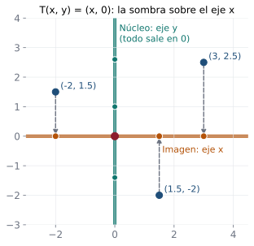
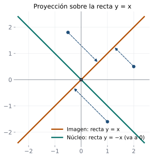
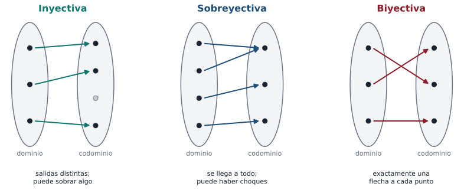

## En la vida diaria: lo que la transformación no ve {.nostretch}

::: {.aplicacion data-t="Para empezar"}
Al pasar una foto a blanco y negro, un naranja y un verde pueden verse exactamente del mismo gris. ¿Qué información se pierde?
:::

{fig-align="center" height="160px"}

Lo que una transformación convierte en cero es su **núcleo**: los cambios que "no ve". Lo que puede producir es su **imagen**.

**En esta clase:** aprenderá a calcular el núcleo y la imagen y qué dicen sobre la transformación.

## Objetivos de la clase

- Entender qué son el **núcleo** y la **imagen** de una transformación lineal.
- Calcularlos paso a paso, sobre todo cuando la transformación es una matriz.
- Usar el **teorema de la dimensión**: lo que se pierde más lo que queda es lo que entra.
- Reconocer cuándo una transformación es **inyectiva**, **sobreyectiva** o **biyectiva**.
- Practicar con una **guía de ejercicios** resueltos paso a paso (sin matrices, con polinomios y con matrices).

## Repaso: una transformación es una máquina

::: {.palabras}
Una transformación $T:V\to W$ es como una **máquina**: entra un vector $\mathbf v$ (del espacio de **salida** $V$) y sale otro vector $T(\mathbf v)$ (en el espacio de **llegada** $W$).
:::

. . .

Ante cualquier máquina hay dos preguntas naturales:

1. **¿Qué entradas producen un resultado nulo?** Es decir, ¿qué vectores salen convertidos en $\mathbf 0$? → **núcleo**.
2. **¿Qué resultados es capaz de producir?** → **imagen**.

## La idea con un ejemplo: la sombra en el piso {.compacto .nostretch}

::: {.ejemplo data-t="Proyección sobre el eje x"}
$T(x,y)=(x,\,0)$: a cada punto le "borra" la altura y lo deja sobre el eje $x$, como la sombra de un objeto cuando el sol está justo encima.
:::

:::: {.columns}
::: {.column width="45%"}
| Entra $\mathbf v$ | Sale $T(\mathbf v)$ |
|---|---|
| $(3,\,5)$ | $(3,\,0)$ |
| $(3,\,-2)$ | $(3,\,0)$ |
| $(0,\,4)$ | $(0,\,0)$ ← cero |
| $(0,\,-7)$ | $(0,\,0)$ ← cero |

- Salen en **cero** los vectores $(0,y)$: el **eje $y$** es el **núcleo**.
- Todo lo que sale es $(a,0)$: el **eje $x$** es la **imagen**.
:::
::: {.column width="55%"}
{height="330px"}
:::
::::

## 1. El núcleo de una transformación

::: {.definicion}
Sea $T:V\to W$ lineal. El **núcleo** de $T$ es el conjunto de todos los vectores del dominio que se transforman en el vector cero:
$$
\boxed{\;\operatorname{nu}T=\ker T=\{\mathbf v\in V:\ T(\mathbf v)=\mathbf 0\}\;}
$$
:::

::: {.palabras}
Buscamos **todos los vectores que, al aplicarles la transformación, producen el vector cero**: lo que la transformación "no ve" o "aplasta". Siempre contiene al $\mathbf 0$, porque $T(\mathbf 0)=\mathbf 0$.
:::

. . .

Se escribe $\operatorname{nu}T$ (como en el libro) o $\ker T$ (del inglés *kernel*): es lo mismo.

## Ejemplo 1: hallar el núcleo (planteamiento)

::: {.ejemplo}
Sea $T:\mathbb R^2\to\mathbb R^2$, $\quad T(x,y)=(x+y,\;2x+2y)$. Halle el núcleo de $T$.
:::

. . .

**Paso 1 · Igualar la transformación al vector cero.** Buscamos los $(x,y)$ tales que
$$
T(x,y)=(0,0)\qquad\Longrightarrow\qquad (x+y,\;2x+2y)=(0,0).
$$

. . .

**Paso 2 · Escribir el sistema.** Dos vectores son iguales si coinciden componente a componente:
$$
\begin{cases} x+y=0\\ 2x+2y=0 \end{cases}
$$

## Ejemplo 1: hallar el núcleo (solución)

**Paso 3 · Resolver el sistema.** La segunda ecuación es **el doble** de la primera ($2x+2y=2(x+y)$), así que no aporta información nueva: las ecuaciones son dependientes. Queda solo
$$
x+y=0\qquad\Longrightarrow\qquad x=-y .
$$

. . .

**Paso 4 · Introducir un parámetro.** Como $y$ puede tomar cualquier valor, hacemos $y=t$; entonces $x=-t$:
$$
(x,y)=(-t,\;t)=t\,(-1,\,1),\qquad t\in\mathbb R .
$$

. . .

**Paso 5 · Escribir la respuesta.**
$$
\boxed{\;\operatorname{nu}T=\operatorname{gen}\{(-1,1)\}\;}
$$

. . .

::: {.obs data-t="Interpretación"}
El núcleo es una **recta que pasa por el origen**, formada por todos los múltiplos de $(-1,1)$. Comprobación: $T(-1,1)=(-1+1,\;-2+2)=(0,0)$ ✓.
:::

## ¿Cómo se halla el núcleo?

1. Se **iguala** $T(\mathbf v)$ al vector cero.
2. Se **escribe el sistema** de ecuaciones (una por componente).
3. Se **resuelve** el sistema (es homogéneo).
4. Se expresa la solución con **parámetros** y se separa un vector por cada parámetro: esos vectores **generan** el núcleo.

. . .

::: {.ejemplo data-t="Mini ejemplo"}
$T(x,y,z)=(x-z,\;y)$. Igualando a cero: $x-z=0$ y $y=0$. Con $z=t$: $(x,y,z)=(t,0,t)=t(1,0,1)$. Entonces $\operatorname{nu}T=\operatorname{gen}\{(1,0,1)\}$.
:::

## 2. La imagen de una transformación

::: {.definicion}
La **imagen** de $T$ es el conjunto de todos los vectores que se obtienen al aplicar $T$ a los vectores del dominio:
$$
\boxed{\;\operatorname{Im}T=\{T(\mathbf v):\ \mathbf v\in V\}\subseteq W\;}
$$
:::

::: {.palabras}
Buscamos **todos los resultados posibles** de la transformación. Un vector $\mathbf w$ está en la imagen si **alguna** entrada da $\mathbf w$ como resultado.
:::

## Ejemplo 2: hallar la imagen

::: {.ejemplo}
Con la misma transformación $T(x,y)=(x+y,\;2x+2y)$, halle la imagen de $T$.
:::

. . .

**Paso 1 · Escribir $T$ en general y buscar algo en común.** La segunda componente es el doble de la primera:
$$
T(x,y)=(x+y,\;2x+2y)=(x+y,\;2(x+y)).
$$

. . .

**Paso 2 · Darle un nombre a lo que se repite.** Llamamos $s=x+y$. Como $x$ e $y$ pueden ser cualquier número, $s$ también puede ser cualquier número:
$$
T(x,y)=(s,\;2s)=s\,(1,\,2),\qquad s\in\mathbb R .
$$

. . .

**Paso 3 · Escribir la respuesta.** Todos los resultados son múltiplos de $(1,2)$:
$$
\boxed{\;\operatorname{Im}T=\operatorname{gen}\{(1,2)\}\;}
$$

. . .

::: {.obs data-t="Interpretación"}
La imagen también es una **recta que pasa por el origen**, pero generada por $(1,2)$: es la recta $y=2x$. Por ejemplo, $T(3,1)=(4,8)$, que cumple $8=2\cdot4$ ✓.
:::

## ¿Cómo se halla la imagen?

1. Se escribe $T(\mathbf v)$ **en general**, con letras.
2. Se **separa** el resultado en una combinación de vectores fijos, uno por cada variable:
$$
T(x,y)=(x+y,\;2x+2y)=x\,(1,2)+y\,(1,2).
$$
3. Esos vectores fijos **generan** la imagen.
4. Se **quitan los que sobran** (los que son combinación de los otros). Aquí $(1,2)$ aparece dos veces, así que basta uno: $\operatorname{Im}T=\operatorname{gen}\{(1,2)\}$.

. . .

::: {.ejemplo data-t="Mini ejemplo"}
$T(x,y,z)=(x+y,\;y+z)=x(1,0)+y(1,1)+z(0,1)$. Los vectores $(1,0)$ y $(0,1)$ ya generan todo $\mathbb R^2$, y $(1,1)=(1,0)+(0,1)$ sobra. Entonces $\operatorname{Im}T=\mathbb R^2$.
:::

## 3. Núcleo frente a imagen

| Característica | Núcleo | Imagen |
|---|---|---|
| ¿Qué buscamos? | Los vectores que producen **cero** | **Todos los resultados** posibles |
| ¿Cómo se calcula? | Resolviendo $T(\mathbf v)=\mathbf 0$ | Escribiendo $T(\mathbf v)$ para todo $\mathbf v$ |
| ¿Dónde vive? | En el **dominio** $V$ (lo que entra) | En el **codominio** $W$ (lo que sale) |
| Su dimensión se llama | **Nulidad**, $\nu(T)$ | **Rango**, $\rho(T)$ |
| En el ejemplo | $\operatorname{gen}\{(-1,1)\}$ | $\operatorname{gen}\{(1,2)\}$ |

## Nulidad y rango: los tamaños

::: {.definicion}
**Nulidad:** $\nu(T)=\dim\operatorname{nu}T$. $\qquad$ **Rango:** $\rho(T)=\dim\operatorname{Im}T$.
:::

::: {.palabras}
Son **dos números** que miden el tamaño de cada conjunto: la nulidad dice **cuántas direcciones se pierden** y el rango, **cuántas direcciones quedan**.
:::

. . .

Las letras $\nu$ ("nu", nulidad) y $\rho$ ("ro", rango) son **griegas**: no son una *v* ni una *p*.

. . .

En el ejemplo $T(x,y)=(x+y,\,2x+2y)$:

- **Nulidad** $=1$: el núcleo tiene una base con **un** vector, $(-1,1)$.
- **Rango** $=1$: la imagen tiene una base con **un** vector, $(1,2)$.
- Entró el plano $\mathbb R^2$, de dimensión $2=1+1$.

## Núcleo e imagen en una figura {.nostretch}

{fig-align="center" height="400px"}

La "sombra" cae sobre la recta $y=x$: los puntos de la recta $y=-x$ caen en el origen (**núcleo**) y todo punto termina sobre $y=x$ (**imagen**). Otra vez $\nu=1$, $\rho=1$ y $1+1=2$.

## 4. Relación con las matrices

Si la transformación está dada por una matriz, $T(\mathbf x)=A\mathbf x$, entonces:

- El **núcleo** se calcula resolviendo $\;\boxed{A\mathbf x=\mathbf 0}\;$ (es el espacio nulo $N_A$, clase 20).
- La **imagen** es el espacio generado por las **columnas** de $A$: $\;\boxed{\operatorname{Im}T=C_A}$.

. . .

¿Por qué las columnas? Porque $A\mathbf x$ es una combinación de las columnas de $A$ (clase 5):
$$
\begin{pmatrix}1&1\\2&2\end{pmatrix}\begin{pmatrix}x\\y\end{pmatrix}=x\begin{pmatrix}1\\2\end{pmatrix}+y\begin{pmatrix}1\\2\end{pmatrix}.
$$
Esta es justamente la matriz del ejemplo: $T(x,y)=(x+y,\,2x+2y)$.

## La receta con matrices

1. **Escalonar** $A$ (forma escalonada reducida).
2. **Núcleo:** resolver $A\mathbf x=\mathbf 0$; cada **variable libre** aporta un vector de la base.
3. **Imagen:** tomar las **columnas originales** de $A$ que quedaron con pivote.
4. **Verificar:** $\nu+\rho=$ número de columnas de $A$.

. . .

::: {.obs}
Error frecuente: tomar como base de la imagen las columnas de la matriz **ya escalonada**. Deben ser las de la matriz **original**.
:::

## Ejemplo guiado (1): escalonar

::: {.ejemplo}
Sea $T(\mathbf x)=A\mathbf x$ con $A=\begin{pmatrix}1&2&-1\\2&4&-2\\0&1&1\end{pmatrix}$. Halle bases del núcleo y de la imagen.
:::

. . .

**Paso 1 · Escalonar.**
$$
A\xrightarrow{F_2\to F_2-2F_1}\begin{pmatrix}1&2&-1\\0&0&0\\0&1&1\end{pmatrix}\xrightarrow{F_2\leftrightarrow F_3}\begin{pmatrix}1&2&-1\\0&1&1\\0&0&0\end{pmatrix}\xrightarrow{F_1\to F_1-2F_2}\begin{pmatrix}1&0&-3\\0&1&1\\0&0&0\end{pmatrix}.
$$

. . .

Hay pivotes en las columnas **1 y 2**; la columna 3 no tiene pivote, así que $z$ es **variable libre**.

## Ejemplo guiado (2): núcleo e imagen

**Paso 2 · Núcleo** (resolver $A\mathbf x=\mathbf 0$ con la matriz escalonada):
$$
x-3z=0,\quad y+z=0\;\Rightarrow\;(x,y,z)=(3z,\,-z,\,z)=z\,(3,-1,1).
$$
$\operatorname{nu}T=\operatorname{gen}\{(3,-1,1)\}$: **una recta**, $\nu(T)=1$. Comprobación: $A(3,-1,1)^T=(3-2-1,\;6-4-2,\;0-1+1)=(0,0,0)$ ✓.

. . .

**Paso 3 · Imagen** (columnas **originales** 1 y 2):
$\operatorname{Im}T=\operatorname{gen}\{(1,2,0),\,(2,4,1)\}$: **un plano**, $\rho(T)=2$.

. . .

**Paso 4 · Verificar:** $\nu+\rho=1+2=3$ columnas ✓. El plano imagen tiene ecuación $2a-b=0$ (normal $(1,2,0)\times(2,4,1)=(2,-1,0)$): todo lo que sale cumple $b=2a$.

## Núcleo e imagen son subespacios

::: {.teorema}
$\operatorname{nu}T$ es un subespacio de $V$ e $\operatorname{Im}T$ es un subespacio de $W$.
:::

::: {.palabras}
Por eso siempre resultan ser el origen, una recta, un plano o todo el espacio, y por eso tiene sentido hablar de su **base** y su **dimensión**.
:::

. . .

::: {.demo data-t="Núcleo"}
$T(\mathbf 0)=\mathbf 0$, así que $\mathbf 0\in\operatorname{nu}T$. Si $\mathbf u,\mathbf v\in\operatorname{nu}T$: $T(\mathbf u+\mathbf v)=T(\mathbf u)+T(\mathbf v)=\mathbf 0+\mathbf 0=\mathbf 0$ y $T(\alpha\mathbf u)=\alpha\mathbf 0=\mathbf 0$.
:::

. . .

::: {.demo data-t="Imagen"}
$\mathbf 0=T(\mathbf 0)\in\operatorname{Im}T$. Si $\mathbf w_1=T(\mathbf v_1)$ y $\mathbf w_2=T(\mathbf v_2)$, entonces $\mathbf w_1+\mathbf w_2=T(\mathbf v_1+\mathbf v_2)\in\operatorname{Im}T$ y $\alpha\mathbf w_1=T(\alpha\mathbf v_1)\in\operatorname{Im}T$.
:::

## Fuera de las matrices (1): la derivada

::: {.ejemplo data-t="Derivación D: P₃ → P₂"}
$D(a_0+a_1t+a_2t^2+a_3t^3)=a_1+2a_2t+3a_3t^2$.
:::

. . .

- **Núcleo:** ¿qué polinomios tienen derivada cero? Los **constantes** ($a_1=a_2=a_3=0$). Por ejemplo, $D(5)=0$ y $D(-2)=0$. Base $\{1\}$, $\nu(D)=1$.

. . .

- **Imagen:** ¿se puede obtener cualquier polinomio de grado 2? Sí: para obtener $b_0+b_1t+b_2t^2$ basta tomar $a_1=b_0$, $a_2=\tfrac{b_1}{2}$, $a_3=\tfrac{b_2}{3}$. $\operatorname{Im}D=P_2$, $\rho(D)=3$.

. . .

Verificación: $\nu+\rho=1+3=4=\dim P_3$ ✓.

## Teorema de la dimensión {.compacto}

::: {.teorema}
Si $T:V\to W$ es lineal y $\dim V=n$, entonces
$$
\nu(T)+\rho(T)=n=\dim V .
$$
:::

::: {.palabras}
**Lo que se pierde** (núcleo) **más lo que queda** (imagen) **es igual a lo que entra** (la dimensión del espacio de salida). También se conoce como **teorema de rango y nulidad**.
:::

. . .

| Ejemplo | $\nu$ | $\rho$ | $\dim V$ |
|---|:-:|:-:|:-:|
| $T(x,y)=(x+y,\,2x+2y)$ (ejemplos 1 y 2) | 1 | 1 | 2 |
| Matriz $3\times3$ del ejemplo guiado | 1 | 2 | 3 |
| Derivación $P_3\to P_2$ | 1 | 3 | 4 |
| Transposición $M_{2\times3}\to M_{3\times2}$ | 0 | 6 | 6 |
| Proyección sobre el plano $xy$ | 1 | 2 | 3 |

. . .

::: {.obs}
Para $T(\mathbf x)=A\mathbf x$ es exactamente el teorema rango-nulidad de la clase 20: $\nu(A)+\rho(A)=n$ (número de columnas).
:::

## 5. Inyectiva y sobreyectiva

::: {.definicion}
$T:V\to W$ es **inyectiva** si $T(\mathbf u)=T(\mathbf v)$ implica $\mathbf u=\mathbf v$. Es **sobreyectiva** si $\operatorname{Im}T=W$.
:::

::: {.palabras}
**Inyectiva:** dos entradas distintas **nunca** dan el mismo resultado (no hay "choques"). **Sobreyectiva:** se alcanza **todo** el espacio de llegada (no sobra nada).
:::

. . .

::: {.ejemplo}
La sombra $T(x,y)=(x,0)$ **no** es inyectiva: $(3,5)$ y $(3,-2)$ dan el mismo resultado $(3,0)$. Tampoco es sobreyectiva: nunca sale $(1,1)$.
:::

## El núcleo decide la inyectividad

::: {.teorema}
Una transformación lineal $T$ es inyectiva **si y solo si** $\operatorname{nu}T=\{\mathbf 0\}$.
:::

::: {.palabras}
Basta revisar **una sola cosa**: si lo único que se convierte en cero es el cero, no hay choques en ningún otro lado.
:::

. . .

::: {.demo}
($\Rightarrow$) Si $T(\mathbf v)=\mathbf 0=T(\mathbf 0)$, por inyectividad $\mathbf v=\mathbf 0$.
($\Leftarrow$) Si $T(\mathbf u)=T(\mathbf v)$, entonces $T(\mathbf u-\mathbf v)=T(\mathbf u)-T(\mathbf v)=\mathbf 0$, luego $\mathbf u-\mathbf v\in\operatorname{nu}T=\{\mathbf 0\}$ y $\mathbf u=\mathbf v$.
:::

## Las tres situaciones en un dibujo {.nostretch}

{fig-align="center" height="400px"}

Cada punto de la izquierda es una entrada y cada flecha lleva a su resultado. **Inyectiva:** nunca llegan dos flechas al mismo punto. **Sobreyectiva:** todo punto de la derecha recibe al menos una flecha. **Biyectiva:** las dos cosas a la vez.

## Biyectiva

::: {.definicion}
$T:V\to W$ es **biyectiva** si es inyectiva **y** sobreyectiva. Para una transformación lineal, biyectiva es lo mismo que **invertible**.
:::

::: {.palabras}
Cada vector de llegada se obtiene **exactamente una vez**: hay una sola entrada para cada salida, y por eso el proceso se puede "deshacer".
:::

. . .

::: {.obs data-t="Ojo con el nombre"}
La palabra correcta es **sobreyectiva** (también se dice *suprayectiva*). Las transformaciones *proyectivas* existen, pero son de otra rama, la geometría proyectiva.
:::

## ¿Cómo reconocerlas con la matriz?

Si $T(\mathbf x)=A\mathbf x$ con $A$ de tamaño $m\times n$ ($n$ columnas = dimensión de lo que entra, $m$ filas = dimensión de lo que sale):

| Propiedad | Condición | ¿Por qué? |
|---|---|---|
| Inyectiva | $\rho(A)=n$ | pivote en cada columna: no hay variables libres, $\nu=0$ |
| Sobreyectiva | $\rho(A)=m$ | pivote en cada fila: las columnas generan todo $\mathbb R^m$ |
| Biyectiva | $\rho(A)=m=n$ | $A$ cuadrada e invertible ($\det A\neq0$) |

. . .

::: {.ejemplo}
$A=\begin{pmatrix}1&0&0\\0&1&0\end{pmatrix}$ ($2\times3$): ya está escalonada, con pivotes en las columnas 1 y 2. $\rho=2$ y $\nu=3-2=1$.

**No** es inyectiva ($\rho=2\neq3$: $z$ es libre). **Sí** es sobreyectiva ($\rho=2=$ número de filas). Por tanto, no es biyectiva.
:::

## La regla para recordar

$$
\boxed{\begin{aligned}
\text{Inyectiva}&\iff \operatorname{nu}T=\{\mathbf 0\}\iff\nu(T)=0\\
\text{Sobreyectiva}&\iff \operatorname{Im}T=W\iff\rho(T)=\dim W\\
\text{Biyectiva}&\iff\text{las dos a la vez}
\end{aligned}}
$$

. . .

::: {.palabras}
Para la primera se mira el **núcleo** (qué se pierde); para la segunda, la **imagen** (a dónde se llega). El teorema de la dimensión conecta las dos: si $\dim V=\dim W$, basta revisar una.
:::

## 6. Guía de ejercicios: núcleo e imagen

Resolvemos **13 ejercicios** completos, de menos a más, y dejamos **10 propuestos** con sus respuestas.

| Parte | Tipo | Ejercicios |
|---|---|---|
| I | Fórmulas en $\mathbb R^n$, sin matrices | 1–3 |
| II | Polinomios y derivadas | 4–6 |
| III | Matrices (Gauss-Jordan) | 7–9 |
| IV | Clasificar: inyectiva, sobreyectiva o biyectiva | 10–13 |
| V | Propuestos (núcleo, imagen, bases, $\nu$, $\rho$ y tipo), con respuestas | 14–23 |
| VI | Errores frecuentes y mini evaluación | — |

## Ejercicio 1: núcleo trivial {.compacto}

::: {.ejemplo}
$T:\mathbb R^2\to\mathbb R^2$, $\;T(x,y)=(x+y,\;x-y)$. Halle núcleo, imagen, bases y dimensiones.
:::

**Paso 1 · Núcleo.** Igualamos a cero: $\;x+y=0\;$ y $\;x-y=0$. Sumando las dos ecuaciones: $2x=0\Rightarrow x=0$; en la primera, $0+y=0\Rightarrow y=0$.
Solo sale el cero: $\operatorname{nu}T=\{(0,0)\}$. Su base es el conjunto vacío y $\nu=0$.

. . .

**Paso 2 · Imagen.** Separamos por letras: $T(x,y)=x(1,1)+y(1,-1)$, así que $\operatorname{Im}T=\operatorname{gen}\{(1,1),(1,-1)\}$.
Los dos vectores no son múltiplos (son LI), y dos vectores LI en $\mathbb R^2$ lo generan todo: $\operatorname{Im}T=\mathbb R^2$, $\rho=2$.

. . .

**Paso 3 · Comprobar:** $\nu+\rho=0+2=2=\dim\mathbb R^2$ ✓.

## Ejercicio 2: un núcleo de dimensión 2 {.compacto}

::: {.ejemplo}
$T:\mathbb R^3\to\mathbb R^2$, $\;T(x,y,z)=(x+y+z,\;2x+2y+2z)$.
:::

**Paso 1 · Núcleo.** $\;x+y+z=0\;$ y $\;2x+2y+2z=0$. La segunda es el doble de la primera: sobra. Queda $x=-y-z$, con $y$ y $z$ **libres**.
Con $y=s$, $z=t$: $(x,y,z)=(-s-t,\;s,\;t)=s(-1,1,0)+t(-1,0,1)$.
$\operatorname{nu}T=\operatorname{gen}\{(-1,1,0),(-1,0,1)\}$, $\nu=2$: es un **plano**.

. . .

**Paso 2 · Imagen.** $T(x,y,z)=x(1,2)+y(1,2)+z(1,2)$: el mismo vector tres veces. $\operatorname{Im}T=\operatorname{gen}\{(1,2)\}$, $\rho=1$.

. . .

**Paso 3 · Comprobar:** $2+1=3$ ✓.

## Ejercicio 3: cuatro variables {.compacto}

::: {.ejemplo}
$T:\mathbb R^4\to\mathbb R^2$, $\;T(a,b,c,d)=(a+b-c,\;2a+2b-2c)$.
:::

**Paso 1 · Núcleo.** $\;a+b-c=0\;$ y $\;2a+2b-2c=0$. La segunda es el doble de la primera: sobra. Queda $c=a+b$, y $d$ no aparece: es libre.
Con $a=s$, $b=t$, $d=u$: $(a,b,c,d)=(s,\;t,\;s+t,\;u)=s(1,0,1,0)+t(0,1,1,0)+u(0,0,0,1)$.
$\operatorname{nu}T=\operatorname{gen}\{(1,0,1,0),(0,1,1,0),(0,0,0,1)\}$, $\nu=3$.

. . .

**Paso 2 · Imagen.** Con $r=a+b-c$: $T=(r,\;2r)=r(1,2)$. $\operatorname{Im}T=\operatorname{gen}\{(1,2)\}$, $\rho=1$.

. . .

**Paso 3 · Comprobar:** $3+1=4=\dim\mathbb R^4$ ✓.

## Parte II · Polinomios y derivadas

Ahora las entradas son **polinomios**. Recuerde que $P_2=\{ax^2+bx+c:\ a,b,c\in\mathbb R\}$, con base $\{1,x,x^2\}$ y dimensión 3.

. . .

::: {.obs data-t="La clave"}
Un polinomio es **el polinomio cero** solo si **todos** sus coeficientes son cero. Así, "$T(p)=0$" se convierte en un sistema: un coeficiente igual a cero por cada potencia de $x$.
:::

. . .

En la imagen, los vectores fijos son ahora polinomios, como $1$, $x$, $x^2$ o $x^2-x$.

## Ejercicio 4: evaluar en dos puntos {.compacto}

::: {.ejemplo}
$T:P_2\to\mathbb R^2$, $\;T(p)=\big(p(0),\;p(1)\big)$.
:::

**Paso 1 · En general.** Con $p(x)=ax^2+bx+c$: $\;p(0)=c\;$ y $\;p(1)=a+b+c$. Así, $T(p)=(c,\;a+b+c)$.

. . .

**Paso 2 · Núcleo.** $c=0$ y $a+b+c=0$. Con $c=0$ queda $a+b=0$, es decir, $b=-a$.
$p(x)=ax^2-ax=a(x^2-x)$. $\operatorname{nu}T=\operatorname{gen}\{x^2-x\}$, $\nu=1$. (Comprobación: $x^2-x$ vale $0$ en $x=0$ y en $x=1$ ✓.)

. . .

**Paso 3 · Imagen.** Separando por letras: $T(p)=a(0,1)+b(0,1)+c(1,1)$. Quedan $(0,1)$ y $(1,1)$, que son LI: $\operatorname{Im}T=\mathbb R^2$, $\rho=2$.
Comprobación: $1+2=3$ ✓.

## Ejercicio 5: la derivada de $P_2$ en $P_1$ {.compacto}

::: {.ejemplo}
$T:P_2\to P_1$, $\;T(p)=p'$.
:::

**Paso 1 · En general.** Con $p(x)=ax^2+bx+c$: $\;T(p)=2ax+b$.

. . .

**Paso 2 · Núcleo.** $2ax+b$ es el polinomio cero solo si cada coeficiente es cero: $2a=0$ y $b=0$, así que $a=0$, $b=0$, y $c$ queda **libre**.
$p(x)=c\cdot1$: $\operatorname{nu}T=\operatorname{gen}\{1\}$ (las constantes), $\nu=1$. Tiene sentido: la derivada de una constante es cero.

. . .

**Paso 3 · Imagen.** $2ax+b=a(2x)+b(1)$: como $a$ y $b$ son cualesquiera, salen **todos** los polinomios de grado $\le1$.
$\operatorname{Im}T=P_1=\operatorname{gen}\{1,x\}$, $\rho=2$. Comprobación: $1+2=3$ ✓.

::: {.obs}
Si se toma $T:P_2\to P_2$ (misma fórmula, pero llegando a $P_2$), la imagen sigue siendo $P_1$, que ya **no** es todo el espacio de llegada: deja de ser sobreyectiva.
:::

## Ejercicio 6: un polinomio más su derivada {.compacto}

::: {.ejemplo}
$T:P_2\to P_2$, $\;T(p)=p+p'$.
:::

**Paso 1 · En general.** Con $p(x)=ax^2+bx+c$, $\;p'(x)=2ax+b$. Sumando y agrupando por potencias:
$\;T(p)=ax^2+(b+2a)x+(c+b)$.

. . .

**Paso 2 · Núcleo.** Cada coeficiente igual a cero: $a=0$, $\;b+2a=0$, $\;c+b=0$.
De la primera, $a=0$; en la segunda, $b+0=0\Rightarrow b=0$; en la tercera, $c+0=0\Rightarrow c=0$. $\operatorname{nu}T=\{0\}$, $\nu=0$.

. . .

**Paso 3 · Imagen.** Por el teorema de la dimensión, $\rho=3-\nu=3-0=3=\dim P_2$, así que $\operatorname{Im}T=P_2$.

::: {.solucion}
Núcleo solo el cero e imagen todo $P_2$: $T$ es **invertible**.
:::

## Ejercicio 7: matriz $2\times2$ {.compacto}

::: {.ejemplo}
$T(\mathbf x)=A\mathbf x$ con $A=\begin{pmatrix}1&2\\2&4\end{pmatrix}$.
:::

**Paso 1 · Escalonar:**
$$
\begin{pmatrix}1&2\\2&4\end{pmatrix}\xrightarrow{F_{2}\to F_{2}-2F_{1}}\begin{pmatrix}1&2\\0&0\end{pmatrix}
$$

. . .

**Paso 2 · Núcleo.** La fila que queda dice $x+2y=0$, así que $x=-2y$. Con $y=t$: $(x,y)=t(-2,1)$. $\operatorname{nu}T=\operatorname{gen}\{(-2,1)\}$, $\nu=1$.

. . .

**Paso 3 · Imagen.** Solo la columna 1 tiene pivote; tomamos la columna **original**: $\operatorname{Im}T=\operatorname{gen}\{(1,2)\}$, $\rho=1$. (La columna 2, $(2,4)$, es el doble de la 1.)

**Paso 4 · Comprobar:** $1+1=2$ columnas ✓.

## Ejercicio 8: matriz $3\times3$ {.compacto}

::: {.ejemplo}
$T(\mathbf x)=A\mathbf x$ con $A=\begin{pmatrix}1&1&1\\1&2&3\\2&3&4\end{pmatrix}$.
:::

**Paso 1 · Escalonar:**
$$
\begin{pmatrix}1&1&1\\1&2&3\\2&3&4\end{pmatrix}\xrightarrow[F_{3}\to F_{3}-2F_{1}]{F_{2}\to F_{2}-F_{1}}\begin{pmatrix}1&1&1\\0&1&2\\0&1&2\end{pmatrix}\xrightarrow[F_{3}\to F_{3}-F_{2}]{F_{1}\to F_{1}-F_{2}}\begin{pmatrix}1&0&-1\\0&1&2\\0&0&0\end{pmatrix}
$$

. . .

**Paso 2 · Núcleo.** Las filas dicen $x-z=0$ y $y+2z=0$. Con $z=t$: $x=t$, $y=-2t$, es decir, $(x,y,z)=t(1,-2,1)$. $\operatorname{nu}T=\operatorname{gen}\{(1,-2,1)\}$, $\nu=1$.

. . .

**Paso 3 · Imagen.** Pivotes en las columnas 1 y 2; columnas **originales**: $\operatorname{Im}T=\operatorname{gen}\{(1,1,2),\;(1,2,3)\}$, $\rho=2$.

::: {.solucion}
$\nu+\rho=1+2=3$ ✓. **No** es invertible: su núcleo no es solo el cero (también se ve en que $\det A=0$).
:::

## Ejercicio 9: matriz $3\times4$ {.compacto}

::: {.ejemplo}
$T(\mathbf x)=A\mathbf x$ con $A=\begin{pmatrix}1&1&0&1\\0&1&1&2\\1&2&1&3\end{pmatrix}$.
:::

**Paso 1 · Escalonar:**
$$
\begin{pmatrix}1&1&0&1\\0&1&1&2\\1&2&1&3\end{pmatrix}\xrightarrow{F_{3}\to F_{3}-F_{1}}\begin{pmatrix}1&1&0&1\\0&1&1&2\\0&1&1&2\end{pmatrix}\xrightarrow[F_{3}\to F_{3}-F_{2}]{F_{1}\to F_{1}-F_{2}}\begin{pmatrix}1&0&-1&-1\\0&1&1&2\\0&0&0&0\end{pmatrix}
$$

## Ejercicio 9 (continuación) {.compacto}

**Paso 2 · Núcleo.** Con incógnitas $(x,y,z,w)$, las filas dicen $x-z-w=0$ y $y+z+2w=0$. Columnas 3 y 4 sin pivote: $z$ y $w$ son libres.
Despejamos: $x=z+w$ y $y=-z-2w$. Con $z=s$, $w=t$:
$$
(x,y,z,w)=(s+t,\;-s-2t,\;s,\;t)=s(1,-1,1,0)+t(1,-2,0,1).
$$
$\operatorname{nu}T=\operatorname{gen}\{(1,-1,1,0),\;(1,-2,0,1)\}$, $\nu=2$.

. . .

**Paso 3 · Imagen.** Pivotes en las columnas 1 y 2; columnas originales: $\operatorname{Im}T=\operatorname{gen}\{(1,0,1),\;(1,1,2)\}$, $\rho=2$.

. . .

**Paso 4 · Comprobar:** $\nu+\rho=2+2=4$ columnas ✓. Y el núcleo: $A(1,-1,1,0)^T=(1-1,\;-1+1,\;1-2+1)=(0,0,0)$ ✓.

## Parte IV · Clasificar: inyectiva, sobreyectiva o biyectiva

Ahora la pregunta es **qué tipo** de transformación es. La respuesta sale de lo que ya sabemos calcular:

| Para saber si es… | se calcula… | y se pregunta… |
|---|---|---|
| inyectiva | el **núcleo** | ¿es solo $\{\mathbf 0\}$? |
| sobreyectiva | la **imagen** | ¿es todo el espacio de llegada $W$? |
| biyectiva | los dos | ¿se cumplen ambas? |

. . .

::: {.obs data-t="Atajo"}
Si $\dim V=\dim W$ (por ejemplo, de $\mathbb R^3$ en $\mathbb R^3$), basta revisar **una** de las dos: por el teorema de la dimensión, inyectiva $\iff$ sobreyectiva.
:::

## Ejercicios 10 y 11: cambiar de dimensión {.compacto}

::: {.ejemplo data-t="Ejercicio 10"}
$T:\mathbb R^3\to\mathbb R^2$, $\;T(x,y,z)=(x,\;y)$.
:::

**Núcleo:** $x=0$, $y=0$ y $z$ libre: $\operatorname{nu}T=\operatorname{gen}\{(0,0,1)\}$. **No** es inyectiva.

**Imagen:** cualquier $(a,b)$ sale de $(a,b,0)$: $\operatorname{Im}T=\mathbb R^2$. **Sí** es sobreyectiva. Conclusión: **sobreyectiva, pero no inyectiva**.

. . .

::: {.ejemplo data-t="Ejercicio 11"}
$T:\mathbb R^2\to\mathbb R^3$, $\;T(x,y)=(x,\;y,\;x+y)$.
:::

**Núcleo:** $(x,y,x+y)=(0,0,0)$ da $x=0$ y $y=0$: núcleo $\{\mathbf 0\}$. **Sí** es inyectiva.

**Imagen:** $x(1,0,1)+y(0,1,1)$: un plano (todos sus vectores cumplen "tercera $=$ primera $+$ segunda"); por ejemplo, $(0,0,1)$ no se alcanza. Conclusión: **inyectiva, pero no sobreyectiva**.

## Ejercicios 12 y 13: con matrices {.compacto}

::: {.ejemplo data-t="Ejercicio 12"}
$T(\mathbf x)=A\mathbf x$ con $A=\begin{pmatrix}1&2\\3&4\end{pmatrix}$.
:::

**Paso 1:** $\det A=1\cdot4-2\cdot3=4-6=-2\neq0$. **Paso 2:** entonces $\rho(A)=2$, que es el número de columnas y también el de filas.
Conclusión: inyectiva ($\rho=n$) y sobreyectiva ($\rho=m$): **biyectiva**.

. . .

::: {.ejemplo data-t="Ejercicio 13"}
$T(\mathbf x)=A\mathbf x$ con $A=\begin{pmatrix}1&0\\0&1\\1&1\end{pmatrix}$ ($3\times2$, de $\mathbb R^2$ en $\mathbb R^3$).
:::

**Núcleo:** $x=0$, $y=0$, $x+y=0$: solo $(0,0)$, así que $\rho=2=n$: **inyectiva**.

**Imagen:** las 2 columnas generan un plano de $\mathbb R^3$; $\rho=2<3=m$: **no** sobreyectiva. Conclusión: **inyectiva, pero no sobreyectiva**.

## Parte V · Ejercicios propuestos {.compacto}

| N.º | Tipo | Transformación |
|---|---|---|
| 14 | Sin matriz | $T(x,y)=(3x-3y,\;6x-6y)$ |
| 15 | Sin matriz | $T(x,y,z)=(x+y,\;y+z)$ |
| 16 | Polinomios | $T:P_3\to P_2$, $\;T(p)=p''$ |
| 17 | Polinomios | $T:P_3\to\mathbb R^2$, $\;T(p)=\big(p(0),\;p'(0)\big)$ |
| 18 | Matriz $2\times3$ | $\begin{pmatrix}1&0&1\\0&1&1\end{pmatrix}$ |
| 19 | Matriz $2\times3$ | $\begin{pmatrix}1&2&1\\0&1&1\end{pmatrix}$ |
| 20 | Matriz $3\times3$ | $\begin{pmatrix}1&2&0\\0&1&1\\1&3&1\end{pmatrix}$ |
| 21 | Matriz $3\times3$ | $\begin{pmatrix}1&1&0\\1&2&1\\2&3&1\end{pmatrix}$ |
| 22 | Matriz $3\times4$ | $\begin{pmatrix}1&1&1&0\\0&1&1&1\\1&2&2&1\end{pmatrix}$ |
| 23 | Matriz $4\times4$ | $\begin{pmatrix}1&1&0&0\\0&1&1&0\\1&2&1&0\\0&0&0&1\end{pmatrix}$ |

## Respuestas de los propuestos (14–17)

::: {.solucion .fragment}
**14.** $3x-3y=0\Rightarrow x=y$: $\operatorname{nu}T=\operatorname{gen}\{(1,1)\}$. Con $s=x-y$: $T=(3s,6s)=3s(1,2)$, así que $\operatorname{Im}T=\operatorname{gen}\{(1,2)\}$. $\nu=\rho=1$. Ni inyectiva ni sobreyectiva.
:::

::: {.solucion .fragment}
**15.** $x=-y$, $z=-y$: $\operatorname{nu}T=\operatorname{gen}\{(1,-1,1)\}$. $T=x(1,0)+y(1,1)+z(0,1)$: $\operatorname{Im}T=\mathbb R^2$. $\nu=1$, $\rho=2$. Sobreyectiva, no inyectiva.
:::

::: {.solucion .fragment}
**16.** $p=ax^3+bx^2+cx+d$, $\;p''=6ax+2b$. Núcleo: $a=b=0$, $\operatorname{nu}T=\operatorname{gen}\{1,x\}$. Imagen: $P_1=\operatorname{gen}\{1,x\}$, que **no** es todo $P_2$. $\nu=2$, $\rho=2$. Ni inyectiva ni sobreyectiva.
:::

::: {.solucion .fragment}
**17.** $p(0)=d$ y $p'(0)=c$, así que $T(p)=(d,c)$. Núcleo: $c=d=0$, $\operatorname{nu}T=\operatorname{gen}\{x^2,x^3\}$. Imagen: $\mathbb R^2$. $\nu=2$, $\rho=2$. Sobreyectiva, no inyectiva.
:::

## Respuestas de los propuestos (18–20) {.compacto}

::: {.solucion .fragment}
**18.** Ya está escalonada: $x=-z$, $y=-z$. $\operatorname{nu}T=\operatorname{gen}\{(-1,-1,1)\}$, $\operatorname{Im}T=\mathbb R^2$. $\nu=1$, $\rho=2$. Sobreyectiva, no inyectiva.
:::

::: {.solucion .fragment}
**19.** $F_1\to F_1-2F_2$ da $\begin{pmatrix}1&0&-1\\0&1&1\end{pmatrix}$: $x=z$, $y=-z$. $\operatorname{nu}T=\operatorname{gen}\{(1,-1,1)\}$, $\operatorname{Im}T=\mathbb R^2$. $\nu=1$, $\rho=2$. Sobreyectiva, no inyectiva.
:::

::: {.solucion .fragment}
**20.** Forma reducida $\begin{pmatrix}1&0&-2\\0&1&1\\0&0&0\end{pmatrix}$: $\operatorname{nu}T=\operatorname{gen}\{(2,-1,1)\}$, $\operatorname{Im}T=\operatorname{gen}\{(1,0,1),(2,1,3)\}$. $\nu=1$, $\rho=2$. Ninguna de las dos.
:::

## Respuestas de los propuestos (21–23) {.compacto}

::: {.solucion .fragment}
**21.** Forma reducida $\begin{pmatrix}1&0&-1\\0&1&1\\0&0&0\end{pmatrix}$: $\operatorname{nu}T=\operatorname{gen}\{(1,-1,1)\}$, $\operatorname{Im}T=\operatorname{gen}\{(1,1,2),(1,2,3)\}$. $\nu=1$, $\rho=2$. Ninguna de las dos.
:::

::: {.solucion .fragment}
**22.** Forma reducida $\begin{pmatrix}1&0&0&-1\\0&1&1&1\\0&0&0&0\end{pmatrix}$: $\operatorname{nu}T=\operatorname{gen}\{(0,-1,1,0),(1,-1,0,1)\}$, $\operatorname{Im}T=\operatorname{gen}\{(1,0,1),(1,1,2)\}$. $\nu=2$, $\rho=2$. Ninguna de las dos.
:::

::: {.solucion .fragment}
**23.** Pivotes en las columnas 1, 2 y 4: $\operatorname{nu}T=\operatorname{gen}\{(1,-1,1,0)\}$, $\operatorname{Im}T=\operatorname{gen}\{(1,0,1,0),(1,1,2,0),(0,0,0,1)\}$. $\nu=1$, $\rho=3$. Ninguna de las dos.
:::

## Parte VI · Tres errores que hay que evitar

1. **Confundir dónde vive cada uno.** El núcleo está en el **dominio** (lo que entra); la imagen, en el **codominio** (lo que sale). En el ejercicio 2, el núcleo tiene vectores de $\mathbb R^3$ y la imagen, de $\mathbb R^2$.

. . .

2. **Usar las columnas de la matriz reducida para la imagen.** La reducida sirve para **ubicar** los pivotes, pero la base se toma con las columnas de la matriz **original**.

. . .

3. **Olvidar el teorema de la dimensión.** $\nu+\rho$ **siempre** debe dar la dimensión del dominio (el número de columnas de la matriz). Si no da, hay un error en alguna de las dos cuentas.

## Mini evaluación {.compacto}

1. Si el núcleo contiene **solo** al vector cero, $T$ es: (a) sobreyectiva, (b) inyectiva, (c) no lineal.
2. Si $T:\mathbb R^3\to\mathbb R^2$ tiene rango 2, su nulidad es: (a) 0, (b) 1, (c) 2.
3. Una matriz con 4 columnas y 2 pivotes tiene cuántas variables libres: (a) 1, (b) 2, (c) 4.
4. Para una base de la imagen se usan: (a) las columnas de la reducida, (b) las columnas pivote de la **original**, (c) las filas nulas.
5. Si $T:P_2\to P_2$ es la derivada, su núcleo es: (a) $\operatorname{gen}\{1\}$, (b) $\operatorname{gen}\{x\}$, (c) $P_2$.

::: {.solucion .fragment}
1. **(b)**.
2. **(b)**: $\nu=3-2=1$.
3. **(b)**: $4-2=2$.
4. **(b)**.
5. **(a)**: las constantes.
:::

::: {.palabras .fragment}
Domine primero los ejercicios **sin matrices**. Al pasar a matrices, Gauss-Jordan no es otra cosa: es una forma ordenada de resolver las **mismas** ecuaciones.
:::

## Ejercicios del texto guía {.texto-guia}

Grossman y Flores, *Álgebra lineal*, 8.ª ed.:

| Sección | Ejercicios |
|---|---|
| 7.2 Propiedades de las transformaciones lineales: imagen y núcleo | 5, 6, 9, 19, 21, 22 |

## Resumen

- **Núcleo:** las entradas que $T$ convierte en $\mathbf 0$. Se halla resolviendo $T(\mathbf v)=\mathbf 0$.
- **Imagen:** todos los resultados posibles. Si $T(\mathbf x)=A\mathbf x$, la generan las columnas de $A$ con pivote.
- Ambos son subespacios; sus dimensiones son la **nulidad** $\nu$ y el **rango** $\rho$.
- **Teorema de la dimensión:** $\nu(T)+\rho(T)=\dim V$ (lo que se pierde más lo que queda es lo que entra).
- $T$ es **inyectiva** $\iff\operatorname{nu}T=\{\mathbf 0\}$; **sobreyectiva** $\iff\operatorname{Im}T=W$; **biyectiva** si es las dos.

 

[← Clase 22](clase_22.qmd) · [Programa del curso](../algebra_lineal.qmd) · [Clase 24: Representación matricial →](clase_24.qmd)
