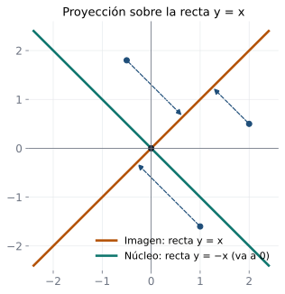

## Objetivos de la clase

- Definir el **núcleo** y la **imagen** de una transformación lineal y demostrar que son subespacios.
- Calcular bases del núcleo y de la imagen.
- Aplicar el **teorema de la dimensión**: $\nu(T)+\rho(T)=\dim V$.
- Caracterizar las transformaciones **inyectivas** mediante el núcleo.

## Ruta de la clase (70 min)

| Tiempo | Actividad |
|:---:|---|
| 0 – 5 | Repaso: transformaciones lineales y su matriz |
| 5 – 20 | Núcleo e imagen: definiciones, figura y demostración de que son subespacios |
| 20 – 40 | Ejemplos en $\mathbb R^n$, polinomios y matrices |
| 40 – 55 | Teorema de la dimensión; inyectividad y sobreyectividad |
| 55 – 70 | Práctica en clase y cierre |

## Definiciones

::: {.definicion}
Sea $T:V\to W$ una transformación lineal.

- **Núcleo (kernel):** $\;\operatorname{nu}T=\{\mathbf v\in V: T(\mathbf v)=\mathbf 0\}$.
- **Imagen (recorrido):** $\;\operatorname{Im}T=\{T(\mathbf v):\mathbf v\in V\}=\{\mathbf w\in W:\mathbf w=T(\mathbf v)\text{ para algún }\mathbf v\}$.
- **Nulidad:** $\nu(T)=\dim\operatorname{nu}T$. $\quad$ **Rango:** $\rho(T)=\dim\operatorname{Im}T$.
:::

. . .

::: {.obs}
Para una transformación matricial $T(\mathbf x)=A\mathbf x$: $\;\operatorname{nu}T=N_A$ y $\operatorname{Im}T=C_A$ (clase 20). Todo lo que sabemos calcular para matrices sirve aquí.
:::

## Núcleo e imagen en una figura

{fig-align="center" width="44%"}

Proyección sobre la recta $y=x$: los puntos de la recta $y=-x$ caen en el origen (**núcleo**), y todo punto cae sobre $y=x$ (**imagen**). $\nu=1$, $\rho=1$, $1+1=2$.

## Núcleo e imagen son subespacios

::: {.teorema}
$\operatorname{nu}T$ es un subespacio de $V$ y $\operatorname{Im}T$ es un subespacio de $W$.
:::

. . .

::: {.demo data-t="Núcleo"}
$T(\mathbf 0)=\mathbf 0$, así que $\mathbf 0\in\operatorname{nu}T$. Si $\mathbf u,\mathbf v\in\operatorname{nu}T$: $T(\mathbf u+\mathbf v)=T(\mathbf u)+T(\mathbf v)=\mathbf 0+\mathbf 0=\mathbf 0$ y $T(\alpha\mathbf u)=\alpha\mathbf 0=\mathbf 0$.
:::

. . .

::: {.demo data-t="Imagen"}
$\mathbf 0=T(\mathbf 0)\in\operatorname{Im}T$. Si $\mathbf w_1=T(\mathbf v_1)$ y $\mathbf w_2=T(\mathbf v_2)$, entonces $\mathbf w_1+\mathbf w_2=T(\mathbf v_1+\mathbf v_2)\in\operatorname{Im}T$ y $\alpha\mathbf w_1=T(\alpha\mathbf v_1)\in\operatorname{Im}T$.
:::

## Ejemplo resuelto: transformación de $\mathbb R^3$ en $\mathbb R^3$

::: {.ejemplo}
Sea $T(\mathbf x)=A\mathbf x$ con $A=\begin{pmatrix}1&2&-1\\2&4&-2\\0&1&1\end{pmatrix}$. Halle bases de $\operatorname{nu}T$ e $\operatorname{Im}T$.
:::

. . .

$$
A\xrightarrow{F_2\to F_2-2F_1}\begin{pmatrix}1&2&-1\\0&0&0\\0&1&1\end{pmatrix}\xrightarrow{F_2\leftrightarrow F_3}\begin{pmatrix}1&2&-1\\0&1&1\\0&0&0\end{pmatrix}\xrightarrow{F_1\to F_1-2F_2}\begin{pmatrix}1&0&-3\\0&1&1\\0&0&0\end{pmatrix}.
$$

. . .

**Núcleo:** $x=3z$, $y=-z$: $\;\operatorname{nu}T=\operatorname{gen}\{(3,-1,1)\}$, $\;\nu(T)=1$ (una recta).

. . .

**Imagen:** pivotes en las columnas 1 y 2, luego $\operatorname{Im}T=\operatorname{gen}\{(1,2,0),(2,4,1)\}$, $\;\rho(T)=2$ (un plano).

. . .

Ecuación del plano imagen: normal $(1,2,0)\times(2,4,1)=(2,-1,0)$, es decir, $\operatorname{Im}T=\{(a,b,c): 2a-b=0\}$. Compruebe que cada columna de $A$ cumple $b=2a$.

## Ejemplos en otros espacios

::: {.ejemplo data-t="Derivación D: P₃ → P₂"}
$D(a_0+a_1t+a_2t^2+a_3t^3)=a_1+2a_2t+3a_3t^2$.
**Núcleo:** $D(p)=0\iff a_1=a_2=a_3=0$: los polinomios **constantes**, $\nu(D)=1$.
**Imagen:** todo $b_0+b_1t+b_2t^2$ se obtiene con $a_1=b_0$, $a_2=\tfrac{b_1}{2}$, $a_3=\tfrac{b_2}{3}$: $\operatorname{Im}D=P_2$, $\rho(D)=3$.
:::

. . .

::: {.ejemplo data-t="Transposición T: M₂ₓ₃ → M₃ₓ₂"}
$A^T=O\iff A=O$: $\operatorname{nu}T=\{O\}$, $\nu=0$. Toda $B\in M_{3\times2}$ es $(B^T)^T$: $\operatorname{Im}T=M_{3\times2}$, $\rho=6$.
:::

. . .

::: {.ejemplo data-t="Proyección sobre el plano xy"}
$T(x,y,z)=(x,y,0)$: $\operatorname{nu}T$ es el eje $z$ ($\nu=1$) e $\operatorname{Im}T$ es el plano $xy$ ($\rho=2$).
:::

## Teorema de la dimensión

::: {.teorema}
Si $T:V\to W$ es lineal y $\dim V=n$, entonces
$$
\nu(T)+\rho(T)=n=\dim V .
$$
:::

. . .

En los ejemplos anteriores: $1+2=3$ (matricial), $1+3=4=\dim P_3$ (derivación), $0+6=6$ (transposición), $1+2=3$ (proyección).

. . .

::: {.demo data-t="Caso matricial"}
Si $T(\mathbf x)=A\mathbf x$ con $A$ de tamaño $m\times n$, es exactamente el teorema rango-nulidad de la clase 20: $\nu(A)+\rho(A)=n$. (En general se reduce a este caso usando la representación matricial, clase 24.)
:::

. . .

::: {.obs data-t="Interpretación"}
Lo que $T$ "aplasta" (núcleo) más lo que $T$ "conserva" (imagen) suman la dimensión de partida.
:::

## Inyectividad y núcleo

::: {.definicion}
$T:V\to W$ es **inyectiva** (uno a uno) si $T(\mathbf u)=T(\mathbf v)$ implica $\mathbf u=\mathbf v$. Es **sobreyectiva** si $\operatorname{Im}T=W$.
:::

. . .

::: {.teorema}
Una transformación lineal $T$ es inyectiva si y solo si $\operatorname{nu}T=\{\mathbf 0\}$.
:::

. . .

::: {.demo}
($\Rightarrow$) Si $T(\mathbf v)=\mathbf 0=T(\mathbf 0)$, por inyectividad $\mathbf v=\mathbf 0$.
($\Leftarrow$) Si $T(\mathbf u)=T(\mathbf v)$, entonces $T(\mathbf u-\mathbf v)=T(\mathbf u)-T(\mathbf v)=\mathbf 0$, luego $\mathbf u-\mathbf v\in\operatorname{nu}T=\{\mathbf 0\}$ y $\mathbf u=\mathbf v$.
:::

. . .

::: {.ejemplo}
$D:P_3\to P_2$ **no** es inyectiva ($D(5)=D(7)=0$) pero sí sobreyectiva. La transposición es ambas cosas.
:::

## Ejemplo resuelto: evaluación de polinomios

::: {.ejemplo}
Sea $T:P_2\to\mathbb R$, $T(p)=p(1)$. Halle su núcleo, su imagen y verifique el teorema de la dimensión.
:::

. . .

$T(a+bt+ct^2)=a+b+c$. Es lineal: $(p+q)(1)=p(1)+q(1)$ y $(\alpha p)(1)=\alpha p(1)$.

. . .

**Núcleo:** $a+b+c=0\Rightarrow a=-b-c$: $\;p=b(t-1)+c(t^2-1)$. Base $\{t-1,\;t^2-1\}$, $\nu(T)=2$.

**Imagen:** $T(a)=a$ toma cualquier valor real: $\operatorname{Im}T=\mathbb R$, $\rho(T)=1$.

. . .

$\nu+\rho=2+1=3=\dim P_2$ ✓. El núcleo son los polinomios con raíz en $t=1$ (taller 3.1, $W_3$).

## Ejercicios propuestos

::: {.ejercicio data-t="1"}
Halle núcleo, imagen, nulidad y rango de $T:\mathbb R^3\to\mathbb R^2$, $T(x,y,z)=(x-y+z,\;2x+y-z)$.
:::

::: {.solucion .fragment}
$A=\begin{pmatrix}1&-1&1\\2&1&-1\end{pmatrix}\sim\begin{pmatrix}1&0&0\\0&1&-1\end{pmatrix}$. $\operatorname{nu}T=\operatorname{gen}\{(0,1,1)\}$, $\nu=1$. $\rho=2$, así que $\operatorname{Im}T=\mathbb R^2$ (sobreyectiva). Comprobación: $1+2=3$.
:::

## Ejercicios propuestos

::: {.ejercicio data-t="2"}
¿Puede una transformación lineal $T:\mathbb R^4\to\mathbb R^3$ ser inyectiva? ¿Y $T:\mathbb R^2\to\mathbb R^3$ sobreyectiva?
:::

::: {.solucion .fragment}
Ninguna de las dos. (a) $\rho\le3$, luego $\nu=4-\rho\ge1$: el núcleo no es $\{\mathbf 0\}$. (b) $\rho=2-\nu\le2<3$: la imagen no puede ser $\mathbb R^3$.
:::

## Ejercicios propuestos

::: {.ejercicio data-t="3"}
Sea $T:M_{2\times2}\to\mathbb R$, $T(A)=a_{11}+a_{22}$ (la **traza**). Halle una base del núcleo y su dimensión.
:::

::: {.solucion .fragment}
$\operatorname{nu}T=\left\{\begin{pmatrix}a&b\\c&-a\end{pmatrix}\right\}$, con base $\left\{\begin{pmatrix}1&0\\0&-1\end{pmatrix},\begin{pmatrix}0&1\\0&0\end{pmatrix},\begin{pmatrix}0&0\\1&0\end{pmatrix}\right\}$: $\nu=3$. Como $\operatorname{Im}T=\mathbb R$ ($\rho=1$), se cumple $3+1=4$.
:::

## Ejercicios propuestos

::: {.ejercicio data-t="4 · Demostración"}
Sea $T:V\to V$ lineal con $\dim V=n$. Demuestre que $T$ es inyectiva si y solo si es sobreyectiva.
:::

::: {.solucion .fragment}
Inyectiva $\iff\nu=0\iff\rho=n$ (teorema de la dimensión) $\iff\operatorname{Im}T$ es un subespacio de dimensión $n$ de $V$ $\iff\operatorname{Im}T=V$ (clase 19).
:::

## Ejercicios del texto guía {.texto-guia}

Grossman y Flores, *Álgebra lineal*, 8.ª ed.:

| Sección | Ejercicios |
|---|---|
| 7.2 Propiedades de las transformaciones lineales: imagen y núcleo | 5, 6, 9, 19, 21, 22 |

## Resumen

- $\operatorname{nu}T=\{\mathbf v: T(\mathbf v)=\mathbf 0\}\subseteq V$; $\;\operatorname{Im}T=\{T(\mathbf v)\}\subseteq W$; ambos son subespacios.
- Para $T(\mathbf x)=A\mathbf x$: núcleo $=N_A$, imagen $=C_A$.
- $\nu(T)+\rho(T)=\dim V$.
- $T$ inyectiva $\iff\operatorname{nu}T=\{\mathbf 0\}$.

 

[← Clase 22](clase_22.qmd) · [Programa del curso](../algebra_lineal.qmd) · [Clase 24: Representación matricial →](clase_24.qmd)
