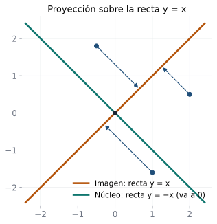

## En la vida diaria: lo que la transformación no ve {.nostretch}

::: {.aplicacion data-t="Para empezar"}
Al pasar una foto a blanco y negro, un naranja y un verde pueden verse exactamente del mismo gris. ¿Qué información se pierde?
:::

{fig-align="center" height="160px"}

Lo que una transformación convierte en cero es su **núcleo**: los cambios que "no ve". Lo que puede producir es su **imagen**.

**En esta clase:** aprenderá a calcular el núcleo y la imagen y qué dicen sobre la transformación.

## Objetivos de la clase

- Entender qué son el **núcleo** y la **imagen** de una transformación lineal.
- Calcularlos paso a paso, sobre todo cuando la transformación es una matriz.
- Usar el **teorema de la dimensión**: lo que se pierde más lo que queda es lo que entra.
- Reconocer cuándo una transformación es **inyectiva** o **sobreyectiva**.

## Repaso: una transformación es una máquina

::: {.palabras}
Una transformación $T:V\to W$ es como una **máquina**: entra un vector $\mathbf v$ (del espacio de **salida** $V$) y sale otro vector $T(\mathbf v)$ (en el espacio de **llegada** $W$).
:::

. . .

Ante cualquier máquina hay dos preguntas naturales:

1. **¿Qué entradas producen un resultado nulo?** Es decir, ¿qué vectores salen convertidos en $\mathbf 0$? → **núcleo**.
2. **¿Qué resultados es capaz de producir?** → **imagen**.

## La idea con un ejemplo: la sombra en el piso

::: {.ejemplo data-t="Proyección sobre el eje x"}
$T(x,y)=(x,\,0)$: a cada punto le "borra" la altura y lo deja sobre el eje $x$, como la sombra de un objeto cuando el sol está justo encima.
:::

. . .

| Entra $\mathbf v$ | Sale $T(\mathbf v)$ |
|---|---|
| $(3,\,5)$ | $(3,\,0)$ |
| $(3,\,-2)$ | $(3,\,0)$ |
| $(0,\,4)$ | $(0,\,0)$ ← salió cero |
| $(0,\,-7)$ | $(0,\,0)$ ← salió cero |

. . .

- Salen en **cero** justo los vectores de la forma $(0,y)$: el **eje $y$**. Ese es el **núcleo**.
- Todo lo que sale tiene la forma $(a,0)$: el **eje $x$**. Esa es la **imagen**.

## El núcleo

::: {.definicion}
Sea $T:V\to W$ lineal. El **núcleo** de $T$ es
$$
\operatorname{nu}T=\{\mathbf v\in V:\ T(\mathbf v)=\mathbf 0\}.
$$
:::

::: {.palabras}
El núcleo son **todas las entradas que la máquina convierte en cero**: lo que la transformación "no ve" o "aplasta". Siempre contiene al $\mathbf 0$, porque $T(\mathbf 0)=\mathbf 0$.
:::

. . .

**¿Cómo se calcula?** Se plantea $T(\mathbf v)=\mathbf 0$ y se resuelve. Es un **sistema homogéneo**, como en la clase 2.

## La imagen

::: {.definicion}
La **imagen** de $T$ es
$$
\operatorname{Im}T=\{T(\mathbf v):\ \mathbf v\in V\}\subseteq W .
$$
:::

::: {.palabras}
La imagen son **todos los resultados que la máquina puede producir**. Un vector $\mathbf w$ está en la imagen si **alguna** entrada da $\mathbf w$ como resultado.
:::

. . .

**¿Cómo se calcula?** Se escribe $T(\mathbf v)$ en general y se mira **qué forma** tienen todos los resultados. Si $T$ viene de una matriz, la imagen la **generan las columnas** de la matriz.

## Nulidad y rango: los tamaños

::: {.definicion}
**Nulidad:** $\nu(T)=\dim\operatorname{nu}T$. $\qquad$ **Rango:** $\rho(T)=\dim\operatorname{Im}T$.
:::

::: {.palabras}
Son **dos números** que miden el tamaño de cada conjunto: la nulidad dice **cuántas direcciones se pierden** y el rango, **cuántas direcciones quedan**.
:::

. . .

En la sombra sobre el eje $x$: el núcleo es una recta ($\nu=1$) y la imagen es otra recta ($\rho=1$). Entró el plano, de dimensión $2=1+1$.

## Núcleo e imagen en una figura {.nostretch}

{fig-align="center" height="400px"}

Ahora la "sombra" cae sobre la recta $y=x$: los puntos de la recta $y=-x$ caen en el origen (**núcleo**) y todo punto termina sobre $y=x$ (**imagen**). Otra vez $\nu=1$, $\rho=1$ y $1+1=2$.

## Cuando $T$ es una matriz: la receta

Si $T(\mathbf x)=A\mathbf x$, entonces el núcleo es el espacio nulo $N_A$ y la imagen es el espacio columna $C_A$ (clase 20). Se calculan así:

1. **Escalonar** $A$ (forma escalonada reducida).
2. **Núcleo:** resolver $A\mathbf x=\mathbf 0$; cada **variable libre** aporta un vector de la base.
3. **Imagen:** tomar las **columnas originales** de $A$ que quedaron con pivote.
4. **Verificar:** $\nu+\rho=$ número de columnas de $A$.

. . .

::: {.obs}
Error frecuente: tomar como base de la imagen las columnas de la matriz **ya escalonada**. Deben ser las de la matriz **original**.
:::

## Ejemplo guiado (1): escalonar

::: {.ejemplo}
Sea $T(\mathbf x)=A\mathbf x$ con $A=\begin{pmatrix}1&2&-1\\2&4&-2\\0&1&1\end{pmatrix}$. Halle bases del núcleo y de la imagen.
:::

. . .

**Paso 1 · Escalonar.**
$$
A\xrightarrow{F_2\to F_2-2F_1}\begin{pmatrix}1&2&-1\\0&0&0\\0&1&1\end{pmatrix}\xrightarrow{F_2\leftrightarrow F_3}\begin{pmatrix}1&2&-1\\0&1&1\\0&0&0\end{pmatrix}\xrightarrow{F_1\to F_1-2F_2}\begin{pmatrix}1&0&-3\\0&1&1\\0&0&0\end{pmatrix}.
$$

. . .

Hay pivotes en las columnas **1 y 2**; la columna 3 no tiene pivote, así que $z$ es **variable libre**.

## Ejemplo guiado (2): núcleo e imagen

**Paso 2 · Núcleo** (resolver $A\mathbf x=\mathbf 0$ con la matriz escalonada):
$$
x-3z=0,\quad y+z=0\;\Rightarrow\;(x,y,z)=(3z,\,-z,\,z)=z\,(3,-1,1).
$$
$\operatorname{nu}T=\operatorname{gen}\{(3,-1,1)\}$: **una recta**, $\nu(T)=1$. Comprobación: $A(3,-1,1)^T=(3-2-1,\;6-4-2,\;0-1+1)=(0,0,0)$ ✓.

. . .

**Paso 3 · Imagen** (columnas **originales** 1 y 2):
$\operatorname{Im}T=\operatorname{gen}\{(1,2,0),\,(2,4,1)\}$: **un plano**, $\rho(T)=2$.

. . .

**Paso 4 · Verificar:** $\nu+\rho=1+2=3$ columnas ✓. El plano imagen tiene ecuación $2a-b=0$ (normal $(1,2,0)\times(2,4,1)=(2,-1,0)$): todo lo que sale cumple $b=2a$.

## Núcleo e imagen son subespacios

::: {.teorema}
$\operatorname{nu}T$ es un subespacio de $V$ e $\operatorname{Im}T$ es un subespacio de $W$.
:::

::: {.palabras}
Por eso siempre resultan ser el origen, una recta, un plano o todo el espacio, y por eso tiene sentido hablar de su **base** y su **dimensión**.
:::

. . .

::: {.demo data-t="Núcleo"}
$T(\mathbf 0)=\mathbf 0$, así que $\mathbf 0\in\operatorname{nu}T$. Si $\mathbf u,\mathbf v\in\operatorname{nu}T$: $T(\mathbf u+\mathbf v)=T(\mathbf u)+T(\mathbf v)=\mathbf 0+\mathbf 0=\mathbf 0$ y $T(\alpha\mathbf u)=\alpha\mathbf 0=\mathbf 0$.
:::

. . .

::: {.demo data-t="Imagen"}
$\mathbf 0=T(\mathbf 0)\in\operatorname{Im}T$. Si $\mathbf w_1=T(\mathbf v_1)$ y $\mathbf w_2=T(\mathbf v_2)$, entonces $\mathbf w_1+\mathbf w_2=T(\mathbf v_1+\mathbf v_2)\in\operatorname{Im}T$ y $\alpha\mathbf w_1=T(\alpha\mathbf v_1)\in\operatorname{Im}T$.
:::

## Fuera de las matrices (1): la derivada

::: {.ejemplo data-t="Derivación D: P₃ → P₂"}
$D(a_0+a_1t+a_2t^2+a_3t^3)=a_1+2a_2t+3a_3t^2$.
:::

. . .

- **Núcleo:** ¿qué polinomios tienen derivada cero? Los **constantes** ($a_1=a_2=a_3=0$). Por ejemplo, $D(5)=0$ y $D(-2)=0$. Base $\{1\}$, $\nu(D)=1$.

. . .

- **Imagen:** ¿se puede obtener cualquier polinomio de grado 2? Sí: para obtener $b_0+b_1t+b_2t^2$ basta tomar $a_1=b_0$, $a_2=\tfrac{b_1}{2}$, $a_3=\tfrac{b_2}{3}$. $\operatorname{Im}D=P_2$, $\rho(D)=3$.

. . .

Verificación: $\nu+\rho=1+3=4=\dim P_3$ ✓.

## Fuera de las matrices (2): transponer y proyectar

::: {.ejemplo data-t="Transposición T: M₂ₓ₃ → M₃ₓ₂"}
- **Núcleo:** la única matriz cuya transpuesta es cero es la matriz cero: $\nu=0$.
- **Imagen:** toda matriz $B$ de $3\times2$ se obtiene transponiendo $B^T$: $\operatorname{Im}T=M_{3\times2}$, $\rho=6$.
:::

. . .

::: {.ejemplo data-t="Proyección sobre el plano xy"}
$T(x,y,z)=(x,y,0)$ "aplasta" la altura:

- **Núcleo:** los puntos $(0,0,z)$, el **eje $z$** ($\nu=1$).
- **Imagen:** los puntos $(x,y,0)$, el **plano $xy$** ($\rho=2$).
:::

## Teorema de la dimensión

::: {.teorema}
Si $T:V\to W$ es lineal y $\dim V=n$, entonces
$$
\nu(T)+\rho(T)=n=\dim V .
$$
:::

::: {.palabras}
**Lo que se pierde** (núcleo) **más lo que queda** (imagen) **es igual a lo que entra** (la dimensión del espacio de salida).
:::

. . .

| Ejemplo | $\nu$ | $\rho$ | $\dim V$ |
|---|:-:|:-:|:-:|
| Matriz $3\times3$ del ejemplo guiado | 1 | 2 | 3 |
| Derivación $P_3\to P_2$ | 1 | 3 | 4 |
| Transposición $M_{2\times3}\to M_{3\times2}$ | 0 | 6 | 6 |
| Proyección sobre el plano $xy$ | 1 | 2 | 3 |

. . .

::: {.obs}
Para $T(\mathbf x)=A\mathbf x$ es exactamente el teorema rango-nulidad de la clase 20: $\nu(A)+\rho(A)=n$ (número de columnas).
:::

## Inyectiva y sobreyectiva

::: {.definicion}
$T:V\to W$ es **inyectiva** si $T(\mathbf u)=T(\mathbf v)$ implica $\mathbf u=\mathbf v$. Es **sobreyectiva** si $\operatorname{Im}T=W$.
:::

::: {.palabras}
**Inyectiva:** dos entradas distintas **nunca** dan el mismo resultado (no hay "choques"). **Sobreyectiva:** se alcanza **todo** el espacio de llegada (no sobra nada).
:::

. . .

::: {.ejemplo}
La sombra $T(x,y)=(x,0)$ **no** es inyectiva: $(3,5)$ y $(3,-2)$ dan el mismo resultado $(3,0)$. Tampoco es sobreyectiva: nunca sale $(1,1)$.
:::

## El núcleo decide la inyectividad

::: {.teorema}
Una transformación lineal $T$ es inyectiva **si y solo si** $\operatorname{nu}T=\{\mathbf 0\}$.
:::

::: {.palabras}
Basta revisar **una sola cosa**: si lo único que se convierte en cero es el cero, no hay choques en ningún otro lado.
:::

. . .

::: {.demo}
($\Rightarrow$) Si $T(\mathbf v)=\mathbf 0=T(\mathbf 0)$, por inyectividad $\mathbf v=\mathbf 0$.
($\Leftarrow$) Si $T(\mathbf u)=T(\mathbf v)$, entonces $T(\mathbf u-\mathbf v)=T(\mathbf u)-T(\mathbf v)=\mathbf 0$, luego $\mathbf u-\mathbf v\in\operatorname{nu}T=\{\mathbf 0\}$ y $\mathbf u=\mathbf v$.
:::

## Resumen de casos

| Si… | entonces $T$ es… |
|---|---|
| $\nu(T)=0$ (núcleo solo el cero) | **inyectiva** |
| $\rho(T)=\dim W$ (la imagen es todo $W$) | **sobreyectiva** |
| ambas cosas | **invertible** (biyectiva) |

. . .

::: {.ejemplo}
- La derivación $D:P_3\to P_2$ **no** es inyectiva ($D(5)=D(7)=0$) pero **sí** es sobreyectiva.
- La transposición es inyectiva **y** sobreyectiva.
- La proyección sobre el plano $xy$ no es ninguna de las dos.
:::

## Ejemplo resuelto: evaluar un polinomio

::: {.ejemplo}
Sea $T:P_2\to\mathbb R$, $\;T(p)=p(1)$ (evaluar el polinomio en $t=1$). Halle su núcleo, su imagen y verifique el teorema de la dimensión.
:::

. . .

**Paso 1 · Escribir $T$ en general:** $\;T(a+bt+ct^2)=a+b+c$. Es lineal, porque $(p+q)(1)=p(1)+q(1)$ y $(\alpha p)(1)=\alpha\,p(1)$.

. . .

**Paso 2 · Núcleo:** $a+b+c=0\Rightarrow a=-b-c$, así que
$p=(-b-c)+bt+ct^2=b(t-1)+c(t^2-1)$. Base $\{t-1,\;t^2-1\}$, $\nu(T)=2$. Son los polinomios que **valen cero en $t=1$**.

. . .

**Paso 3 · Imagen:** el polinomio constante $a$ da $T(a)=a$, así que sale **cualquier** número real: $\operatorname{Im}T=\mathbb R$, $\rho(T)=1$.

. . .

**Paso 4 · Verificar:** $\nu+\rho=2+1=3=\dim P_2$ ✓.

## Ejemplo 1 · Fácil: núcleo e imagen de una proyección {.compacto}

::: {.ejemplo data-t="Nivel fácil"}
Halle el núcleo y la imagen de $T(x,y)=(x-y,\;2x-2y)$.
:::

. . .

**Paso 1 · Núcleo:** $T(x,y)=(0,0)\iff x-y=0$. Son los vectores $(t,t)$: la recta $y=x$.

. . .

**Paso 2 · Imagen:** $T(x,y)=(x-y)(1,2)$. Todo lo que sale es múltiplo de $(1,2)$: la recta $y=2x$.

::: {.solucion}
$\operatorname{nu}T=\operatorname{gen}\{(1,1)\}$, $\;\operatorname{im}T=\operatorname{gen}\{(1,2)\}$. Dimensiones $1+1=2=\dim\mathbb R^2$ ✓.
:::

## Ejemplo 2 · Fácil: núcleo trivial {.compacto}

::: {.ejemplo data-t="Nivel fácil"}
Halle el núcleo y la imagen de $T(x,y)=(x+y,\;x-y)$. ¿Es inyectiva?
:::

. . .

**Paso 1 · Núcleo:** $x+y=0$ y $x-y=0$ dan $x=y=0$. $\;\operatorname{nu}T=\{\mathbf 0\}$.

. . .

**Paso 2 · Imagen:** por el teorema de la dimensión, $\dim\operatorname{im}T=2-0=2$, así que $\operatorname{im}T=\mathbb R^2$.

::: {.solucion}
$T$ es inyectiva (núcleo trivial) y sobreyectiva: es invertible.
:::

## Ejemplo 3 · Medio: de $\mathbb R^3$ a $\mathbb R^2$ {.compacto}

::: {.ejemplo data-t="Nivel medio"}
Para $T(x,y,z)=(x+y,\;y+z)$, halle una base del núcleo y la imagen, y verifique el teorema de la dimensión.
:::

. . .

**Paso 1 · Núcleo:** $x+y=0$, $y+z=0$. Con $y=t$: $x=-t$, $z=-t$. $\;\operatorname{nu}T=\operatorname{gen}\{(-1,1,-1)\}$, dimensión $1$.

. . .

**Paso 2 · Imagen:** generada por las imágenes de la base canónica: $T(\mathbf e_1)=(1,0)$, $T(\mathbf e_2)=(1,1)$, $T(\mathbf e_3)=(0,1)$. Ya $(1,0)$ y $(0,1)$ generan $\mathbb R^2$.

::: {.solucion}
$\dim\operatorname{nu}T+\dim\operatorname{im}T=1+2=3=\dim\mathbb R^3$ ✓. $T$ es sobreyectiva pero no inyectiva.
:::

## Ejemplo 4 · Difícil: $T(A)=A-A^T$ {.compacto}

::: {.ejemplo data-t="Nivel difícil"}
Sea $T:M_{2\times2}\to M_{2\times2}$, $\;T(A)=A-A^T$. Halle su núcleo y su imagen con sus dimensiones.
:::

. . .

**Paso 1 · Calcular $T$ en general:**
$$
T\begin{pmatrix}a&b\\c&d\end{pmatrix}=\begin{pmatrix}a&b\\c&d\end{pmatrix}-\begin{pmatrix}a&c\\b&d\end{pmatrix}=\begin{pmatrix}0&b-c\\c-b&0\end{pmatrix}=(b-c)\begin{pmatrix}0&1\\-1&0\end{pmatrix}.
$$

. . .

**Paso 2 · Núcleo:** $T(A)=0\iff b=c\iff A$ es **simétrica**. Las simétricas $\begin{pmatrix}a&b\\b&d\end{pmatrix}$ tienen 3 parámetros: dimensión $3$.

. . .

**Paso 3 · Imagen:** todos los múltiplos de $\begin{pmatrix}0&1\\-1&0\end{pmatrix}$, es decir, las **antisimétricas**: dimensión $1$.

::: {.solucion}
$\operatorname{nu}T=$ simétricas ($\dim 3$), $\operatorname{im}T=$ antisimétricas ($\dim1$), y $3+1=4=\dim M_{2\times2}$ ✓.
:::

## Ejercicios propuestos

::: {.ejercicio data-t="1"}
Halle núcleo, imagen, nulidad y rango de $T:\mathbb R^3\to\mathbb R^2$, $T(x,y,z)=(x-y+z,\;2x+y-z)$.
:::

::: {.solucion .fragment}
$A=\begin{pmatrix}1&-1&1\\2&1&-1\end{pmatrix}\sim\begin{pmatrix}1&0&0\\0&1&-1\end{pmatrix}$. $\operatorname{nu}T=\operatorname{gen}\{(0,1,1)\}$, $\nu=1$. $\rho=2$, así que $\operatorname{Im}T=\mathbb R^2$ (sobreyectiva). Comprobación: $1+2=3$.
:::

## Ejercicios propuestos

::: {.ejercicio data-t="2"}
¿Puede una transformación lineal $T:\mathbb R^4\to\mathbb R^3$ ser inyectiva? ¿Y $T:\mathbb R^2\to\mathbb R^3$ sobreyectiva?
:::

::: {.solucion .fragment}
Ninguna de las dos. (a) $\rho\le3$, luego $\nu=4-\rho\ge1$: el núcleo no es $\{\mathbf 0\}$. (b) $\rho=2-\nu\le2<3$: la imagen no puede ser $\mathbb R^3$.
:::

## Ejercicios propuestos

::: {.ejercicio data-t="3"}
Sea $T:M_{2\times2}\to\mathbb R$, $T(A)=a_{11}+a_{22}$ (la **traza**). Halle una base del núcleo y su dimensión.
:::

::: {.solucion .fragment}
$\operatorname{nu}T=\left\{\begin{pmatrix}a&b\\c&-a\end{pmatrix}\right\}$, con base $\left\{\begin{pmatrix}1&0\\0&-1\end{pmatrix},\begin{pmatrix}0&1\\0&0\end{pmatrix},\begin{pmatrix}0&0\\1&0\end{pmatrix}\right\}$: $\nu=3$. Como $\operatorname{Im}T=\mathbb R$ ($\rho=1$), se cumple $3+1=4$.
:::

## Ejercicios propuestos

::: {.ejercicio data-t="4 · Demostración"}
Sea $T:V\to V$ lineal con $\dim V=n$. Demuestre que $T$ es inyectiva si y solo si es sobreyectiva.
:::

::: {.solucion .fragment}
Inyectiva $\iff\nu=0\iff\rho=n$ (teorema de la dimensión) $\iff\operatorname{Im}T$ es un subespacio de dimensión $n$ de $V$ $\iff\operatorname{Im}T=V$ (clase 19).
:::

## Ejercicios del texto guía {.texto-guia}

Grossman y Flores, *Álgebra lineal*, 8.ª ed.:

| Sección | Ejercicios |
|---|---|
| 7.2 Propiedades de las transformaciones lineales: imagen y núcleo | 5, 6, 9, 19, 21, 22 |

## Resumen

- **Núcleo:** las entradas que $T$ convierte en $\mathbf 0$. Se halla resolviendo $T(\mathbf v)=\mathbf 0$.
- **Imagen:** todos los resultados posibles. Si $T(\mathbf x)=A\mathbf x$, la generan las columnas de $A$ con pivote.
- Ambos son subespacios; sus dimensiones son la **nulidad** $\nu$ y el **rango** $\rho$.
- **Teorema de la dimensión:** $\nu(T)+\rho(T)=\dim V$ (lo que se pierde más lo que queda es lo que entra).
- $T$ es **inyectiva** $\iff\operatorname{nu}T=\{\mathbf 0\}$.

 

[← Clase 22](clase_22.qmd) · [Programa del curso](../algebra_lineal.qmd) · [Clase 24: Representación matricial →](clase_24.qmd)
