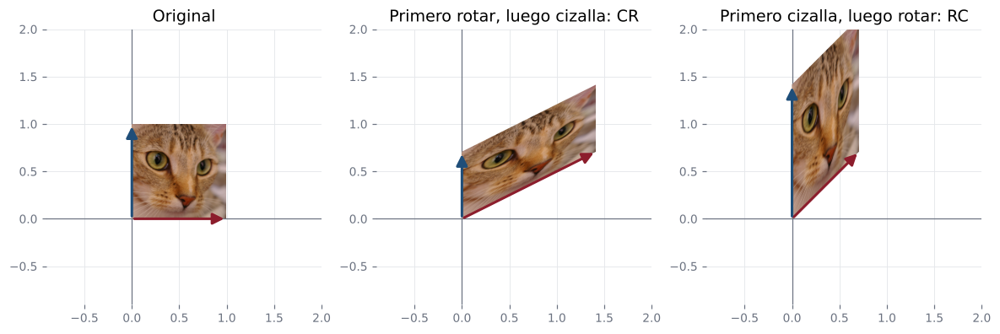
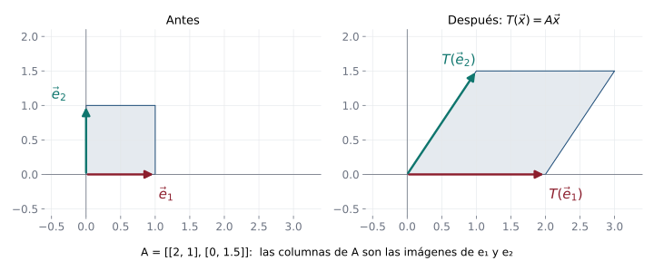

## En la vida diaria: el orden importa {.nostretch}

::: {.aplicacion data-t="Para empezar"}
En un programa de diseño, no es lo mismo girar y luego inclinar una imagen que inclinarla y luego girarla.
:::

{fig-align="center" height="220px"}

Cada transformación tiene una **matriz**, y hacer una después de otra es **multiplicar** sus matrices. Como el producto de matrices no conmuta, el orden cambia el resultado.

**En esta clase:** aprenderá a encontrar la matriz de una transformación y a combinar transformaciones.

## Objetivos de la clase

- Construir la **matriz estándar** $A_T$ de una transformación lineal $T:\mathbb R^n\to\mathbb R^m$.
- Representar transformaciones geométricas (rotaciones, reflexiones, proyecciones) con matrices.
- Hallar la matriz de $T$ **respecto a bases** arbitrarias, incluso en $P_n$ y $M_{m\times n}$.
- Relacionar la **composición** de transformaciones con el **producto** de matrices.

## Toda transformación lineal de $\mathbb R^n$ en $\mathbb R^m$ es matricial

::: {.teorema}
Si $T:\mathbb R^n\to\mathbb R^m$ es lineal, existe una única matriz $A_T$ de tamaño $m\times n$ tal que $T(\mathbf x)=A_T\mathbf x$ para todo $\mathbf x$. Sus columnas son las imágenes de la base canónica:
$$
A_T=\Big(T(\mathbf e_1)\;\;T(\mathbf e_2)\;\;\cdots\;\;T(\mathbf e_n)\Big).
$$
$A_T$ se llama **matriz de transformación** (o matriz estándar) de $T$.
:::

. . .

::: {.demo}
Si $\mathbf x=(x_1,\dots,x_n)^T=x_1\mathbf e_1+\cdots+x_n\mathbf e_n$, por linealidad
$$
T(\mathbf x)=x_1T(\mathbf e_1)+\cdots+x_nT(\mathbf e_n)=\Big(T(\mathbf e_1)\;\cdots\;T(\mathbf e_n)\Big)\mathbf x=A_T\mathbf x ,
$$
usando que $A\mathbf x$ es la combinación lineal de las columnas de $A$ con pesos $x_i$ (clase 4). La unicidad: si $A\mathbf x=B\mathbf x$ para todo $\mathbf x$, con $\mathbf x=\mathbf e_j$ se obtiene que las columnas $j$ coinciden.
:::

## Interpretación geométrica

{fig-align="center" width="72%"}

Para conocer $T$ basta saber **a dónde van** $\mathbf e_1$ y $\mathbf e_2$: el cuadrado unitario se transforma en el paralelogramo generado por las columnas de $A$, y su área se multiplica por $|\det A|$ (aquí $|\det A|=3$).

## Galería: cada matriz deforma el plano

{fig-align="center" width="98%"}

Para reconocer una transformación, mire **a dónde van** $\mathbf e_1$ y $\mathbf e_2$: son las columnas de su matriz. La proyección tiene determinante $0$ y "aplasta" la figura sobre una recta.

## Ejemplos resueltos: matrices estándar

::: {.ejemplo}
$T(x,y)=(x+y,\;x-y,\;3y)$: $\;T(\mathbf e_1)=(1,1,0)$, $T(\mathbf e_2)=(1,-1,3)$, luego $A_T=\begin{pmatrix}1&1\\1&-1\\0&3\end{pmatrix}$.
:::

. . .

::: {.ejemplo data-t="Geometría en ℝ²"}
| Transformación | $T(\mathbf e_1)$ | $T(\mathbf e_2)$ | $A_T$ |
|---|---|---|---|
| Rotación $90^\circ$ | $(0,1)$ | $(-1,0)$ | $\begin{pmatrix}0&-1\\1&0\end{pmatrix}$ |
| Reflexión respecto a $y=x$ | $(0,1)$ | $(1,0)$ | $\begin{pmatrix}0&1\\1&0\end{pmatrix}$ |
| Proyección sobre $y=x$ | $\left(\tfrac12,\tfrac12\right)$ | $\left(\tfrac12,\tfrac12\right)$ | $\tfrac12\begin{pmatrix}1&1\\1&1\end{pmatrix}$ |
| Corte horizontal | $(1,0)$ | $(k,1)$ | $\begin{pmatrix}1&k\\0&1\end{pmatrix}$ |
:::

. . .

La proyección sobre $y=x$ usa la clase 11: $\operatorname{proy}_{(1,1)}\mathbf e_1=\tfrac{1}{2}(1,1)$.

## Núcleo e imagen desde la matriz

::: {.teorema}
Si $A_T$ es la matriz de $T:\mathbb R^n\to\mathbb R^m$:
$$
\operatorname{nu}T=N_{A_T},\qquad\operatorname{Im}T=C_{A_T},\qquad\nu(T)=\nu(A_T),\qquad\rho(T)=\rho(A_T).
$$
:::

. . .

::: {.ejemplo}
La proyección sobre $y=x$, con $A_T=\tfrac12\begin{pmatrix}1&1\\1&1\end{pmatrix}$: $\;N_A=\operatorname{gen}\{(1,-1)\}$ (la recta perpendicular, que se "aplasta") y $C_A=\operatorname{gen}\{(1,1)\}$ (la recta sobre la que se proyecta). $\;\nu=1$, $\rho=1$, $1+1=2$ ✓.
:::

## Matriz respecto a bases arbitrarias

::: {.teorema}
Sean $B_1=\{\mathbf v_1,\dots,\mathbf v_n\}$ base de $V$ y $B_2=\{\mathbf w_1,\dots,\mathbf w_m\}$ base de $W$, y $T:V\to W$ lineal. La matriz
$$
A_T=\Big([T(\mathbf v_1)]_{B_2}\;\;[T(\mathbf v_2)]_{B_2}\;\;\cdots\;\;[T(\mathbf v_n)]_{B_2}\Big)
$$
cumple $\;[T(\mathbf x)]_{B_2}=A_T\,[\mathbf x]_{B_1}\;$ para todo $\mathbf x\in V$.
:::

. . .

::: {.obs data-t="Receta"}
1. Aplique $T$ a cada vector de la base de **salida** $B_1$.
2. Escriba cada imagen en **coordenadas** de la base de **llegada** $B_2$.
3. Ponga esas coordenadas como **columnas**.
:::

## Ejemplo resuelto: la derivada como matriz

::: {.ejemplo}
Halle la matriz de $D:P_3\to P_2$, $D(p)=p'$, respecto a $B_1=\{1,t,t^2,t^3\}$ y $B_2=\{1,t,t^2\}$. Úsela para derivar $p=2-t+4t^3$.
:::

. . .

$D(1)=0$, $D(t)=1$, $D(t^2)=2t$, $D(t^3)=3t^2$. En coordenadas de $B_2$: $(0,0,0)$, $(1,0,0)$, $(0,2,0)$, $(0,0,3)$:
$$
A_D=\begin{pmatrix}0&1&0&0\\0&0&2&0\\0&0&0&3\end{pmatrix}.
$$

. . .

$[p]_{B_1}=(2,-1,0,4)^T$ y
$$
A_D[p]_{B_1}=\begin{pmatrix}0&1&0&0\\0&0&2&0\\0&0&0&3\end{pmatrix}\begin{pmatrix}2\\-1\\0\\4\end{pmatrix}=\begin{pmatrix}-1\\0\\12\end{pmatrix}\;\Longrightarrow\;p'=-1+12t^2.\ ✓
$$

## Ejemplo resuelto: otra base en $\mathbb R^2$

::: {.ejemplo}
Sea $T(x,y)=(2x+y,\;3x-2y)$ y $B=\{(1,1),(1,-1)\}$. Halle $[T]_B$ (misma base de salida y de llegada).
:::

. . .

$T(1,1)=(3,1)$: $\;c_1+c_2=3$, $c_1-c_2=1\Rightarrow[T(1,1)]_B=(2,1)^T$.
$T(1,-1)=(1,5)$: $\;c_1+c_2=1$, $c_1-c_2=5\Rightarrow[T(1,-1)]_B=(3,-2)^T$.

. . .

$$
[T]_B=\begin{pmatrix}2&3\\1&-2\end{pmatrix},\qquad\text{mientras que}\qquad A_T=\begin{pmatrix}2&1\\3&-2\end{pmatrix}.
$$

. . .

::: {.teorema data-t="Cambio de base"}
Si $P$ tiene por columnas los vectores de $B$, entonces $[T]_B=P^{-1}A_TP$. Aquí: $P=\begin{pmatrix}1&1\\1&-1\end{pmatrix}$ y $P^{-1}A_TP=\begin{pmatrix}2&3\\1&-2\end{pmatrix}$ ✓. Matrices de la forma $P^{-1}AP$ se llaman **semejantes** (clase 26).
:::

## Composición y producto de matrices

::: {.teorema}
Si $T:\mathbb R^n\to\mathbb R^m$ y $S:\mathbb R^m\to\mathbb R^p$ son lineales, entonces $A_{S\circ T}=A_SA_T$. Si $T$ es invertible, $A_{T^{-1}}=A_T^{-1}$.
:::

. . .

::: {.demo}
$(S\circ T)(\mathbf x)=S(A_T\mathbf x)=A_S(A_T\mathbf x)=(A_SA_T)\mathbf x$, por la asociatividad del producto. Por la unicidad de la matriz estándar, $A_{S\circ T}=A_SA_T$.
:::

. . .

::: {.ejemplo}
Rotar $\alpha$ y luego $\beta$ es rotar $\alpha+\beta$: $R_\beta R_\alpha=R_{\alpha+\beta}$ (clase 4). Reflejar dos veces respecto a $y=x$: $\begin{pmatrix}0&1\\1&0\end{pmatrix}^2=I$, se vuelve al punto de partida.
:::

. . .

::: {.obs data-t="¡El orden importa!"}
$S\circ T$ significa "primero $T$, luego $S$", y su matriz es $A_SA_T$ (la de $T$ a la **derecha**).
:::

## Composición en una figura

{fig-align="center" width="92%"}

Primero se aplica $T$ (cizalla), luego $S$ (rotación). El resultado es la transformación con matriz $A_SA_T$: el orden de las matrices es el **inverso** al orden en que se leen "primero $T$, luego $S$".

## En la vida real: el orden de las transformaciones importa {.compacto .nostretch}

{fig-align="center" height="270px"}

Con $R$ la rotación de $45^\circ$ y $C=\begin{pmatrix}1&1\\0&1\end{pmatrix}$ una cizalla, **rotar y luego inclinar** ($CR$) no da lo mismo que **inclinar y luego rotar** ($RC$), porque $CR\neq RC$.

::: {.aplicacion data-t="Gráficos por computador"}
Los programas de diseño y los videojuegos guardan cada objeto con una matriz que es el **producto** de todas sus transformaciones. Para incluir traslaciones usan matrices $3\times3$ en **coordenadas homogéneas**: $\begin{pmatrix}1&0&t_x\\0&1&t_y\\0&0&1\end{pmatrix}$.
:::

## Ejemplo resuelto: rotación de un vector

::: {.ejemplo}
Rote el vector $(2,0)$ un ángulo de $30^\circ$ en sentido antihorario y halle la matriz de la rotación.
:::

. . .

$R_{30^\circ}=\begin{pmatrix}\cos30^\circ&-\operatorname{sen}30^\circ\\\operatorname{sen}30^\circ&\cos30^\circ\end{pmatrix}=\begin{pmatrix}\frac{\sqrt3}{2}&-\frac12\\\frac12&\frac{\sqrt3}{2}\end{pmatrix}$, y
$$
R_{30^\circ}\begin{pmatrix}2\\0\end{pmatrix}=\begin{pmatrix}\sqrt3\\1\end{pmatrix}.
$$

. . .

Comprobación: $\|(\sqrt3,1)\|=2$ (la rotación conserva longitudes) y el ángulo con el eje $x$ es $\arctan\frac{1}{\sqrt3}=30^\circ$ ✓. Además $\det R_\theta=\cos^2\theta+\operatorname{sen}^2\theta=1$: conserva áreas.

## Ejemplo 1 · Fácil: la matriz de una transformación {.compacto}

::: {.ejemplo data-t="Nivel fácil"}
Halle la matriz estándar de $T(x,y)=(2x+y,\;x-3y)$ y úsela para calcular $T(1,2)$.
:::

. . .

**Paso 1 · Las columnas de la matriz son $T(\mathbf e_1)$ y $T(\mathbf e_2)$:** $\;T(1,0)=(2,1)$, $\;T(0,1)=(1,-3)$.
$$
A_T=\begin{pmatrix}2&1\\1&-3\end{pmatrix}.
$$

. . .

**Paso 2.** $\;A_T\begin{pmatrix}1\\2\end{pmatrix}=\begin{pmatrix}2+2\\1-6\end{pmatrix}=\begin{pmatrix}4\\-5\end{pmatrix}.$

::: {.solucion}
$T(1,2)=(4,-5)$, igual que con la fórmula: $(2+2,\;1-6)$ ✓.
:::

## Ejemplo 2 · Fácil: reflexión y rotación {.compacto}

::: {.ejemplo data-t="Nivel fácil"}
Halle las matrices de la reflexión respecto al eje $x$ y de la rotación de $90^\circ$, y aplíquelas a $(3,1)$.
:::

. . .

**Paso 1 · Reflexión:** $\mathbf e_1\mapsto(1,0)$, $\mathbf e_2\mapsto(0,-1)$: $\;R_x=\begin{pmatrix}1&0\\0&-1\end{pmatrix}$, $\;R_x(3,1)=(3,-1)$.

. . .

**Paso 2 · Rotación de $90^\circ$:** $\mathbf e_1\mapsto(0,1)$, $\mathbf e_2\mapsto(-1,0)$: $\;R_{90}=\begin{pmatrix}0&-1\\1&0\end{pmatrix}$, $\;R_{90}(3,1)=(-1,3)$.

::: {.solucion}
Basta pensar **a dónde van $\mathbf e_1$ y $\mathbf e_2$** y escribirlos como columnas. Comprobación: $(-1,3)\cdot(3,1)=0$, y en efecto el giro es de $90^\circ$.
:::

## Ejemplo 3 · Medio: de $\mathbb R^3$ a $\mathbb R^2$ {.compacto}

::: {.ejemplo data-t="Nivel medio"}
Halle la matriz de $T(x,y,z)=(x+2z,\;y-z)$, su tamaño, y calcule $T(1,2,3)$ de dos formas.
:::

. . .

**Paso 1 · Columnas** $T(\mathbf e_1)=(1,0)$, $T(\mathbf e_2)=(0,1)$, $T(\mathbf e_3)=(2,-1)$:
$$
A_T=\begin{pmatrix}1&0&2\\0&1&-1\end{pmatrix}\qquad(2\times3:\text{ sale de }\mathbb R^3,\text{ llega a }\mathbb R^2).
$$

. . .

**Paso 2.** Con la matriz: $A_T(1,2,3)^T=(1+6,\;2-3)=(7,-1)$. Con la fórmula: $(1+2\cdot3,\;2-3)=(7,-1)$ ✓.

::: {.solucion}
Una transformación de $\mathbb R^n$ en $\mathbb R^m$ tiene matriz $m\times n$: tantas **columnas** como dimensión del espacio de **salida**.
:::

## Ejemplo 4 · Difícil: la matriz de un operador en polinomios {.compacto}

::: {.ejemplo data-t="Nivel difícil"}
Sea $T:P_2\to P_2$, $\;T(p)=p+p'$. Halle su matriz en la base $\{1,x,x^2\}$ y úsela para calcular $T(3-x+2x^2)$.
:::

. . .

**Paso 1 · Imagen de cada vector de la base**, en coordenadas:
$$
T(1)=1\to(1,0,0),\qquad T(x)=x+1\to(1,1,0),\qquad T(x^2)=x^2+2x\to(0,2,1).
$$

. . .

**Paso 2 · Ponerlas como columnas:** $\;A_T=\begin{pmatrix}1&1&0\\0&1&2\\0&0&1\end{pmatrix}$.

. . .

**Paso 3 · Aplicar** a las coordenadas $(3,-1,2)$:
$$
A_T\begin{pmatrix}3\\-1\\2\end{pmatrix}=\begin{pmatrix}3-1\\-1+4\\2\end{pmatrix}=\begin{pmatrix}2\\3\\2\end{pmatrix}\;\to\;2+3x+2x^2 .
$$

::: {.solucion}
Directamente: $p'=-1+4x$, y $p+p'=2+3x+2x^2$ ✓. Con la matriz, derivar y sumar se convierte en multiplicar matriz por vector.
:::

## Ejercicios propuestos

::: {.ejercicio data-t="1"}
Halle la matriz estándar de $T:\mathbb R^3\to\mathbb R^3$ que refleja respecto al plano $xy$ y luego rota $90^\circ$ alrededor del eje $z$.
:::

::: {.solucion .fragment}
Reflexión: $F=\operatorname{diag}(1,1,-1)$. Rotación: $R=\begin{pmatrix}0&-1&0\\1&0&0\\0&0&1\end{pmatrix}$. La composición (primero $F$) es $RF=\begin{pmatrix}0&-1&0\\1&0&0\\0&0&-1\end{pmatrix}$.
:::

## Ejercicios propuestos

::: {.ejercicio data-t="2"}
Sea $T:P_2\to P_2$, $T(p)(t)=p(t+1)$. Halle su matriz respecto a $\{1,t,t^2\}$.
:::

::: {.solucion .fragment}
$T(1)=1$, $T(t)=1+t$, $T(t^2)=1+2t+t^2$. Columnas: $\begin{pmatrix}1&1&1\\0&1&2\\0&0&1\end{pmatrix}$.
:::

## Ejercicios propuestos

::: {.ejercicio data-t="3"}
Use la matriz del ejercicio 2 para decidir si $T$ es invertible y halle $T^{-1}$.
:::

::: {.solucion .fragment}
Es triangular con diagonal de unos: $\det=1\neq0$, invertible. Por la clase 6 (o pensando que la inversa es $p(t)\mapsto p(t-1)$): $A^{-1}=\begin{pmatrix}1&-1&1\\0&1&-2\\0&0&1\end{pmatrix}$.
:::

## Ejercicios propuestos

::: {.ejercicio data-t="4 · Demostración"}
Demuestre que si $T:\mathbb R^n\to\mathbb R^n$ es lineal, $T$ es invertible si y solo si $\det A_T\neq0$.
:::

::: {.solucion .fragment}
$T$ invertible $\iff$ $T$ inyectiva (clase 23, por ser $V=W$) $\iff\operatorname{nu}T=N_{A_T}=\{\mathbf 0\}\iff\det A_T\neq0$ (teorema de la matriz invertible).
:::

## Ejercicios del texto guía {.texto-guia}

Grossman y Flores, *Álgebra lineal*, 8.ª ed.:

| Sección | Ejercicios |
|---|---|
| 7.3 Representación matricial de una transformación lineal | 4, 11, 22, 38 |

. . .

::: {.obs data-t="Evaluación"}
Hasta aquí: **Evaluación intermedia 2 del tercer tercio** (secciones 5.7 a 7.3).
:::

## Resumen

- $A_T=\big(T(\mathbf e_1)\cdots T(\mathbf e_n)\big)$ y $T(\mathbf x)=A_T\mathbf x$.
- Respecto a bases: columnas $=[T(\mathbf v_j)]_{B_2}$, y $[T(\mathbf x)]_{B_2}=A_T[\mathbf x]_{B_1}$.
- Misma base $B$ a ambos lados: $[T]_B=P^{-1}A_TP$.
- Composición ↔ producto: $A_{S\circ T}=A_SA_T$.

 

[← Clase 23](clase_23.qmd) · [Programa del curso](../algebra_lineal.qmd) · [Clase 25: Valores y vectores propios →](clase_25.qmd)
