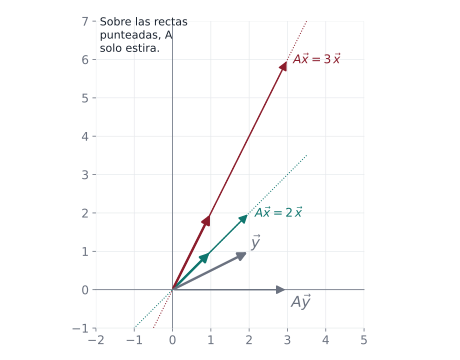
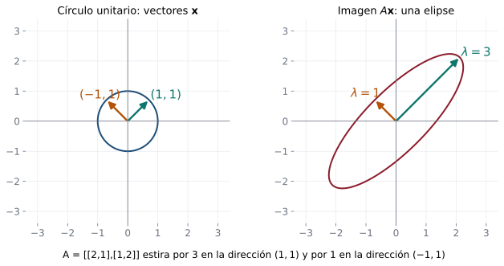
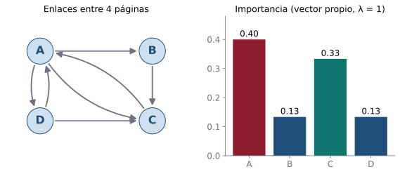

## Objetivos de la clase

- Definir **valor propio** (característico) y **vector propio** de una matriz cuadrada.
- Calcular el **polinomio característico** y sus raíces.
- Hallar los **espacios propios** resolviendo sistemas homogéneos.
- Distinguir multiplicidad **algebraica** y **geométrica**.
- Demostrar propiedades: espacios propios son subespacios; vectores propios de valores distintos son LI.

## Definición

::: {.definicion}
Sea $A$ una matriz $n\times n$. Un número $\lambda$ es un **valor propio** (valor característico, eigenvalor) de $A$ si existe un vector $\mathbf x\neq\mathbf 0$ tal que
$$
A\mathbf x=\lambda\mathbf x .
$$
Todo $\mathbf x\neq\mathbf 0$ que cumple esto es un **vector propio** asociado a $\lambda$.
:::

. . .

::: {.obs}
$\mathbf x=\mathbf 0$ siempre cumple $A\mathbf 0=\lambda\mathbf 0$, por eso se **excluye**: un vector propio debe ser no nulo. En cambio, $\lambda=0$ **sí** puede ser valor propio.
:::

. . .

::: {.ejemplo}
$A=\begin{pmatrix}0&\tfrac12\\\tfrac12&0\end{pmatrix}$: $\;A\begin{pmatrix}1\\1\end{pmatrix}=\begin{pmatrix}\tfrac12\\\tfrac12\end{pmatrix}=\tfrac12\begin{pmatrix}1\\1\end{pmatrix}$. Así $(1,1)$ es vector propio con valor propio $\lambda=\tfrac12$.
:::

## Interpretación geométrica

{fig-align="center" width="42%"}

Para $A=\begin{pmatrix}1&1\\-2&4\end{pmatrix}$, un vector cualquiera $\mathbf y$ cambia de dirección al aplicarle $A$, pero sobre las rectas generadas por $(1,1)$ y $(1,2)$, $A$ solo **estira**: por $2$ y por $3$.

## Los vectores propios marcan los ejes de la deformación

{fig-align="center" width="86%"}

$A=\begin{pmatrix}2&1\\1&2\end{pmatrix}$ transforma el círculo unitario en una elipse. Sus ejes apuntan en las direcciones propias $(1,1)$ y $(-1,1)$, y sus semiejes miden los valores propios $3$ y $1$.

## El polinomio característico

::: {.teorema}
$\lambda$ es valor propio de $A$ si y solo si
$$
p(\lambda)=\det(\lambda I-A)=0 .
$$
:::

. . .

::: {.demo}
$A\mathbf x=\lambda\mathbf x\iff(\lambda I-A)\mathbf x=\mathbf 0$. Existe $\mathbf x\neq\mathbf 0$ que lo cumple $\iff$ el sistema homogéneo tiene soluciones no triviales $\iff\lambda I-A$ no es invertible $\iff\det(\lambda I-A)=0$ (teorema de la matriz invertible).
:::

. . .

::: {.definicion}
$p(\lambda)=\det(\lambda I-A)$ es el **polinomio característico** de $A$ (de grado $n$), y $p(\lambda)=0$ es la **ecuación característica**. El **espacio propio** de $\lambda$ es $E_\lambda=N_{(A-\lambda I)}$: los vectores propios junto con el $\mathbf 0$.
:::

## Procedimiento

::: {.definicion data-t="Cálculo de valores y vectores propios"}
1. Calcule $p(\lambda)=\det(\lambda I-A)$.
2. Encuentre las raíces $\lambda_1,\dots,\lambda_k$ de $p(\lambda)=0$.
3. Para cada $\lambda_i$, resuelva el sistema homogéneo $(A-\lambda_iI)\mathbf x=\mathbf 0$. Una base de su solución es una base de $E_{\lambda_i}$.
:::

. . .

::: {.teorema data-t="Dos atajos"}
a) Si $A$ es **triangular**, sus valores propios son las entradas de la diagonal.
b) La suma de los valores propios (con multiplicidad) es la **traza** $a_{11}+\cdots+a_{nn}$, y su producto es $\det A$.
:::

. . .

::: {.demo data-t="a)"}
$\lambda I-A$ también es triangular, con diagonal $\lambda-a_{ii}$; su determinante es $\prod(\lambda-a_{ii})$.
:::

## Ejemplo resuelto: matriz $2\times 2$

::: {.ejemplo}
Halle valores y vectores propios de $A=\begin{pmatrix}1&1\\-2&4\end{pmatrix}$.
:::

. . .

$$
p(\lambda)=\begin{vmatrix}\lambda-1&-1\\2&\lambda-4\end{vmatrix}=(\lambda-1)(\lambda-4)+2=\lambda^2-5\lambda+6=(\lambda-2)(\lambda-3).
$$
Valores propios: $\lambda_1=2$, $\lambda_2=3$. (Comprobación: $2+3=5=$ traza, $2\cdot3=6=\det A$ ✓.)

. . .

$\lambda=2$: $\;A-2I=\begin{pmatrix}-1&1\\-2&2\end{pmatrix}\sim\begin{pmatrix}1&-1\\0&0\end{pmatrix}$, $x=y$. $\;E_2=\operatorname{gen}\{(1,1)\}$.

. . .

$\lambda=3$: $\;A-3I=\begin{pmatrix}-2&1\\-2&1\end{pmatrix}\sim\begin{pmatrix}1&-\tfrac12\\0&0\end{pmatrix}$, $x=\tfrac12y$. $\;E_3=\operatorname{gen}\{(1,2)\}$.

. . .

Verificación: $A\begin{pmatrix}1\\2\end{pmatrix}=\begin{pmatrix}3\\6\end{pmatrix}=3\begin{pmatrix}1\\2\end{pmatrix}$ ✓.

## Ejemplo resuelto: matriz $3\times 3$ con valor propio repetido

::: {.ejemplo}
Halle valores y vectores propios de $A=\begin{pmatrix}4&-1&6\\2&1&6\\2&-1&8\end{pmatrix}$.
:::

. . .

Desarrollando, $\;p(\lambda)=\det(\lambda I-A)=\lambda^3-13\lambda^2+40\lambda-36=(\lambda-2)^2(\lambda-9)$. (Traza $=13=2+2+9$ ✓.)

. . .

$\lambda=2$: $\;A-2I=\begin{pmatrix}2&-1&6\\2&-1&6\\2&-1&6\end{pmatrix}\sim\begin{pmatrix}1&-\tfrac12&3\\0&0&0\\0&0&0\end{pmatrix}$, $x=\tfrac12y-3z$:
$$
E_2=\operatorname{gen}\{(1,2,0),\;(-3,0,1)\},\qquad\dim E_2=2.
$$

. . .

$\lambda=9$: $\;A-9I=\begin{pmatrix}-5&-1&6\\2&-8&6\\2&-1&-1\end{pmatrix}\sim\begin{pmatrix}1&0&-1\\0&1&-1\\0&0&0\end{pmatrix}$, $\;E_9=\operatorname{gen}\{(1,1,1)\}$.

## Multiplicidades

::: {.definicion}
- **Multiplicidad algebraica** de $\lambda$: cuántas veces aparece $\lambda$ como raíz de $p(\lambda)$.
- **Multiplicidad geométrica** de $\lambda$: $\dim E_\lambda$ (número de vectores propios LI asociados).
:::

. . .

::: {.teorema}
Para cada valor propio: $\;1\le\text{mult. geométrica}\le\text{mult. algebraica}$.
:::

. . .

| Matriz | $\lambda$ | Algebraica | Geométrica |
|---|---|---|---|
| $\begin{pmatrix}4&-1&6\\2&1&6\\2&-1&8\end{pmatrix}$ | $2$ | 2 | 2 |
| $\begin{pmatrix}3&1\\0&3\end{pmatrix}$ | $3$ | 2 | **1** |

. . .

En el segundo caso, $A-3I=\begin{pmatrix}0&1\\0&0\end{pmatrix}$ da $y=0$: solo $E_3=\operatorname{gen}\{(1,0)\}$. "Faltan" vectores propios; esto impedirá diagonalizar (clase 26).

## En la vida real: cómo ordena Google las páginas {.compacto .nostretch}

{fig-align="center" height="260px"}

Cada página reparte su "importancia" por igual entre las páginas a las que enlaza. La importancia $\mathbf r$ cumple $M\mathbf r=\mathbf r$: es un **vector propio con $\lambda=1$**.
$$
M=\begin{pmatrix}0&0&1&\tfrac12\\\tfrac13&0&0&0\\\tfrac13&1&0&\tfrac12\\\tfrac13&0&0&0\end{pmatrix}
\;\Rightarrow\;
\mathbf r=\tfrac1{15}(6,\,2,\,5,\,2).
$$
La página A es la más importante: la enlazan C y D, que a su vez son importantes. Es la idea original del algoritmo **PageRank**.

## Propiedades y demostraciones

::: {.teorema}
a) $E_\lambda$ es un subespacio de $\mathbb R^n$.
b) Vectores propios asociados a valores propios **distintos** son linealmente independientes.
c) $A$ es invertible si y solo si $\lambda=0$ **no** es valor propio.
:::

. . .

::: {.demo data-t="a) y c)"}
a) $E_\lambda=N_{A-\lambda I}$ es un espacio nulo (clase 16). c) $0$ es valor propio $\iff\det(0I-A)=(-1)^n\det A=0\iff A$ no es invertible.
:::

. . .

::: {.demo data-t="b) para dos vectores"}
Sean $A\mathbf x_1=\lambda_1\mathbf x_1$, $A\mathbf x_2=\lambda_2\mathbf x_2$, $\lambda_1\neq\lambda_2$, y $c_1\mathbf x_1+c_2\mathbf x_2=\mathbf 0$ $\;(*)$. Aplicando $A$: $c_1\lambda_1\mathbf x_1+c_2\lambda_2\mathbf x_2=\mathbf 0$. Restando $\lambda_2(*)$: $c_1(\lambda_1-\lambda_2)\mathbf x_1=\mathbf 0$. Como $\lambda_1\neq\lambda_2$ y $\mathbf x_1\neq\mathbf 0$, $c_1=0$; entonces $c_2\mathbf x_2=\mathbf 0$ y $c_2=0$. (El caso general es por inducción.)
:::

## Ejemplo resuelto: matriz simétrica

::: {.ejemplo}
Halle valores y vectores propios de $A=\begin{pmatrix}2&1\\1&2\end{pmatrix}$ y verifique lo que muestra la figura.
:::

. . .

$p(\lambda)=(\lambda-2)^2-1=\lambda^2-4\lambda+3=(\lambda-1)(\lambda-3)$.

. . .

$\lambda=3$: $A-3I=\begin{pmatrix}-1&1\\1&-1\end{pmatrix}$, $x=y$, $E_3=\operatorname{gen}\{(1,1)\}$.
$\;\lambda=1$: $A-I=\begin{pmatrix}1&1\\1&1\end{pmatrix}$, $x=-y$, $E_1=\operatorname{gen}\{(-1,1)\}$.

. . .

Los dos vectores propios son **ortogonales**: $(1,1)\cdot(-1,1)=0$. Esto ocurre siempre con matrices simétricas (teorema espectral).

## Ejemplo 1 · Fácil: comprobar un vector propio {.compacto}

::: {.ejemplo data-t="Nivel fácil"}
¿Es $\mathbf v=(1,1)$ un vector propio de $A=\begin{pmatrix}2&1\\1&2\end{pmatrix}$? ¿Y $\mathbf w=(1,0)$?
:::

. . .

**Paso 1 · Calcular $A\mathbf v$** y ver si es un múltiplo de $\mathbf v$: $\;A\mathbf v=(3,3)=3\mathbf v$ ✓. Valor propio $\lambda=3$.

. . .

**Paso 2.** $\;A\mathbf w=(2,1)$, que **no** es múltiplo de $(1,0)$.

::: {.solucion}
$\mathbf v$ es vector propio con $\lambda=3$; $\mathbf w$ no lo es, porque $A$ cambia su dirección.
:::

## Ejemplo 2 · Fácil: valores propios de una triangular {.compacto}

::: {.ejemplo data-t="Nivel fácil"}
Halle los valores propios de $A=\begin{pmatrix}3&5\\0&-1\end{pmatrix}$.
:::

. . .

**Paso 1.** $\;\det(A-\lambda I)=\begin{vmatrix}3-\lambda&5\\0&-1-\lambda\end{vmatrix}=(3-\lambda)(-1-\lambda).$

. . .

**Paso 2.** Se anula en $\lambda=3$ y $\lambda=-1$.

::: {.solucion}
$\lambda_1=3$, $\lambda_2=-1$: en una matriz triangular, los valores propios son **los de la diagonal**. Comprobación: suma $=2=$ traza ✓ y producto $=-3=\det A$ ✓.
:::

## Ejemplo 3 · Medio: valores y vectores propios $2\times2$ {.compacto}

::: {.ejemplo data-t="Nivel medio"}
Halle los valores y vectores propios de $A=\begin{pmatrix}4&1\\2&3\end{pmatrix}$.
:::

. . .

**Paso 1 · Polinomio característico:** $\;(4-\lambda)(3-\lambda)-2=\lambda^2-7\lambda+10=(\lambda-5)(\lambda-2)$.

. . .

**Paso 2 · $\lambda=5$:** $(A-5I)\mathbf x=\mathbf 0$ con $A-5I=\begin{pmatrix}-1&1\\2&-2\end{pmatrix}$: $\;x=y$, vector $(1,1)$.

. . .

**Paso 3 · $\lambda=2$:** $A-2I=\begin{pmatrix}2&1\\2&1\end{pmatrix}$: $\;y=-2x$, vector $(1,-2)$.

::: {.solucion}
$\lambda=5$ con $(1,1)$; $\;\lambda=2$ con $(1,-2)$. Comprobación: $A(1,-2)^T=(4-2,\;2-6)=(2,-4)=2(1,-2)$ ✓.
:::

## Ejemplo 4 · Difícil: valor propio repetido en $3\times3$ {.compacto}

::: {.ejemplo data-t="Nivel difícil"}
Halle los valores propios, sus multiplicidades y los espacios propios de $A=\begin{pmatrix}1&2&0\\2&1&0\\0&0&3\end{pmatrix}$.
:::

. . .

**Paso 1 · Aprovechar los bloques.** Expandiendo por la tercera fila:
$$
\det(A-\lambda I)=(3-\lambda)\big[(1-\lambda)^2-4\big]=(3-\lambda)(\lambda-3)(\lambda+1)=-(\lambda-3)^2(\lambda+1).
$$

. . .

**Paso 2 · $\lambda=3$** (multiplicidad algebraica $2$): $A-3I=\begin{pmatrix}-2&2&0\\2&-2&0\\0&0&0\end{pmatrix}$ da solo $x=y$, con $y$ y $z$ libres: $\;E_3=\operatorname{gen}\{(1,1,0),(0,0,1)\}$, dimensión $2$.

. . .

**Paso 3 · $\lambda=-1$:** $A+I=\begin{pmatrix}2&2&0\\2&2&0\\0&0&4\end{pmatrix}$: $\;z=0$, $y=-x$. $\;E_{-1}=\operatorname{gen}\{(1,-1,0)\}$.

::: {.solucion}
$\lambda=3$ (algebraica $2$, geométrica $2$) y $\lambda=-1$ (algebraica y geométrica $1$). Como coinciden, $A$ es diagonalizable (clase 26). Los tres vectores propios son ortogonales: $A$ es simétrica.
:::

## Ejercicios propuestos

::: {.ejercicio data-t="1"}
Halle valores y vectores propios de $A=\begin{pmatrix}5&4\\1&2\end{pmatrix}$.
:::

::: {.solucion .fragment}
$p(\lambda)=\lambda^2-7\lambda+6=(\lambda-1)(\lambda-6)$. $\;E_1=\operatorname{gen}\{(-1,1)\}$, $\;E_6=\operatorname{gen}\{(4,1)\}$. Verifique: $A(4,1)^T=(24,6)^T=6(4,1)^T$.
:::

## Ejercicios propuestos

::: {.ejercicio data-t="2"}
Muestre que $R=\begin{pmatrix}0&-1\\1&0\end{pmatrix}$ (rotación de $90^\circ$) no tiene valores propios reales. Interprete.
:::

::: {.solucion .fragment}
$p(\lambda)=\lambda^2+1$, sin raíces reales (sus raíces son $\pm i$). Geométricamente: una rotación de $90^\circ$ no deja **ninguna** dirección fija.
:::

## Ejercicios propuestos

::: {.ejercicio data-t="3"}
Halle valores propios y bases de los espacios propios de $A=\begin{pmatrix}2&0&0\\1&2&-1\\1&3&-2\end{pmatrix}$.
:::

::: {.solucion .fragment}
Desarrollando por la fila 1: $p(\lambda)=(\lambda-2)\big[(\lambda-2)(\lambda+2)+3\big]=(\lambda-2)(\lambda^2-1)=(\lambda-2)(\lambda-1)(\lambda+1)$.
$E_2=\operatorname{gen}\{(1,1,1)\}$, $\;E_1=\operatorname{gen}\{(0,1,1)\}$, $\;E_{-1}=\operatorname{gen}\{(0,1,3)\}$.
:::

## Ejercicios propuestos

::: {.ejercicio data-t="4 · Demostración"}
Demuestre que si $\lambda$ es valor propio de $A$ con vector propio $\mathbf x$, entonces $\lambda^k$ es valor propio de $A^k$ y, si $A$ es invertible, $1/\lambda$ es valor propio de $A^{-1}$.
:::

::: {.solucion .fragment}
$A^2\mathbf x=A(\lambda\mathbf x)=\lambda A\mathbf x=\lambda^2\mathbf x$ y, por inducción, $A^k\mathbf x=\lambda^k\mathbf x$. Si $A$ es invertible, $\lambda\neq0$ y de $A\mathbf x=\lambda\mathbf x$ se obtiene $\mathbf x=\lambda A^{-1}\mathbf x$, es decir $A^{-1}\mathbf x=\tfrac1\lambda\mathbf x$.
:::

## Ejercicios del texto guía {.texto-guia}

Grossman y Flores, *Álgebra lineal*, 8.ª ed.:

| Sección | Ejercicios |
|---|---|
| 8.1 Valores característicos y vectores característicos | 3, 5, 14, 20, 30, 31, 33, 36 |

## Resumen

- $A\mathbf x=\lambda\mathbf x$, $\mathbf x\neq\mathbf 0$.
- Valores propios: raíces de $\det(\lambda I-A)=0$. Vectores propios: $N_{A-\lambda I}\setminus\{\mathbf 0\}$.
- Triangular ⇒ diagonal. Suma = traza, producto = $\det A$.
- $1\le$ mult. geométrica $\le$ mult. algebraica.
- Valores propios distintos ⇒ vectores propios LI.

 

[← Clase 24](clase_24.qmd) · [Programa del curso](../algebra_lineal.qmd) · [Clase 26: Diagonalización →](clase_26.qmd)
