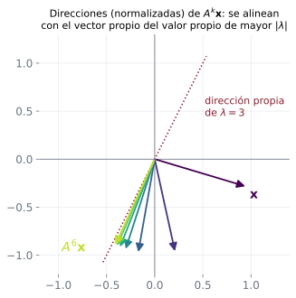
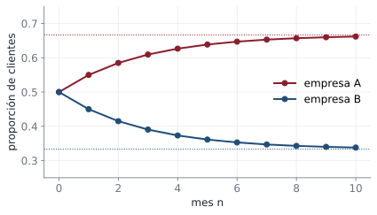
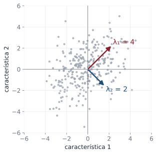

## Objetivos de la clase

- Definir **matrices semejantes** y demostrar qué comparten.
- Enunciar y demostrar el **criterio de diagonalización**.
- Diagonalizar una matriz: hallar $P$ invertible y $D$ diagonal con $D=P^{-1}AP$.
- Usar la diagonalización para calcular **potencias** $A^k$.

## Matrices semejantes

::: {.definicion}
$B$ es **semejante** a $A$ (se escribe $B\sim A$) si existe una matriz invertible $P$ tal que
$$
B=P^{-1}AP .
$$
:::

. . .

::: {.ejemplo}
$A=\begin{pmatrix}1&1\\-2&4\end{pmatrix}$, $P=\begin{pmatrix}1&1\\1&2\end{pmatrix}$, $P^{-1}=\begin{pmatrix}2&-1\\-1&1\end{pmatrix}$:
$$
P^{-1}AP=\begin{pmatrix}2&-1\\-1&1\end{pmatrix}\begin{pmatrix}1&1\\-2&4\end{pmatrix}\begin{pmatrix}1&1\\1&2\end{pmatrix}=\begin{pmatrix}2&0\\0&3\end{pmatrix}.
$$
$A$ es semejante a una matriz **diagonal**.
:::

. . .

::: {.teorema data-t="Propiedades elementales"}
1. $A\sim A$. $\quad$ 2. Si $B\sim A$, entonces $A\sim B$. $\quad$ 3. Si $A\sim B$ y $B\sim C$, entonces $A\sim C$.
:::

## Lo que comparten las matrices semejantes

::: {.teorema}
Si $B=P^{-1}AP$, entonces $A$ y $B$ tienen el mismo **polinomio característico**; por tanto, los mismos **valores propios** (con multiplicidad), el mismo **determinante** y la misma **traza**.
:::

. . .

::: {.demo}
Usando $\lambda I=P^{-1}(\lambda I)P$ y $\det(XY)=\det X\det Y$:
$$
\det(\lambda I-B)=\det(P^{-1}\lambda IP-P^{-1}AP)=\det\big(P^{-1}(\lambda I-A)P\big)=\det P^{-1}\,\det(\lambda I-A)\,\det P=\det(\lambda I-A).
$$
:::

. . .

::: {.obs data-t="Ojo"}
El recíproco es falso: $\begin{pmatrix}3&1\\0&3\end{pmatrix}$ y $\begin{pmatrix}3&0\\0&3\end{pmatrix}$ tienen el mismo polinomio $(\lambda-3)^2$ pero **no** son semejantes ($P^{-1}(3I)P=3I$ para toda $P$).
:::

## Diagonalización

::: {.definicion}
$A$ ($n\times n$) es **diagonalizable** si es semejante a una matriz diagonal: existe $P$ invertible con $P^{-1}AP=D$ diagonal.
:::

. . .

::: {.teorema data-t="Criterio"}
$A$ es diagonalizable si y solo si tiene $n$ vectores propios **linealmente independientes**. En ese caso,
$$
P=\big(\mathbf x_1\;\mathbf x_2\;\cdots\;\mathbf x_n\big),\qquad D=\begin{pmatrix}\lambda_1&&\\&\ddots&\\&&\lambda_n\end{pmatrix},
$$
donde $\mathbf x_i$ es un vector propio asociado a $\lambda_i$ (en el **mismo orden**).
:::

## Demostración del criterio

::: {.demo}
Sea $P=(\mathbf x_1\cdots\mathbf x_n)$ y $D=\operatorname{diag}(\lambda_1,\dots,\lambda_n)$. Por la clase 4 (columna $j$ de un producto):
$$
AP=\big(A\mathbf x_1\;\cdots\;A\mathbf x_n\big),\qquad PD=\big(\lambda_1\mathbf x_1\;\cdots\;\lambda_n\mathbf x_n\big).
$$
Entonces $\;AP=PD\iff A\mathbf x_i=\lambda_i\mathbf x_i$ para todo $i$.

($\Leftarrow$) Si los $\mathbf x_i$ son vectores propios LI, $P$ es invertible (clase 20) y $AP=PD$ da $P^{-1}AP=D$.

($\Rightarrow$) Si $P^{-1}AP=D$, entonces $AP=PD$: cada columna $\mathbf x_i$ de $P$ cumple $A\mathbf x_i=\lambda_i\mathbf x_i$, y $\mathbf x_i\neq\mathbf 0$ porque $P$ es invertible. Las columnas de una matriz invertible son LI.
:::

. . .

::: {.teorema data-t="Consecuencias"}
a) Si $A$ tiene $n$ valores propios **distintos**, es diagonalizable (clase 25: vectores propios de valores distintos son LI).
b) $A$ es diagonalizable $\iff$ para cada $\lambda$, multiplicidad geométrica = multiplicidad algebraica.
:::

## Procedimiento

::: {.definicion data-t="Para diagonalizar A"}
1. Halle los valores propios (raíces de $\det(\lambda I-A)=0$).
2. Para cada $\lambda$, halle una base de $E_\lambda$.
3. Si en total hay $n$ vectores, forme $P$ con ellos como columnas y $D$ con los $\lambda$ correspondientes en la diagonal (mismo orden). Si hay menos de $n$, $A$ **no** es diagonalizable.
4. (Verificación) Compruebe $AP=PD$, que no requiere calcular $P^{-1}$.
:::

## Ejemplo resuelto: $3\times3$ con valor propio repetido

::: {.ejemplo}
Diagonalice $A=\begin{pmatrix}4&-1&6\\2&1&6\\2&-1&8\end{pmatrix}$ (clase 25).
:::

. . .

Ya obtuvimos $p(\lambda)=(\lambda-2)^2(\lambda-9)$, $\;E_2=\operatorname{gen}\{(1,2,0),(-3,0,1)\}$ y $E_9=\operatorname{gen}\{(1,1,1)\}$.

. . .

Para $\lambda=2$: multiplicidad algebraica 2 y geométrica 2. Para $\lambda=9$: 1 y 1. Hay $3$ vectores propios LI: **es diagonalizable**.
$$
P=\begin{pmatrix}1&-3&1\\2&0&1\\0&1&1\end{pmatrix},\qquad D=\begin{pmatrix}2&0&0\\0&2&0\\0&0&9\end{pmatrix}.
$$

. . .

**Verificación** de la tercera columna de $AP=PD$: $A(1,1,1)^T=(4-1+6,\;2+1+6,\;2-1+8)^T=(9,9,9)^T=9(1,1,1)^T$ ✓.

## Ejemplo: una matriz que no es diagonalizable

::: {.ejemplo}
¿Es diagonalizable $A=\begin{pmatrix}3&1\\0&3\end{pmatrix}$?
:::

. . .

Es triangular: $\lambda=3$ con multiplicidad algebraica 2. Pero $A-3I=\begin{pmatrix}0&1\\0&0\end{pmatrix}$ da $E_3=\operatorname{gen}\{(1,0)\}$: multiplicidad geométrica 1.

. . .

Solo hay **un** vector propio LI y se necesitan **dos**. $A$ **no es diagonalizable**.

. . .

::: {.obs}
Que un valor propio se repita **no** impide diagonalizar (ejemplo anterior); lo que lo impide es que falten vectores propios.
:::

## Aplicación: potencias de una matriz

::: {.teorema}
Si $A=PDP^{-1}$, entonces $\;A^k=PD^kP^{-1}$, y $D^k=\operatorname{diag}(\lambda_1^k,\dots,\lambda_n^k)$.
:::

. . .

::: {.demo}
$A^2=(PDP^{-1})(PDP^{-1})=PD(P^{-1}P)DP^{-1}=PD^2P^{-1}$, y por inducción $A^{k+1}=A^kA=PD^kP^{-1}PDP^{-1}=PD^{k+1}P^{-1}$.
:::

. . .

::: {.ejemplo}
Para $A=\begin{pmatrix}1&1\\-2&4\end{pmatrix}=PDP^{-1}$ con $P=\begin{pmatrix}1&1\\1&2\end{pmatrix}$, $D=\operatorname{diag}(2,3)$:
$$
A^k=\begin{pmatrix}1&1\\1&2\end{pmatrix}\begin{pmatrix}2^k&0\\0&3^k\end{pmatrix}\begin{pmatrix}2&-1\\-1&1\end{pmatrix}=\begin{pmatrix}2^{k+1}-3^k&3^k-2^k\\2^{k+1}-2\cdot3^k&2\cdot3^k-2^k\end{pmatrix}.
$$
Con $k=1$ se recupera $A$ ✓. Calcular $A^{10}$ así toma segundos.
:::

## ¿Qué pasa con $A^k\mathbf x$ cuando $k$ crece?

{fig-align="center" width="48%"}

Como $A^k\mathbf x=c_1\lambda_1^k\mathbf x_1+c_2\lambda_2^k\mathbf x_2$, el término del valor propio de **mayor** $|\lambda|$ domina y $A^k\mathbf x$ se alinea con su vector propio.

## Aplicación: cadena de Markov

::: {.ejemplo}
Cada mes, el 90 % de los clientes de la empresa A se queda y el 10 % pasa a B; de B, el 80 % se queda y el 20 % pasa a A. Hoy cada empresa tiene la mitad del mercado. ¿Qué pasa a largo plazo?
:::

. . .

$P=\begin{pmatrix}0.9&0.2\\0.1&0.8\end{pmatrix}$, $\;\mathbf x_{k+1}=P\mathbf x_k$. Valores propios: $\lambda_1=1$ con $\mathbf v_1=(2,1)$ y $\lambda_2=0.7$ con $\mathbf v_2=(-1,1)$.

. . .

Escribiendo $\mathbf x_0=\left(\tfrac12,\tfrac12\right)=\left(\tfrac23,\tfrac13\right)+\tfrac16(-1,1)$:
$$
\mathbf x_k=P^k\mathbf x_0=\begin{pmatrix}\tfrac23\\\tfrac13\end{pmatrix}+\tfrac16(0.7)^k\begin{pmatrix}-1\\1\end{pmatrix}\;\xrightarrow{k\to\infty}\;\begin{pmatrix}\tfrac23\\\tfrac13\end{pmatrix}.
$$

. . .

A largo plazo A tiene $\tfrac23$ del mercado y B $\tfrac13$, sin importar el reparto inicial. Comprobación con $k=2$: $\tfrac23-\tfrac{0.49}{6}=0.585$, igual a $P^2\mathbf x_0$ ✓.

## La cadena de Markov en una gráfica {.nostretch}

{fig-align="center" width="62%"}

Con la fórmula diagonalizada $\;x_A(k)=\tfrac23-\tfrac16(0.7)^k$ se ve que el término $(0.7)^k$ se apaga: en pocos meses el mercado se estabiliza en $\tfrac23$ y $\tfrac13$. El mismo modelo se usa para el clima, el tráfico web o el texto predictivo del celular.

## Machine learning: análisis de componentes principales {.compacto .nostretch}

:::: {.columns}
::: {.column width="55%"}
::: {.ml data-t="PCA"}
La matriz de covarianza de unos datos con dos características es simétrica: $\;C=\begin{pmatrix}3&1\\1&3\end{pmatrix}$.
:::

Se diagonaliza: $\lambda_1=4$ con $\mathbf v_1=(1,1)$ y $\lambda_2=2$ con $\mathbf v_2=(1,-1)$, ortogonales.

- $\mathbf v_1$ es la dirección en la que los datos **más varían**: concentra $\tfrac{4}{4+2}\approx67\,\%$ de la variación.
- Proyectar sobre $\mathbf v_1$ reduce de 2 a 1 característica perdiendo poca información.
:::
::: {.column width="45%"}
{width="100%"}
:::
::::

Con cientos de características, PCA es la forma clásica de **reducir la dimensión** de los datos antes de entrenar o de graficarlos.

## Ejemplo 1 · Fácil: construir una matriz semejante {.compacto}

::: {.ejemplo data-t="Nivel fácil"}
Con $D=\begin{pmatrix}2&0\\0&3\end{pmatrix}$ y $P=\begin{pmatrix}1&1\\0&1\end{pmatrix}$, calcule $A=PDP^{-1}$ y compare traza y determinante con los de $D$.
:::

. . .

**Paso 1.** $\;P^{-1}=\begin{pmatrix}1&-1\\0&1\end{pmatrix}$, $\;PD=\begin{pmatrix}2&3\\0&3\end{pmatrix}$, $\;A=PDP^{-1}=\begin{pmatrix}2&1\\0&3\end{pmatrix}.$

. . .

**Paso 2 · Comparar.** Traza: $5$ y $5$. Determinante: $6$ y $6$. Valores propios: $2$ y $3$ en ambas.

::: {.solucion}
$A=\begin{pmatrix}2&1\\0&3\end{pmatrix}$ es semejante a $D$: son la **misma transformación vista en otra base**, por eso comparten traza, determinante y valores propios.
:::

## Ejemplo 2 · Fácil: una matriz que no es diagonalizable {.compacto}

::: {.ejemplo data-t="Nivel fácil"}
¿Es diagonalizable $A=\begin{pmatrix}1&1\\0&1\end{pmatrix}$?
:::

. . .

**Paso 1 · Valores propios:** es triangular, $\lambda=1$ con multiplicidad algebraica $2$.

. . .

**Paso 2 · Vectores propios:** $A-I=\begin{pmatrix}0&1\\0&0\end{pmatrix}$ da $y=0$: solo los múltiplos de $(1,0)$. Multiplicidad geométrica $1$.

::: {.solucion}
**No** es diagonalizable: para una matriz $2\times2$ se necesitan **dos** vectores propios independientes y solo hay una dirección. Geométricamente es una cizalla.
:::

## Ejemplo 3 · Medio: diagonalizar una matriz $2\times2$ {.compacto}

::: {.ejemplo data-t="Nivel medio"}
Diagonalice $A=\begin{pmatrix}4&1\\2&3\end{pmatrix}$ (sus valores y vectores propios se hallaron en la clase 25).
:::

. . .

**Paso 1 · Ordenar:** los vectores propios van como columnas de $P$, en el mismo orden que sus valores propios en $D$:
$$
P=\begin{pmatrix}1&1\\1&-2\end{pmatrix},\qquad D=\begin{pmatrix}5&0\\0&2\end{pmatrix}.
$$

. . .

**Paso 2 · Inversa:** $\det P=-3$, $\;P^{-1}=\dfrac13\begin{pmatrix}2&1\\1&-1\end{pmatrix}$.

. . .

**Paso 3 · Verificar** $PDP^{-1}=A$: $\;PD=\begin{pmatrix}5&2\\5&-4\end{pmatrix}$ y $\;\tfrac13\begin{pmatrix}5&2\\5&-4\end{pmatrix}\begin{pmatrix}2&1\\1&-1\end{pmatrix}=\tfrac13\begin{pmatrix}12&3\\6&9\end{pmatrix}=\begin{pmatrix}4&1\\2&3\end{pmatrix}$ ✓.

::: {.solucion}
$A=PDP^{-1}$. Si se cambia el orden de las columnas de $P$, hay que cambiar también el orden en $D$.
:::

## Ejemplo 4 · Difícil: una fórmula para $A^n$ {.compacto}

::: {.ejemplo data-t="Nivel difícil"}
Con la diagonalización anterior, halle una fórmula para $A^n$ y verifíquela con $n=2$.
:::

. . .

**Paso 1 · Las potencias de $D$ son fáciles:** $\;A^n=PD^nP^{-1}$, con $D^n=\begin{pmatrix}5^n&0\\0&2^n\end{pmatrix}$.

. . .

**Paso 2 · Multiplicar:**
$$
A^n=\frac13\begin{pmatrix}1&1\\1&-2\end{pmatrix}\begin{pmatrix}5^n&0\\0&2^n\end{pmatrix}\begin{pmatrix}2&1\\1&-1\end{pmatrix}
=\frac13\begin{pmatrix}2\cdot5^n+2^n&5^n-2^n\\2\cdot5^n-2\cdot2^n&5^n+2\cdot2^n\end{pmatrix}.
$$

. . .

**Paso 3 · Verificar con $n=2$:** $\;\tfrac13\begin{pmatrix}50+4&25-4\\50-8&25+8\end{pmatrix}=\begin{pmatrix}18&7\\14&11\end{pmatrix}$, y directamente $A^2=\begin{pmatrix}16+2&4+3\\8+6&2+9\end{pmatrix}=\begin{pmatrix}18&7\\14&11\end{pmatrix}$ ✓.

::: {.solucion}
Con la fórmula, $A^{10}$ se calcula sin multiplicar diez matrices. Para $n$ grande domina $5^n$: $A^n\approx\tfrac{5^n}{3}\begin{pmatrix}2&1\\2&1\end{pmatrix}$, cuyas columnas apuntan en la dirección del vector propio $(1,1)$.
:::

## Ejercicios propuestos

::: {.ejercicio data-t="1"}
Diagonalice $A=\begin{pmatrix}5&4\\1&2\end{pmatrix}$ (clase 25, ejercicio 1).
:::

::: {.solucion .fragment}
$\lambda=1$, $\mathbf x=(-1,1)$; $\lambda=6$, $\mathbf x=(4,1)$. $\;P=\begin{pmatrix}-1&4\\1&1\end{pmatrix}$, $D=\begin{pmatrix}1&0\\0&6\end{pmatrix}$. (Si cambia el orden de las columnas de $P$, cambia el orden en $D$.)
:::

## Ejercicios propuestos

::: {.ejercicio data-t="2"}
¿Es diagonalizable $A=\begin{pmatrix}1&2&0\\0&3&0\\2&-4&2\end{pmatrix}$? Justifique sin hallar los vectores propios.
:::

::: {.solucion .fragment}
Desarrollando por la columna 3, $p(\lambda)=(\lambda-2)(\lambda-1)(\lambda-3)$: tres valores propios **distintos** en una matriz $3\times3$. **Sí** es diagonalizable (consecuencia a).
:::

## Ejercicios propuestos

::: {.ejercicio data-t="3 · Demostración"}
Demuestre que si $A$ es diagonalizable e invertible, entonces $A^{-1}$ es diagonalizable.
:::

::: {.solucion .fragment}
$P^{-1}AP=D$ con $D$ invertible (sus entradas son los valores propios, no nulos porque $A$ es invertible). Invirtiendo: $(P^{-1}AP)^{-1}=P^{-1}A^{-1}P=D^{-1}$, que es diagonal.
:::

## Ejercicios propuestos

::: {.ejercicio data-t="4 · Demostración"}
Demuestre que si $A$ es diagonalizable con todos sus valores propios iguales a $c$, entonces $A=cI$.
:::

::: {.solucion .fragment}
$D=cI$, luego $A=PDP^{-1}=P(cI)P^{-1}=cPP^{-1}=cI$. (Esto confirma de nuevo que $\begin{pmatrix}3&1\\0&3\end{pmatrix}$ no es diagonalizable.)
:::

## Ejercicios propuestos

::: {.ejercicio data-t="5"}
Sea $A=\begin{pmatrix}2&1\\1&2\end{pmatrix}$. Diagonalícela y calcule $A^5$.
:::

::: {.solucion .fragment}
$\lambda=1$: $(-1,1)$; $\lambda=3$: $(1,1)$. $P=\begin{pmatrix}-1&1\\1&1\end{pmatrix}$, $P^{-1}=\tfrac12\begin{pmatrix}-1&1\\1&1\end{pmatrix}$. $A^5=P\operatorname{diag}(1,243)P^{-1}=\begin{pmatrix}122&121\\121&122\end{pmatrix}$.
:::

## Ejercicios del texto guía {.texto-guia}

Grossman y Flores, *Álgebra lineal*, 8.ª ed.:

| Sección | Ejercicios |
|---|---|
| 8.3 Matrices semejantes y diagonalización | 3, 10, 11, 14, 22, 23, 26, 27, 32 |

. . .

::: {.obs data-t="Cierre del curso"}
Con esta clase termina el contenido del **examen final de semestre**. Repase el teorema de la matriz invertible: conecta sistemas, determinantes, espacios vectoriales, transformaciones y valores propios.
:::

## Resumen

- $B\sim A\iff B=P^{-1}AP$; comparten polinomio característico, determinante y traza.
- $A$ diagonalizable $\iff$ $n$ vectores propios LI $\iff$ mult. geométrica = algebraica para cada $\lambda$.
- $P$ = vectores propios en columnas, $D$ = valores propios en el mismo orden.
- $A^k=PD^kP^{-1}$.

 

[← Clase 25](clase_25.qmd) · [Programa del curso](../algebra_lineal.qmd)
