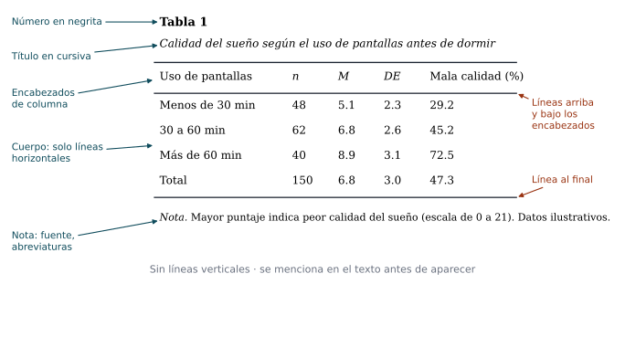
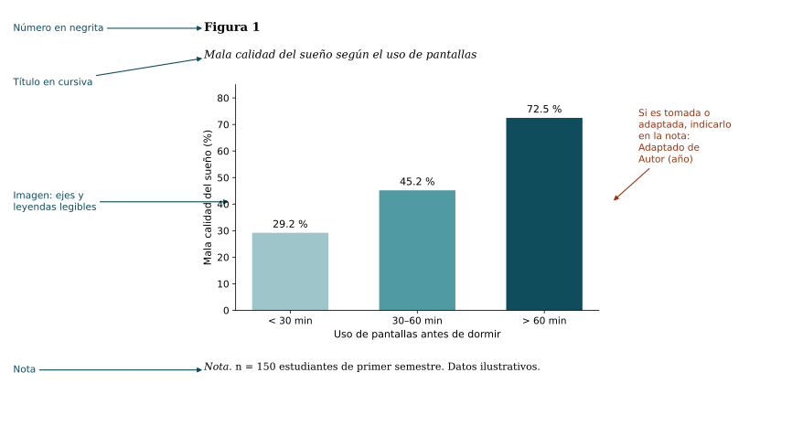
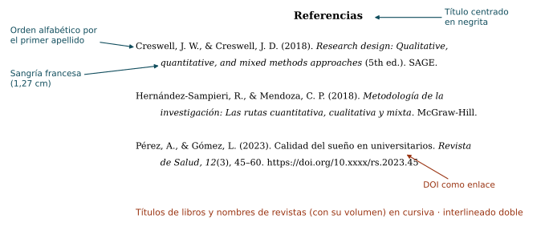

## Objetivo de la sesión

Aplicar las normas APA, séptima edición, para dar formato a un trabajo escrito, citar las fuentes en el texto y elaborar la lista de referencias.

## ¿Qué son las normas APA?

::: {.definicion}
Las **normas APA** son un conjunto de estándares de la *American Psychological Association* para **unificar la forma de presentar trabajos escritos** y **reconocer el trabajo de los autores** citados. La versión vigente es la **séptima edición** (APA, 2020).
:::

. . .

Se usan sobre todo en ciencias sociales, de la salud, educación y administración. En ingeniería es frecuente el estilo **IEEE** (sesión 7).

. . .

::: {.obs data-t="¿Para qué sirven?"}
- Dar crédito a las ideas de otros y **evitar el plagio**.
- Permitir que el lector **encuentre** cada fuente.
- Presentar el documento con un formato **claro y uniforme**.
:::

## Formato general del documento

{fig-align="center" width="62%"}

## Formato general: resumen

| Elemento | Norma APA 7 |
|---|---|
| **Fuente** | Legible y uniforme: Times New Roman 12, Calibri 11, Arial 11 o Georgia 11 |
| **Márgenes** | 2,54 cm (1 pulgada) en los cuatro lados |
| **Interlineado** | Doble, sin espacio adicional entre párrafos |
| **Alineación** | A la izquierda, **sin justificar** |
| **Sangría** | 1,27 cm en la primera línea de cada párrafo |
| **Numeración** | Todas las páginas, arriba a la derecha, desde la portada |

. . .

::: {.obs data-t="Atención"}
Muchas instituciones adaptan estos parámetros (por ejemplo, piden interlineado de 1,5 o texto justificado). Siga siempre las indicaciones de **su** curso o revista; la norma APA es la base.
:::

## Niveles de títulos

| Nivel | Formato |
|:-:|---|
| 1 | **Centrado, en negrita, con mayúsculas iniciales** (el texto empieza en un párrafo nuevo) |
| 2 | **Alineado a la izquierda, en negrita, con mayúsculas iniciales** |
| 3 | ***Alineado a la izquierda, en negrita y cursiva*** |
| 4 | **Con sangría, en negrita, terminado en punto.** El texto continúa en la misma línea. |
| 5 | ***Con sangría, en negrita y cursiva, terminado en punto.*** El texto continúa en la misma línea. |

. . .

::: {.ejemplo}
**Método** (nivel 1) → **Participantes** (nivel 2) → ***Criterios de inclusión*** (nivel 3).
:::

## Tablas y figuras: reglas generales

::: {.columns}
::: {.column width="50%"}
**Tabla**

1. **Número** en negrita: **Tabla 1**.
2. **Título** en cursiva, una línea abajo.
3. **Encabezados** de columna y cuerpo.
4. Solo **líneas horizontales** (sin verticales).
5. **Nota** debajo, si hace falta.
:::
::: {.column width="50%"}
**Figura** (gráficos, diagramas, fotografías, mapas)

1. **Número** en negrita: **Figura 1**.
2. **Título** en cursiva, una línea abajo.
3. La **imagen**, con ejes y leyendas legibles.
4. **Nota** debajo, si hace falta.
:::
:::

. . .

::: {.obs}
Toda tabla y figura se **menciona en el texto** antes de aparecer ("como se observa en la Tabla 1…") y se numera en el orden en que se menciona. Tablas y figuras tienen numeraciones **independientes**.
:::

## Ejemplo de tabla en APA

{fig-align="center" width="92%"}

## Ejemplo de figura en APA

{fig-align="center" width="92%"}

## Notas de tablas y figuras

La **nota** va debajo, empieza con la palabra *Nota* en cursiva seguida de punto, y puede incluir:

| Tipo de nota | Ejemplo |
|---|---|
| **General** (aclaraciones, abreviaturas) | *Nota.* M = media; DE = desviación estándar. |
| **De fuente** (tomada de otra obra) | *Nota.* Tomado de *Título de la obra* (p. 12), por A. Pérez, 2023, Editorial. |
| **De adaptación** (modificada) | *Nota.* Adaptado de "Título del artículo," por A. Pérez y L. Gómez, 2023, *Revista de Salud, 12*(3), p. 50. |
| **Específica** (una celda o columna) | ª Datos de 2022. |
| **De probabilidad** | \* *p* < .05. \*\* *p* < .01. |

. . .

::: {.obs data-t="Derechos de autor"}
Si la tabla o figura se reproduce de otra fuente, además de citarla puede requerir **permiso** del titular de los derechos. Lo más seguro es elaborar una propia con los datos citados.
:::

## Citas en el texto: dos formatos

| Cita **parentética** | Cita **narrativa** |
|---|---|
| Autor y año van **entre paréntesis**. | El autor forma parte de la oración; el año va entre paréntesis. |
| Énfasis en la **idea**. | Énfasis en el **autor**. |
| *…mejora la memoria (Pérez, 2023).* | *Pérez (2023) encontró que…* |

. . .

Toda cita incluye al menos **apellido del autor** y **año**. Si es textual, también la **página** (p. 45) o, si no hay páginas, el párrafo (párr. 3).

## Citas directas (textuales)

::: {.definicion data-t="Cita corta · menos de 40 palabras"}
Se integra en el párrafo **entre comillas**, con autor, año y página.

*Según Pérez (2023), "la evaluación temprana permite intervenciones más efectivas" (p. 45).*

*"La evaluación temprana permite intervenciones más efectivas" (Pérez, 2023, p. 45).*
:::

. . .

::: {.definicion data-t="Cita larga · 40 palabras o más"}
Va en un **bloque aparte**, **sin comillas**, con sangría de 1,27 cm en todo el bloque. La página va al final, **después** del punto.

> Pérez (2023) concluyó lo siguiente:
>
> La evaluación temprana permite intervenciones más efectivas, porque identifica las dificultades antes de que se consoliden y orienta el diseño de estrategias específicas para cada caso. Estas evaluaciones también facilitan el seguimiento del progreso a lo largo del tiempo. (p. 45)
:::

## Citas indirectas (paráfrasis)

::: {.definicion}
**Parafrasear** es expresar con **palabras propias** la idea de un autor. No lleva comillas. La página es opcional, pero se recomienda cuando la idea es muy específica.
:::

. . .

::: {.ejemplo}
**Original:** "La evaluación temprana permite intervenciones más efectivas".

**Paráfrasis narrativa:** Pérez (2023) sostiene que identificar a tiempo las dificultades mejora los resultados de la intervención.

**Paráfrasis parentética:** Identificar a tiempo las dificultades mejora los resultados de la intervención (Pérez, 2023).
:::

. . .

::: {.obs data-t="Cuidado"}
Cambiar unas pocas palabras **no** es parafrasear. Si conserva la estructura del original, debe citarse como cita textual.
:::

## Citas según el número de autores

| Autores | Cita parentética | Cita narrativa |
|---|---|---|
| Uno | (López, 2020) | López (2020) |
| Dos | (Vargas & González, 2020) | Vargas y González (2020) |
| Tres o más | (Cardona et al., 2020) | Cardona et al. (2020) |
| Autor corporativo | (Organización Mundial de la Salud, 2020) | Organización Mundial de la Salud (2020) |
| Corporativo con sigla, 1.ª cita | (Organización Mundial de la Salud [OMS], 2020) | Organización Mundial de la Salud (OMS, 2020) |
| Corporativo con sigla, siguientes | (OMS, 2020) | OMS (2020) |
| Sin fecha | (López, s. f.) | López (s. f.) |

. . .

Varias fuentes en una misma cita se ordenan alfabéticamente y se separan con punto y coma: (García, 2021; Pérez, 2023).

## Citas, referencias y bibliografía

| Concepto | Qué es |
|---|---|
| **Cita** | La mención breve de la fuente **dentro del texto** (autor y año). |
| **Referencias** | La lista completa, al final, de **todas y solo** las fuentes citadas. **Es lo que pide APA.** |
| **Bibliografía** | Lista de obras consultadas o recomendadas, aunque no se hayan citado. APA **no** la usa. |

. . .

::: {.teorema data-t="Regla de oro"}
Cada cita del texto tiene su referencia, y cada referencia aparece citada en el texto.
:::

## La lista de referencias

- Título **Referencias**, centrado y en negrita, en una página nueva.
- Orden **alfabético** por el apellido del primer autor.
- **Sangría francesa** de 1,27 cm (la primera línea al margen y las demás con sangría).
- Interlineado doble.
- Hasta **20 autores**: se escriben todos. Con 21 o más, los 19 primeros, puntos suspensivos y el último.
- Se incluye el **DOI** como enlace (https://doi.org/…) cuando existe.

## Ejemplo de lista de referencias

{fig-align="center" width="92%"}

## Anatomía de una referencia

{fig-align="center" width="100%"}

Toda referencia responde cuatro preguntas: **¿quién?** (autor), **¿cuándo?** (fecha), **¿qué?** (título) y **¿dónde?** (fuente). Los modelos que siguen cambian solo en **cómo se escribe cada parte** según el tipo de fuente.

::: {.obs}
Los ejemplos de las diapositivas siguientes son **ilustrativos**: los autores, títulos y direcciones web son ficticios y sirven solo para mostrar el formato.
:::

## Referencias: libros {.refs}

| Tipo | Modelo y ejemplo |
|----------|------------------------------------------------|
| **Libro impreso** | Apellido, A. A. (Año). *Título del libro*. Editorial. *Ej.:* Pérez, A. (2021). *Introducción a la investigación*. Editorial Académica. |
| **Libro electrónico** | Apellido, A. A. (Año). *Título del libro*. Editorial. https://doi.org/xxxx o URL *Ej.:* Gómez, L., & Ruiz, M. (2022). *Estadística aplicada a la salud*. Editorial Académica. https://doi.org/10.xxxx/eas2022 |
| **Edición distinta de la primera** | … *Título del libro* (3.ª ed.). Editorial. *Ej.:* Torres, J. (2020). *Métodos cuantitativos* (3.ª ed.). Editorial Académica. |
| **Libro con editores** | Apellido, A. A. (Ed.). (Año). *Título*. Editorial. (Con varios: Eds.) *Ej.:* Díaz, R., & Mora, P. (Eds.). (2019). *Avances en educación*. Editorial Académica. |
| **Autor corporativo** | Nombre de la organización. (Año). *Título*. Editorial (si es distinta del autor). *Ej.:* Asociación de Investigadores en Salud. (2022). *Guía de buenas prácticas*. |

. . .

En APA 7 **ya no** se escribe la ciudad de la editorial.

## Referencias: capítulos y obras de consulta {.refs}

| Tipo | Modelo y ejemplo |
|----------|------------------------------------------------|
| **Capítulo de libro editado (impreso)** | Apellido, A. A. (Año). Título del capítulo. En E. Editor (Ed.), *Título del libro* (pp. xx–xx). Editorial. *Ej.:* Ramos, C. (2019). La entrevista en profundidad. En R. Díaz & P. Mora (Eds.), *Avances en educación* (pp. 30–56). Editorial Académica. |
| **Capítulo de libro electrónico** | … (pp. xx–xx). Editorial. https://doi.org/xxxx o URL *Ej.:* Ramos, C. (2019). La entrevista en profundidad. En R. Díaz & P. Mora (Eds.), *Avances en educación* (pp. 30–56). Editorial Académica. https://doi.org/10.xxxx/ae.c3 |
| **Diccionario o enciclopedia en línea** | Autor o institución. (s. f.). Término. En *Nombre de la obra*. Recuperado el día de mes de año de URL *Ej.:* Academia de la Lengua. (s. f.). Brecha. En *Diccionario general*. Recuperado el 5 de marzo de 2024 de https://www.ejemplo.org/brecha |

. . .

Se usa "Recuperado el … de" solo cuando el contenido **cambia con el tiempo** y no está archivado.

## Referencias: revistas y periódicos {.refs}

| Tipo | Modelo y ejemplo |
|----------|------------------------------------------------|
| **Artículo con DOI** | Apellido, A. A., & Apellido, B. B. (Año). Título del artículo. *Revista, vol*(n.º), pp–pp. https://doi.org/xxxx *Ej.:* Pérez, A., & Gómez, L. (2023). Calidad del sueño en universitarios. *Revista de Salud, 12*(3), 45–60. https://doi.org/10.xxxx/rs.2023.45 |
| **Artículo sin DOI, con URL** | … *Revista, vol*(n.º), pp–pp. URL *Ej.:* Ruiz, M. (2021). Hábitos de estudio en línea. *Revista de Educación Digital, 8*(2), 15–29. https://www.ejemplo.org/red/82 |
| **Artículo sin DOI ni URL** | … *Revista, vol*(n.º), pp–pp. *Ej.:* Torres, J. (2018). Ansiedad y rendimiento académico. *Psicología Hoy, 5*(1), 9–20. |
| **Periódico impreso** | Apellido, A. A. (Año, día de mes). Título de la nota. *Nombre del Periódico*, p. x. *Ej.:* Mora, P. (2023, 4 de agosto). Jóvenes duermen menos. *El Diario Nacional*, p. 12. |
| **Periódico en línea** | Apellido, A. A. (Año, día de mes). Título de la nota. *Nombre del Periódico*. URL *Ej.:* Mora, P. (2023, 4 de agosto). Jóvenes duermen menos. *El Diario Nacional*. https://www.ejemplo.com/sueno |

## Referencias: trabajos académicos, eventos e informes {.refs}

| Tipo | Modelo y ejemplo |
|----------|------------------------------------------------|
| **Tesis en repositorio** | Apellido, A. A. (Año). *Título* [Tesis de maestría, Nombre de la universidad]. Repositorio. URL *Ej.:* Díaz, R. (2022). *Uso de pantallas y sueño en adolescentes* [Tesis de maestría, Universidad Ejemplo]. Repositorio Institucional. https://repositorio.ejemplo.edu/123 |
| **Tesis no publicada** | Apellido, A. A. (Año). *Título* [Trabajo de grado no publicado]. Nombre de la universidad. *Ej.:* Castro, E. (2021). *Hábitos de sueño en deportistas* [Trabajo de grado no publicado]. Universidad Ejemplo. |
| **Ponencia o póster** | Apellido, A. A. (Año, días de mes). *Título* [Presentación de ponencia / Póster]. Nombre del evento, Ciudad, País. URL *Ej.:* Gómez, L. (2023, 12–14 de octubre). *Sueño y rendimiento académico* [Presentación de ponencia]. Congreso de Investigación en Salud, Ciudad Ejemplo, País Ejemplo. |
| **Informe de una organización** | Organización. (Año). *Título del informe* (Informe n.º x). URL *Ej.:* Observatorio de Salud Juvenil. (2023). *Salud mental de los estudiantes universitarios* (Informe n.º 4). https://www.ejemplo.org/informe4 |

## Referencias: documentos legales {.refs}

APA 7 remite a las normas jurídicas de cada país. En español es frecuente esta **adaptación**: tipo y número de la norma, año, título o asunto, fecha, publicación oficial y URL.

| Tipo | Modelo y ejemplo |
|----------|------------------------------------------------|
| **Constitución** | Nombre oficial de la constitución [Sigla]. (Año). Artículo citado. Fecha de promulgación. URL *Ej.:* Constitución Política de País Ejemplo [Const.]. (1991). Art. 49. 7 de julio de 1991. |
| **Ley** | Ley número de año. (Año, día de mes). Asunto. Publicación oficial n.º x. URL *Ej.:* Ley 1234 de 2020. (2020, 10 de marzo). Por la cual se regula la investigación en salud. Diario Oficial n.º 51 234. |
| **Decreto, resolución o acuerdo** | Tipo número de año [Entidad que lo expide]. (Año, día de mes). Asunto. Publicación oficial. URL *Ej.:* Resolución 456 de 2021 [Ministerio de Salud]. (2021, 2 de junio). Por la cual se establecen normas éticas para la investigación. |
| **Código** | Título oficial del código [Abreviatura]. Ley o decreto que lo adopta. Artículos citados. Fecha. URL *Ej.:* Código Civil [C. C.]. Ley 57 de 1887. Art. 33. 15 de abril de 1887. |

. . .

::: {.obs}
Verifique si su institución tiene una guía propia para normas legales: este es el tipo de fuente con más variaciones.
:::

## Referencias: medios audiovisuales {.refs}

| Tipo | Modelo y ejemplo |
|----------|------------------------------------------------|
| **Video en línea** | Autor o canal. (Año, día de mes). *Título del video* [Video]. Plataforma. URL *Ej.:* Ciencia Fácil. (2022, 3 de mayo). *¿Qué es una hipótesis?* [Video]. YouTube. https://www.youtube.com/watch?v=xxxx |
| **Película** | Apellido, A. A. (Director). (Año). *Título* [Película]. Productora. *Ej.:* Ríos, D. (Director). (2019). *El experimento* [Película]. Producciones Ejemplo. |
| **Episodio de pódcast** | Apellido, A. A. (Anfitrión). (Año, día de mes). Título del episodio (n.º x) [Episodio de pódcast]. En *Nombre del pódcast*. Productora. URL *Ej.:* Vega, S. (Anfitriona). (2023, 1 de febrero). Cómo leer un artículo (n.º 12) [Episodio de pódcast]. En *Investigar sin miedo*. https://www.ejemplo.com/pod12 |
| **Canción** | Artista. (Año). Título de la canción [Canción]. En *Título del álbum*. Sello discográfico. *Ej.:* Grupo Ejemplo. (2018). Noches sin dormir [Canción]. En *Insomnio*. Sello Ejemplo. |
| **Diapositivas** | Apellido, A. A. (Año). *Título* [Diapositivas de PowerPoint]. Sitio. URL *Ej.:* Mora, P. (2022). *Diseño de encuestas* [Diapositivas de PowerPoint]. Repositorio Ejemplo. https://www.ejemplo.org/encuestas |

## Referencias: redes sociales y páginas web {.refs}

| Tipo | Modelo y ejemplo |
|----------|------------------------------------------------|
| **Publicación en X (Twitter)** | Autor [@usuario]. (Año, día de mes). *Hasta las primeras 20 palabras de la publicación* [Descripción de adjuntos] [Post]. X. URL *Ej.:* Red de Sueño [@redsueno]. (2023, 15 de marzo). *Hoy es el Día Mundial del Sueño: dormir bien mejora la memoria* [Imagen adjunta] [Post]. X. https://x.com/redsueno/status/xxxx |
| **Publicación en Facebook o Instagram** | Autor. (Año, día de mes). *Primeras 20 palabras* [Estado / Fotografía]. Facebook / Instagram. URL *Ej.:* Red de Sueño. (2023, 15 de marzo). *Cinco hábitos para dormir mejor* [Estado de Facebook]. Facebook. https://www.facebook.com/xxxx |
| **Página web con autor** | Apellido, A. A. (Año, día de mes). *Título de la página*. Nombre del sitio. URL *Ej.:* Vega, S. (2022, 9 de septiembre). *Diez consejos para escribir un resumen*. Blog de Escritura Académica. https://www.ejemplo.org/resumen |
| **Página web de una organización, sin fecha** | Organización. (s. f.). *Título de la página*. URL *Ej.:* Observatorio de Salud Juvenil. (s. f.). *Preguntas frecuentes sobre el sueño*. https://www.ejemplo.org/faq |

. . .

Si el autor y el sitio son la misma organización, el nombre del sitio **se omite**.

## Referencias: datos, software e inteligencia artificial {.refs}

| Tipo | Modelo y ejemplo |
|----------|------------------------------------------------|
| **Conjunto de datos** | Autor. (Año). *Título* (Versión x) [Conjunto de datos]. Editor o repositorio. https://doi.org/xxxx o URL *Ej.:* Observatorio de Salud Juvenil. (2023). *Encuesta de hábitos de sueño 2022* (Versión 2) [Conjunto de datos]. Repositorio de Datos Ejemplo. https://doi.org/10.xxxx/ehs22 |
| **Software o aplicación** | Autor. (Año). *Nombre* (Versión x.x) [Software]. Editor. URL *Ej.:* Equipo de Desarrollo Ejemplo. (2024). *AnalizaDatos* (Versión 3.1) [Software]. https://www.ejemplo.org/analizadatos |
| **Herramienta de IA generativa** | Empresa. (Año). *Nombre de la herramienta* (versión del día de mes) [Modelo de lenguaje de gran tamaño]. URL *Ej.:* Empresa Ejemplo. (2024). *AsistenteIA* (versión del 10 de mayo) [Modelo de lenguaje de gran tamaño]. https://www.ejemplo.com/asistente |

. . .

::: {.obs data-t="IA generativa"}
Si usa una herramienta de IA, **declárelo** en el método o en una nota, describa cómo la usó y verifique cada dato y cita que produzca: estas herramientas pueden inventar referencias.
:::

## Casos especiales

| Situación | Cómo se resuelve | Ejemplo en el texto |
|---|---|---|
| **Sin autor** | El título pasa al lugar del autor | (*Guía de sueño saludable*, 2020) |
| **Sin fecha** | Se escribe s. f. | (Pérez, s. f.) |
| **Mismo autor, mismo año** | Se agregan letras a, b, c al año | (Pérez, 2020a, 2020b) |
| **Obra traducida** | Se indica el traductor y el año original | (Freud, 1900/2010) |
| **Fuente secundaria** (citada por otro) | Solo se referencia la fuente que se leyó | (Ruiz, 1990, como se citó en Pérez, 2023) |
| **Comunicación personal** (entrevista, correo) | Solo se cita en el texto, **no** va en referencias | (L. Gómez, comunicación personal, 3 de mayo de 2024) |

. . .

::: {.obs}
Evite las fuentes secundarias cuando pueda conseguir la original: siempre es mejor citar lo que realmente se leyó.
:::

## Gestores de referencias

Herramientas como **Zotero** (gratuito), **Mendeley** o el administrador de citas de los procesadores de texto:

- Guardan las fuentes con sus datos completos (autor, año, DOI…).
- Insertan las citas mientras se escribe.
- Generan automáticamente la lista de referencias en APA, IEEE u otros estilos.

. . .

::: {.obs data-t="Revise siempre"}
Los gestores dependen de los metadatos importados: verifique mayúsculas, cursivas, nombres de autores y DOI antes de entregar.
:::

## Actividad en clase

1. Tomar cinco fuentes de distinto tipo de la matriz de literatura (artículo, libro, capítulo, tesis y página web) y escribir su referencia en APA con los modelos vistos.
2. Escribir para una de ellas una cita textual corta, una cita parentética y una cita narrativa.
3. Elaborar en formato APA **una tabla** y **una figura** con datos de un artículo de la matriz, con número, título y nota de fuente.
4. Intercambiar con otro grupo y revisar el formato de citas, referencias, tablas y figuras.

## Avance del anteproyecto

1. Lista de **referencias en APA** de todas las fuentes de la matriz de literatura.
2. Revisión del formato del documento: márgenes, interlineado, títulos y numeración.

## Lecturas recomendadas

- American Psychological Association. (2020). *Publication manual of the American Psychological Association* (7.ª ed.). Capítulos 2, 8 y 9.
- American Psychological Association. (s. f.). *APA Style*. <https://apastyle.apa.org/>

 

[← Sesión anterior](sesion_05.qmd) · [Programa del curso](../metodologia_investigacion.qmd) · [Sesión siguiente →](sesion_07.qmd)
