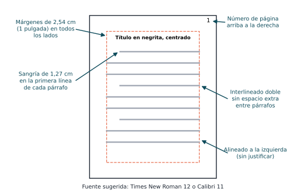
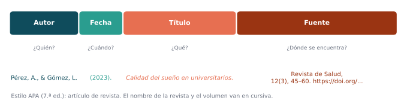

## Objetivo de la sesión

Aplicar las normas APA, séptima edición, para dar formato a un trabajo escrito, citar las fuentes en el texto y elaborar la lista de referencias.

## ¿Qué son las normas APA?

::: {.definicion}
Las **normas APA** son un conjunto de estándares de la *American Psychological Association* para **unificar la forma de presentar trabajos escritos** y **reconocer el trabajo de los autores** citados. La versión vigente es la **séptima edición** (APA, 2020).
:::

. . .

Se usan sobre todo en ciencias sociales, de la salud, educación y administración. En ingeniería es frecuente el estilo **IEEE** (sesión 7).

. . .

::: {.obs data-t="¿Para qué sirven?"}
- Dar crédito a las ideas de otros y **evitar el plagio**.
- Permitir que el lector **encuentre** cada fuente.
- Presentar el documento con un formato **claro y uniforme**.
:::

## Formato general del documento

{fig-align="center" width="62%"}

## Formato general: resumen

| Elemento | Norma APA 7 |
|---|---|
| **Fuente** | Legible y uniforme: Times New Roman 12, Calibri 11, Arial 11 o Georgia 11 |
| **Márgenes** | 2,54 cm (1 pulgada) en los cuatro lados |
| **Interlineado** | Doble, sin espacio adicional entre párrafos |
| **Alineación** | A la izquierda, **sin justificar** |
| **Sangría** | 1,27 cm en la primera línea de cada párrafo |
| **Numeración** | Todas las páginas, arriba a la derecha, desde la portada |

. . .

::: {.obs data-t="Atención"}
Muchas instituciones adaptan estos parámetros (por ejemplo, piden interlineado de 1,5 o texto justificado). Siga siempre las indicaciones de **su** curso o revista; la norma APA es la base.
:::

## Niveles de títulos

| Nivel | Formato |
|:-:|---|
| 1 | **Centrado, en negrita, con mayúsculas iniciales** (el texto empieza en un párrafo nuevo) |
| 2 | **Alineado a la izquierda, en negrita, con mayúsculas iniciales** |
| 3 | ***Alineado a la izquierda, en negrita y cursiva*** |
| 4 | **Con sangría, en negrita, terminado en punto.** El texto continúa en la misma línea. |
| 5 | ***Con sangría, en negrita y cursiva, terminado en punto.*** El texto continúa en la misma línea. |

. . .

::: {.ejemplo}
**Método** (nivel 1) → **Participantes** (nivel 2) → ***Criterios de inclusión*** (nivel 3).
:::

## Tablas y figuras

::: {.columns}
::: {.column width="50%"}
**Tabla**

1. **Número** en negrita: **Tabla 1**.
2. **Título** en cursiva, una línea abajo.
3. Cuerpo con **líneas horizontales** solamente (sin líneas verticales).
4. **Nota** debajo, si hace falta: fuente, abreviaturas, aclaraciones.
:::
::: {.column width="50%"}
**Figura**

1. **Número** en negrita: **Figura 1**.
2. **Título** en cursiva, una línea abajo.
3. La imagen (gráfico, diagrama, fotografía).
4. **Nota** debajo, si hace falta.
:::
:::

. . .

::: {.obs}
Toda tabla y figura debe **mencionarse en el texto** antes de aparecer ("como se observa en la Tabla 1…"). Si se toma o adapta de otra fuente, se indica en la nota: *Adaptado de* Autor (año).
:::

## Citas en el texto: dos formatos

| Cita **parentética** | Cita **narrativa** |
|---|---|
| Autor y año van **entre paréntesis**. | El autor forma parte de la oración; el año va entre paréntesis. |
| Énfasis en la **idea**. | Énfasis en el **autor**. |
| *…mejora la memoria (Pérez, 2023).* | *Pérez (2023) encontró que…* |

. . .

Toda cita incluye al menos **apellido del autor** y **año**. Si es textual, también la **página** (p. 45) o, si no hay páginas, el párrafo (párr. 3).

## Citas directas (textuales)

::: {.definicion data-t="Cita corta · menos de 40 palabras"}
Se integra en el párrafo **entre comillas**, con autor, año y página.

*Según Pérez (2023), "la evaluación temprana permite intervenciones más efectivas" (p. 45).*

*"La evaluación temprana permite intervenciones más efectivas" (Pérez, 2023, p. 45).*
:::

. . .

::: {.definicion data-t="Cita larga · 40 palabras o más"}
Va en un **bloque aparte**, **sin comillas**, con sangría de 1,27 cm en todo el bloque. La página va al final, **después** del punto.

> Pérez (2023) concluyó lo siguiente:
>
> La evaluación temprana permite intervenciones más efectivas, porque identifica las dificultades antes de que se consoliden y orienta el diseño de estrategias específicas para cada caso. Estas evaluaciones también facilitan el seguimiento del progreso a lo largo del tiempo. (p. 45)
:::

## Citas indirectas (paráfrasis)

::: {.definicion}
**Parafrasear** es expresar con **palabras propias** la idea de un autor. No lleva comillas. La página es opcional, pero se recomienda cuando la idea es muy específica.
:::

. . .

::: {.ejemplo}
**Original:** "La evaluación temprana permite intervenciones más efectivas".

**Paráfrasis narrativa:** Pérez (2023) sostiene que identificar a tiempo las dificultades mejora los resultados de la intervención.

**Paráfrasis parentética:** Identificar a tiempo las dificultades mejora los resultados de la intervención (Pérez, 2023).
:::

. . .

::: {.obs data-t="Cuidado"}
Cambiar unas pocas palabras **no** es parafrasear. Si conserva la estructura del original, debe citarse como cita textual.
:::

## Citas según el número de autores

| Autores | Cita parentética | Cita narrativa |
|---|---|---|
| Uno | (López, 2020) | López (2020) |
| Dos | (Vargas & González, 2020) | Vargas y González (2020) |
| Tres o más | (Cardona et al., 2020) | Cardona et al. (2020) |
| Autor corporativo | (Organización Mundial de la Salud, 2020) | Organización Mundial de la Salud (2020) |
| Corporativo con sigla, 1.ª cita | (Organización Mundial de la Salud [OMS], 2020) | Organización Mundial de la Salud (OMS, 2020) |
| Corporativo con sigla, siguientes | (OMS, 2020) | OMS (2020) |
| Sin fecha | (López, s. f.) | López (s. f.) |

. . .

Varias fuentes en una misma cita se ordenan alfabéticamente y se separan con punto y coma: (García, 2021; Pérez, 2023).

## Citas, referencias y bibliografía

| Concepto | Qué es |
|---|---|
| **Cita** | La mención breve de la fuente **dentro del texto** (autor y año). |
| **Referencias** | La lista completa, al final, de **todas y solo** las fuentes citadas. **Es lo que pide APA.** |
| **Bibliografía** | Lista de obras consultadas o recomendadas, aunque no se hayan citado. APA **no** la usa. |

. . .

::: {.teorema data-t="Regla de oro"}
Cada cita del texto tiene su referencia, y cada referencia aparece citada en el texto.
:::

## La lista de referencias

- Título **Referencias**, centrado y en negrita, en una página nueva.
- Orden **alfabético** por el apellido del primer autor.
- **Sangría francesa** de 1,27 cm (la primera línea al margen y las demás con sangría).
- Interlineado doble.
- Hasta **20 autores**: se escriben todos. Con 21 o más, los 19 primeros, puntos suspensivos y el último.
- Se incluye el **DOI** como enlace (https://doi.org/…) cuando existe.

## Anatomía de una referencia

{fig-align="center" width="100%"}

Toda referencia responde cuatro preguntas: **¿quién?** (autor), **¿cuándo?** (fecha), **¿qué?** (título) y **¿dónde?** (fuente).

## Modelos de referencia (1)

| Tipo | Modelo y ejemplo |
|---|---|
| **Artículo de revista** | Apellido, A. A., & Apellido, B. B. (Año). Título del artículo. *Nombre de la Revista, volumen*(número), pp–pp. https://doi.org/xxxx |
| | Pérez, A., & Gómez, L. (2023). Calidad del sueño en universitarios. *Revista de Salud, 12*(3), 45–60. https://doi.org/10.xxxx/rs.2023.45 |
| **Libro** | Apellido, A. A. (Año). *Título del libro* (ed.). Editorial. |
| | Hernández-Sampieri, R., & Mendoza, C. P. (2018). *Metodología de la investigación: Las rutas cuantitativa, cualitativa y mixta*. McGraw-Hill. |
| **Capítulo de libro** | Apellido, A. A. (Año). Título del capítulo. En E. Editor (Ed.), *Título del libro* (pp. xx–xx). Editorial. |

## Modelos de referencia (2)

| Tipo | Modelo |
|---|---|
| **Tesis** | Apellido, A. A. (Año). *Título de la tesis* [Tesis de maestría, Nombre de la universidad]. Repositorio. URL |
| **Ponencia** | Apellido, A. A. (Año, día de mes). *Título de la ponencia* [Presentación]. Nombre del evento, Ciudad, País. URL |
| **Página web** | Autor u organización. (Año, día de mes). *Título de la página*. Nombre del sitio. URL |
| **Ley o norma** | Nombre de la ley y número. (Año, día de mes). Nombre del diario oficial. URL |
| **Video** | Autor o canal. (Año, día de mes). *Título del video* [Video]. Plataforma. URL |
| **Software o base de datos** | Autor. (Año). *Nombre* (Versión x.x) [Software]. Editor. URL |

. . .

::: {.obs}
Si la página web cambia con frecuencia, se agrega la fecha de consulta: *Recuperado el día de mes de año de* URL.
:::

## Gestores de referencias

Herramientas como **Zotero** (gratuito), **Mendeley** o el administrador de citas de los procesadores de texto:

- Guardan las fuentes con sus datos completos (autor, año, DOI…).
- Insertan las citas mientras se escribe.
- Generan automáticamente la lista de referencias en APA, IEEE u otros estilos.

. . .

::: {.obs data-t="Revise siempre"}
Los gestores dependen de los metadatos importados: verifique mayúsculas, cursivas, nombres de autores y DOI antes de entregar.
:::

## Actividad en clase

1. Tomar tres fuentes de la matriz de literatura (un artículo, un libro y una página web) y escribir su referencia en APA.
2. Escribir para una de ellas una cita textual corta, una cita parentética y una cita narrativa.
3. Intercambiar con otro grupo y revisar el formato con la tabla de citas según el número de autores.

## Avance del anteproyecto

1. Lista de **referencias en APA** de todas las fuentes de la matriz de literatura.
2. Revisión del formato del documento: márgenes, interlineado, títulos y numeración.

## Lecturas recomendadas

- American Psychological Association. (2020). *Publication manual of the American Psychological Association* (7.ª ed.). Capítulos 2, 8 y 9.
- American Psychological Association. (s. f.). *APA Style*. <https://apastyle.apa.org/>

 

[← Sesión anterior](sesion_05.qmd) · [Programa del curso](../metodologia_investigacion.qmd) · [Sesión siguiente →](sesion_07.qmd)
