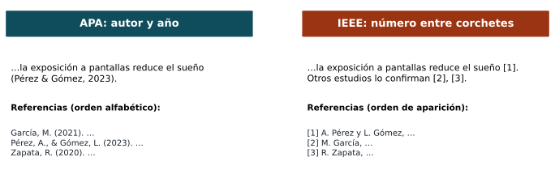
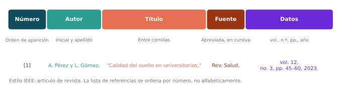

## Para empezar

::: {.analogia data-t="Los turnos del banco"}
En el banco, a cada persona le dan un **número** según el orden de llegada, y la llaman por ese número, no por su nombre.
:::

. . .

El estilo **IEEE** funciona igual: cada fuente recibe un número según el **orden en que aparece** en el texto, y se cita con ese número entre corchetes, por ejemplo [1].

## ¿Qué vamos a lograr hoy?

- Citar con números en el estilo IEEE.
- Escribir la lista de referencias en IEEE.
- Diferenciar IEEE de APA.

## ¿Qué es el estilo IEEE?

::: {.simple}
Es la forma de citar del *Institute of Electrical and Electronics Engineers* (IEEE). En el texto se pone un **número entre corchetes**, y al final se hace la lista de fuentes **en el orden en que se citaron**.
:::

. . .

Se usa en **ingeniería** (eléctrica, electrónica, sistemas, biomédica, mecatrónica), **computación** y ciencias aplicadas.

. . .

::: {.obs data-t="¿APA o IEEE?"}
Lo decide la **institución, la revista o el congreso** donde se presenta el trabajo. Lo importante es usar **un solo estilo** en todo el documento.
:::

## APA frente a IEEE

{fig-align="center" width="95%"}

## APA frente a IEEE: las diferencias clave

| | APA | IEEE |
|---|---|---|
| Cita en el texto | (Autor, año) | [número] |
| Orden de la lista | Alfabético | Orden de aparición |
| Nombres de autores | Apellido, Inicial. | Inicial. Apellido |
| Títulos de artículos | Sin comillas | "Entre comillas" |

## Citas en el texto

- Cada fuente recibe un número **la primera vez** que se cita: [1], [2], [3]…
- Si se vuelve a citar, se usa **el mismo número**.
- El número va **dentro de la oración**, antes del signo de puntuación, con un espacio antes del corchete.

. . .

::: {.ejemplo}
- Las redes convolucionales superan a los métodos clásicos en clasificación de imágenes [1].
- Varios trabajos lo confirman [2], [5], [7].
- Para un rango de fuentes: [3]–[6].
- Cita textual con página: "…" [4, p. 12].
- Con el autor en la frase: Pérez *et al.* [2] propusieron un modelo…
:::

. . .

::: {.obs}
El número **reemplaza** al autor: no se escribe "en [1] se muestra" de forma repetitiva; se prefiere "Pérez [1] muestra…" o "se ha mostrado [1]".
:::

## Figuras, tablas y ecuaciones en IEEE

- Figuras: **Fig. 1**, Fig. 2… con el título debajo de la figura.
- Tablas: **TABLA I**, TABLA II… (números romanos) con el título encima.
- Ecuaciones numeradas a la derecha entre paréntesis: (1), (2). En el texto: "como se observa en (2)".

## La lista de referencias

- Título **Referencias**, al final del documento.
- Ordenada por **número**, en el orden en que las fuentes aparecen por primera vez en el texto (no alfabéticamente).
- El número entre corchetes va alineado a la izquierda, separado del cuerpo de la referencia.
- Nombres de autores: **iniciales y apellido** (A. B. Pérez).
- Hasta **seis autores** se escriben todos; con más de seis, el primero seguido de *et al.*
- Nombres de revistas **abreviados** y en *cursiva*; títulos de artículos **entre comillas**.

## Anatomía de una referencia IEEE

{fig-align="center" width="100%"}

## Modelos de referencia (1)

| Tipo | Modelo y ejemplo |
|---|---|
| **Artículo de revista** | [n] A. B. Apellido, "Título del artículo," *Abrev. Revista*, vol. x, no. x, pp. xx–xx, mes. año, doi: xxx. |
| | [1] A. Pérez y L. Gómez, "Calidad del sueño en universitarios," *Rev. Salud*, vol. 12, no. 3, pp. 45–60, mar. 2023, doi: 10.xxxx/rs.2023.45. |
| **Libro** | [n] A. B. Apellido, *Título del libro*, x.ª ed. Ciudad, País: Editorial, año. |
| | [2] R. C. Gonzalez y R. E. Woods, *Digital Image Processing*, 4th ed. New York, NY, USA: Pearson, 2018. |
| **Capítulo de libro** | [n] A. B. Apellido, "Título del capítulo," en *Título del libro*, E. Editor, Ed. Ciudad, País: Editorial, año, pp. xx–xx. |

## Modelos de referencia (2)

| Tipo | Modelo |
|---|---|
| **Artículo de congreso** | [n] A. B. Apellido, "Título del artículo," en *Abrev. Nombre del Congreso*, Ciudad, País, año, pp. xx–xx, doi: xxx. |
| **Tesis** | [n] A. B. Apellido, "Título de la tesis," tesis de maestría, Depto., Universidad, Ciudad, País, año. |
| **Página web** | [n] Autor u organización. "Título de la página." Nombre del sitio. Accedido: mes día, año. [En línea]. Disponible: URL |
| **Norma técnica** | [n] *Título de la norma*, Número de la norma, Organización, año. |
| **Conjunto de datos** | [n] Autor, "Título del conjunto de datos," Repositorio, año. [En línea]. Disponible: URL |
| **Software** | [n] Autor, *Nombre del software*, versión x.x, año. [En línea]. Disponible: URL |

. . .

::: {.obs data-t="Idioma"}
En documentos en español se aceptan "en", "Accedido" y "[En línea]. Disponible:"; en revistas en inglés se usan "in", "Accessed" y "[Online]. Available:".
:::

## Ejemplo completo

> El aprendizaje profundo ha mejorado la detección automática de lesiones en imágenes médicas [1]. Sin embargo, su desempeño disminuye cuando los datos de entrenamiento son pocos [2], [3]. Pérez *et al.* [1] propusieron aumentar los datos con transformaciones geométricas, estrategia que también se evaluó en [3].

**Referencias**

[1] A. Pérez, L. Gómez y M. Ruiz, "Detección automática de lesiones con redes convolucionales," *Rev. Ing. Biomed.*, vol. 8, no. 2, pp. 10–22, 2023.

[2] J. Smith, "Small data in deep learning," en *Proc. Int. Conf. Mach. Learn. Appl.*, 2022, pp. 101–108.

[3] K. Lee, *Data Augmentation for Medical Imaging*. Boston, MA, USA: Academic Press, 2021.

. . .

Observe que [1] se cita dos veces con el **mismo número** y que la lista sigue el **orden de aparición**.

## Errores frecuentes

| Error | Corrección |
|---|---|
| Ordenar la lista alfabéticamente | Ordenarla por número de aparición |
| Asignar un número nuevo a una fuente ya citada | Reutilizar su número original |
| Escribir (Pérez, 2023) en un documento IEEE | Usar [n] |
| Poner el número después del punto: "…imágenes. [1]" | Antes del punto: "…imágenes [1]." |
| Mezclar APA e IEEE en el mismo documento | Usar un solo estilo |

## Actividad en clase

1. Tomar un párrafo de la matriz de literatura escrito en APA y convertirlo a IEEE: citas en el texto y lista de referencias.
2. Configurar el gestor de referencias en estilo IEEE y regenerar la lista.
3. Comparar ambas versiones y señalar tres diferencias de formato.

## Avance del anteproyecto

Elegir el estilo de citación del anteproyecto según el área y la indicación del curso, y revisar que **todas** las citas y referencias sigan ese estilo de forma consistente.

## Lecturas recomendadas

- IEEE. (s. f.). *IEEE Reference Guide*. IEEE Author Center. <https://journals.ieeeauthorcenter.ieee.org/>
- IEEE. (s. f.). *IEEE Editorial Style Manual for Authors*. IEEE Author Center.

 

[← Sesión anterior](sesion_06.qmd) · [Programa del curso](../metodologia_investigacion.qmd) · [Sesión siguiente →](sesion_08.qmd)
