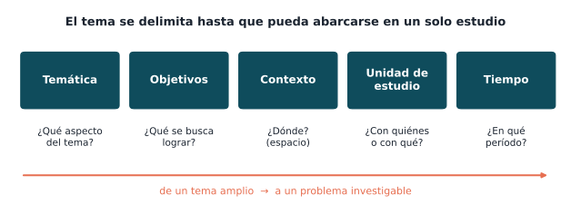
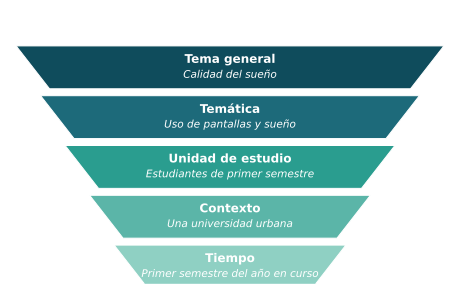
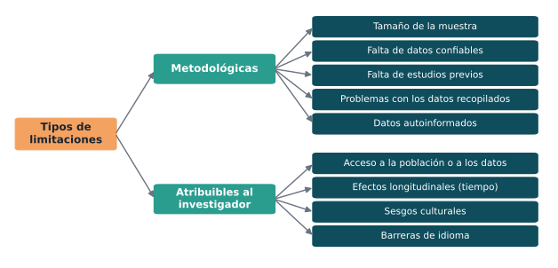
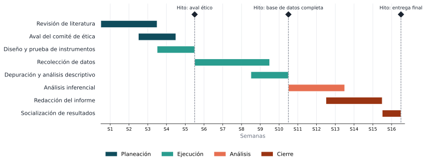

## Objetivo de la sesión

Delimitar la investigación en sus dimensiones temática, espacial, temporal y de unidades de estudio, reconocer sus limitaciones y planificarla en el tiempo con un diagrama de Gantt.

## Alcance y delimitación

::: {.definicion}
**Delimitar** es precisar **qué abarca y qué no abarca** la investigación. Al final de la fase exploratoria, el tema debe quedar delimitado de manera que pueda resolverse en **un solo estudio**.
:::

. . .

El investigador debe tener claro **qué le interesa realmente** de los múltiples aspectos que podría estudiar sobre el tema.

. . .

::: {.obs data-t="No confundir"}
**Alcance y delimitación** (esta sesión): **hasta dónde** llega el estudio. **Nivel de alcance** (sesión 14): **qué tan profundo** es (exploratorio, descriptivo, correlacional o explicativo).
:::

## Dimensiones de la delimitación

{fig-align="center" width="92%"}

## Delimitar es ir de lo amplio a lo concreto

::: {.columns}
::: {.column width="52%"}
{width="100%"}
:::
::: {.column width="48%"}
Cada nivel **reduce** el universo del estudio hasta un problema que se puede investigar con los recursos y el tiempo disponibles.

. . .

**Resultado:** *Relación entre el uso de pantallas antes de dormir y la calidad del sueño en estudiantes de primer semestre de una universidad urbana, durante el primer semestre del año en curso.*
:::
:::

## Cómo redactar la delimitación

| Dimensión | Pregunta | Ejemplo |
|---|---|---|
| **Temática** | ¿Qué aspecto del tema se estudia y cuáles quedan por fuera? | Se estudia la calidad del sueño; no se evalúan trastornos clínicos del sueño. |
| **Espacial** | ¿Dónde se realiza? | Estudiantes de una universidad de una ciudad intermedia. |
| **Temporal** | ¿En qué período se recogen los datos? | Entre febrero y mayo del año en curso. |
| **Unidad de estudio** | ¿Quiénes o qué se estudia? | Estudiantes de primer semestre, de 17 a 25 años. |
| **Teórica / metodológica** | ¿Desde qué enfoque? | Enfoque cuantitativo, con un cuestionario validado. |

## Limitaciones

::: {.definicion}
Las **limitaciones** son las condiciones, fuera del control del investigador, que **restringen** los resultados o su generalización. Reconocerlas da **transparencia** y credibilidad al estudio.
:::

. . .

{fig-align="center" width="78%"}

## Delimitaciones frente a limitaciones

| | Delimitaciones | Limitaciones |
|---|---|---|
| **Quién las define** | El investigador, **por decisión** | Las **circunstancias** |
| **Qué expresan** | Los límites que se fijan al estudio | Las debilidades o restricciones posibles |
| **Ejemplo** | "Solo estudiantes de primer semestre." | "La muestra es pequeña y los datos son autoinformados." |

. . .

::: {.obs data-t="Buena práctica"}
Por cada limitación, indique **cómo se mitigará**: por ejemplo, "para reducir el sesgo de los datos autoinformados se usará un instrumento validado y se garantizará el anonimato".
:::

## El cronograma

::: {.definicion}
El **cronograma** organiza en el tiempo las actividades necesarias para cumplir los objetivos. Muestra **qué** se hará, **cuándo** y en qué **orden**, y permite verificar que el proyecto es **viable** en el plazo disponible.
:::

. . .

La forma más usada es el **diagrama de Gantt**: una tabla de doble entrada con las **actividades** en las filas, el **tiempo** en las columnas y una **barra** que indica la duración de cada actividad.

## El diagrama de Gantt

{fig-align="center" width="100%"}

## Cómo construir un diagrama de Gantt

1. **Liste las actividades** a partir de los objetivos específicos y de las fases del método (revisión, recolección, análisis, redacción, socialización).
2. **Estime la duración** de cada actividad (en días, semanas o meses).
3. **Identifique las dependencias**: qué actividad no puede empezar hasta que termine otra (no se recogen datos sin aval ético).
4. **Ubique las barras** en la línea de tiempo respetando esas dependencias. Algunas actividades pueden **solaparse**.
5. **Marque los hitos**: momentos clave que indican el cierre de una fase (aval ético, base de datos completa, entrega final).
6. **Revise el total**: el proyecto debe caber en el tiempo disponible, con un pequeño margen para imprevistos.

## El cronograma como tabla {.compacto}

En el anteproyecto también puede presentarse como tabla:

| Fase / actividad | S1–2 | S3–4 | S5–6 | S7–8 | S9–10 | S11–12 | S13–14 | S15–16 |
|---|:-:|:-:|:-:|:-:|:-:|:-:|:-:|:-:|
| Revisión de literatura | ■ | ■ | | | | | | |
| Aval del comité de ética | | ■ | ■ | | | | | |
| Diseño y prueba de instrumentos | | ■ | ■ | | | | | |
| Recolección de datos | | | ■ | ■ | ■ | | | |
| Depuración y análisis descriptivo | | | | | ■ | ■ | | |
| Análisis inferencial | | | | | | ■ | ■ | |
| Redacción del informe | | | | | | | ■ | ■ |
| Socialización de resultados | | | | | | | | ■ |

. . .

::: {.obs data-t="Herramientas"}
Puede hacerse en una hoja de cálculo (sombreando celdas), en un procesador de texto o con herramientas de gestión de proyectos. Lo importante es que sea **realista** y **coherente** con los objetivos.
:::

## Errores frecuentes en el cronograma

- Actividades **genéricas** ("hacer el proyecto") en lugar de tareas concretas.
- No considerar el tiempo de **aprobación ética** o de **acceso a los datos**.
- Recolección y análisis **sin solaparse** cuando podrían avanzar en paralelo, o al revés: analizar antes de tener datos.
- No dejar **margen** para imprevistos.
- Actividades que **no corresponden** a ningún objetivo específico.

## Actividad en clase

1. Cada grupo redacta la **delimitación** de su proyecto en sus cinco dimensiones.
2. Identifica al menos **tres limitaciones** (metodológicas y atribuibles al investigador) y una medida de mitigación para cada una.
3. Construye un **diagrama de Gantt** del anteproyecto, con actividades, duración, dependencias y al menos tres hitos.

## Avance del anteproyecto

1. **Delimitación** de la investigación (temática, espacial, temporal y unidad de estudio).
2. **Limitaciones** previstas y cómo se mitigarán.
3. **Cronograma** en diagrama de Gantt o en tabla.

## Lecturas recomendadas

- Hernández-Sampieri, R., & Mendoza, C. P. (2018). *Metodología de la investigación: Las rutas cuantitativa, cualitativa y mixta*. McGraw-Hill. Capítulo 3.
- Creswell, J. W., & Creswell, J. D. (2018). *Research design: Qualitative, quantitative, and mixed methods approaches* (5.ª ed.). SAGE.

 

[← Sesión anterior](sesion_11.qmd) · [Programa del curso](../metodologia_investigacion.qmd) · [Sesión siguiente →](sesion_13.qmd)
