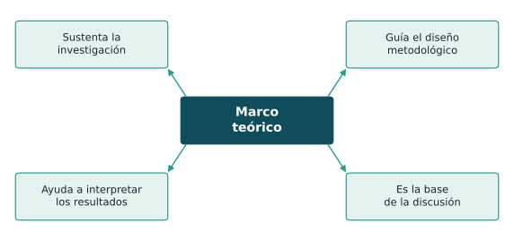
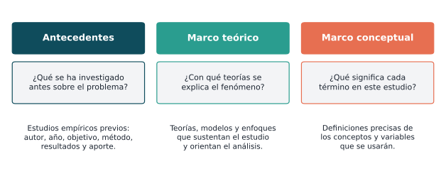
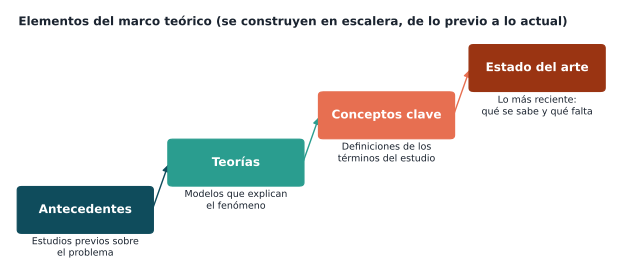
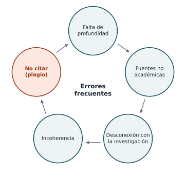

## Para empezar

::: {.analogia data-t="Los cimientos de una casa"}
Nadie construye una casa sobre la tierra suelta: primero se hacen los cimientos. No se ven al final, pero sostienen todo.
:::

. . .

El **marco teórico** son los cimientos de la investigación: lo que ya se sabe (estudios, teorías y conceptos) sobre lo que se apoya el proyecto.

## ¿Qué vamos a lograr hoy?

- Entender para qué sirve el marco teórico.
- Diferenciar **antecedentes**, **marco teórico** y **marco conceptual**.
- Construirlo a partir de lo que ya leyó en su matriz de literatura.

## ¿Qué es el marco teórico?

::: {.simple}
El **marco teórico** reúne **lo que ya se sabe** sobre el tema (estudios anteriores, teorías y conceptos) y lo organiza para **apoyar y guiar** la investigación. Sirve para decidir cómo estudiar el problema y, al final, para entender los resultados (Hernández-Sampieri & Mendoza, 2018).
:::

. . .

En muchos formatos se llama **marco referencial** y agrupa varios componentes: antecedentes, marco teórico, marco conceptual y, cuando aplica, marco normativo o contextual.

## Funciones del marco teórico

{fig-align="center" width="56%"}

. . .

Además, ayuda a **evitar errores** cometidos en estudios previos, a formular **hipótesis** y a definir **variables**.

## Antecedentes, marco teórico y marco conceptual

{fig-align="center" width="95%"}

## Las tres partes en una frase

::: {.simple}
- **Antecedentes:** ¿qué **estudios** se han hecho antes sobre esto?
- **Marco teórico:** ¿qué **teorías** explican el fenómeno?
- **Marco conceptual:** ¿qué significa **cada palabra clave** en mi estudio?
:::

. . .

::: {.analogia data-t="Un partido de fútbol"}
- **Antecedentes:** los resultados de los partidos anteriores entre los dos equipos.
- **Marco teórico:** las tácticas y estrategias que explican cómo juega cada equipo.
- **Marco conceptual:** qué se entiende por "fuera de lugar", "penalti" o "tiro de esquina".
:::

## Los antecedentes

::: {.simple}
Los **antecedentes** son los **estudios que otras personas ya hicieron** sobre su problema: qué estudiaron, cómo lo hicieron, qué encontraron y qué quedó sin resolver.
:::

. . .

Para cada antecedente se reporta, en pocas líneas:

- **Autor y año** (citados en APA o IEEE).
- **Objetivo** y **contexto** del estudio.
- **Método**: enfoque, población, instrumentos.
- **Resultados** principales.
- **Aporte** a la investigación propia: qué se toma, qué se cuestiona o qué falta.

. . .

::: {.obs}
Se recomienda organizarlos de lo **internacional a lo local**, o por **temas**, y priorizar estudios de los **últimos cinco años**. La matriz de literatura (sesión 5) es el insumo principal.
:::

## El marco teórico (propiamente dicho)

::: {.simple}
Presenta las **teorías y modelos** que **explican por qué** ocurre el fenómeno que va a estudiar.
:::

. . .

::: {.ejemplo}
Un estudio sobre la calidad del sueño en estudiantes puede apoyarse en:

- El **modelo de regulación del sueño** (proceso homeostático y ritmo circadiano).
- Los estudios sobre el efecto de la **luz azul** en la secreción de melatonina.
- Una teoría del **comportamiento** para explicar los hábitos de uso de pantallas.
:::

. . .

No se trata de copiar todo lo que se sabe del tema, sino de elegir las teorías **pertinentes** al problema y explicar **cómo** se relacionan con él.

## El marco conceptual

::: {.simple}
Es un pequeño **glosario**: explica qué significa cada palabra clave **en su estudio**, apoyándose en autores reconocidos.
:::

. . .

| Concepto | Definición que adopta el estudio |
|---|---|
| **Calidad del sueño** | Satisfacción subjetiva con el sueño, que incluye duración, latencia, eficiencia y alteraciones (según el instrumento elegido). |
| **Uso de pantallas antes de dormir** | Tiempo de uso de celular, computador o televisión en la hora previa a acostarse. |
| **Estudiante de primer semestre** | Persona matriculada por primera vez en un programa de pregrado. |

. . .

Las definiciones del marco conceptual deben ser **coherentes** con la operacionalización de las variables (sesión 14).

## Elementos y orden de construcción

{fig-align="center" width="92%"}

El **estado del arte** cierra el marco: sintetiza lo más reciente y señala la **brecha** que justifica el estudio.

## ¿Dónde obtener la información?

| Fuente | Ejemplos |
|---|---|
| **Literatura académica** | Artículos de revistas científicas, libros especializados, tesis. |
| **Documentos oficiales** | Informes técnicos, estadísticas y publicaciones de organismos públicos o internacionales. |
| **Bases de datos** | Scopus, Web of Science, PubMed, IEEE Xplore, SciELO, Redalyc, Google Académico. |

. . .

::: {.obs data-t="Evite"}
Blogs, páginas sin autor, sitios comerciales o enciclopedias abiertas como fuente principal. Úselos, si acaso, para orientarse y luego busque la fuente académica original.
:::

## Búsqueda con operadores booleanos

| Operador | Función | Ejemplo |
|---|---|---|
| **AND** | Ambos términos deben aparecer | "calidad del sueño" AND estudiantes |
| **OR** | Al menos uno de los términos | insomnio OR "trastornos del sueño" |
| **NOT** | Excluye un término | sueño NOT apnea |
| **" "** (comillas) | Frase exacta | "uso de pantallas" |
| **\*** (asterisco) | Variaciones de una palabra | universitar\* (universitario, universitaria, universitarios…) |

. . .

Recuerde la ecuación de búsqueda de la sesión 4 y combine operadores con paréntesis: ("calidad del sueño" OR insomnio) AND (pantalla\* OR celular).

## Estrategias para construirlo (1)

::: {.columns}
::: {.column width="50%"}
**1. Revisión de la literatura**

- Búsqueda **exhaustiva** en varias bases de datos.
- **Selección** de fuentes pertinentes, recientes y confiables.
- **Organización** de la información en la matriz de literatura.

**2. Identificación de teorías y conceptos**

- Identificar las **teorías** que explican el fenómeno.
- **Definir** los conceptos clave.
- **Analizar críticamente**: coincidencias, contradicciones y vacíos.
:::
::: {.column width="50%"}
**3. Organización del contenido**

- De lo **general a lo particular**.
- **Agrupación temática** (no autor por autor).
- Elaboración de un **esquema**: índice o mapa conceptual.
:::
:::

## Estrategias para construirlo (2)

::: {.columns}
::: {.column width="50%"}
**4. Redacción**

- Un **hilo conductor** que conecte las ideas con el problema.
- **Lenguaje académico**, claro y preciso.
- **Síntesis**, no resumen: agrupar autores que coinciden.
- Revisión de redacción, ortografía y citación.
:::
::: {.column width="50%"}
**5. Integración con la investigación**

El marco debe conectarse con:

- El **problema** y los **objetivos**.
- La **justificación**.
- Las **hipótesis** y las **variables**.
:::
:::

. . .

::: {.ejemplo data-t="Sintetizar en lugar de resumir"}
❌ "García (2022) hizo… López (2023) hizo… Pérez (2024) hizo…"

✅ "Varios estudios asocian el uso nocturno de pantallas con menor calidad del sueño en universitarios (García, 2022; López, 2023; Pérez, 2024), aunque ninguno ha evaluado a estudiantes de primer semestre."
:::

## Errores frecuentes

::: {.columns}
::: {.column width="45%"}
{width="100%"}
:::
::: {.column width="55%"}
- **Falta de profundidad:** listar autores sin analizarlos.
- **Fuentes no académicas** o desactualizadas.
- **Desconexión** con el problema y los objetivos.
- **Incoherencia:** saltos entre temas sin hilo conductor.
- **No citar:** usar ideas ajenas sin reconocer al autor es **plagio**, aunque se cambie la redacción.
:::
:::

## Actividad en clase

1. A partir de la matriz de literatura, cada grupo clasifica sus fuentes en **antecedentes**, **teorías** y **conceptos**.
2. Elabora un **mapa conceptual** del marco teórico, de lo general a lo particular.
3. Redacta un párrafo de antecedentes que **sintetice** al menos tres estudios agrupados por una idea común y cierre con la brecha.

## Avance del anteproyecto

1. **Antecedentes**: síntesis de los estudios previos más relevantes.
2. **Marco teórico**: teorías y modelos que sustentan el estudio.
3. **Marco conceptual**: definición de los conceptos clave.

Todo con fuentes académicas, preferiblemente de los últimos cinco años, citadas en el estilo elegido (APA o IEEE).

## Lecturas recomendadas

- Hernández-Sampieri, R., & Mendoza, C. P. (2018). *Metodología de la investigación: Las rutas cuantitativa, cualitativa y mixta*. McGraw-Hill. Capítulo 4.
- Creswell, J. W., & Creswell, J. D. (2018). *Research design: Qualitative, quantitative, and mixed methods approaches* (5.ª ed.). SAGE.
- Ridley, D. (2012). *The literature review: A step-by-step guide for students* (2.ª ed.). SAGE.
- Boote, D. N., & Beile, P. (2005). Scholars before researchers: On the centrality of the dissertation literature review in research preparation. *Educational Researcher, 34*(6), 3–15. <https://doi.org/10.3102/0013189X034006003>

 

[← Sesión anterior](sesion_12.qmd) · [Programa del curso](../metodologia_investigacion.qmd) · [Sesión siguiente →](sesion_14.qmd)
