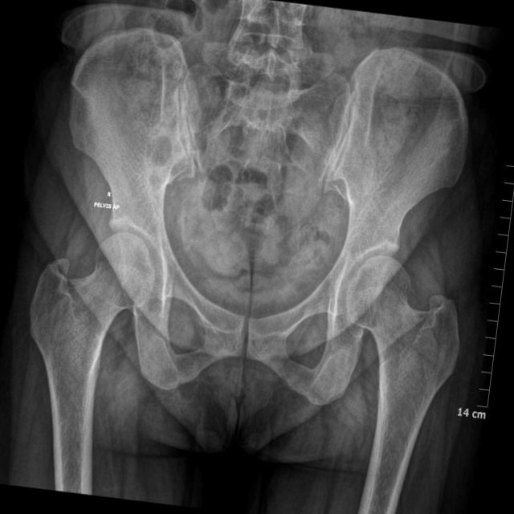
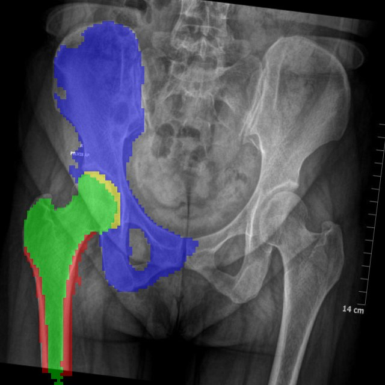
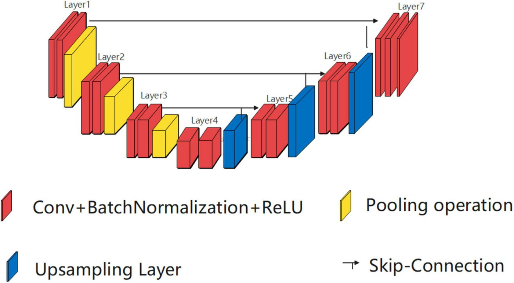
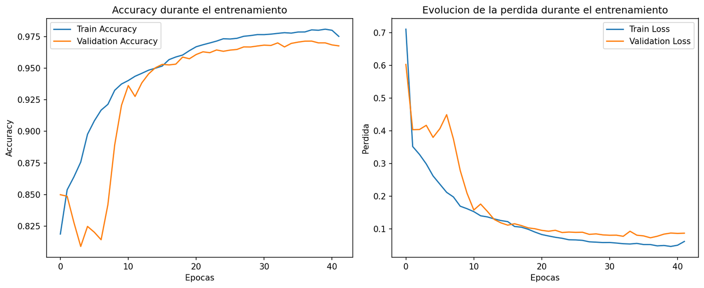
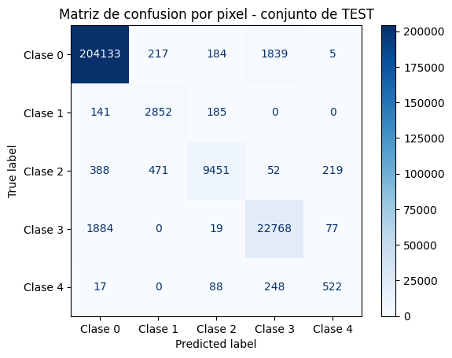

```{=html}
<p style="margin:1.2rem 0 1.6rem;display:flex;gap:.7rem;flex-wrap:wrap">
  <a class="btn btn-lg" href="https://github.com/MarioPuche2002/HipSegmentation" target="_blank" rel="noopener"
     style="background:#990000;border-color:#990000;color:#fff;padding:.7rem 1.6rem;border-radius:.6rem">
    Ver el código en GitHub ↗
  </a>
  <a class="btn btn-lg btn-outline-secondary" href="https://hipsegmentation.onrender.com/docs" target="_blank" rel="noopener"
     style="padding:.7rem 1.6rem;border-radius:.6rem">
    Probar la API ↗
  </a>
</p>
```

::: {layout-ncol=2}
{fig-alt="Radiografía anteroposterior de pelvis en escala de grises."}

{fig-alt="La misma radiografía con la pelvis en azul, el fémur proximal en verde, el canal diafisiario en rojo y el espacio articular en amarillo."}
:::

## ¿Qué hace?

Recibe una radiografía de pelvis en proyección **anteroposterior (AP)** y devuelve, píxel por píxel, a qué estructura pertenece cada punto de la imagen:

| Clase | Estructura | Color |
|:-:|---|---|
| 0 | Fondo | sin color |
| 1 | Pelvis | <span style="color:#3a4fd6">■</span> azul |
| 2 | Fémur proximal | <span style="color:#2fae3c">■</span> verde |
| 3 | Canal diafisiario | <span style="color:#d23a3a">■</span> rojo |
| 4 | Espacio articular | <span style="color:#d6c23a">■</span> amarillo |

Este tipo de segmentación es el primer paso para medir automáticamente la anatomía de la cadera, por ejemplo al planear una **artroplastia total de cadera**.

## Lo interesante del proyecto

- **Datos etiquetados a mano.** Se partió de 100 radiografías del dataset público *pelvis_xray* de Roboflow Universe. Las máscaras se dibujaron una por una en **ITK-SNAP**.
- **Un problema muy desbalanceado.** El fondo ocupa cerca del 84 % de los píxeles y el espacio articular apenas el 0,4 %. Por eso el modelo se evalúa con el **coeficiente Dice por clase** y no solo con accuracy global.
- **Ecualización guiada por el gradiente.** El análisis exploratorio mostró que el histograma está dominado por el fondo oscuro. En lugar de la ecualización clásica, el contraste se redistribuye según la magnitud del gradiente (Sobel), así que pesan los bordes óseos y no el fondo.
- **Contrato de datos con Pandera.** Antes de entrenar o predecir se valida cada imagen y cada máscara: formato, canales, tamaño y etiquetas válidas.
- **Listo para producción.** El modelo se exporta a **TensorFlow Lite**. Da las mismas máscaras que el original y la memoria baja de unos 570 MB a cerca de 200 MB, lo que permite servirlo gratis en Render dentro de un contenedor **Docker** con **FastAPI**. Hay pruebas automáticas e integración continua con GitHub Actions.

## Arquitectura



La U-Net recibe imágenes de 128 × 128 en escala de grises. El **codificador** extrae características cada vez más abstractas mientras reduce la resolución. El **decodificador** la recupera, y las **conexiones de salto** le devuelven el detalle fino de los bordes. La salida es un mapa de 128 × 128 × 5, con una probabilidad por clase en cada píxel.

## Resultados



El entrenamiento converge en unas 20 épocas, con un accuracy de validación cercano al 97 % y sin señales claras de *overfitting*. En el conjunto de prueba, el fondo, el fémur proximal y el canal diafisiario superan el 90 % de aciertos. El mayor error está en el espacio articular, la clase más pequeña, que se confunde con su vecina anatómica.

{width=70%}

## La API

```
imagen subida → validación con Pandera → ¿ya es 128×128 y de 1 canal?
                                          sí → segmentar
                                          no → redimensionar + ecualizar → segmentar
```

La documentación interactiva (Swagger) está en [hipsegmentation.onrender.com/docs](https://hipsegmentation.onrender.com/docs). Allí se puede subir una radiografía desde el navegador y descargar la máscara.

::: {.callout-note}
El plan gratuito de Render apaga el servicio tras unos 15 minutos sin uso. La primera petición puede tardar cerca de un minuto mientras vuelve a encender.
:::

::: {.callout-warning}
Es un proyecto académico, entrenado con 100 imágenes. No está validado para uso clínico ni para tomar decisiones médicas.
:::

## Ficha técnica

| | |
|---|---|
| **Modelo** | U-Net (TensorFlow/Keras), exportada a TensorFlow Lite |
| **Datos** | 100 radiografías AP de pelvis (Roboflow Universe), máscaras hechas a mano en ITK-SNAP |
| **Preprocesamiento** | Pipeline de scikit-learn: redimensionado a 128×128, ecualización por gradiente, normalización |
| **Validación de datos** | Pandera |
| **Despliegue** | FastAPI + Docker en Render, CI con GitHub Actions |
| **Autor** | Mario Andrés Puche Ajiaco |
