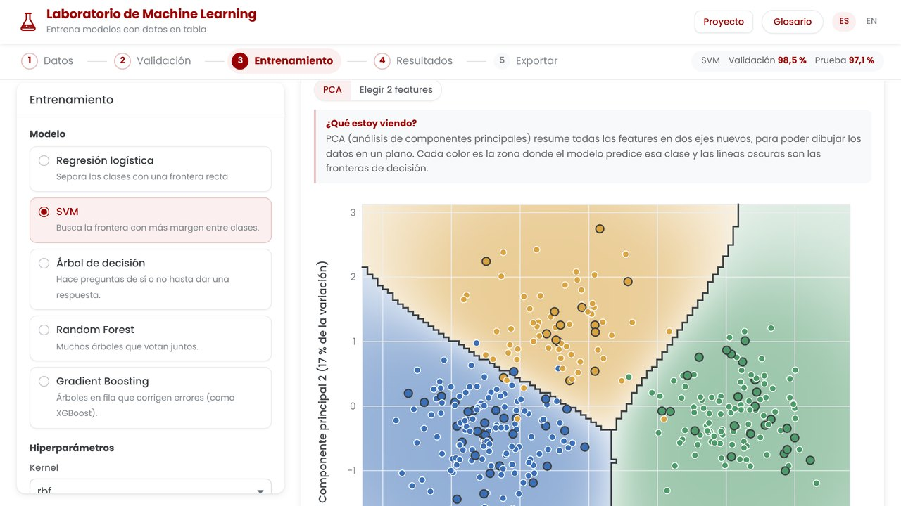

```{=html}
<p style="margin:1.2rem 0 1.6rem">
  <a class="btn btn-lg" href="laboratorio-ml/index.html" target="_blank" rel="noopener"
     style="background:#990000;border-color:#990000;color:#fff;padding:.7rem 1.6rem;border-radius:.6rem">
    Abrir el laboratorio ↗
  </a>
</p>
```

{fig-alt="Captura del laboratorio en el paso de entrenamiento, con una SVM y su mapa de decisión sobre los datos de pingüinos."}

## ¿Qué es?

El **Laboratorio de Machine Learning** es una herramienta web para aprender aprendizaje supervisado con **datos en tabla**, en la línea de Teachable Machine pero enfocada en datos tabulares. Está pensada para estudiantes desde los 12 años y para cursos introductorios de ciencia de datos: usa el vocabulario técnico (feature, target, overfitting, validación…) y explica cada término en palabras sencillas.

No hay que instalar nada ni crear una cuenta: basta con abrirlo en el navegador.

## Cómo funciona

El trabajo se organiza en cuatro pasos, que se pueden recorrer en orden o saltar libremente:

1. **Datos.** Seis datasets de ejemplo (pingüinos, flores Iris, frutas, diabetes, venta de helados y precio de vivienda) o un CSV propio. Al subir un archivo se elige la variable objetivo y las features. Luego los datos se validan automáticamente con un esquema al estilo de **Pandera**: los valores que no son números quedan vacíos y se quitan las filas repetidas. En este paso se ve el esquema de cada columna, la distribución del target y la matriz de correlación de Pearson, y se eligen el escalado y la forma de rellenar los datos faltantes (media, mediana o KNN). Las columnas de categorías se codifican con one-hot encoding.
2. **Entrenamiento.** Regresión logística o lineal, SVM, árbol de decisión, Random Forest y Gradient Boosting, con sus principales hiperparámetros, y la partición en entrenamiento, validación y prueba. Al entrenar se muestran el diagnóstico de *overfitting* y el **mapa de decisión** (con PCA).
3. **Resultados.** Inferencia con casos nuevos, matriz de confusión con todas las métricas, curva ROC, residuos, el árbol dibujado, la prueba de permutación y el historial de experimentos.
4. **Exportar.** El modelo entrenado como archivo `.pkl` de scikit-learn, listo para cargarlo en Python.

## Para usarlo en clase

- Funciona en computadores, tabletas y celulares, en español e inglés.
- Cada gráfico trae un recuadro *¿Qué estoy viendo?* y la página incluye un **glosario** con la definición, la ecuación y la interpretación de cada métrica.
- Los datasets de ejemplo, salvo Iris, son **sintéticos**: imitan patrones plausibles pero no provienen de personas reales. El de diabetes es solo para aprender y no sirve para diagnosticar.

::: {.callout-note}
## Ideas de actividades
- Entrenar un árbol muy profundo y uno poco profundo, y comparar entrenamiento contra validación para descubrir el *overfitting*.
- Simular datos faltantes y comparar cómo cambian las métricas al rellenarlos con la media, la mediana o KNN.
- Quitar una feature a la vez y usar la prueba de permutación para explicar cuáles importan.
- Exportar el modelo `.pkl` y usarlo en Google Colab para predecir casos nuevos.
:::

## Ficha técnica

| | |
|---|---|
| **Tecnologías** | HTML, CSS y JavaScript sin servidor; libsvm para la SVM; Pyodide y scikit-learn solo para generar el `.pkl`; validación de datos al estilo Pandera |
| **Modelos** | Implementados en JavaScript siguiendo los algoritmos de scikit-learn y comparados contra él |
| **Autor** | Mario Andrés Puche Ajiaco |
