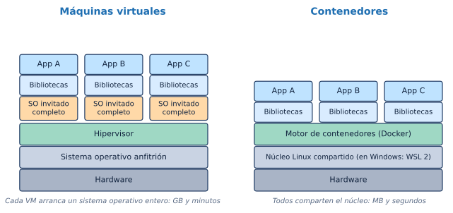
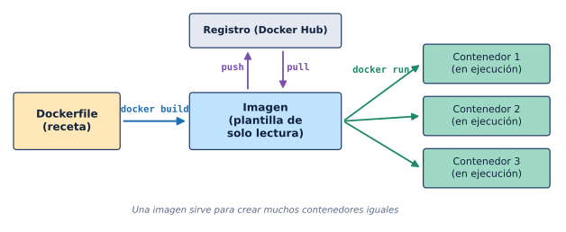
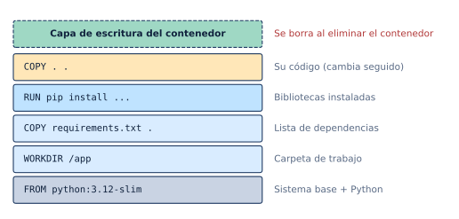

## Introducción

Un programa que funciona en un computador muchas veces falla en otro: cambia la versión de Python, falta una biblioteca del sistema o el sistema operativo es distinto. **Docker** resuelve ese problema empaquetando la aplicación **junto con todo lo que necesita** (sistema base, bibliotecas, configuración) en una unidad portátil llamada **contenedor**, que se ejecuta igual en cualquier equipo que tenga Docker: el portátil de un estudiante, el servidor de un laboratorio o un servicio en la nube.

Docker usa funciones del **núcleo Linux**. En Windows, ese núcleo lo aporta **WSL 2**, por eso este tutorial parte de tener WSL funcionando (ver el [tutorial de WSL](tutorial_wsl.qmd)).

**Objetivos de aprendizaje.** Al finalizar este tutorial, el estudiante estará en capacidad de:

1. Explicar qué son una imagen, un contenedor, un Dockerfile, un volumen y un registro, y en qué se diferencia un contenedor de una máquina virtual.
2. Instalar Docker en Windows con WSL 2 y comprobar que funciona.
3. Descargar, ejecutar, inspeccionar, detener y eliminar contenedores.
4. Escribir un Dockerfile para una aplicación propia y construir su imagen.
5. Guardar datos con volúmenes y publicar puertos para abrir la aplicación desde el navegador.
6. Levantar una aplicación con Docker Compose y leer sus registros (*logs*).

## Parte 1 · Conceptos

### Contenedores y máquinas virtuales

{fig-align="center" width="100%"}

| | Máquina virtual | Contenedor |
|---|---|---|
| Qué incluye | Un sistema operativo completo | Solo la aplicación y sus bibliotecas |
| Tamaño típico | Varios GB | Decenas a cientos de MB |
| Arranque | Minutos | Segundos |
| Aislamiento | Muy fuerte (núcleo propio) | Fuerte (comparte el núcleo) |
| Uso típico | Probar otro sistema operativo | Empaquetar y desplegar aplicaciones |

Un contenedor **no es una máquina virtual pequeña**: es un proceso normal de Linux al que Docker le da su propio sistema de archivos, su propia red y límites de recursos.

### Vocabulario básico

| Término | Qué es | Analogía |
|---|---|---|
| **Imagen** | Plantilla de solo lectura con el sistema base, las bibliotecas y la aplicación | Un molde, o la receta ya cocinada y congelada |
| **Contenedor** | Una imagen en ejecución; se pueden crear muchos desde la misma imagen | Una porción servida a partir del molde |
| **Dockerfile** | Archivo de texto con las instrucciones para construir una imagen | La receta |
| **Registro** | Servidor donde se publican y descargan imágenes (el público más usado es **Docker Hub**) | Una biblioteca de recetas |
| **Etiqueta (*tag*)** | Versión de una imagen: `python:3.12-slim`, `nginx:1.27`, `ubuntu:24.04` | La edición de un libro |
| **Volumen** | Almacenamiento que sobrevive aunque el contenedor se borre | Un disco externo |
| **Puerto publicado** | Conexión entre un puerto de Windows y uno del contenedor | Una extensión telefónica |
| **Docker Compose** | Herramienta para describir y levantar varios contenedores con un archivo YAML | Un plano de toda la instalación |

### Del Dockerfile al contenedor

{fig-align="center" width="100%"}

El ciclo completo es:

1. Se escribe un **Dockerfile** con la receta.
2. `docker build` lo convierte en una **imagen**.
3. `docker run` crea uno o varios **contenedores** a partir de la imagen.
4. Opcionalmente, `docker push` publica la imagen en un registro y `docker pull` la descarga en otro equipo.

### Capas: por qué Docker es rápido

Cada instrucción del Dockerfile crea una **capa**. Docker guarda las capas en caché y, al reconstruir, solo vuelve a ejecutar las que cambiaron y las que están encima de ellas. Por eso se instalan primero las dependencias (cambian poco) y se copia el código al final (cambia seguido).

{fig-align="center" width="85%"}

::: {.callout-important}
## Los contenedores son desechables
Lo que un programa escribe dentro del contenedor queda en su **capa de escritura** y **se pierde al eliminarlo**. Los datos que deben conservarse (bases de datos, archivos subidos, resultados) van en un **volumen** (Parte 5).
:::

## Parte 2 · Instalación

### Antes de empezar

1. **WSL 2 con Ubuntu funcionando**, con los componentes de Windows ya activados (Paso 1 del [tutorial de WSL](tutorial_wsl.qmd)). En PowerShell, `wsl -l -v` debe mostrar Ubuntu con **VERSION 2**.
2. **WSL actualizado**: en PowerShell, `wsl --update`.
3. **Windows 10 22H2 (compilación 19045) o Windows 11 23H2 o posterior**, de 64 bits, con la virtualización activa en el BIOS/UEFI. Se recomiendan **8 GB de RAM**.

### Dos formas de instalar Docker

| | **Opción A · Docker Desktop** | **Opción B · Docker Engine en Ubuntu** |
|---|---|---|
| Dónde se instala | En Windows, y se conecta a WSL | Dentro de Ubuntu, como en un servidor Linux |
| Interfaz gráfica | Sí (contenedores, imágenes, volúmenes, logs) | No, solo terminal |
| Uso de recursos | Mayor | Menor |
| Licencia | Gratuita para uso personal, educativo y empresas pequeñas; las grandes requieren suscripción | Libre y gratuita |
| Recomendado para | Quien empieza | Quien ya se maneja en la terminal |

::: {.callout-warning}
## Elija solo una
No instale Docker Engine dentro de Ubuntu si va a usar Docker Desktop (ni al revés): las dos instalaciones chocan entre sí. Si ya tenía una y cambia a la otra, desinstale primero la anterior.
:::

### Opción A · Docker Desktop

1. Descargue **Docker Desktop para Windows** desde <https://docs.docker.com/desktop/setup/install/windows-install/> (versión **AMD64**, salvo equipos con procesador ARM).
2. Ejecute el instalador y deje marcada la opción **Use WSL 2 instead of Hyper-V**. Al terminar, cierre sesión o reinicie si lo pide.
3. Abra **Docker Desktop** desde el menú Inicio, acepte los términos y, si lo desea, omita el inicio de sesión (no es obligatorio).
4. En **Settings → General**, verifique que esté marcado **Use the WSL 2 based engine**.
5. En **Settings → Resources → WSL integration**, active **Enable integration with my default WSL distro** y el interruptor de **Ubuntu**. Pulse **Apply**.
6. **Cierre y vuelva a abrir** la terminal de Ubuntu para que reconozca el comando `docker`.

::: {.callout-note}
## Docker Desktop debe estar abierto
Con esta opción, el motor de Docker vive en Docker Desktop. Si la aplicación está cerrada, los comandos `docker` en Ubuntu no funcionan. Para que arranque sola: **Settings → General → Start Docker Desktop when you sign in**. El ícono de la ballena en la barra de tareas indica que está corriendo.
:::

### Opción B · Docker Engine dentro de Ubuntu

1. Compruebe que Ubuntu arranca con **systemd** (necesario para que Docker se inicie solo):

   ```bash
   ps -p 1 -o comm=
   ```

   Debe responder `systemd`. Si no, agregue esto a `/etc/wsl.conf` (con `sudo nano /etc/wsl.conf`), ejecute `wsl --shutdown` en PowerShell y vuelva a abrir Ubuntu:

   ```ini
   [boot]
   systemd=true
   ```

2. Agregue el repositorio oficial de Docker:

   ```bash
   sudo apt update
   sudo apt install -y ca-certificates curl
   sudo install -m 0755 -d /etc/apt/keyrings
   sudo curl -fsSL https://download.docker.com/linux/ubuntu/gpg -o /etc/apt/keyrings/docker.asc
   sudo chmod a+r /etc/apt/keyrings/docker.asc

   sudo tee /etc/apt/sources.list.d/docker.sources <<EOF
   Types: deb
   URIs: https://download.docker.com/linux/ubuntu
   Suites: $(. /etc/os-release && echo "${UBUNTU_CODENAME:-$VERSION_CODENAME}")
   Components: stable
   Architectures: $(dpkg --print-architecture)
   Signed-By: /etc/apt/keyrings/docker.asc
   EOF
   ```

3. Instale Docker y el complemento de Compose:

   ```bash
   sudo apt update
   sudo apt install -y docker-ce docker-ce-cli containerd.io docker-buildx-plugin docker-compose-plugin
   sudo systemctl enable --now docker
   ```

4. Permita usar `docker` **sin `sudo`** agregando su usuario al grupo `docker`:

   ```bash
   sudo usermod -aG docker $USER
   ```

5. El grupo nuevo se aplica al iniciar una sesión nueva: en PowerShell ejecute `wsl --terminate Ubuntu` y vuelva a abrir Ubuntu.

### Comprobar la instalación

En la terminal de **Ubuntu** (con cualquiera de las dos opciones):

```bash
docker version            # deben aparecer dos bloques: Client y Server
docker compose version    # Compose viene incluido
docker run hello-world    # descarga una imagen de prueba y la ejecuta
```

Si todo está bien, el último comando imprime *"Hello from Docker! This message shows that your installation appears to be working correctly."*

::: {.callout-tip}
## Si `docker version` muestra Client pero no Server
El comando está instalado, pero no encuentra el motor. Con la opción A, abra Docker Desktop y espere a que diga *Engine running*; con la opción B, ejecute `sudo systemctl start docker`.
:::

## Parte 3 · Primeros contenedores

### Un contenedor interactivo

```bash
docker run -it --rm ubuntu:24.04 bash
```

| Parte | Significado |
|---|---|
| `run` | Crear y arrancar un contenedor |
| `-it` | Modo interactivo con terminal |
| `--rm` | Borrarlo al salir |
| `ubuntu:24.04` | Imagen y etiqueta (si no está, se descarga) |
| `bash` | Programa que se ejecuta dentro |

Dentro del contenedor está un Ubuntu mínimo y aislado: `cat /etc/os-release`, `ls /`, `apt update`... Al escribir `exit`, el contenedor se detiene y se borra. Nada de lo que se hizo dentro afecta a su Ubuntu de WSL.

### Ejecutar un solo comando

```bash
docker run --rm python:3.12-slim python -c "import sys; print(sys.version)"
```

Sirve para usar una versión concreta de un programa sin instalarla: el contenedor nace, ejecuta el comando y desaparece.

### Un servidor web en segundo plano

```bash
docker run -d --name web -p 8080:80 nginx:1.27
```

- `-d` (*detached*): corre en segundo plano y devuelve la terminal.
- `--name web`: nombre para referirse al contenedor.
- `-p 8080:80`: el puerto **8080 de Windows** se conecta al puerto **80 del contenedor** (formato `ANFITRIÓN:CONTENEDOR`).

Abra en el navegador de Windows <http://localhost:8080>: aparece la página de bienvenida de nginx.

### Administrar contenedores

```bash
docker ps                 # contenedores en ejecución
docker ps -a              # todos, incluidos los detenidos
docker logs web           # mensajes del contenedor
docker logs -f web        # seguir los mensajes en vivo (Ctrl + C para salir)
docker stop web           # detener
docker start web          # volver a arrancar
docker restart web        # reiniciar
docker exec -it web bash  # abrir una terminal dentro de un contenedor que ya corre
docker rm web             # eliminar (debe estar detenido; o use docker rm -f web)
```

::: {.callout-tip}
## Nombre o ID
Todos estos comandos aceptan el **nombre** (`web`) o el **ID** del contenedor. Basta con los primeros caracteres del ID: `docker stop 3f2a`.
:::

### Imágenes

```bash
docker images                    # imágenes descargadas y su tamaño
docker pull postgres:17          # descargar sin ejecutar
docker rmi nginx:1.27            # borrar una imagen (sin contenedores que la usen)
docker image prune               # borrar imágenes huérfanas
```

::: {.callout-note}
## Use etiquetas concretas
Si no se indica etiqueta, Docker usa `latest`, que cambia con el tiempo. Para que un proyecto funcione igual dentro de un año, fije la versión: `python:3.12-slim` en lugar de `python`.
:::

## Parte 4 · Su propia imagen con un Dockerfile

Como ejemplo se usará una pequeña aplicación web en Python (Flask) que saluda y cuenta las visitas. En Ubuntu, cree la carpeta del proyecto **dentro de Linux**:

```bash
mkdir -p ~/proyectos/mi-app && cd ~/proyectos/mi-app
code .     # abrir en VS Code (opcional)
```

### Los archivos del proyecto

**`app.py`**

```python
import logging
import os
from pathlib import Path

from flask import Flask

logging.basicConfig(level=logging.INFO, format="%(asctime)s %(levelname)s %(message)s")
log = logging.getLogger("mi-app")

app = Flask(__name__)
MENSAJE = os.environ.get("MENSAJE", "Hola desde un contenedor")
ARCHIVO = Path(os.environ.get("DATOS", "/datos")) / "visitas.txt"


def contar_visita():
    ARCHIVO.parent.mkdir(parents=True, exist_ok=True)
    visitas = int(ARCHIVO.read_text()) + 1 if ARCHIVO.exists() else 1
    ARCHIVO.write_text(str(visitas))
    return visitas


@app.route("/")
def inicio():
    visitas = contar_visita()
    log.info("Visita número %s", visitas)
    return f"{MENSAJE}. Visitas: {visitas}\n"


@app.route("/salud")
def salud():
    return {"estado": "ok"}


if __name__ == "__main__":
    app.run(host="0.0.0.0", port=8000)
```

**`requirements.txt`**

```text
flask==3.1.*
```

**`Dockerfile`** (sin extensión, con D mayúscula)

```dockerfile
# 1. Imagen base: Linux con Python 3.12 ya instalado
FROM python:3.12-slim

# 2. Carpeta de trabajo dentro del contenedor
WORKDIR /app

# 3. Primero las dependencias (esta capa se reutiliza si no cambian)
COPY requirements.txt .
RUN pip install --no-cache-dir -r requirements.txt

# 4. Después el código
COPY . .

# 5. Puerto que usa la aplicación y comando de arranque
EXPOSE 8000
CMD ["python", "app.py"]
```

**`.dockerignore`** (lo que **no** debe copiarse a la imagen)

```text
__pycache__/
*.pyc
.venv/
.git/
.env
datos/
```

### Instrucciones más usadas

| Instrucción | Para qué sirve |
|---|---|
| `FROM` | Imagen base sobre la que se construye |
| `WORKDIR` | Carpeta de trabajo (la crea si no existe) |
| `COPY origen destino` | Copiar archivos del proyecto a la imagen |
| `RUN comando` | Ejecutar un comando **al construir** (instalar paquetes) |
| `ENV NOMBRE=valor` | Variable de entorno por defecto |
| `EXPOSE puerto` | Documentar el puerto que usa la aplicación |
| `CMD ["programa", "arg"]` | Comando que se ejecuta **al arrancar** el contenedor |

### Construir y ejecutar

```bash
docker build -t mi-app .                    # el punto indica "este directorio"
docker images                               # aparece mi-app
docker run -d --name mi-app -p 8000:8000 mi-app
```

Abra <http://localhost:8000> en el navegador de Windows: debe aparecer *"Hola desde un contenedor. Visitas: 1"*, y el número sube al recargar. En <http://localhost:8000/salud> la aplicación responde `{"estado":"ok"}`.

Vea los registros:

```bash
docker logs -f mi-app
```

```text
2026-10-23 22:19:39,610 INFO Visita número 2
2026-10-23 22:19:39,610 INFO 172.17.0.1 - - [23/Oct/2026 22:19:39] "GET / HTTP/1.1" 200 -
```

::: {.callout-important}
## Escuchar en `0.0.0.0`, no en `127.0.0.1`
Dentro del contenedor, la aplicación debe escuchar en **`0.0.0.0`** (todas las interfaces). Si escucha solo en `127.0.0.1`, el contenedor corre pero el navegador no puede conectarse. Por eso `app.py` usa `app.run(host="0.0.0.0", port=8000)`. Lo mismo aplica a otros servidores: `uvicorn main:app --host 0.0.0.0`, `jupyter lab --ip 0.0.0.0`, etc.
:::

Cuando cambie el código, reconstruya y reemplace el contenedor:

```bash
docker rm -f mi-app
docker build -t mi-app .
docker run -d --name mi-app -p 8000:8000 mi-app
```

Al reconstruir, Docker reutiliza las capas que no cambiaron (en pantalla aparece `CACHED`), así que solo se repite la copia del código.

::: {.callout-note}
## El aviso *development server*
Flask muestra *"WARNING: This is a development server"*. Es normal para practicar; para publicar una aplicación en un servidor real se usa un servidor de producción como `gunicorn` o `uvicorn`.
:::

## Parte 5 · Datos y configuración

### Volúmenes: datos que sobreviven

Borre el contenedor y créelo de nuevo: el contador vuelve a 1, porque el archivo `visitas.txt` estaba en la capa de escritura. Con un **volumen**, los datos quedan fuera del contenedor:

```bash
docker rm -f mi-app
docker run -d --name mi-app -p 8000:8000 -v datos-mi-app:/datos mi-app
```

`-v datos-mi-app:/datos` crea (si no existe) un volumen llamado `datos-mi-app` y lo monta en la carpeta `/datos` del contenedor. Ahora puede borrar y recrear el contenedor sin perder la cuenta.

```bash
docker volume ls                   # listar volúmenes
docker volume inspect datos-mi-app # ver detalles
docker volume rm datos-mi-app      # borrar (¡se pierden los datos!)
```

### Montar una carpeta del proyecto (*bind mount*)

Para desarrollar, se puede montar una carpeta propia dentro del contenedor y ver los cambios sin reconstruir:

```bash
docker run --rm -it -v "$PWD":/app -w /app python:3.12-slim bash
```

Así, los archivos de `~/proyectos/mi-app` aparecen en `/app` dentro del contenedor, y lo que se edite en VS Code se ve al instante.

::: {.callout-tip}
## Carpetas de Linux, no de Windows
Monte carpetas que estén **dentro de Linux** (`~/proyectos/...`), no en `/mnt/c/...`. Desde `/mnt/c` todo es mucho más lento y algunas herramientas no detectan los cambios en los archivos.
:::

### Variables de entorno

La aplicación lee la variable `MENSAJE`. Se puede cambiar sin tocar el código:

```bash
docker run -d --name saludo -p 8001:8000 -e MENSAJE="Buenos días" mi-app
```

Para varias variables, use un archivo `.env` y `--env-file .env`. Las **contraseñas y claves** van en variables o en `.env`, **nunca** dentro del Dockerfile ni del código; y `.env` debe estar en `.gitignore` y en `.dockerignore`.

## Parte 6 · Docker Compose

Escribir comandos `docker run` largos es incómodo y fácil de equivocar. **Docker Compose** describe la aplicación en un archivo `compose.yaml` y la levanta con un solo comando.

**`compose.yaml`** (en la misma carpeta del proyecto)

```yaml
services:
  web:
    build: .
    ports:
      - "8000:8000"
    environment:
      MENSAJE: "Hola desde Docker Compose"
    volumes:
      - datos:/datos
    restart: unless-stopped

volumes:
  datos:
```

### Comandos de Compose

```bash
docker compose up -d --build   # construir (si hace falta) y levantar en segundo plano
docker compose ps              # estado de los servicios
docker compose logs -f web     # registros en vivo del servicio web
docker compose exec web bash   # terminal dentro del servicio
docker compose restart web     # reiniciar un servicio
docker compose down            # detener y borrar contenedores (los volúmenes se conservan)
docker compose down -v         # además borrar los volúmenes
```

::: {.callout-note}
## `docker compose` y `docker-compose`
La forma actual es **`docker compose`** (con espacio), incluida en Docker. `docker-compose` (con guion) es la versión antigua; si un tutorial la usa, basta con cambiar el guion por un espacio.
:::

### Varios servicios que se comunican

Compose crea una red privada en la que cada servicio se encuentra por **su nombre**. Por ejemplo, para agregar una base de datos PostgreSQL:

```yaml
services:
  web:
    build: .
    ports:
      - "8000:8000"
    environment:
      DATABASE_URL: "postgresql://app:secreto@db:5432/app"
    depends_on:
      - db

  db:
    image: postgres:17
    environment:
      POSTGRES_USER: app
      POSTGRES_PASSWORD: secreto
      POSTGRES_DB: app
    volumes:
      - pgdatos:/var/lib/postgresql/data

volumes:
  pgdatos:
```

La aplicación se conecta al servidor `db` (el nombre del servicio), no a `localhost`. La base de datos no publica puertos: solo la ve la aplicación, dentro de la red de Compose.

## Parte 7 · Buenas prácticas con WSL

1. **Use Docker desde la terminal de Ubuntu** y guarde los proyectos en `~/proyectos`. Desde PowerShell también funciona con Docker Desktop, pero mezclar terminales confunde las rutas.
2. **Revise nombres exactos.** Linux distingue mayúsculas: si el Dockerfile dice `COPY requirements.txt .` y el archivo se llama `Requirements.txt`, la construcción falla. El archivo de construcción se llama `Dockerfile`, con D mayúscula y sin extensión.
3. **Finales de línea de Linux en los scripts.** Un script `.sh` guardado con finales de línea de Windows (CRLF) falla dentro del contenedor con errores como `exec format error` o `/bin/sh^M: bad interpreter`. En VS Code, cambie **CRLF → LF** en la barra inferior; en Git, agregue al repositorio un archivo `.gitattributes` con:

   ```text
   *.sh text eol=lf
   ```

4. **Una sola terminal por servidor.** `docker compose up` sin `-d` ocupa la terminal mostrando los registros; abra otra pestaña de Ubuntu (**Ctrl + Shift + T** en Windows Terminal) para seguir trabajando.
5. **Limite la memoria de WSL** si el equipo se pone lento. Docker usa la memoria de la máquina virtual de WSL; se ajusta en `.wslconfig` (Parte 8 del [tutorial de WSL](tutorial_wsl.qmd)).
6. **Fije versiones** en `FROM` y en `requirements.txt`, y agregue un `.dockerignore`.

## Parte 8 · Limpieza y espacio en disco

Las imágenes y los contenedores detenidos ocupan espacio rápidamente.

```bash
docker system df                 # cuánto ocupan imágenes, contenedores, volúmenes y caché
docker container prune           # borrar contenedores detenidos
docker image prune -a            # borrar imágenes que no use ningún contenedor
docker builder prune             # borrar la caché de construcción
docker system prune              # todo lo anterior que no esté en uso (pide confirmación)
```

::: {.callout-warning}
## Los volúmenes se borran aparte
`docker system prune` **no** borra volúmenes salvo que se agregue `--volumes`. Úselo solo si está seguro de que no contienen datos importantes.
:::

## Flujo de trabajo recomendado

1. Abra **Windows Terminal → Ubuntu** (y Docker Desktop, si usa la opción A).
2. Vaya al proyecto: `cd ~/proyectos/mi-app` y ábralo con `code .`.
3. Edite el código y levante todo con `docker compose up -d --build`.
4. Pruebe en el navegador (`http://localhost:PUERTO`) y revise `docker compose logs -f`.
5. Repita 3 y 4 hasta que funcione; guarde el avance con Git.
6. Al terminar el día: `docker compose down`.

## Referencia rápida

| Tarea | Comando |
|---|---|
| Ver versión y motor | `docker version` |
| Ejecutar un contenedor interactivo | `docker run -it --rm imagen bash` |
| Ejecutar en segundo plano con puerto | `docker run -d --name nombre -p 8080:80 imagen` |
| Contenedores activos / todos | `docker ps` / `docker ps -a` |
| Registros | `docker logs -f nombre` |
| Entrar a un contenedor | `docker exec -it nombre bash` |
| Detener / eliminar | `docker stop nombre` / `docker rm nombre` |
| Construir una imagen | `docker build -t nombre .` |
| Listar / borrar imágenes | `docker images` / `docker rmi imagen` |
| Volumen | `-v nombre-volumen:/ruta/en/contenedor` |
| Variable de entorno | `-e NOMBRE=valor` |
| Levantar con Compose | `docker compose up -d --build` |
| Registros con Compose | `docker compose logs -f` |
| Apagar con Compose | `docker compose down` |
| Espacio usado | `docker system df` |

## Problemas frecuentes

| Problema | Solución |
|---|---|
| `docker: command not found` en Ubuntu | Opción A: active Ubuntu en **Settings → Resources → WSL integration** y abra una terminal nueva. Opción B: revise la instalación. |
| `Cannot connect to the Docker daemon` | El motor no está corriendo: abra Docker Desktop, o `sudo systemctl start docker`. |
| `permission denied ... docker.sock` | Falta el grupo `docker`: `sudo usermod -aG docker $USER` y `wsl --terminate Ubuntu`. |
| No aparece **WSL integration** en Docker Desktop | Docker está en modo de contenedores de Windows: menú de la ballena → **Switch to Linux containers**. |
| `port is already allocated` | Otro contenedor o programa usa ese puerto: `docker ps`, o cambie el puerto de la izquierda (`-p 8081:8000`). |
| El contenedor corre pero el navegador no abre la página | La aplicación debe escuchar en `0.0.0.0` y el puerto debe estar publicado con `-p`. |
| El contenedor se detiene apenas arranca | Lea el error con `docker logs nombre`; casi siempre es un error de la aplicación o un archivo que falta. |
| Al construir: `COPY failed` o `failed to compute cache key: ... not found` | El archivo no existe con ese nombre exacto (mayúsculas) o está excluido en `.dockerignore`. |
| `exec format error` o `bad interpreter` con un `.sh` | Convierta el script a finales de línea LF. |
| Los cambios del código no se ven | Reconstruya: `docker compose up -d --build`. |
| El disco se llena | `docker system df` y luego `docker system prune`. |

## Ejercicio práctico

1. Ejecute `docker run -it --rm ubuntu:24.04 bash`, cree un archivo con `echo hola > /prueba.txt`, salga y vuelva a ejecutar el mismo comando. ¿Sigue el archivo? Explique por qué.
2. Levante nginx en el puerto 8081 de Windows con el nombre `practica`, ábralo en el navegador, revise sus registros y luego elimínelo.
3. Construya la imagen `mi-app` de la Parte 4 y ejecútela con un volumen llamado `contador`. Recargue la página tres veces, borre el contenedor, créelo de nuevo con el mismo volumen y verifique que el contador sigue en 4 al recargar.
4. Con Compose, cambie el mensaje a *"Mi primer servicio con Compose"* y publique la aplicación en el puerto 5000 de Windows.

::: {.callout-tip collapse="true"}
## Solución
1. No sigue: con `--rm` el contenedor se borra al salir y su capa de escritura con él. El segundo `docker run` crea un contenedor nuevo desde la imagen original.
2. ```bash
   docker run -d --name practica -p 8081:80 nginx:1.27
   # navegador: http://localhost:8081
   docker logs practica
   docker rm -f practica
   ```
3. ```bash
   cd ~/proyectos/mi-app
   docker build -t mi-app .
   docker run -d --name mi-app -p 8000:8000 -v contador:/datos mi-app
   # recargar http://localhost:8000 tres veces → Visitas: 3
   docker rm -f mi-app
   docker run -d --name mi-app -p 8000:8000 -v contador:/datos mi-app
   # recargar → Visitas: 4
   ```
4. En `compose.yaml`, cambie `MENSAJE: "Mi primer servicio con Compose"` y el puerto a `"5000:8000"` (el de la izquierda es el de Windows; la aplicación sigue escuchando en el 8000 dentro del contenedor). Luego `docker compose up -d --build` y abra <http://localhost:5000>.
:::

## Referencias

- Docker. *Get started* (conceptos y guías). <https://docs.docker.com/get-started/>
- Docker. *Install Docker Desktop on Windows*. <https://docs.docker.com/desktop/setup/install/windows-install/>
- Docker. *Docker Desktop WSL 2 backend on Windows*. <https://docs.docker.com/desktop/features/wsl/>
- Docker. *Install Docker Engine on Ubuntu*. <https://docs.docker.com/engine/install/ubuntu/>
- Docker. *Dockerfile reference*. <https://docs.docker.com/reference/dockerfile/>
- Docker. *Compose file reference*. <https://docs.docker.com/reference/compose-file/>
- Microsoft. *Introducción a los contenedores remotos de Docker en WSL 2*. <https://learn.microsoft.com/es-es/windows/wsl/tutorials/wsl-containers>
